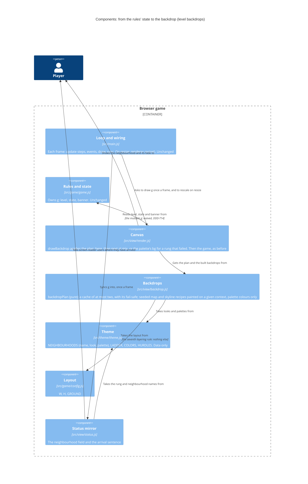

<!-- markdownlint-disable MD024 -->
# Feature delta: rightmove-invaders-level-backdrops

Every rung of the property ladder is a different place. Each has its own neighbourhood map, drawn faintly like a property search map, a time-of-day palette and a skyline of that rung's homes. The next rung's neighbourhood fades in while "Wave cleared!" shows, and from Forever home onwards the backdrop stays on Forever home. No foreground colour gets harder to read.

- **Type**: user-facing, brownfield, visual. Branch `rightmove-invaders-level-backdrops`. The walking skeleton is committed (`83a83fb`); the spike docs are in `378d427`.
- **Persona**: [`casual-arcade-player`](../../product/personas/casual-arcade-player.yaml).
- **Density**: lean (Tier-1 only).
- **No DISCOVER, DIVERGE or DISCUSS.** The brief came straight from the user ("every level has the same background"). The concept, the legibility rule and the walking skeleton were agreed with the user in SPIKE on 2026-10-26: [findings](spike/findings.md) · [wave decisions](spike/wave-decisions.md) · [contact sheet](spike/contact-sheet.png).
- **SSOT**: [architecture brief](../../product/architecture/brief.md) · [ADR-010](../../product/architecture/adr-010-neighbourhood-backdrops-seeded-view-recipes.md) · [ADR-011](../../product/architecture/adr-011-backdrop-legibility-rule.md) · [journey](../../product/journeys/play-a-session.yaml) · [outcomes registry](../../product/outcomes/registry.yaml) · [ATDD policy](../../architecture/atdd-infrastructure-policy.md)

---

## Wave: DESIGN / [REF] DDD list

Scope: application (nw-solution-architect) · mode: propose · paradigm: OOP · density: lean. The walking skeleton is a given: this design builds on it. Every decision below was **accepted by the user on 2026-10-26**, with the architect's recommendation chosen each time. The IDs are `DDD-B…`, so they don't clash with the leaderboard's DDD-1…19 or typed-initials' DDD-T1…T14. ADRs: [ADR-010](../../product/architecture/adr-010-neighbourhood-backdrops-seeded-view-recipes.md) and [ADR-011](../../product/architecture/adr-011-backdrop-legibility-rule.md).

| ID | Decision | Verdict | One-line rationale |
|---|---|---|---|
| DDD-B1 | **Where the art lives** (ADR-010): • **`theme/` holds what each rung is**, as data: `NEIGHBOURHOODS`, with each entry's `name`, `look` and nine-colour `palette`, and `neighbourhood(level)`, which clamps at Forever home as `ladderName` does. • **`view/backdrop.js` holds how it is drawn**: one map recipe and one skyline recipe per `look`. • A recipe draws **only with its palette's colours**, plus `COLORS.green` for the ground line. So the data check in DDD-B6 covers every pixel of a backdrop. | Accepted | Theme stays data that imports nothing. A recipe needs loops, curves and a seeded generator, which are code |
| DDD-B2 | **Painting on a given context** (ADR-010). The recipes paint on a 2D context they are handed. `buildBackdrop` only creates the canvas, at `k` device pixels to a unit, and hands over its context. The function names are suggestions. Each rung draws with its **own seeded generator** (mulberry32, seed 1000 + the rung's index). A backdrop **never calls `Math.random`**: it comes out the same on every build, and the game's seeded sequence is left alone. | Accepted | Capability injection: a recording context in a unit test can see every call. A backdrop that used `Math.random` would change the game that the seeded tests play |
| DDD-B3 | **Build timing**: lazy, as the skeleton does it. A backdrop is built the first time it is drawn, and the cache keeps **at most two**, the least recently drawn going first. A resize drops both, and they are rebuilt at the new scale on the next draw. A build happens only: • on the title's first frame (Studio flat); • on the first "Wave cleared!" frame (the next rung). The pin can't move then (`movePlayer` runs only in `'play'`), the bolts have just been cleared (`game.js:410`), and the fade starts at a mix of 0; • on the first frame of a new game started from a higher rung (Studio flat, ≤ 2 ms at 2×); • after a resize. Never in any other frame. | Accepted | Firefox builds Country pile in 7 ms at 2× (spike). This puts that cost on the one frame where the player has nothing to control |
| DDD-B4 | **A backdrop that can't be built** (ADR-010; Earned Trust). The build can fail: `getContext('2d')` returns null, or a draw call throws (canvas memory limits, a lost GPU). Then: • the cache records that rung as failed, and **the screen is filled with the palette's `bg`**, straight on the main context; • it is **not retried until the next rescale**; • nothing is thrown to the loop, and nothing is logged. The first build, on the title, is the probe. A failure there leaves a flat background and the game starts anyway. | Accepted | Today a throw inside `draw()` would skip `main.js`'s `requestAnimationFrame(frame)` and freeze the game over a piece of decoration. This is the same stance as the synth's fail-safe (ADR-002 amendment) |
| DDD-B5 | **The crossfade is a pure plan**. `backdropPlan({ level, state, banner })` returns `{ here, next, mix }`. It lives in `backdrop.js`, is pure, and reads no `g`; the name is a suggestion. `drawBackdrop` in `render.js` is its shell: it draws `here`, then `next` at `globalAlpha = mix` when `next` isn't null. The cases are in the table under Component decomposition. | Accepted | Inline in `drawBackdrop`, the fade could only be checked by eye. As a plan, every case can be enumerated in a unit test. The rules hold no view state |
| DDD-B6 | **The legibility rule** (ADR-011): a test-only unit check, `tests/unit/backdrop-legibility.spec.js`. It checks **every pair**, in plain loops, without fast-check. The WCAG relative-luminance and contrast maths lives in `tests/unit/support/contrast.js`. Two clauses: **(i) The cap**: every palette colour of every neighbourhood has relative luminance **≤ 0.05**. **(ii) Contrast need per use**: each use in the needs table (under Component decomposition) meets its need, 4.5:1 for text and 3:1 for objects. It is checked against every palette colour it can stand on, with that colour's luminance **raised by 0.001**. That is the largest overshoot the spike measured for an anti-aliased pixel: 0.0488 against a palette maximum of 0.048. The named exemptions are in DDD-B7. | Accepted | Clause (i) alone is not enough. The Dream-home bonus text is 8 px in `COLORS.dream` (`game.js:428`), whose luminance of 0.396 gives only 4.46:1 against 0.05. Its real ceiling is about 0.049, not the dim label's 0.052. Fast-check is unseeded in the unit project, and about 540 pairs are few enough to check them all |
| DDD-B7 | **Exemptions, by name and with their reasons**: • **The door** (`COLORS.door`, 1.6–1.8:1). For 3:1 against a 0.05 backdrop it would need a luminance of at least 0.25. Brick is 0.285, so the door would fall from 2.2:1 to 1.1:1 against its own brick and vanish into the house. No colour satisfies both. The house's outline is carried by the brick. • **Gazumper's name in the title legend** (16 px text, 3.51:1 on Studio flat against 4.5:1 needed). It was already 3.84:1 on the old backdrop. Held to 3:1, like the hurdle itself, and **logged as a follow-up, not this feature** (Open questions). • **`COLORS.danger`** isn't checked against the palettes: it is drawn only on the game-over overlay. | Accepted | Neither exemption is caused by this feature, and the door can't be fixed with a colour |
| DDD-B8 | **The status mirror**. The `data-hud="neighbourhood"` field names `neighbourhood(g.level).name` (as built), and changes in the same frame as the ladder field. **The arrival sentence** becomes "Now on the property ladder at {rung}. {Neighbourhood name}.", for example "Now on the property ladder at Terrace. Terraced streets in the morning." It is still one live-region write, made when the wave starts. "Wave cleared! Moving up the ladder to {rung}." is unchanged. The wording and the six names in `theme.js` were approved by the user (2026-10-26). The words live in `status.js`, because the mirror alone says them (DDD-T9's rule). | Accepted | Screen-reader users hear where they have arrived at the moment the place appears, with nothing added to the live region's cadence |
| DDD-B9 | **The title shows Studio flat**, as now. The title only appears at page load: Enter after game over starts a new game directly (`game.js:172`). So "the rung the game is on" is always level 0. There is no attract-mode tour of the neighbourhoods. | Accepted (product decision, the user) | The higher rungs stay a reward for climbing. The title's 16 px legend text has to pass on one backdrop, not six |
| DDD-B10 | **Reduced motion: no change**. The crossfade is a 2.4 s fade in opacity between two dark images, every colour at luminance ≤ 0.05. It has no movement, scaling, parallax or flashing. The game doesn't honour `prefers-reduced-motion` anywhere, and an instant swap would be the more abrupt change. | Accepted | A setting covering the whole game would be its own feature |
| DDD-B11 | **Skyline art constraint** (DELIVER, checked by hand). The houses stand at x 84–156, 324–396, 564–636 and 804–876, y 530–584 (`houseCentreX`, `SW × PX`, `SHIELD_Y`). A skyline must either read within the band y 590–686, or rise clear above y 530 outside the houses' x ranges. A landmark mostly hidden behind a house is a defect. Check first: Country pile's manor (x 460–630, its east half behind the third house) and Forever home's lighthouse. | Accepted | Whether a skyline "reads" is a visual judgement, so it can't be a property |
| DDD-B12 | **Two tables, one ladder**. `LADDER` and `NEIGHBOURHOODS` are both indexed by `level` and clamp at their last entry. A unit check asserts they have the same length. | Accepted | Cheap, and it catches a rung added to one table but not the other. Merging them would rework `LADDER`, which the views read |
| DDD-B13 | **Testability: what observes what** (waiver D10: no test reads the canvas): • **Browser**: the walking skeleton stays the **only scripted wave**. A change to the game's tuning means retuning its script (accepted by the user in SPIKE). It can't catch a backdrop that uses `Math.random`, because both builds happen outside wave-1 play. • **In-memory/unit**: rungs 1 to 6 and the clamp (levels 6 and 9 give Forever home), through `tests/unit/support/fresh-game.js` (`arrange.lastHurdleShot`) and `fake-status-root.js`: the field and the arrival sentence. `backdropPlan`, enumerated over its table. Every neighbourhood painted on a **recording context** with `Math.random` replaced by a stub that throws. The cache, with a canvas factory injected. • **No seam into the game**: no rung in the URL and no writable global. ADR-003's handle stays read-only and the only global. • **By hand** (DoD): the Rendering universe. | Accepted | Everything but pixels is checked automatically, and the fragile scripted wave isn't duplicated |
| DDD-B14 | **Earned trust for the canvas**: the catalogued lies below, each with its check. | Accepted | Each thing the backdrops rely on, browser or art, is checked somewhere |
| DDD-B15 | **Unchanged**: • `src/game/**`, `main.js`, `sound/**`, `platform/**`, `netlify/**`, `messages.js`, and ADR-000…009. • `index.html`, after the skeleton's field. **Layering**: the six rules hold. A **seventh** is added by DISTILL or DELIVER to `tests/unit/layering.spec.js`: `src/view/backdrop.js` imports only from `src/theme/` and `src/game/config.js`. So a backdrop depends only on its neighbourhood, its scale and the layout, and can never read `g`. | Accepted | The change stays inside the view and the theme |

## Wave: DESIGN / [REF] Component decomposition

What each component gains. The contract shapes and checks are in the Reuse Analysis, and the rejected alternatives in the Decisions table.

| Component | Path | Change | What this feature changes |
|---|---|---|---|
| Backdrops | `src/view/backdrop.js` | EXTEND (new in the skeleton) | The pure `backdropPlan` (DDD-B5). The recipes paint on a context they are given, and `buildBackdrop` only creates the canvas (DDD-B2). The backdrop cache moves here from `render.js`, with its canvas factory injected, its limit of two, and the fail-safe (DDD-B3, DDD-B4). It imports only `theme/` and `game/config.js` (the seventh rule) |
| Rendering | `src/view/render.js` | EXTEND | `drawBackdrop` becomes the shell of the plan: `here`, then `next` at `mix`, or the palette's `bg` for a rung that failed. `resize()` still rescales the cache. Nothing else it draws changes (the Rendering universe) |
| Theme | `src/theme/theme.js` | EXTEND (as built) | `NEIGHBOURHOODS` and `neighbourhood(level)`. DELIVER may darken a palette colour if DDD-B6's check fails, but never lightens a foreground colour: that would be a product decision |
| Status mirror | `src/view/status.js` | EXTEND | The arrival sentence (DDD-B8). The field is as built |
| Layering test | `tests/unit/layering.spec.js` | EXTEND (DISTILL or DELIVER) | The seventh rule (DDD-B15) |

### The backdrop plan (`backdropPlan`, `src/view/backdrop.js`)

This table is the plan's unit-test oracle. `here` and `next` are `NEIGHBOURHOODS` entries. "None" means `next` is null and `mix` is 0. The plan reads only its argument, `{ level, state, banner }`.

| State | `here` | `next` | `mix` |
|---|---|---|---|
| `title` | `neighbourhood(level)`: City centre at dawn, because the level is 0 on the title (DDD-B9) | None | 0 |
| `play`, `dead` | `neighbourhood(level)` | None | 0 |
| `clear`, level below 5 | `neighbourhood(level)` | `neighbourhood(level + 1)` | `1 − banner / BANNER_TIME`, clamped to [0, 1]: 0 on the first frame, rising to just under 1 |
| `clear`, level 5 or above | `neighbourhood(level)`: Forever home | None: the next rung would be the same place | 0 |
| `over` | `neighbourhood(level)`: the rung reached, under the game-over overlay | None | 0 |
| Paused, in any state | As the state underneath. The banner doesn't count down while paused, so the mix holds | As underneath | As underneath |
| The first frame of a new game, from any rung | Studio flat at once, with no fade, as the HUD resets | None | 0 |

### Legibility needs (DDD-B6's clause ii)

The check's oracle. "Every palette" means all 54 colours of the six palettes, each with its luminance raised by 0.001.

| Use | Colour | Need | Against |
|---|---|---|---|
| HUD labels, the tagline, the controls line, "Moving up the ladder to", "Sound off" and "Music off" (8 px) | `COLORS.dim` | 4.5:1 | Every palette |
| HUD values, the banner's rung, the legend's values | `COLORS.text` | 4.5:1 | Every palette |
| The ladder value, "Press Enter to start", "Wave cleared!", "Right Move"; also the pin and the shot | `COLORS.green` | 4.5:1 | Every palette |
| "Dream home saved +£…" (8 px, `game.js:428`) and the title's "Dream home"; also the Dream Home and its particles | `COLORS.dream` | 4.5:1 | Every palette |
| The hurdles, their bolts and hit particles | The five `HURDLES` colours | 3:1 | Every palette |
| The hurdle names in the title legend (16 px) | The five `HURDLES` colours | 4.5:1, Gazumper exempt (held to 3:1) | Studio flat's palette only, the title's one backdrop (DDD-B9) |
| The houses | `COLORS.brick`, `COLORS.window` | 3:1 | Every palette |
| The houses' door | `COLORS.door` | Exempt (DDD-B7) | – |
| The game-over reason, the refusal, "Couldn't confirm…" | `COLORS.danger` | Not checked: drawn only on the game-over overlay | – |

The tightest pair, by the architect's estimate, is dream against Detached's `light`: about 4.5:1 with the 0.001 allowance. The check is the authority. If it fails, DELIVER darkens that palette colour by a step.

### Rendering universe (the canvas checklist, by hand under D10)

**Changes**: the backdrop on every screen, one neighbourhood per rung; the fade during "Wave cleared!", except from Forever home onwards; a flat palette background for a rung whose backdrop couldn't be built.

**Must not move or change**: everything else the canvas draws, on every screen: the title, the HUD, the houses, the formation, the Dream Home, the pin, the shot, the bolts, the particles, the floating texts, the lives, the banner, the paused and game-over overlays, the initials entry and the high-score lists.

**Checked by hand**, in Chrome, Firefox and Safari, at 1× and 2×:
- all six backdrops in the real game;
- one frame mid-fade;
- the skylines against DDD-B11;
- Terrace's street pattern with bolts in motion, which needs play-testing (the spike's edge case 4);
- the cost of a fade frame on real hardware, in Firefox at 2× (the spike measured 2.8 ms, but only headless);
- a resize during the fade.

### Catalogued lies (DDD-B14)

| Lie | How it shows | How the design handles it, and the check |
|---|---|---|
| The canvas can't be allocated (`getContext` returns null, a draw call throws) | `draw()` throws, and the loop stops | The fail-safe (DDD-B4). Unit: the cache with a canvas factory whose context is null, and one whose draw throws: a flat `bg`, no throw, no retry until a rescale |
| An anti-aliased pixel is brighter than any palette colour | Contrast falls below its need on the edge of a shape | The 0.05 cap sits below dim's 0.052, and clause (ii) adds 0.001 to every palette colour (DDD-B6) |
| A crossfaded pixel is brighter than either backdrop | The same, mid-fade | The canvas blends in gamma space, and the sRGB curve is convex. So a blend is never brighter than its brighter colour, except for an 8-bit rounding step, which the 0.001 allowance covers. By hand: one frame mid-fade (Rendering universe) |
| A recipe draws a colour that isn't in its palette | Clause (i) passes, but the pixels are brighter | Unit: the recording context's fill and stroke styles must all be palette colours or `COLORS.green` |
| A recipe calls `Math.random` | The seeded game, and its tests, change after the first build | Unit: painting with `Math.random` replaced by a stub that throws; and the same call log on two paints. The browser skeleton can't see this (DDD-B13) |
| A build costs several milliseconds | A dropped frame | Built at most once per rung and scale, on a frame where the player can't act (DDD-B3). Resize during a fade: both rebuilt, about 9 ms in Firefox at 2×, accepted |
| The fade's cost was only measured headless | Jank on a real GPU or a 4K screen | By hand, on real hardware (Rendering universe) |
| Contrast doesn't measure clutter | Busy streets hide the 3 px bolts | Play-testing (Rendering universe) |

## Wave: DESIGN / [REF] Driving ports

- No new driving port. The backdrop follows the rules' state, `g.level`, `g.state` and `g.banner`, through the existing frame pipeline.
- Unchanged: the keyboard, window `blur` and `visibilitychange`, and page load. Window `resize`, already wired in `main.js` to `renderer.resize()`, also drops the cached backdrops and, with them, any failed rung (DDD-B3, DDD-B4).

## Wave: DESIGN / [REF] Driven ports + adapters

| Port | Adapter | Change | In acceptance tests |
|---|---|---|---|
| Screen | `src/view/render.js`, with `src/view/backdrop.js` | The backdrops, the fade, and the flat fail-safe | Real, not asserted on (waiver D10). The plan, the recipes and the cache are unit-checked; the rest is the Rendering universe, by hand |
| Accessibility tree | `src/view/status.js` | The arrival sentence. The field as built | Real, and asserted on: the browser skeleton for Terrace; in-memory for every rung |
| Audio output | `src/sound/synth.js` | None: the fanfare already plays during the banner | Unchanged |
| Persistence, high-score table | `src/platform/storage.js`, `src/platform/leaderboard.js` | None | Unchanged |

**Contract tests for external integrations**: none new. The only external integration, Netlify Blobs behind the Score API, is untouched.

## Wave: DESIGN / [REF] Technology choices

- Unchanged: vanilla ES2022 modules, Canvas2D, no bundler, and **no new dependency**, runtime or dev.
- From Canvas2D, all in the three target engines: offscreen `<canvas>` elements created with `document.createElement`, as the sprites and the houses already are; `globalAlpha` for the fade; `setLineDash`, `bezierCurveTo`, `ellipse`.
- mulberry32, a public-domain generator, written inline in five lines (as built).
- The WCAG 2.x relative-luminance and contrast-ratio formulas, hand-written in a test helper of about ten lines.
- Rejected:
  - `requestIdleCallback` and an `OffscreenCanvas` in a Worker (DDD-B3);
  - a colour-contrast package (a dev dependency for ten lines);
  - image files for the backdrops (one file per scale, no seeded detail, and no asset pipeline in this project).

## Wave: DESIGN / [REF] Decisions table

The decisions themselves are in the DDD list. This table holds only what was rejected, and why.

| ID | Alternatives rejected |
|---|---|
| DDD-B1 | Shape data in `theme/`: the city map alone is about 860 seeded rectangles, so it would mean hand-written coordinate tables plus an interpreter, with no build step to generate them. Recipe functions in `theme/`: the import scan would allow it, but it breaks "theme is data" |
| DDD-B2 | `Math.random` (it changes the seeded game and gives a different map on every resize); a seed per neighbourhood stored in the theme (one more field, for a ladder that has six fixed rungs); `buildBackdrop` creating its own canvas inside the recipes (nothing could see the calls without a browser) |
| DDD-B3 | Building ahead at wave start: it moves the cost into a frame where the player is playing. `requestIdleCallback`: a synchronous 7 ms build still blocks inside it, Playwright's fake clock fakes it, and Safari support would need checking. An `OffscreenCanvas` in a Worker: a new module type for one build per wave. Debouncing a resize: more state, for a rare edge |
| DDD-B4 | Letting it throw (the game freezes); a try/catch around `draw()` in `main.js` (it would hide every rendering bug); retrying every frame (a failing build would cost a frame, every frame); refusing to start (decoration must never stop the game) |
| DDD-B5 | Inline in `drawBackdrop` (only checkable by eye); a fade state in `g` (view state in the rules, and a write the rules would own for the view's sake) |
| DDD-B6 | The cap alone (fails on dream's 8 px text); the rule and the WCAG maths as theme data (nothing in production would read them); fast-check sampling (unseeded in the unit project, and about 540 pairs are few enough to check them all); reading pixels in a browser test (waiver D10, and it would need the canvas) |
| DDD-B7 | A lighter door (it vanishes into the brick); fixing Gazumper's legend label here (it predates the feature, and changing a hurdle's colour is a product decision) |
| DDD-B8 | The field only (screen-reader users wouldn't hear the arrival); the place in the "Wave cleared!" sentence too (it would be said twice) |
| DDD-B9 | An attract-mode tour of the neighbourhoods (it gives away the reveal, the legend text would have to pass on all six backdrops, and it means a build every 5 s) |
| DDD-B10 | An instant swap under `prefers-reduced-motion` (more abrupt than a slow fade, and the only reduced-motion behaviour in the game) |
| DDD-B11 | A bounding-box rule checked on the recording context (it tests geometry, not whether a skyline reads) |
| DDD-B12 | Merging `LADDER` into `NEIGHBOURHOODS` (it reworks a table the views read, for a check that costs one line) |
| DDD-B13 | A rung chosen in the URL, or a writable test global (the first write-capable hook in the game, against ADR-003); a second scripted wave in a browser (the fragility doubles) |
| DDD-B15 | dependency-cruiser for the seventh rule (the hand-rolled scan covers it, ADR-006) |

## Wave: DESIGN / [REF] Reuse Analysis

Searched `src/**` and `tests/**` for:
- backdrop and offscreen drawing: `createElement('canvas')`, `getContext`, `drawImage`, `globalAlpha`;
- colour maths: `luminance`, `contrast`;
- reduced motion and idle work: `prefers-`, `matchMedia`, `requestIdleCallback`;
- the arrival sentence: `Now on the property ladder`, `Moving up`, which no test asserts;
- reaching a later rung: `lastHurdleShot`, `loadFreshGame`, `createStatus`.

Contract shapes, as in typed-initials: **pure** · **bounded-change** (a declared universe and delta) · **unbounded-preservation** (a pure function returns a plan, and a thin shell only applies it) · **composition root** / **static**.

| Existing component | File | Overlap | Decision | Contract shape | Universe, and how it is checked | Justification |
|---|---|---|---|---|---|---|
| Backdrops | `src/view/backdrop.js` | The recipes, `rng`, `buildBackdrop` | EXTEND | **unbounded-preservation** for the fade: `backdropPlan` is pure, and `drawBackdrop` only applies it. **bounded-change** for painting: it writes only to the context it is given. **bounded-change** for the cache: only its own map, at most two canvases, failed rungs marked | (1) `backdropPlan` enumerated against the plan table; (2) every neighbourhood painted on a recording context, with `Math.random` replaced by a stub that throws: no throw, the same call log twice, only palette colours and `COLORS.green`, both recipes present for every `look`; (3) the cache with an injected canvas factory: at most two kept, one build per rung and scale, a null context or a throw gives the flat fallback, retried only after a rescale | Created by the skeleton because nothing drew a map. The other offscreen helpers in `render.js` draw bitmaps, not recipes |
| Rendering | `src/view/render.js` | `createBackdropCache`, `drawBackdrop`, `resize` | EXTEND | bounded-change (pixels) | `drawBackdrop` draws only what the plan names. Checked by hand (D10, the Rendering universe) | It already draws the backdrop. The cache moves to `backdrop.js`, where it can be unit-checked |
| Shield cache pattern | `render.js` `createShieldCache` | One offscreen canvas per object, built when needed | REUSE the pattern, no merge | – | – | The two are dropped for different reasons: a dirty flag per house versus a change of scale plus keeping only two |
| Sprites | `render.js` `sprite()` | Pixel art on a tiny canvas | NONE | – | – | Bitmaps from data, not recipes |
| Theme | `src/theme/theme.js` | `NEIGHBOURHOODS`, `neighbourhood()`, `LADDER`, `COLORS`, `HURDLES` | EXTEND (as built) | pure (data) | The legibility check (DDD-B6) and the length check (DDD-B12) | The home of the colours and the ladder; imports nothing |
| Status mirror | `src/view/status.js` | The neighbourhood field, `announcement()`'s `play` case | EXTEND | bounded-change | The `[data-hud]` fields and the live-region writes. In-memory over rungs 1 to 6 and the clamp: the field, and one arrival sentence per arrival | The sentence exists; it gains a second sentence |
| View wording | `src/view/messages.js` | The words both views say | NONE | pure | Unchanged | Only the mirror names the place (DDD-T9's rule) |
| Rules and state | `src/game/game.js` | `g.level`, `g.state`, `g.banner`, `BANNER_TIME` | NONE | – | Read only. The views' reading of `g` stays waived (DDD-T14) | Already says which backdrop to show and how far the fade has gone |
| Loop and wiring | `src/main.js` | `resize` → `renderer.resize()` | NONE | composition root | Unchanged | A resize already reaches the cache |
| Page | `index.html` | `data-hud="neighbourhood"` | NONE (added by the skeleton) | static | Unchanged | The field exists |
| Seeded wave driver | `tests/e2e/…/steps/backdrops.steps.js` | Plays wave 1 for real | REUSE | – | – | The only scripted wave (DDD-B13) |
| Rung reachers | `tests/unit/support/fresh-game.js` (`arrange.lastHurdleShot`), `fake-status-root.js` | Clearing a wave in Node, and the mirror's fields | REUSE | – | – | The fake root reads its fields from `index.html`, so it already has the neighbourhood field |
| Layering scan | `tests/unit/layering.spec.js` | The import scan and its rules | EXTEND | pure (test) | One more rule, with a broken and a kept case | Keeps a backdrop from ever reading `g` |
| Contrast maths | `tests/unit/support/contrast.js` | – | CREATE NEW | pure (test) | – | **Evidence**: no `luminance` or `contrast` anywhere in `src/` or `tests/`, and production needs none |
| Recording 2D context | `tests/unit/support/fake-canvas.js` | – | CREATE NEW | test double | It offers only the calls the recipes make and refuses any other, as `fake-status-root.js` does | **Evidence**: no `getContext` or `CanvasRenderingContext` anywhere in `tests/`. `fake-audio.js` and `fake-status-root.js` set the pattern |

**No CREATE NEW under `src/`**: `backdrop.js` already exists (skeleton), and the plan, the painting split and the cache are its exports.

## Wave: DESIGN / [REF] C4 diagrams

**System context**: unchanged. See the [brief's System context](../../product/architecture/brief.md#c4-system-context).

**Containers**: unchanged, except that the browser game's description in the [brief](../../product/architecture/brief.md#c4-containers) gains "neighbourhood backdrops".

**Components**: from the rules' state to the backdrop on the screen.

## Wave: DESIGN / [REF] Changed assumptions

The originals are quoted verbatim, with their path, and the new assumption follows the arrow. DESIGN doesn't edit the spike docs, the journey or the code.

`docs/feature/rightmove-invaders-level-backdrops/spike/findings.md`:
- **Probe question**: "Hurdles, bolts, shot, pin, Dream home and the houses' bricks and windows need at least 3:1 contrast (WCAG 1.4.11, non-text). The HUD's small text needs at least 4.5:1 (WCAG 1.4.3)." → The spike missed some text. The Dream-home bonus text is 8 px and needs 4.5:1 (`game.js:428`). The hurdle names in the title legend are 16 px text and need 4.5:1 against Studio flat (Gazumper exempt, DDD-B7). Green is text too (4.5:1). Danger is drawn only on the overlay. The full table is under Legibility needs.
- **Where the 0.05 comes from**: "The dim HUD label (0.410) needs 0.052 for 4.5:1, so it is the binding limit." → Dream (0.396) is the binding colour, with a ceiling of about 0.049. So the 0.05 cap alone doesn't guarantee legibility, and the check also compares each use with every palette colour, plus 0.001 (DDD-B6).
- **Edge case 1**: "This was there before the feature, so it is not a gate, but a slightly lighter door would fix it everywhere." → No colour fixes it. 3:1 against the backdrop needs a luminance of at least 0.25, which takes the door to 1.1:1 against its own brick. It is exempt by name (DDD-B7).
- **Design implications, Accessibility**: "It could also name the place and the time of day, for example "Terrace, morning", so screen-reader users get the same sense of moving up." → "Now on the property ladder at Terrace. Terraced streets in the morning." It uses the full neighbourhood name, with wording approved by the user (DDD-B8).
- **Design implications**: "Skylines go in the band below the houses, y 590 to the ground, with at most a few landmarks rising above them." → A landmark that rises above y 530 must stand outside the houses' x ranges (DDD-B11).

`docs/feature/rightmove-invaders-level-backdrops/spike/wave-decisions.md`:
- **Design Implications**: "Backdrops are built when needed and cached (at most two: the current rung and the next), and rebuilt on resize." → Plus the fail-safe. A build that fails leaves the palette's `bg`, and it isn't retried until the next resize (DDD-B4). Built when needed is confirmed: on a frame where the player can't act (DDD-B3).
- **Open for the promotion gate** (`findings.md`): "Attract mode is left to DISCUSS." → No DISCUSS ran. The user decided in DESIGN: the title shows Studio flat, with no tour (DDD-B9).

`docs/product/journeys/play-a-session.yaml` (**the product owner's edit**: no DISCUSS ran, so DESIGN records it here and doesn't make it):
- **Step `start`**, `sees`: "The formation and four terraced-house shields." → …over the first rung's neighbourhood, City centre at dawn.
- **Step `outcome`**: "A rising fanfare for "Wave cleared!"" → plus: the next rung's neighbourhood fades in while the banner shows; screen readers hear "Now on the property ladder at Terrace. Terraced streets in the morning." when the next wave starts.
- **`shared_artifacts`**: add `neighbourhood: {source: "NEIGHBOURHOODS in src/theme/theme.js, through neighbourhood(g.level)", consumers: [canvas backdrop, "data-hud=neighbourhood field", arrival sentence]}`.

The code (DELIVER changes it; the quotes record what DESIGN overturns):
- `src/view/status.js:58`: "`` `Now on the property ladder at ${ladderName(g.level)}.` ``" → plus the neighbourhood's name as a second sentence (DDD-B8).
- `src/view/render.js` (`drawBackdrop`): "`if (g.state !== 'clear' || next === here) return;`", "`ctx.globalAlpha = 1 - g.banner / BANNER_TIME;`" → the shell of `backdropPlan` (DDD-B5).
- `src/view/render.js` (`createBackdropCache`): "`const c = built.get(n) ?? buildBackdrop(n, k);`" → moves to `backdrop.js`, with an injected canvas factory and the fail-safe (DDD-B4).
- `src/view/backdrop.js` (`buildBackdrop`): "`const c = document.createElement('canvas');`" … "`MAPS[look](b, palette, r);`" → painting on a given context, wrapped by a build that creates the canvas (DDD-B2).

## Wave: DESIGN / [REF] Open questions

**For DISTILL**:
1. **Outcomes to register** (`nwave-ai outcomes register`), as typed-initials did. The proposed rows:

   | ID | Kind | Summary | Inputs | Output | Keywords | Artifact |
   |---|---|---|---|---|---|---|
   | OUT-17 | invariant | Backdrop legibility | The six neighbourhood palettes and the foreground uses (Legibility needs) | Every palette colour has relative luminance ≤ 0.05. Every use meets its need (4.5:1 text, 3:1 objects) against every palette colour it can stand on, raised by 0.001. Exempt by name: the door, and Gazumper's title-legend label (held to 3:1). `COLORS.danger` is not checked (overlay only) | backdrop-legibility, palette-luminance-cap, contrast-need, wcag-contrast | `src/theme/theme.js` |
   | OUT-18 | specification | A neighbourhood for every rung, faded in on "Wave cleared!" | `g.level`, `g.state`, `g.banner`, each frame | `backdropPlan` per the plan table: `here` = `neighbourhood(level)`, clamped at Forever home; `next` only while `clear` below Forever home, with mix = 1 − banner / BANNER_TIME in [0, 1]. `data-hud=neighbourhood` reads `neighbourhood(level).name`. On arriving at a rung, the live region says "Now on the property ladder at {rung}. {name}." | neighbourhood, backdrop-crossfade, ladder-rung-place, arrival-sentence | `src/view/backdrop.js` |
   | OUT-19 | invariant | Backdrops are seeded, palette-only and fail safe | Painting any neighbourhood at any scale; a canvas that can't be allocated | Painting never calls `Math.random`, makes the same calls every time, and uses only its palette's colours and `COLORS.green`. A failed build leaves the palette's `bg`, is retried only after the next resize, and never reaches the loop | backdrop-determinism, seeded-backdrop, no-math-random, backdrop-fail-safe | `src/view/backdrop.js` |

   The collision check by hand found no overlap with the keywords of OUT-1…16 (see the Wave decisions summary).
2. **In-memory scenarios** (DDD-B13): over rungs 1 to 6 and the clamp (levels 6 and 9), the field, and one arrival sentence per arrival, with the approved wording. Optionally, the skeleton gains a Then for Terrace's arrival sentence. Its scripted wave stays the only one.
3. **The unit oracles**: the plan table; the legibility needs table, with its exemptions named in the test; the recording-context property (DDD-B14's rows 4 and 5); the cache's limit of two and its fail-safe; the length check (DDD-B12); the seventh layering rule, with a broken case and a kept case.
4. **Seeding**: the ATDD policy says property tests use fast-check seed 20261023 unless `FC_SEED` is set, but `tests/unit/support/seed.js` seeds only when `FC_SEED` is set. That gap predates this feature (the spike's flake at `status-mirror.spec.js:320`). The legibility check avoids fast-check. The gap itself is a follow-up.

**For DELIVER**:
1. Build what the Component decomposition lists. Function names are suggestions.
2. If DDD-B6's check fails on a palette colour, darken that palette colour. Never lighten a foreground colour: that changes the whole game's look and is a product decision.
3. The Rendering universe, by hand (D10), including the art constraint (DDD-B11) and the play-test of Terrace's streets.

**Follow-ups, not this feature**:
- **Gazumper's name in the title legend**: 3.51:1 on Studio flat, against 4.5:1 needed for 16 px text (3.84:1 before this feature). Changing a hurdle's colour is a product decision.
- The door: exempt by design, because no colour fixes it (DDD-B7).
- Seeding fast-check in the unit project (Open questions, DISTILL 4).
- A read-only view of `g` for the views (DDD-T14, still waived).

**For DEVOPS**: nothing new. No instrumentation, no new file types, and no change to the build.

## Wave: DESIGN / [REF] Wave decisions summary

- **Pattern**: unchanged. A modular monolith with ports and adapters, and the OOP paradigm (`CLAUDE.md`). Palettes are theme data. The view holds seeded recipes painted on a given context, a pure fade plan with `drawBackdrop` as its shell, and a cache of at most two with a fail-safe (ADR-010). Legibility is a rule on data, checked over every pair (ADR-011).
- **Changes**:
  - **New**: ADR-010 and ADR-011. No new source file beyond the skeleton's `backdrop.js`. Two test helpers, `support/contrast.js` and `support/fake-canvas.js`, written by DISTILL or DELIVER.
  - **Extended**: `view/backdrop.js`, `view/render.js` and `view/status.js`; `theme/theme.js` as built; the layering test (the seventh rule).
  - **Unchanged**: `game/**`, `main.js`, `sound/**`, `platform/**`, `netlify/**`, `messages.js`, and `index.html` after the skeleton.
- **Constraints**:
  - A backdrop never calls `Math.random`, and draws only its palette's colours and green.
  - A backdrop is built at most once per rung and scale, on a frame where the player can't act.
  - A failed build never reaches the loop.
  - `backdrop.js` imports only `theme/` and `game/config.js`.
  - The skeleton stays the only scripted wave.
- **Quality attributes**:
  - **Legibility**: the cap, plus the contrast need of every use, checked over every pair with a 0.001 allowance for anti-aliasing; two exemptions, named.
  - **Determinism**: seeded per rung, and checked with a `Math.random` that throws.
  - **Responsiveness**: no per-frame build; the fade adds one `drawImage`.
  - **Graceful degradation**: a flat background, never a frozen game.
  - **Testability**: everything but pixels is unit-checked or checked in-memory; pixels are checked by hand (D10).
  - **Maintainability**: one recipe pair per look, and palettes as data guarded by the check.
- **Upstream**: no DISCUSS ran. The journey edit belongs to the product owner (Changed assumptions). The user took decisions d and e (title, wording) directly.
- **Review**: the per-wave peer review (solution-architect-reviewer) was not run in this session. A self-check against the critique dimensions found:
  - no new technology or dependency, so no technology bias;
  - two ADRs, each with context, three or more rejected alternatives and consequences;
  - every DDD with a rejected alternative;
  - testability addressed without a seam into the game;
  - degradation and performance addressed with measured figures from the spike.
- **Outcomes check**: `nwave-ai outcomes check-delta` could not be run in this session (no shell). A manual check of the proposed keywords against OUT-1…16 found no shared keyword. Unlike OUT-14, none of them is `accessibility`. DISTILL registers OUT-17…19.
- **Handoff**: DISTILL (nw-acceptance-designer), for Open questions 1–4. Then DELIVER, with the DDD list, the plan table, the legibility needs, the catalogued lies and the Rendering universe. DEVOPS: nothing new.
