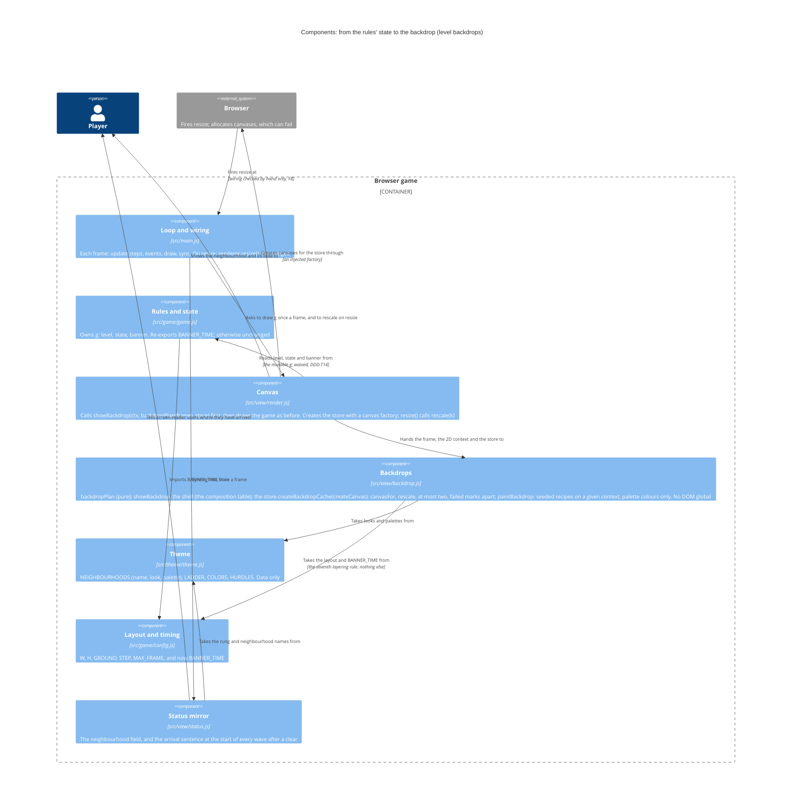

<!-- markdownlint-disable MD024 -->
# Feature delta: rightmove-invaders-level-backdrops

Every rung of the property ladder is a different place. Each has its own neighbourhood map, drawn faintly like a property search map, a time-of-day palette and a skyline of that rung's homes. The next rung's neighbourhood fades in while "Wave cleared!" shows, and from Forever home onwards the backdrop stays on Forever home. **Every foreground use still meets its WCAG minimum on every backdrop: 3:1 for objects, 4.5:1 for text.** One shortfall is a named exemption, and it predates the feature: the houses' door. A second, Gazumper's name in the title legend, is fixed: every name in the legend is drawn on a dark outline and checked against it (the follow-up, merged after DISTILL). Three more uses are excused by name because they never need to stand out against a backdrop: the game-over red, drawn only over the game-over screen's veil; the paused and game-over veils themselves, which only darken; and the legend's outline, which is there to set the names off. Some contrasts do drop against the old backdrop, a trade the user accepted (2026-10-26). For example, on Studio flat Gazumper goes from 3.84:1 to 3.51:1, and brick from 3.92:1 to 3.42:1.

- **Type**: user-facing, brownfield, visual. Branch `rightmove-invaders-level-backdrops`. The walking skeleton is committed (`83a83fb`); the spike docs are in `378d427`.
- **Persona**: [`casual-arcade-player`](../../product/personas/casual-arcade-player.yaml).
- **Density**: lean (Tier-1 only).
- **No DISCOVER, DIVERGE or DISCUSS.** The brief came straight from the user ("every level has the same background"). The concept, the legibility rule and the walking skeleton were agreed with the user in SPIKE on 2026-10-26: [findings](spike/findings.md) · [wave decisions](spike/wave-decisions.md) · [contact sheet](spike/contact-sheet.png).
- **SSOT**: [architecture brief](../../product/architecture/brief.md) · [ADR-010](../../product/architecture/adr-010-neighbourhood-backdrops-seeded-view-recipes.md) · [ADR-011](../../product/architecture/adr-011-backdrop-legibility-rule.md) · [journey](../../product/journeys/play-a-session.yaml) · [outcomes registry](../../product/outcomes/registry.yaml) · [ATDD policy](../../architecture/atdd-infrastructure-policy.md)

---

## Wave: DESIGN / [REF] DDD list

Scope: application (nw-solution-architect) · mode: propose · paradigm: OOP · density: lean. The walking skeleton is a given: this design builds on it. Every decision below was **accepted by the user on 2026-10-26**, with the architect's recommendation chosen each time. The IDs are `DDD-B…`, so they don't clash with the leaderboard's DDD-1…19 or typed-initials' DDD-T1…T14. ADRs: [ADR-010](../../product/architecture/adr-010-neighbourhood-backdrops-seeded-view-recipes.md) and [ADR-011](../../product/architecture/adr-011-backdrop-legibility-rule.md).

**Revised on 2026-10-26, after the Final Wave Review Gate** (DESIGN review: conditionally approved, 0 blockers, 2 high, 5 medium, 6 low; plus the DISTILL review's findings that land in DESIGN). The user decided four things, all as recommended:
- `BANNER_TIME` moves to `config.js` (H-1, F9);
- the contrast trade is stated (H-2);
- when the arrival sentence is heard (F4);
- the drawing shell moves into `backdrop.js` (F7, M-3).

The resize wiring is a recorded gap, checked by hand (F8). M-1, M-2, M-4, M-5 and L-1…L-6 are answered in place. Each changed row says what changed.

| ID | Decision | Verdict | One-line rationale |
|---|---|---|---|
| DDD-B1 | **Where the art lives** (ADR-010): • **`theme/` holds what each rung is**, as data: `NEIGHBOURHOODS`, with each entry's `name`, `look` and nine-colour `palette`, and `neighbourhood(level)`, which clamps at Forever home as `ladderName` does. • **`view/backdrop.js` holds how it is drawn**: one map recipe and one skyline recipe per `look`. • A recipe draws **only with its palette's colours**, plus `COLORS.green` for the ground line. So the data check in DDD-B6 covers every pixel of a backdrop. | Accepted | Theme stays data that imports nothing. A recipe needs loops, curves and a seeded generator, which are code |
| DDD-B2 | **Painting on a given context** (ADR-010). The recipes paint on a 2D context they are handed: `paintBackdrop(context, neighbourhood)`, in game units, with no transform. Building happens inside the store. It takes a canvas from the store's injected factory (DDD-B15), sizes it at `k` device pixels to a unit, sets the transform, and hands its context to `paintBackdrop`. The names are DISTILL's. Each rung draws with its **own seeded generator** (mulberry32, seed 1000 + the rung's index). A backdrop **never calls `Math.random`**: it comes out the same on every build, and the game's seeded sequence is left alone. | Accepted | Capability injection: a recording context in a test can see every call. A backdrop that used `Math.random` would change the game that the seeded tests play |
| DDD-B3 | **Build timing**: lazy, as the skeleton does it. A backdrop is built the first time the store is asked for it. The store, `createBackdropCache(createCanvas)` → `{ rescale(k), canvasFor(neighbourhood) }`, keeps **at most two built canvases**, the least recently asked-for going first. *Documented (N8)*: `canvasFor` is build-on-first-ask, not a plain read: asking builds a missing backdrop, moves it to most recent, and marks a failed build. `rescale(k)` with a **new** scale drops both canvases and every failed mark (DDD-B4), and they are rebuilt at the new scale when next asked for. **`rescale(k)` with the same scale returns at once**, so a resize event that keeps the scale keeps the built canvases and the failed marks too. *Revised (M-1, M-2; L-4b renames the skeleton's `get` to `canvasFor`)*: a build happens on exactly these triggers, and on no other frame: • **the title's first frame**: Studio flat; • **the first "Wave cleared!" frame**: the next rung. The pin can't move then (`movePlayer` runs only in `'play'`), the bolts have just been cleared (`game.js:410`), and the fade starts at a mix of 0; • **the first frame of a new game started from a higher rung**: Studio flat, ≤ 2 ms at 2×, while the pin can already move; • **the first frame after a change of scale**: `here`, plus `next` during the fade. That frame can fall in play: each change of scale while the window is dragged rebuilds `here`, up to 7 ms in Firefox at 2× (Country pile). Accepted. | Accepted | Firefox builds Country pile in 7 ms at 2× (spike). The one build a player meets in every climb lands on the frame where they have nothing to control. A resize, the only trigger during play, is rare and already costly (the screen canvas is reallocated) |
| DDD-B4 | **A backdrop that can't be built** (ADR-010; Earned Trust). The build can fail: `getContext('2d')` returns null, or a draw call throws (canvas memory limits, a lost GPU). Then: • the store marks that rung as failed, and `canvasFor` returns **null** for it. `showBackdrop` (DDD-B5) then fills the screen with **the palette's `bg`**, straight on the main context; • it is **not retried until the next change of scale** (DDD-B3); • nothing is thrown to the loop, and nothing is logged. **Failed marks are kept apart from the built canvases.** They don't count towards the two, and they are never evicted: only a change of scale clears them. The first build, on the title, is the probe. A failure there leaves a flat background, and the game starts anyway. *Added (L-5)*: this game has no client telemetry, so a failed backdrop is visible only to tests and to the eye. | Accepted | Today a throw inside `draw()` would skip `main.js`'s `requestAnimationFrame(frame)` and freeze the game over a piece of decoration. This is the same stance as the synth's fail-safe (ADR-002 amendment) |
| DDD-B5 | **The crossfade is a pure plan, and its shell lives in `backdrop.js` too**. • **The plan**: `backdropPlan({ level, state, banner })` returns `{ here, next, mix }`. It is pure and reads no `g`. It takes `BANNER_TIME` from `src/game/config.js`. • **`BANNER_TIME` moves** (*revised, H-1 and F9*, the user's decision): from `game.js` to `config.js`, next to `STEP` and `MAX_FRAME`. `game.js` imports it and re-exports it, so every existing import keeps working. DELIVER does this as its first step. The plan's argument stays `{ level, state, banner }`, and the seventh layering rule stands as written (DDD-B15). • **The shell** (*revised, F7 and M-3*, the user's decision): one exported function in `backdrop.js`, `showBackdrop(context, plan, canvasFor)`. *Narrowed (N8)*: it is handed the store's `canvasFor` alone, a view of the store that can't rescale it. It asks `canvasFor` for `here`, and for `next` whenever the plan names one, even at a mix of 0, so the build lands on the first "Wave cleared!" frame (DDD-B3). It draws `here` at full strength, then `next` at `globalAlpha = mix`, and then restores `globalAlpha` to the value it found. • **Null guard**: a rung whose canvas is null is filled with that palette's `bg`, at the same alpha its canvas would have had, and `drawImage` is never called with null. The six cases are in the composition table under Component decomposition. • **Assumed**: drawing a canvas that was built doesn't throw (Catalogued lies). • **`render.js` only calls it**, with the frame `{ level, state, banner }` read from `g`. The plan's cases are in the plan table under Component decomposition. | Accepted | Inline in `drawBackdrop`, the fade and the fail-safe could only be checked by eye. As a plan and a shell over a store, every case can be enumerated in memory. The rules hold no view state, and the plan needs no constant from the rules |
| DDD-B6 | **The legibility rule** (ADR-011). It is a test-only check on data. *Revised (L-1)*: it lives in the `in-memory` project, as milestone 5, `tests/e2e/rightmove-invaders-level-backdrops/acceptance/milestone-5-everything-stays-readable.feature`, which runs in the same build gate. It checks **every pair**, 639 pairs plus 54 cap checks, in plain loops, without fast-check. The WCAG relative-luminance and contrast maths lives in `tests/unit/support/contrast.js`. Two clauses: **(i) The cap**: every palette colour of every neighbourhood has relative luminance **≤ 0.05**. **(ii) Contrast need per use**: each use in the needs table (under Component decomposition) meets its need, 4.5:1 for text and 3:1 for objects. It is checked against every palette colour it can stand on, with that colour's luminance **raised by 0.001**. *Corrected (N3)*: it is a margin for an anti-aliased or crossfaded pixel, which can come out at most an 8-bit rounding step brighter than the brighter colour it blends (about 0.001 at these levels). The spike's brightest measured pixel, 0.0488, matches the brightest palette colour today, Leafy avenue's road `#403f33` (0.0488). The named exemptions are in DDD-B7. | Accepted | Clause (i) alone is not enough. The Dream-home bonus text is 8 px in `COLORS.dream` (`game.js:428`), whose luminance of 0.396 gives only 4.46:1 against 0.05. Its real ceiling is about 0.049, not the dim label's 0.052. Fast-check is unseeded in the unit project, and 639 pairs are few enough to check them all |
| DDD-B7 | **Exemptions, by name and with their reasons**: • **The door** (`COLORS.door`, 1.6–1.8:1). For 3:1 against a 0.05 backdrop it would need a luminance of at least 0.25. Brick is 0.285, so the door would fall from 2.2:1 to 1.1:1 against its own brick and vanish into the house. No colour satisfies both. The house's outline is carried by the brick. • **`COLORS.danger`** isn't checked against the palettes: it is drawn only on the game-over overlay. • **Excused by name** (*added, N6 and the follow-up*): the paused and game-over veils, which only darken, and `COLORS.outline`, the dark outline round the title legend's names, which is there to set them off. **No longer exempt: Gazumper's name in the title legend** (16 px text, 3.51:1 on Studio flat against 4.5:1 needed; 3.84:1 on the old backdrop, so this feature deepened it). The follow-up (the user, 2026-10-26; merged after DISTILL) draws every name in the legend, the five hurdles' and "Dream home", on a 2 px dark outline, `COLORS.outline` (`#141420`), with no colour changed. Milestone 5 checks the names against the outline: Gazumper's 6.0:1 is the lowest (ADR-011's amendment). | Accepted; amended by the follow-up (the user, 2026-10-26) | *Revised (H-2)*: the promise is that every use meets its WCAG minimum (3:1 for objects, 4.5:1 for text), not that no contrast drops. Some do drop, and the user accepted it (2026-10-26): on Studio flat, Gazumper goes from 3.84:1 to 3.51:1 and brick from 3.92:1 to 3.42:1, both still above 3:1. The door predates the feature, and no colour fixes it. Gazumper's legend label predated the feature and was deepened by it; the outline fixes it without changing a colour |
| DDD-B8 | **The status mirror**. The `data-hud="neighbourhood"` field names `neighbourhood(g.level).name` (as built), and changes in the same frame as the ladder field. **The arrival sentence** becomes "Now on the property ladder at {rung}. {Neighbourhood name}.", for example "Now on the property ladder at Terrace. Terraced streets in the morning." It is still one live-region write, made when the wave starts. *Clarified (F4)*: it is heard at the start of **every wave after a clear**, including the repeats from Forever home onwards ("Now on the property ladder at Forever home. Seaside at night." on the seventh wave and every one after it). **A new game never says it**: it says only "Game started. Defend your dream home from the hurdles.", as today. Resuming from a pause, or the pin coming back after a lost home, says nothing new, as today. "Wave cleared! Moving up the ladder to {rung}." is unchanged. The wording and the six names in `theme.js` were approved by the user (2026-10-26). The words live in `status.js`, because the mirror alone says them (DDD-T9's rule). | Accepted | Screen-reader users hear where they have arrived when the next wave starts, after the fade has shown the place (*reworded, N5*), with nothing added to the live region's cadence |
| DDD-B9 | **The title shows Studio flat**, as now. The title only appears at page load: Enter after game over starts a new game directly (`game.js:172`). So "the rung the game is on" is always level 0. There is no attract-mode tour of the neighbourhoods. | Accepted (product decision, the user) | The higher rungs stay a reward for climbing. The title's 16 px legend text has to pass on one backdrop, not six |
| DDD-B10 | **Reduced motion: no change**. The crossfade is a 2.4 s fade in opacity between two dark images, every colour at luminance ≤ 0.05. It has no movement, scaling, parallax or flashing. The game doesn't honour `prefers-reduced-motion` anywhere, and an instant swap would be the more abrupt change. | Accepted | A setting covering the whole game would be its own feature |
| DDD-B11 | **Skyline art constraint** (DELIVER, checked by hand). The houses stand at x 84–156, 324–396, 564–636 and 804–876, y 530–584 (`houseCentreX`, `SW × PX`, `SHIELD_Y`). *Revised (M-4), to agree with the spike*: a skyline reads in the band y 590–686 below the houses. **A few landmarks may rise above the houses, but none may be mostly hidden behind one.** *Pass test (N2)*: a landmark passes when more than half of its silhouette is visible, judged by eye at 1× and 2×. On a fail, DELIVER moves the art, never the houses, or the user excuses it by name. The list below is the whole list of landmarks that rise above y 530 or stand in a house's x range today: • **Studio flat's towers**: up to y 506, all across the screen. They are also the backdrop behind the title screen's legend; • **Forever home's cottage**: x 74–146, y 524–576, right over the first house (x 84–156). Most of it is behind the house's solid wall (y 551–584), so it **fails today**: DELIVER moves it; • **Country pile's manor**: its east wing, x 604–630, and the east end of its centre block are behind the third house (x 564–636); • **Country pile's trees** at x 360–390 and 560–590, inside the second and third houses' ranges. | Accepted | Whether a skyline "reads" is a visual judgement, so it can't be a property |
| DDD-B12 | **Two tables, one ladder**. `LADDER` and `NEIGHBOURHOODS` are both indexed by `level` and clamp at their last entry. A check asserts they have the same length (M1, in memory). | Accepted | Cheap, and it catches a rung added to one table but not the other. Merging them would rework `LADDER`, which the views read |
| DDD-B13 | **Testability: what observes what** (waiver D10: no test reads the canvas): • **Browser**: the walking skeleton stays the **only scripted wave**. A change to the game's tuning means retuning its script (accepted by the user in SPIKE). It can't catch a backdrop that uses `Math.random`, because both builds happen outside wave-1 play. • **In-memory/unit**: rungs 1 to 6 and the clamp (levels 6 and 9 give Forever home), through `tests/unit/support/fresh-game.js` (`arrange.lastHurdleShot`) and `fake-status-root.js`: the field and the arrival sentence. `backdropPlan`, enumerated over its table. Every neighbourhood painted on a **recording context** with `Math.random` replaced by a stub that throws. The cache, with a canvas factory injected. • **No seam into the game**: no rung in the URL and no writable global. ADR-003's handle stays read-only and the only global. • **By hand** (DoD): the Rendering universe. • *Added (F8)*: **the resize wiring is a recorded gap**. The chain from window `resize` to `renderer.resize()` to the store's `rescale` isn't driven by any automated scenario. The store's `rescale` is checked in memory, but the browser skeleton never resizes. It is covered by hand by "a resize during the fade" (Rendering universe), and the acceptance designer records the waiver in the ATDD policy. | Accepted | Everything but pixels and the resize wiring is checked automatically, and the fragile scripted wave isn't duplicated |
| DDD-B14 | **Earned trust for the canvas**: the catalogued lies below, each with its check. | Accepted | Each thing the backdrops rely on, browser or art, is checked somewhere |
| DDD-B15 | **Unchanged**: • `src/game/**`, **except one constant**: `BANNER_TIME` moves to `config.js`, and `game.js` re-exports it (DDD-B5; *revised, H-1*). • `main.js`, `sound/**`, `platform/**`, `netlify/**`, `messages.js`, and ADR-000…009. • `index.html`, after the skeleton's field. **Layering**: the six rules hold. A **seventh** is in `tests/unit/layering.spec.js` (added by DISTILL): `src/view/backdrop.js` imports only from `src/theme/` and `src/game/config.js`. So a backdrop depends only on its neighbourhood, its scale and the layout, and can never read `g`. *Added (L-4a)*: **`backdrop.js` references no DOM global** (`document`, `window`, `devicePixelRatio`). Its canvases come only from the factory `render.js` hands to `createBackdropCache`. The import scan can't see globals, so DELIVER checks this with a grep. | Accepted | The change stays inside the view and the theme, plus one constant moved within `game/` |

## Wave: DESIGN / [REF] Component decomposition

What each component gains. The contract shapes and checks are in the Reuse Analysis, and the rejected alternatives in the Decisions table.

| Component | Path | Change | What this feature changes |
|---|---|---|---|
| Game layout | `src/game/config.js` | EXTEND (DELIVER's first step) | Gains `BANNER_TIME` (2.4 s), next to `STEP` and `MAX_FRAME` (DDD-B5; *revised, H-1*) |
| Rules and state | `src/game/game.js` | One constant moved | Imports `BANNER_TIME` from `config.js` and re-exports it, so every existing import keeps working. Nothing else changes |
| Backdrops | `src/view/backdrop.js` | EXTEND (new in the skeleton) | Four exports (the names are DISTILL's, except `showBackdrop` and `canvasFor`): • `backdropPlan` (DDD-B5); • `paintBackdrop(context, neighbourhood)`, for the recipes painting on a context they are given (DDD-B2); • the store, `createBackdropCache(createCanvas)` → `{ rescale(k), canvasFor(neighbourhood) }`, which moves here from `render.js` with its canvas factory injected, its limit of two, its early return on an unchanged scale and the fail-safe (DDD-B3, DDD-B4); • *revised (F7, M-3, N8)*: the shell, `showBackdrop(context, plan, canvasFor)`, handed the store's `canvasFor` alone (DDD-B5). It imports only `theme/` and `game/config.js` (the seventh rule), and references no DOM global (DDD-B15) |
| Rendering | `src/view/render.js` | EXTEND | *Revised (F7, M-3)*: it only calls `showBackdrop(ctx, backdropPlan({ level: g.level, state: g.state, banner: g.banner }), store)` at the start of `draw()`. It creates the store with `() => document.createElement('canvas')`, and `resize()` calls the store's `rescale(k)`. It has no cache and no fade logic of its own. Nothing else it draws changes (the Rendering universe), except the title legend's names, drawn on a dark outline by `outlinedText` (DDD-B7's follow-up, as built) |
| Theme | `src/theme/theme.js` | EXTEND (as built, plus two road colours) | `NEIGHBOURHOODS` and `neighbourhood(level)`; `COLORS.outline` (DDD-B7's follow-up, as built). DELIVER darkens Terrace's and Leafy avenue's road colours by a step, so that DDD-B6's check passes (L-1). It never lightens a foreground colour: that would be a product decision |
| Status mirror | `src/view/status.js` | EXTEND | The arrival sentence, at the start of every wave after a clear and never on a new game (DDD-B8, F4). The field is as built |
| Layering test | `tests/unit/layering.spec.js` | EXTEND (done by DISTILL) | The seventh rule (DDD-B15) |

### The backdrop plan (`backdropPlan`, `src/view/backdrop.js`)

This table is the plan's oracle. `here` and `next` are `NEIGHBOURHOODS` entries. "None" means `next` is null and `mix` is 0. The plan reads only its argument, `{ level, state, banner }`, and `BANNER_TIME` from `src/game/config.js`.

| State | `here` | `next` | `mix` |
|---|---|---|---|
| `title` | `neighbourhood(level)`: City centre at dawn, because the level is 0 on the title (DDD-B9) | None | 0 |
| `play`, `dead` | `neighbourhood(level)` | None | 0 |
| `clear`, level below 5 | `neighbourhood(level)` | `neighbourhood(level + 1)` | `1 − banner / BANNER_TIME`, clamped to [0, 1]: 0 on the first frame, rising to just under 1 |
| `clear`, level 5 or above | `neighbourhood(level)`: Forever home | None: the next rung would be the same place | 0 |
| `over` | `neighbourhood(level)`: the rung reached, under the game-over overlay | None | 0 |
| Paused, in any state | As the state underneath. The banner doesn't count down while paused, so the mix holds | As underneath | As underneath |
| The first frame of a new game, from any rung | Studio flat at once, with no fade, as the HUD resets | None | 0 |

### The shell's composition (`showBackdrop(context, plan, canvasFor)`, `src/view/backdrop.js`)

*Added (F7, M-3).* The shell asks the store for `here` first, then for `next` if the plan names one, even when `mix` is 0. "Ok" means `canvasFor` returned a canvas, and "failed" means it returned null (DDD-B4). Every drawing covers the whole screen, 0, 0, W, H in game units. `globalAlpha` is restored afterwards to the value the shell found, which is 1 at the start of `draw()`. `drawImage` is never called with null.

| `here` | `next` | First, at `globalAlpha` 1 | Then, at `globalAlpha` = `mix` |
|---|---|---|---|
| ok | none | `drawImage(here's canvas)` | Nothing |
| ok | ok | `drawImage(here's canvas)` | `drawImage(next's canvas)` |
| ok | failed | `drawImage(here's canvas)` | `fillRect` in `next.palette.bg` |
| failed | none | `fillRect` in `here.palette.bg` | Nothing |
| failed | ok | `fillRect` in `here.palette.bg` | `drawImage(next's canvas)` |
| failed | failed | `fillRect` in `here.palette.bg` | `fillRect` in `next.palette.bg` |

Assumed, not checked: drawing a canvas that was built doesn't throw (Catalogued lies).

### Legibility needs (DDD-B6's clause ii)

The check's oracle. "Every palette" means all 54 colours of the six palettes, each with its luminance raised by 0.001. The title legend's row is checked against the outline, in milestone 5 like every other row (the follow-up's own unit check moved there when it merged).

| Use | Colour | Need | Against |
|---|---|---|---|
| HUD labels, the tagline, the controls line, "Moving up the ladder to", "Sound off" and "Music off" (8 px) | `COLORS.dim` | 4.5:1 | Every palette |
| HUD values, the banner's rung, the legend's values | `COLORS.text` | 4.5:1 | Every palette |
| The ladder value, "Press Enter to start", "Wave cleared!", "Right Move"; also the pin and the shot | `COLORS.green` | 4.5:1 | Every palette |
| "Dream home saved +£…" (8 px, `game.js:428`); also the Dream Home and its particles | `COLORS.dream` | 4.5:1 | Every palette |
| The hurdles, their bolts and hit particles | The five `HURDLES` colours | 3:1 | Every palette |
| The names in the title legend (16 px): the five hurdles' and "Dream home", each drawn on a 2 px outline | The five `HURDLES` colours, `COLORS.dream` | 4.5:1 | `COLORS.outline`, whatever the backdrop, with no allowance: it is one solid colour (DDD-B7) |
| The houses | `COLORS.brick`, `COLORS.window` | 3:1 | Every palette |
| The houses' door | `COLORS.door` | Exempt (DDD-B7) | – |
| The game-over reason, the refusal, "Couldn't confirm…" | `COLORS.danger` | Not checked: drawn only on the game-over overlay | – |
| The paused and game-over veils (`render.js`, translucent near-black over the whole screen) | not a theme colour | Excused by name (*added, N6*): they only darken, so anything lighter than the backdrop drawn over them only gains contrast | – |

*Corrected (L-1)*: the tightest pairs are not the one the architect estimated (dream against Detached's `light`). DISTILL's check finds dream **below** 4.5:1 on two road colours, with the 0.001 allowance:
- Terrace's road, `#2f3f57`: 4.479:1;
- Leafy avenue's road (the Detached rung), `#403f33`: 4.463:1.

DELIVER darkens both by a step. DISTILL's scratch build passed with `#2e3e56` (4.548:1) and `#3f3e32` (4.532:1). The check is the authority, and only palette colours are darkened, never the Dream home's pink.

### Rendering universe (the canvas checklist, by hand under D10)

**Changes**: the backdrop on every screen, one neighbourhood per rung; the fade during "Wave cleared!", except from Forever home onwards; a flat palette background for a rung whose backdrop couldn't be built. Already built by DDD-B7's follow-up: the title legend's names on a dark outline.

**Must not move or change** (*relabelled, M-5*: this is the canvas's **unbounded-preservation** contract): everything else the canvas draws, on every screen. That is the title, the HUD, the houses, the formation, the Dream Home, the pin, the shot, the bolts, the particles, the floating texts, the lives, the banner, the paused and game-over overlays, the initials entry and the high-score lists.

No test enforces it. There is no golden call log of `render.js`, because one would break on every legitimate change to the art. It is **an accepted residual risk, checked by hand** against `main`, on the deploy preview. The shell can't widen this risk: it only draws the backdrop, and it restores `globalAlpha`.

**Checked by hand**, in Chrome, Firefox and Safari, at 1× and 2×:
- all six backdrops in the real game;
- one frame mid-fade;
- the skylines against DDD-B11's pass test: Studio flat's towers (on the title too), Forever home's cottage (fails today), Country pile's manor and Country pile's trees;
- Terrace's street pattern with bolts in motion, which needs play-testing (the spike's edge case 4);
- the cost of a fade frame on real hardware, in Firefox at 2× (the spike measured 2.8 ms, but only headless);
- a resize during the fade. This is the only check of the wiring from window `resize` to `renderer.resize()` to the store's `rescale` (DDD-B13, F8). It shows both neighbourhoods again at the new size, and the fade carries on;
- a resize during play: one hitch at most per change of scale (DDD-B3).

### Catalogued lies (DDD-B14)

| Lie | How it shows | How the design handles it, and the check |
|---|---|---|
| The canvas can't be allocated (`getContext` returns null, a draw call throws) | `draw()` throws, and the loop stops | The fail-safe (DDD-B4) and the shell's null guard (DDD-B5). In memory (M4): the store with a canvas factory whose context is null, and one whose drawing throws. The result is a flat `bg`, no throw, no log, and no retry until a change of scale. A real allocation failure can't be produced on demand |
| A canvas that was built throws when drawn | `draw()` throws | **Assumed not to happen**: `drawImage` of a valid canvas doesn't throw in the three engines. A lost GPU may blank a built canvas instead, so the backdrop goes dark until the next change of scale. That stays legible, and is accepted |
| A resize event that doesn't change the scale | Needless rebuilds, and failed rungs retried | `rescale(k)` returns at once for an unchanged `k` (DDD-B3) |
| The resize wiring (`main.js`'s listener → `renderer.resize()` → `rescale`) is broken | The backdrops stay at the old scale, blurred or misplaced | *Recorded gap (F8)*: no automated scenario drives it, because the browser skeleton never resizes. By hand: "a resize during the fade" (Rendering universe). The acceptance designer adds the waiver to the ATDD policy |
| An anti-aliased pixel is brighter than any palette colour | Contrast falls below its need on the edge of a shape | The 0.05 cap sits below dim's 0.052, and clause (ii) adds 0.001 to every palette colour (DDD-B6) |
| A crossfaded pixel is brighter than either backdrop | The same, mid-fade | The canvas blends in gamma space, and the sRGB curve is convex. So a blend is never brighter than its brighter colour, except for an 8-bit rounding step, which the 0.001 allowance covers. By hand: one frame mid-fade (Rendering universe) |
| A recipe draws a colour that isn't in its palette | Clause (i) passes, but the pixels are brighter | In memory (M3): the recording context's fill and stroke styles must all be palette colours or `COLORS.green` |
| A recipe calls `Math.random` | The seeded game, and its tests, change after the first build | In memory (M3): painting with `Math.random` replaced by a stub that throws, around each painting call only; and the same call log on two paints. The browser skeleton can't see this (DDD-B13) |
| A build costs several milliseconds | A dropped frame | *Revised (M-1, N1)*: a backdrop the store holds is never rebuilt at its scale, and a rung dropped from the two is built again when it is next needed, on the four triggers of DDD-B3 only. The build every climb meets (the next rung) lands on the first "Wave cleared!" frame, when the player can't act. **A resize during play** rebuilds `here` on each change of scale while the window is dragged: up to 7 ms in Firefox at 2× (Country pile), accepted. **A resize during the fade** rebuilds both: about 9 ms, accepted. Debouncing stays rejected (Decisions table) |
| The fade's cost was only measured headless | Jank on a real GPU or a 4K screen | By hand, on real hardware (Rendering universe) |
| Contrast doesn't measure clutter | Busy streets hide the 3 px bolts | Play-testing (Rendering universe) |
| A failed backdrop goes unnoticed in the field | A player sees a flat background, and nobody knows | *Added (L-5)*: accepted. The game has no client telemetry, so a failed backdrop is visible only to tests and to the eye |

## Wave: DESIGN / [REF] Driving ports

- No new driving port. The backdrop follows the rules' state, `g.level`, `g.state` and `g.banner`, through the existing frame pipeline.
- Unchanged: the keyboard, window `blur` and `visibilitychange`, and page load. Window `resize` is already wired in `main.js` to `renderer.resize()`, which calls the store's `rescale(k)`. A new scale drops the built backdrops and every failed mark; the same scale changes nothing (DDD-B3, DDD-B4). That wiring is checked by hand only (F8).

## Wave: DESIGN / [REF] Driven ports + adapters

| Port | Adapter | Change | In acceptance tests |
|---|---|---|---|
| Screen | `src/view/render.js`, which calls `showBackdrop` in `src/view/backdrop.js` | The backdrops, the fade, and the flat fail-safe | Real, not asserted on (waiver D10). The plan, the painting, the store and the shell's composition are checked in memory, the last on the recording context against its table. The pixels and the resize wiring are the Rendering universe, by hand |
| Accessibility tree | `src/view/status.js` | The arrival sentence. The field as built | Real, and asserted on. *Corrected (N4)*: the browser skeleton reads the field only (Terrace); the arrival sentence, and the field for every rung, are checked in memory (milestone 1) |
| Audio output | `src/sound/synth.js` | None: the fanfare already plays during the banner | Unchanged |
| Persistence, high-score table | `src/platform/storage.js`, `src/platform/leaderboard.js` | None | Unchanged |

**Contract tests for external integrations**: none new. The only external integration, Netlify Blobs behind the Score API, is untouched.

## Wave: DESIGN / [REF] Technology choices

- Unchanged: vanilla ES2022 modules, Canvas2D, no bundler, and **no new dependency**, runtime or dev.
- From Canvas2D, all in the three target engines: offscreen `<canvas>` elements created with `document.createElement`, as the sprites and the houses already are; `globalAlpha` for the fade; `setLineDash`, `bezierCurveTo`, `ellipse`.
- mulberry32, a public-domain generator, written inline in five lines (as built).
- The WCAG 2.x relative-luminance and contrast-ratio formulas, hand-written in a test helper of about ten lines.
- Rejected:
  - `requestIdleCallback` and an `OffscreenCanvas` in a Worker (DDD-B3);
  - a colour-contrast package (a dev dependency for ten lines);
  - image files for the backdrops (one file per scale, no seeded detail, and no asset pipeline in this project).

## Wave: DESIGN / [REF] Decisions table

The decisions themselves are in the DDD list. This table holds only what was rejected, and why.

| ID | Alternatives rejected |
|---|---|
| DDD-B1 | Shape data in `theme/`: the city map alone is about 860 seeded rectangles, so it would mean hand-written coordinate tables plus an interpreter, with no build step to generate them. Recipe functions in `theme/`: the import scan would allow it, but it breaks "theme is data". *Added (L-6)*: one shared map, recoloured per rung. It would be the cheapest, but the concept the user chose in SPIKE is a distinct place per rung, with its own streets and skyline |
| DDD-B2 | `Math.random` (it changes the seeded game and gives a different map on every resize); a seed per neighbourhood stored in the theme (one more field, for a ladder that has six fixed rungs); `buildBackdrop` creating its own canvas inside the recipes (nothing could see the calls without a browser) |
| DDD-B3 | Building ahead at wave start: it moves the cost into a frame where the player is playing. `requestIdleCallback`: a synchronous 7 ms build still blocks inside it, Playwright's fake clock fakes it, and Safari support would need checking. An `OffscreenCanvas` in a Worker: a new module type for one build per wave. Debouncing a resize (confirmed rejected, M-1): more state and a timer in the view, for a rare edge whose cost is one hitch per change of scale. Dropping everything on every `rescale`, even at the same scale: needless rebuilds, and failed rungs retried for nothing |
| DDD-B4 | Letting it throw (the game freezes); a try/catch around `draw()` in `main.js` (it would hide every rendering bug); retrying every frame (a failing build would cost a frame, every frame); refusing to start (decoration must never stop the game); counting failed marks among the two, or evicting them (a failed rung would be retried as soon as two others were shown, or would push out a built canvas); logging the failure (the game has no telemetry, so a console line reaches no one) |
| DDD-B5 | Inline in `drawBackdrop` (only checkable by eye); a fade state in `g` (view state in the rules, and a write the rules would own for the view's sake). The shell staying in `render.js` (F7, M-3): its six cases could only be checked by eye. For `BANNER_TIME` (H-1): a copy of 2.4 kept in `backdrop.js` (two sources of truth); the shell handing the banner time to the plan (it changes the plan's argument, and every scenario that calls it); importing it from `game.js` (it breaks the seventh rule, and lets a backdrop see `g`) |
| DDD-B6 | The cap alone (fails on dream's 8 px text); the rule and the WCAG maths as theme data (nothing in production would read them); fast-check sampling (unseeded in the unit project, and 639 pairs are few enough to check them all); reading pixels in a browser test (waiver D10, and it would need the canvas); a unit spec in `tests/unit/` (L-1: DISTILL put it in the `in-memory` project as milestone 5, beside the feature's other outcomes, in the same build gate) |
| DDD-B7 | A lighter door (it vanishes into the brick); fixing Gazumper's legend label by changing a hurdle's colour (a product decision). In the follow-up, with the user: a dark plate behind the legend rows (5.2:1, but it hides part of the neighbourhood on the title), and a lighter red for Gazumper's name alone (`#ff888c`, 4.6:1: the name would no longer match its sprite, with about 3% headroom) |
| DDD-B8 | The field only (screen-reader users wouldn't hear the arrival); the place in the "Wave cleared!" sentence too (it would be said twice); saying the arrival on a new game too (F4: "Game started…" already says the game has begun, and the place is in the field); saying it only once per rung, so not on the repeats from Forever home (the sentence marks each new wave, as "Game started…" marks the first) |
| DDD-B9 | An attract-mode tour of the neighbourhoods (it gives away the reveal, the legend text would have to pass on all six backdrops, and it means a build every 5 s) |
| DDD-B10 | An instant swap under `prefers-reduced-motion` (more abrupt than a slow fade, and the only reduced-motion behaviour in the game) |
| DDD-B11 | A bounding-box rule checked on the recording context (it tests geometry, not whether a skyline reads) |
| DDD-B12 | Merging `LADDER` into `NEIGHBOURHOODS` (it reworks a table the views read, for a check that costs one line) |
| DDD-B13 | A rung chosen in the URL, or a writable test global (the first write-capable hook in the game, against ADR-003); a second scripted wave in a browser (the fragility doubles) |
| DDD-B15 | dependency-cruiser for the seventh rule (the hand-rolled scan covers it, ADR-006); `document.createElement` inside `backdrop.js` (L-4a: the module couldn't run in Node, and the fail-safe couldn't be exercised); a globals check in the import scan just for this (the grep is enough for one file; a globals check for all of `src/` stays the typed-initials follow-up) |

## Wave: DESIGN / [REF] Reuse Analysis

Searched `src/**` and `tests/**` for:
- backdrop and offscreen drawing: `createElement('canvas')`, `getContext`, `drawImage`, `globalAlpha`;
- colour maths: `luminance`, `contrast`;
- reduced motion and idle work: `prefers-`, `matchMedia`, `requestIdleCallback`;
- the arrival sentence: `Now on the property ladder`, `Moving up`, which no test asserts;
- reaching a later rung: `lastHurdleShot`, `loadFreshGame`, `createStatus`.

Contract shapes, as in typed-initials: **pure** · **bounded-change** (a declared universe and delta) · **unbounded-preservation** (a pure function returns a plan, and a thin shell only applies it) · **composition root** / **static**.

| Existing component | File | Overlap | Decision | Contract shape | Universe, and how it is checked | Justification |
|---|---|---|---|---|---|---|
| Backdrops | `src/view/backdrop.js` | The recipes, `rng`, `buildBackdrop` | EXTEND | Three contract shapes: • **unbounded-preservation** for the fade: `backdropPlan` is pure, and `showBackdrop` only applies it, drawing the backdrop and nothing else, with `globalAlpha` restored; • **bounded-change** for painting: it writes only to the context it is given; • **bounded-change** for the store: only its own map, at most two canvases, and failed marks kept apart from them | (1) `backdropPlan` enumerated against the plan table. (2) Every neighbourhood painted on a recording context, with `Math.random` replaced by a stub that throws: no throw, the same call log twice, only palette colours and `COLORS.green`, and both recipes present for every `look`. (3) The store with an injected canvas factory: at most two kept, a held backdrop never rebuilt at its scale (a dropped one built again when next asked for), an unchanged scale changing nothing, and a null context or a throw giving `null` from `canvasFor`, retried only after a change of scale. (4) `showBackdrop` on the recording context against the composition table | Created by the skeleton because nothing drew a map. The other offscreen helpers in `render.js` draw bitmaps, not recipes |
| Rendering | `src/view/render.js` | `createBackdropCache`, `drawBackdrop`, `resize` | EXTEND | composition (calls only) | It calls `showBackdrop` with the plan and the store, and `rescale` on resize. Pixels are checked by hand (D10, the Rendering universe) | It already draws the backdrop. The store and the shell move to `backdrop.js`, where they can be checked in memory (F7, M-3) |
| Game layout | `src/game/config.js` | `STEP`, `MAX_FRAME`, the layout | EXTEND | static | One constant added: `BANNER_TIME` | The home of the game's timing constants; `backdrop.js` may import it under the seventh rule (H-1) |
| Other seeded generators | `src/sound/voices.js` (a white-noise LCG, seed 1); the e2e init script's mulberry32 in `steps/backdrops.steps.js`; `fresh-game.js`'s Park–Miller generator | Seeded randomness that never touches `Math.random` | NONE: `backdrop.js` keeps its own five-line mulberry32 (*added, L-3*) | – | – | Sharing one would need a module that both `view/` and `sound/` import, against the seventh rule and for five lines. The e2e copy is serialised into the page by `addInitScript`, so it must be self-contained. The LCG fills an audio buffer, where quality doesn't matter. Each copy has one purpose, and none is on the other's path |
| Shield cache pattern | `render.js` `createShieldCache` | One offscreen canvas per object, built when needed | REUSE the pattern, no merge | – | – | The two are dropped for different reasons: a dirty flag per house versus a change of scale plus keeping only two |
| Sprites | `render.js` `sprite()` | Pixel art on a tiny canvas | NONE | – | – | Bitmaps from data, not recipes |
| Theme | `src/theme/theme.js` | `NEIGHBOURHOODS`, `neighbourhood()`, `LADDER`, `COLORS`, `HURDLES` | EXTEND (as built, plus two road colours darkened by a step) | pure (data) | The legibility check (DDD-B6, milestone 5) and the length check (DDD-B12) | The home of the colours and the ladder; imports nothing |
| Status mirror | `src/view/status.js` | The neighbourhood field, `announcement()`'s `play` case | EXTEND | bounded-change | The `[data-hud]` fields and the live-region writes. In-memory over rungs 1 to 6 and the clamp: the field, and one arrival sentence per arrival | The sentence exists; it gains a second sentence |
| View wording | `src/view/messages.js` | The words both views say | NONE | pure | Unchanged | Only the mirror names the place (DDD-T9's rule) |
| Rules and state | `src/game/game.js` | `g.level`, `g.state`, `g.banner`, `BANNER_TIME` | One constant moved (*revised, H-1*): `BANNER_TIME` is imported from `config.js` and re-exported | – | Read only otherwise. The views' reading of `g` stays waived (DDD-T14). The existing importers of `BANNER_TIME` keep working through the re-export | Already says which backdrop to show and how far the fade has gone |
| Loop and wiring | `src/main.js` | `resize` → `renderer.resize()` | NONE | composition root | Unchanged | A resize already reaches the cache |
| Page | `index.html` | `data-hud="neighbourhood"` | NONE (added by the skeleton) | static | Unchanged | The field exists |
| Seeded wave driver | `tests/e2e/…/steps/backdrops.steps.js` | Plays wave 1 for real | REUSE | – | – | The only scripted wave (DDD-B13) |
| Rung reachers | `tests/unit/support/fresh-game.js` (`arrange.lastHurdleShot`), `fake-status-root.js` | Clearing a wave in Node, and the mirror's fields | REUSE | – | – | The fake root reads its fields from `index.html`, so it already has the neighbourhood field |
| Layering scan | `tests/unit/layering.spec.js` | The import scan and its rules | EXTEND | pure (test) | One more rule, with a broken and a kept case | Keeps a backdrop from ever reading `g` |
| Contrast maths | `tests/unit/support/contrast.js` | – | CREATE NEW (written by DISTILL and, separately, by DDD-B7's follow-up; the merge kept one: `relativeLuminance` and `contrastRatio`, checked against WCAG's published ratios in `tests/unit/contrast.spec.js`) | pure (test) | – | **Evidence**: no `luminance` or `contrast` anywhere in `src/` or `tests/`, and production needs none |
| Recording 2D context | `tests/unit/support/fake-canvas.js` | – | CREATE NEW | test double | It offers only the calls the recipes make and refuses any other, as `fake-status-root.js` does | **Evidence**: no `getContext` or `CanvasRenderingContext` anywhere in `tests/`. `fake-audio.js` and `fake-status-root.js` set the pattern |

**No CREATE NEW under `src/`**: `backdrop.js` already exists (skeleton), and the plan, the painting, the store and the shell are its exports. *Note (L-1)*: the two test helpers were written by DISTILL as planned, but the legibility check itself is milestone 5 in the `in-memory` project, not a `tests/unit/` spec.

## Wave: DESIGN / [REF] C4 diagrams

**System context**: unchanged. See the [brief's System context](../../product/architecture/brief.md#c4-system-context).

**Containers**: unchanged, except that the browser game's description in the [brief](../../product/architecture/brief.md#c4-containers) gains "neighbourhood backdrops".

**Components**: from the rules' state to the backdrop on the screen.

## Wave: DESIGN / [REF] Changed assumptions

The originals are quoted verbatim, with their path, and the new assumption follows the arrow. DESIGN doesn't edit the spike docs, the journey or the code.

`docs/feature/rightmove-invaders-level-backdrops/spike/findings.md`:
- **Probe question**: "Hurdles, bolts, shot, pin, Dream home and the houses' bricks and windows need at least 3:1 contrast (WCAG 1.4.11, non-text). The HUD's small text needs at least 4.5:1 (WCAG 1.4.3)." → The spike missed some text. The Dream-home bonus text is 8 px and needs 4.5:1 (`game.js:428`). The hurdle names in the title legend are 16 px text and need 4.5:1; they are drawn on a dark outline and checked against it (DDD-B7's follow-up). Green is text too (4.5:1). Danger is drawn only on the overlay. The full table is under Legibility needs.
- **Where the 0.05 comes from**: "The dim HUD label (0.410) needs 0.052 for 4.5:1, so it is the binding limit." → Dream (0.396) is the binding colour, with a ceiling of about 0.049. So the 0.05 cap alone doesn't guarantee legibility, and the check also compares each use with every palette colour, plus 0.001 (DDD-B6).
- **Edge case 1**: "This was there before the feature, so it is not a gate, but a slightly lighter door would fix it everywhere." → No colour fixes it. 3:1 against the backdrop needs a luminance of at least 0.25, which takes the door to 1.1:1 against its own brick. It is exempt by name (DDD-B7).
- **Design implications, Accessibility**: "It could also name the place and the time of day, for example "Terrace, morning", so screen-reader users get the same sense of moving up." → "Now on the property ladder at Terrace. Terraced streets in the morning." It uses the full neighbourhood name, with wording approved by the user (DDD-B8).
- **Design implications**: "Skylines go in the band below the houses, y 590 to the ground, with at most a few landmarks rising above them." → Kept as the spike says it (*revised, M-4*; the first version wrongly required every tall landmark to stand clear of the houses). The addition: none may be mostly hidden behind a house, and the three to check by hand are named (DDD-B11).
- **Verdict**: "every check passed on 100% of its area on all six backdrops" → That held for the probe's needs. With the full needs table and the 0.001 allowance, dream's 8 px text falls to 4.480:1 on Terrace's road and 4.463:1 on Leafy avenue's road. DELIVER darkens both by a step (DDD-B6, L-1). The headline promise is restated (H-2): every use meets its WCAG minimum, and some contrasts drop against the old backdrop, a trade the user accepted.

`docs/feature/rightmove-invaders-level-backdrops/spike/wave-decisions.md`:
- **Design Implications**: "Backdrops are built when needed and cached (at most two: the current rung and the next), and rebuilt on resize." → Plus the fail-safe. A build that fails leaves the palette's `bg`, and isn't retried until the next change of scale (DDD-B4). "Rebuilt on resize" becomes "rebuilt on a change of scale": a resize that keeps the scale changes nothing (DDD-B3, M-2). Built when needed is confirmed, on the four triggers of DDD-B3 (M-1).
- **Design Implications**: "`src/game/` does not change: `g.level`, `g.state`, `g.banner` and `BANNER_TIME` already say which backdrop to show and how far the fade has gone." → `BANNER_TIME` moves to `src/game/config.js`, and `game.js` re-exports it, so the plan can import it under the seventh rule (DDD-B5, H-1). That is the one change to `src/game/`.
- **Open for the promotion gate** (`findings.md`): "Attract mode is left to DISCUSS." → No DISCUSS ran. The user decided in DESIGN: the title shows Studio flat, with no tour (DDD-B9).

`docs/product/journeys/play-a-session.yaml` (no DISCUSS ran, so DESIGN recorded the edit here). *Updated (L-2)*: **DISTILL made this edit, with the user's approval** (2026-10-26). The lines below are what DESIGN asked for; the journey is the authority for what it now says.
- **Step `start`**, `sees`: "The formation and four terraced-house shields." → …over the first rung's neighbourhood, City centre at dawn.
- **Step `outcome`**: "A rising fanfare for "Wave cleared!"" → plus: the next rung's neighbourhood fades in while the banner shows; screen readers hear "Now on the property ladder at Terrace. Terraced streets in the morning." when the next wave starts.
- **`shared_artifacts`**: add `neighbourhood: {source: "NEIGHBOURHOODS in src/theme/theme.js, through neighbourhood(g.level)", consumers: [canvas backdrop, "data-hud=neighbourhood field", arrival sentence]}`.

The code (DELIVER changes it; the quotes record what DESIGN overturns):
- `src/view/status.js:58`: "`` `Now on the property ladder at ${ladderName(g.level)}.` ``" → plus the neighbourhood's name as a second sentence (DDD-B8).
- `src/view/status.js:58-59`, when it is heard: "`if (last.state === 'clear') return …`", otherwise "`'Game started. Defend your dream home from the hurdles.'`" → unchanged, and now stated: at the start of every wave after a clear, the repeats from Forever home onwards included, and never on a new game (DDD-B8, F4).
- `src/view/render.js` (`drawBackdrop`): "`if (g.state !== 'clear' || next === here) return;`", "`ctx.globalAlpha = 1 - g.banner / BANNER_TIME;`" → replaced by a call to `showBackdrop` in `backdrop.js`, applying `backdropPlan` (DDD-B5, F7).
- `src/view/render.js` (`createBackdropCache`): "`const c = built.get(n) ?? buildBackdrop(n, k);`" and "`rescale(scale) { k = scale; built.clear(); }`" → moves to `backdrop.js`, with an injected canvas factory, `get` renamed `canvasFor` (L-4b), an early return on an unchanged scale (M-2) and the fail-safe (DDD-B3, DDD-B4).
- `src/view/backdrop.js` (`buildBackdrop`): "`const c = document.createElement('canvas');`" … "`MAPS[look](b, palette, r);`" → painting on a given context; the canvas comes only from the store's injected factory, with no DOM global in the module (DDD-B2, DDD-B15, L-4a).
- `src/game/game.js:19`: "`export const BANNER_TIME = 2.4;`" → declared in `src/game/config.js`, then imported and re-exported by `game.js` (DDD-B5, H-1).

## Wave: DESIGN / [REF] Open questions

**For DISTILL**:
1. **Outcomes to register** (`nwave-ai outcomes register`), as typed-initials did. The proposed rows:

   | ID | Kind | Summary | Inputs | Output | Keywords | Artifact |
   |---|---|---|---|---|---|---|
   | OUT-17 | invariant | Backdrop legibility | The six neighbourhood palettes and the foreground uses (Legibility needs) | Every palette colour has relative luminance ≤ 0.05. Every use meets its need (4.5:1 text, 3:1 objects) against every palette colour it can stand on, raised by 0.001. Exempt by name: the door. The title legend's names meet 4.5:1 against their outline, `COLORS.outline` (the follow-up). `COLORS.danger`, the veils and the outline are not checked against backdrops | backdrop-legibility, palette-luminance-cap, contrast-need, wcag-contrast | `src/theme/theme.js` |
   | OUT-18 | specification | A neighbourhood for every rung, faded in on "Wave cleared!" | `g.level`, `g.state`, `g.banner`, each frame | `backdropPlan` per the plan table: `here` = `neighbourhood(level)`, clamped at Forever home; `next` only while `clear` below Forever home, with mix = 1 − banner / BANNER_TIME in [0, 1]. `data-hud=neighbourhood` reads `neighbourhood(level).name`. At the start of every wave after a clear, the repeats from Forever home included, the live region says "Now on the property ladder at {rung}. {name}."; a new game never says it (*revised, F4*) | neighbourhood, backdrop-crossfade, ladder-rung-place, arrival-sentence | `src/view/backdrop.js` |
   | OUT-19 | invariant | Backdrops are seeded, palette-only and fail safe | Painting any neighbourhood at any scale; a canvas that can't be allocated | Painting never calls `Math.random`, makes the same calls every time, and uses only its palette's colours and `COLORS.green`. A failed build leaves the palette's `bg`, is retried only after the next change of scale (*revised, M-2*), and never reaches the loop | backdrop-determinism, seeded-backdrop, no-math-random, backdrop-fail-safe | `src/view/backdrop.js` |

   The collision check by hand found no overlap with the keywords of OUT-1…16 (see the Wave decisions summary).
2. **In-memory scenarios** (DDD-B13): over rungs 1 to 6 and the clamp (levels 6 and 9), the field, and one arrival sentence per arrival, with the approved wording. Optionally, the skeleton gains a Then for Terrace's arrival sentence. Its scripted wave stays the only one.
3. **The unit oracles**: the plan table; the legibility needs table, with its exemptions named in the test; the recording-context property (DDD-B14's rows 4 and 5); the cache's limit of two and its fail-safe; the length check (DDD-B12); the seventh layering rule, with a broken case and a kept case.
4. **Seeding**: the ATDD policy says property tests use fast-check seed 20261023 unless `FC_SEED` is set, but `tests/unit/support/seed.js` seeds only when `FC_SEED` is set. That gap predates this feature (the spike's flake at `status-mirror.spec.js:320`). The legibility check avoids fast-check. The gap itself is a follow-up.

**For DELIVER**:
1. **First step** (*revised, H-1*): move `BANNER_TIME` to `src/game/config.js`, and have `game.js` import and re-export it. Then build what the Component decomposition lists. The names are DISTILL's scaffold names, plus `showBackdrop` and `canvasFor` (*revised, F7 and L-4b*). The acceptance designer renames the store's `get` in the steps.
2. If DDD-B6's check fails on a palette colour, darken that palette colour. Never lighten a foreground colour: that changes the whole game's look and is a product decision. Known today (L-1): Terrace's road and Leafy avenue's road, by a step each. DISTILL's scratch build passed with `#2e3e56` and `#3f3e32`.
3. A grep confirms that `src/view/backdrop.js` references no DOM global: `document`, `window`, `devicePixelRatio` (DDD-B15, L-4a).
4. The Rendering universe, by hand (D10). It includes the art constraint and its three named landmarks (DDD-B11), the play-test of Terrace's streets, and a resize during the fade and during play (F8, M-1).

**Follow-ups, not this feature**:
- **Gazumper's name in the title legend**: done (the user, 2026-10-26; merged after DISTILL). It was 3.51:1 on Studio flat, against 4.5:1 needed for 16 px text (3.84:1 before this feature). Every name in the legend is now drawn on a 2 px dark outline, and Gazumper gets 6.0:1 against it, with no colour changed (DDD-B7, ADR-011's amendment). Milestone 5's legend scenario checks the names against the outline, with no exemption.
- The door: exempt by design, because no colour fixes it (DDD-B7).
- Seeding fast-check in the unit project (Open questions, DISTILL 4).
- A read-only view of `g` for the views (DDD-T14, still waived).

**For DEVOPS**: nothing new. No instrumentation, no new file types, and no change to the build.

## Wave: DESIGN / [REF] Wave decisions summary

- **Pattern**: unchanged. A modular monolith with ports and adapters, and the OOP paradigm (`CLAUDE.md`). Palettes are theme data. `backdrop.js` holds:
  - seeded recipes painted on a given context;
  - a pure fade plan;
  - its shell `showBackdrop`, which `render.js` only calls;
  - a store of at most two with a fail-safe (ADR-010).

  Legibility is a rule on data, checked over every pair (ADR-011).
- **Changes**:
  - **New**: ADR-010 and ADR-011. No new source file beyond the skeleton's `backdrop.js`. Two test helpers, `support/contrast.js` and `support/fake-canvas.js`, written by DISTILL (the follow-up wrote the same contrast helper; the merge kept one).
  - **Extended**: `view/backdrop.js`, `view/render.js` (and, from the follow-up, `outlinedText` for the legend's names) and `view/status.js`; `theme/theme.js` (as built, `COLORS.outline` from the follow-up, plus two road colours darkened); `game/config.js` (`BANNER_TIME`); the layering test (the seventh rule).
  - **Unchanged**: `game/**` except `BANNER_TIME`'s move, `main.js`, `sound/**`, `platform/**`, `netlify/**`, `messages.js`, and `index.html` after the skeleton.
- **Constraints**:
  - A backdrop never calls `Math.random`, and draws only its palette's colours and green.
  - A backdrop the store holds is never rebuilt at its scale; a rung dropped from the two is built again when it is next needed, on the four triggers of DDD-B3 (N1). The next rung is built on the first "Wave cleared!" frame; during play, only a new game (Studio flat) or a change of scale builds.
  - A failed build never reaches the loop, and `drawImage` never gets null.
  - `backdrop.js` imports only `theme/` and `game/config.js`, and references no DOM global.
  - The skeleton stays the only scripted wave.
- **Quality attributes**:
  - **Legibility**: every use meets its WCAG minimum, which is the cap plus the contrast need of every use, checked over every pair (639 plus 54 cap checks) with a 0.001 allowance for anti-aliasing. One exemption is named (the door); the title legend's names are checked against their outline (the follow-up). Some contrasts drop against the old backdrop, a trade the user accepted (H-2).
  - **Determinism**: seeded per rung, and checked with a `Math.random` that throws.
  - **Responsiveness**: no per-frame build. The fade adds one `drawImage`. A resize during play costs one hitch per change of scale, accepted.
  - **Graceful degradation**: a flat background, never a frozen game. With no telemetry, a failure is seen only by tests and by eye.
  - **Testability**: everything but the pixels and the resize wiring is checked in memory. Those two are checked by hand (D10, F8).
  - **Maintainability**: one recipe pair per look, and palettes as data guarded by the check.
- **Upstream**: no DISCUSS ran. The user took decisions d and e (title, wording) directly. The journey edit was made by DISTILL with the user's approval (L-2).
- **Revision 1, after the Final Wave Review Gate (2026-10-26)**:
  - **H-1, F9**: `BANNER_TIME` moves to `config.js` (DDD-B5, DDD-B15).
  - **H-2**: the headline and DDD-B7 state the real promise and the accepted drops.
  - **F4**: the arrival sentence is heard on every wave after a clear, never on a new game (DDD-B8).
  - **F7, M-3**: `showBackdrop` and its composition table (DDD-B5).
  - **F8**: the resize wiring is a recorded gap, checked by hand (DDD-B13, Catalogued lies).
  - **M-1**: the four build triggers, and the cost of a resize during play (DDD-B3).
  - **M-2**: an unchanged scale changes nothing (DDD-B3).
  - **M-4**: the skyline rule agrees with the spike, with three named landmarks (DDD-B11).
  - **M-5**: the must-not-change list is unbounded-preservation, an accepted residual risk checked by hand (Rendering universe).
  - **L-1**: the check is milestone 5, with 639 pairs, and the tightest pairs corrected (DDD-B6).
  - **L-2**: the journey note.
  - **L-3**: a Reuse row for the other seeded generators.
  - **L-4**: no DOM global in `backdrop.js`, and `get` renamed `canvasFor`.
  - **L-5**: no telemetry (DDD-B4).
  - **L-6**: "one shared map, recoloured" rejected (Decisions table).
- **Review**: the per-wave peer review (solution-architect-reviewer) was not run in this session. A self-check against the critique dimensions found:
  - no new technology or dependency, so no technology bias;
  - two ADRs, each with context, three or more rejected alternatives and consequences;
  - every DDD with a rejected alternative;
  - testability addressed without a seam into the game;
  - degradation and performance addressed with measured figures from the spike.
- **Outcomes check**: `nwave-ai outcomes check-delta` could not be run in DESIGN's session (no shell). A manual check of the proposed keywords against OUT-1…16 found no shared keyword. DISTILL registered OUT-17…19 and ran `check-delta`: exit 0, 0 collisions. The revision changes OUT-18 (when the arrival is heard) and OUT-19 ("retried only after the next resize" becomes "after the next change of scale"). Those registry edits are the acceptance designer's.
- **Handoff**: DISTILL (nw-acceptance-designer), for Open questions 1–4. Then DELIVER, with the DDD list, the plan table, the legibility needs, the catalogued lies and the Rendering universe. DEVOPS: nothing new.

---

## Wave: DISTILL / [REF] Inputs and reconciliation

Run on 2026-10-26 (nw-acceptance-designer, lean, no expansion menu) against SPIKE `378d427`, the walking skeleton `83a83fb` and DESIGN `644df67`, then revised the same day (revision cycle 1, below) against DESIGN as revised after the Final Wave Review Gate. `[lang-mode] javascript` (Playwright 1.62.1, playwright-bdd 9.2.1; fast-check not used) · `[policy-mode] inherit` (rows appended and widened, below) · `[port-mode] inherit` ([tests/common/state-delta.js](../../../tests/common/state-delta.js)) · deliverable type `application` (no `.nwave/des-config.json`).

- **Read**: this delta (DESIGN, as revised), [ADR-010](../../product/architecture/adr-010-neighbourhood-backdrops-seeded-view-recipes.md), [ADR-011](../../product/architecture/adr-011-backdrop-legibility-rule.md), the [brief](../../product/architecture/brief.md)'s level-backdrops parts, the [journey](../../product/journeys/play-a-session.yaml), [kpi-contracts.yaml](../../product/kpi-contracts.yaml), the [outcomes registry](../../product/outcomes/registry.yaml), the [ATDD policy](../../architecture/atdd-infrastructure-policy.md), the spike's [findings](spike/findings.md) and [wave decisions](spike/wave-decisions.md), the walking skeleton and its steps, `src/view/backdrop.js`, `render.js`, `status.js`, `src/theme/theme.js`, and typed-initials' DISTILL as the precedent.
- **DISCUSS is missing: WARN.** The acceptance criteria come from DESIGN (the DDD list, the plan table, the composition table, the Legibility needs, the catalogued lies, Open questions "For DISTILL" 2 and 3). There is no story tracing; scenarios are tagged by the `@DDD-B…` they check.
- **DEVOPS is missing: WARN.** Nothing new for DEVOPS (DESIGN). Every new scenario runs in the existing `in-memory` project, which is part of the Netlify build gate.
- **KPIs: none.** `kpi-contracts.yaml` has no backdrop KPI (soft gate), so there is no `@kpi` scenario.
- **Reconciliation passed: 0 contradictions.** DESIGN records every change against SPIKE as a user decision (Changed assumptions). The one DESIGN gap DISTILL found, `BANNER_TIME` against the seventh rule, is resolved by the user's decision (Upstream issues 1).
- **Policy** (the user, 2026-10-26), in the [ATDD policy](../../architecture/atdd-infrastructure-policy.md):
  - the Driving row "Backdrops on their own": the four units of `backdrop.js`, two recording contexts (the recipes' and the screen's), the stand-in canvas factory, and the climb harness;
  - a Driving row for window `resize`, a waived gap (F8);
  - the D10 row widened to "no test reads the canvas" (DDD-B13), and a Driven row for the offscreen canvas factory (F15);
  - two deviations: Mandate 1 (F1), and the resize wiring (F8).

**Revision cycle 1** (2026-10-26), after the Sentinel review (needs_revision: 3 blockers, 6 high, 8 low) and DESIGN's revision. Done:
- F1: a deviation from Mandate 1 in the policy.
- F2: business words in the Gherkin and the step texts; the mechanics stay in `#` comments and the drivers.
- F3: the WS strategy, below.
- F4: M1's description and the "Moving up" rows state when the arrival is heard; OUT-18 says it, and OUT-19 says "a change of scale".
- F5: M5's closed set asserts over the colours actually measured, and is pending with the Dream home row.
- F6: M4's "The title's backdrop can't be prepared…".
- F7: the drivers call the real `showBackdrop`; "plain background" is read off the screen's recording; the composition table is an outline of six rows; the main.js overclaim is corrected.
- F8: the resize waiver, in the policy and here.
- F9: resolved (Upstream issues 1).
- F10 to F17: in place, each in the section it concerns.
- M-2: a new size in "Resizing the window to a new size tries…", and two same-size scenarios.
- The rename: `get` is `canvasFor`, and the shell is `showBackdrop`, everywhere DISTILL names them.

Testing the store's scenarios showed a gap, now closed: M4's "A backdrop that couldn't be prepared takes no room from the two kept…".

## Wave: DISTILL / [REF] Scenario list with tags

40 scenarios (74 runs) in [tests/e2e/rightmove-invaders-level-backdrops/acceptance/](../../../tests/e2e/rightmove-invaders-level-backdrops/acceptance/), all `@in-memory`.
- **55 runs are `@pending`**: RED, for DELIVER.
- **19 are enabled and green** now, because what they check is already built and belongs to no DELIVER step (RED classification).

Every scenario has exactly one When. The walking skeleton stays the only browser scenario (DDD-B13). Tags:
- `@DDD-B…` names the decision a scenario checks, and `@contract-shape:…` its shape;
- `@property` marks a claim over a whole set (all rungs, all neighbourhoods, all pairs), checked exhaustively in plain loops or outlines. There is no sampling, so no fast-check and no seed.

The Gherkin and the step texts say "prepared", never "built", and give time in seconds, never frames. They name contrast as "as much as text needs to" or "as much as something I play against needs to", never as a ratio, and brightness as "brighter than a backdrop may be". *Revised (cycle 2, B1)*: the `#` comments are in domain words too, with no function names, file paths or figures; the mechanics live in the drivers' header comments.

- **Error and edge share**: `@error` or `@edge`, 28 of 40 scenarios (70%) and 38 of 74 runs (51%). Strictly `@error`, 12 of 40 (30%) and 17 of 74 runs (23%). The 40% target is met by error and edge paths together. Most edges here are boundaries: the top of the ladder, the clamp, the fade's ends, a pause, a resize.
- **By file**:
  - M1: 6 scenarios, 19 runs (12 enabled);
  - M2: 11, 21 (all pending);
  - M3: 4, 4 (all pending);
  - M4: 15, 21 (all pending);
  - M5: 4, 9 (7 enabled).

| File | Scenario | Tags (all `@in-memory`) |
|---|---|---|
| M1 a place for every rung | Starting a game puts me in the city centre at dawn | `@contract-shape:bounded-change @DDD-B8` — enabled |
| M1 | The <wave> wave is at <rung>, in <neighbourhood> (outline ×7: second to sixth; seventh and tenth `@edge`) | `@property @contract-shape:bounded-change @DDD-B8 @DDD-B12` — enabled |
| M1 | Moving up to the <wave> wave, I hear that I am now at <rung>, in <neighbourhood> (outline ×7: second to sixth; seventh and tenth, Forever home's repeats, `@edge`) | `@pending @property @contract-shape:bounded-change @DDD-B8` |
| M1 | Where I have arrived isn't said again when I <interruption> (outline ×2: pause and resume; a home lost and the pin back) | `@edge @contract-shape:bounded-change @DDD-B8` — enabled |
| M1 | Playing again after reaching Country pile starts me in the city centre, without an arrival | `@edge @contract-shape:bounded-change @DDD-B8 @DDD-B9` — enabled |
| M1 | Every rung of the property ladder has a neighbourhood of its own | `@property @edge @contract-shape:pure-function @DDD-B12` — enabled |
| M2 fades in | The title shows the city centre at dawn, with nothing fading in | `@pending @contract-shape:unbounded-preservation @DDD-B5 @DDD-B9` |
| M2 | Starting a game keeps the city centre at dawn, with nothing fading in | `@pending @contract-shape:unbounded-preservation @DDD-B5` |
| M2 | Clearing a wave starts the next neighbourhood fading in, from nothing | `@pending @contract-shape:unbounded-preservation @DDD-B5` |
| M2 | Half way through "Wave cleared!" on the <wave> wave, the backdrop shows <here>, with <fade> (outline ×8: first to fifth fade in at 50%; sixth, seventh and tenth fade nothing, `@edge`) | `@pending @property @contract-shape:unbounded-preservation @DDD-B5` |
| M2 | <passed> seconds into "Wave cleared!", the next neighbourhood has faded in to <strength> (outline ×3: 0.6 s 25%, 1.8 s 75%, 2.35 s 97.9%) | `@pending @contract-shape:unbounded-preservation @DDD-B5` |
| M2 | "Wave cleared!" with <left> seconds of the banner left holds the fade at <strength> (outline ×2: −0.5 s 100%, 3 s 0%) | `@pending @edge @error @contract-shape:pure-function @DDD-B5` |
| M2 | Pausing mid-fade holds the fade where it is | `@pending @edge @contract-shape:unbounded-preservation @DDD-B5` |
| M2 | When the banner ends, I am in the next neighbourhood, with nothing fading in | `@pending @contract-shape:unbounded-preservation @DDD-B5` |
| M2 | Losing a home fades nothing in | `@pending @edge @contract-shape:unbounded-preservation @DDD-B5` |
| M2 | The game-over screen shows the neighbourhood I reached | `@pending @edge @contract-shape:unbounded-preservation @DDD-B5` |
| M2 | Playing again from a higher rung goes straight back to the city centre at dawn | `@pending @edge @contract-shape:unbounded-preservation @DDD-B5 @DDD-B9` |
| M3 the same place every time | Drawing every neighbourhood leaves the game's luck alone | `@pending @property @error @contract-shape:unbounded-preservation @DDD-B2` |
| M3 | Every neighbourhood is drawn exactly the same way every time | `@pending @property @contract-shape:bounded-change @DDD-B2` |
| M3 | Every neighbourhood is drawn only in its own colours, and the green of the ground line | `@pending @property @error @contract-shape:bounded-change @DDD-B1` |
| M3 | Every neighbourhood has its streets and its skyline | `@pending @property @contract-shape:bounded-change @DDD-B1` |
| M4 the game plays on | A neighbourhood is prepared once, however long it is shown | `@pending @contract-shape:bounded-change @DDD-B3` |
| M4 | The screen keeps the two neighbourhoods it showed last | `@pending @edge @contract-shape:bounded-change @DDD-B3` |
| M4 | When the screen <trouble>, I see <underneath>, with <over it> (outline ×6, DESIGN's composition table: `here` ok with `next` none or ok; then, `@error`, `here` failed with `next` none, ok/failed, failed/ok, failed/failed) | `@pending @contract-shape:bounded-change @DDD-B4 @DDD-B5` |
| M4 | When the screen <trouble>, the neighbourhood shows its plain background and the game plays on (outline ×2: no room; loses its drawing part-way) | `@pending @error @contract-shape:bounded-change @DDD-B4` |
| M4 | The title's backdrop can't be prepared, and the game still starts and plays (F6) | `@pending @error @contract-shape:bounded-change @DDD-B4 @DDD-B9` |
| M4 | A backdrop that couldn't be prepared doesn't stop the next one | `@pending @error @contract-shape:bounded-change @DDD-B4` |
| M4 | A backdrop that couldn't be prepared takes no room from the two kept, however many others are shown | `@pending @error @contract-shape:bounded-change @DDD-B3 @DDD-B4` |
| M4 | A backdrop that couldn't be prepared isn't tried again until the game's size changes | `@pending @error @contract-shape:bounded-change @DDD-B4` |
| M4 | Resizing the window without changing the game's size doesn't try a backdrop that couldn't be prepared again (M-2) | `@pending @error @contract-shape:bounded-change @DDD-B3 @DDD-B4` |
| M4 | Resizing the window to a new size tries a backdrop that couldn't be prepared again (M-2) | `@pending @error @contract-shape:bounded-change @DDD-B3 @DDD-B4` |
| M4 | Resizing the window without changing the game's size keeps the backdrops it has (M-2) | `@pending @edge @contract-shape:bounded-change @DDD-B3` |
| M4 | Resizing the window to a new size prepares the neighbourhoods on screen again, once each | `@pending @edge @contract-shape:bounded-change @DDD-B3` |
| M4 | Over a whole climb, each neighbourhood is prepared only as it first appears (split from one bundled When, cycle 2, H1) | `@pending @property @contract-shape:bounded-change @DDD-B3 @DDD-B5` |
| M4 | Playing again after a long climb prepares the city centre at dawn once more, as the new game starts (H1) | `@pending @edge @contract-shape:bounded-change @DDD-B3` |
| M4 | Resizing the window mid-fade prepares both neighbourhoods again, once each | `@pending @edge @contract-shape:bounded-change @DDD-B3` |
| M5 readable | No neighbourhood has a colour brighter than a backdrop may be | `@property @contract-shape:pure-function @DDD-B6` — enabled |
| M5 | Every neighbourhood leaves <use> readable (outline ×6: grey text, white text, green, hurdles, houses enabled; the Dream home row `@pending` on its own Examples block) | `@property @contract-shape:pure-function @DDD-B6` |
| M5 | The names in the title's legend stay readable on their outline (rewritten when the outlining follow-up merged: no exemption) | `@property @edge @contract-shape:pure-function @DDD-B6 @DDD-B7 @DDD-B9` — enabled |
| M5 | Every colour the game draws over a backdrop stands out as much as its use needs, or is excused by name (F5) | `@pending @error @contract-shape:pure-function @DDD-B6 @DDD-B7` |

**Coverage of DESIGN**:
- every row of the plan table is in M2: title, play, dead, clear below 5 and at or above 5, over, paused, and a new game from a higher rung;
- every row of the composition table is in M4's six-row outline;
- DDD-B1 and B2, and the catalogued lies about foreign colours and `Math.random`, are in M3;
- DDD-B3 and B4, the lie of a canvas that can't be allocated, and the lie of a resize that keeps the scale are in M4;
- DDD-B6 and B7, and the lie of an anti-aliased pixel, are in M5;
- DDD-B8, the clamp and DDD-B12 are in M1;
- DDD-B15 (the seventh layering rule) is in `tests/unit/layering.spec.js`.

Not automated, by design:
- DDD-B10 (no change) and DDD-B11 (by hand);
- the Rendering universe, by hand under D10;
- the resize wiring, by hand under the F8 waiver;
- the lie of a built canvas that throws when drawn, assumed not to happen.

## Wave: DISTILL / [REF] WS strategy

**Inherited from SPIKE, not rewritten, duplicated or retagged.** "Clearing the first wave moves the house-hunter from the city centre to terraced streets" (`@walking_skeleton @driving_port`) stays the feature's only walking skeleton and only scripted browser wave (DDD-B13). Its feature file and steps don't change, and it is green in Chromium, Firefox and WebKit.

**Strategy, under the Architecture of Reference** (F3; the policy's rows):
- **Driving port, real**: the keyboard on the real page, served by `npm start`, through Playwright's `page.keyboard` (Enter, the arrows, Space).
- **Driven-internal ports, real**: the status mirror, real DOM read through `role=status` and `[data-hud]`, where the ladder and neighbourhood fields are asserted; and the canvas, real but not asserted on (D10). It draws both backdrops and the fade through the real offscreen canvases.
- **Fakes only for the non-deterministic**: Playwright's clock (`install`, `pauseAt`, `runFor`), and `Math.random` seeded (mulberry32) by an init script.

That is the retired strategy C (real local, nothing costly to fake). The skeleton doesn't gain DESIGN's optional Then for Terrace's arrival sentence (Open questions, DISTILL 2): every arrival sentence is checked in memory instead (M1).

**Tier B: not applied (Mandate 10).** The journey is long, but its input space isn't rich: six rungs, five states and a banner time. Every case can be listed, so the scenarios are outlines over the whole set (the falsifier gate: a closed, finite domain takes enumeration, not sampling). The one continuous input, the banner, is checked at representative points and at both clamps.

## Wave: DISTILL / [REF] Adapter coverage table

The column says where an adapter runs for real. The project's browser scenarios use the real page and its real adapters; there is no `@real-io` tag (F16).

| Adapter | Real, in a browser scenario | Covered by |
|---|---|---|
| Screen, canvas (`src/view/render.js`, drawing with `src/view/backdrop.js`) | Yes, not asserted on (waiver D10: no test reads the canvas) | The WS draws both backdrops and the fade on the real canvas. In memory: • the plan (M2); • the painting (M3); • the store, with its fail-safe; • the shell `showBackdrop`, on a recording of the screen's context: what is drawn, in which order, at which strength, and the strength put back (M4). Pixels, the cost of a build and the resize wiring stay with the Rendering universe, by hand |
| Offscreen canvas factory (the store's `createCanvas`) | Yes, `document.createElement('canvas')`, not asserted on | M4 in memory, with the stand-in `createFakeCanvasFactory` (`tests/unit/support/fake-canvas.js`): no room (`getContext` null), room for one more only, room for all but the first, and a draw that throws. A real allocation failure can't be produced on demand, so it stays by hand |
| Accessibility tree (`src/view/status.js`) | Yes (the WS: the Terrace field, in three engines) | M1 in memory: the real `status.js` on `fake-status-root.js`, for every rung, the clamp, the arrival sentence, pause, respawn and a new game; M4's title probe |
| Theme data (`src/theme/theme.js`) | n/a (data) | M1 (two tables, one ladder), M5 (legibility) |
| Audio, persistence, the high-score table | Yes, unchanged | The inherited suites; nothing here touches them |

## Wave: DISTILL / [REF] Driving adapter coverage

DESIGN adds no driving port (Driving ports).

| Driving port | Scenario(s) |
|---|---|
| Keyboard (Enter, Space, P), through the real page | The WS (Enter, the arrows, Space) |
| Keyboard, as `main.js` hands it to the rules (`handlePresses`) | M1 and M2 (Enter to start and play again, P to pause and resume), M4's climb and title probe. Played by the in-memory harness, which presses through `handlePresses` |
| Page load (the title's first frame) | M2 "The title shows…", M4 "Over a whole climb…" and the title probe |
| Window `resize` → `renderer.resize()` → the store's `rescale` | **Waived (F8; the user, 2026-10-26, DESIGN DDD-B13)**: no scenario drives the wiring. The store's `rescale` is checked at its port, in memory, in M4's five resize scenarios: two new sizes, two kept sizes, and mid-fade. The real listener in `main.js` is unchanged. The wiring is checked by hand in DELIVER, with "a resize during the fade" from the Rendering universe. Recorded in the policy (Driving row "Window `resize`", and Deviations) |
| The frame loop (`update`, `draw`, `sync` once a frame) | A stand-in, not `main.js` (F7). The in-memory harness (`steps/in-memory-game.js`) plays one fixed step per frame, in the order `main.js` plays a frame. When the window shows the game, it makes the call DESIGN gives `render.js`, `showBackdrop(ctx, backdropPlan(frame), store)`. That `render.js` makes it is DELIVER's, seen by hand |

## Wave: DISTILL / [REF] Scaffolds

**Mandate 7: four RED scaffolds, all in `src/view/backdrop.js`** (`export const __SCAFFOLD__ = true`). Each throws `new Error('Not yet implemented -- RED scaffold')`.

They are additions only. `buildBackdrop` and `render.js` are unchanged, so the game runs as before, and the WS proves it. The names are final, `showBackdrop` and `canvasFor` being DESIGN's; DELIVER may change them only together with the steps.
- `backdropPlan({ level, state, banner })` → `{ here, next, mix }`, `here` and `next` being `NEIGHBOURHOODS` entries. The plan table is its oracle. The steps pass the frame frozen, as `{ level, state, banner, paused }`: the plan may read the first three, must ignore the pause, and can't write. Its argument is unchanged by the `BANNER_TIME` move (F9).
- `paintBackdrop(context, neighbourhood)`: paints on the given 2D context, in game units: the ground, the map, the skyline and the green ground line. It sets no transform: the store does that.
- `createBackdropCache(createCanvas)` → `{ rescale(k), canvasFor(neighbourhood) }`, the store.
  - `createCanvas()` takes no arguments. It returns a canvas whose `width` and `height` the store sets (`round(W·k)` × `round(H·k)`), and whose `getContext('2d')` may be null.
  - `canvasFor` returns that neighbourhood's own canvas, or `null` once its build has failed. It never throws or logs.
  - A failed mark doesn't count towards the two, is never evicted, and is cleared only by a change of scale.
  - `rescale` with the same `k` changes nothing.
  - The stand-in refuses anything else a canvas or a 2D context is asked for, and records the refusal even when the fail-safe swallows it.
- `showBackdrop(context, plan, canvasFor)`, the shell, handed the store's `canvasFor` alone (N8).
  - It asks the store for `here`, then for `next` whenever the plan names one, even at a mix of 0.
  - It draws `here` at full strength and `next` at `globalAlpha = mix`, each over 0, 0, W, H.
  - A null canvas is a `fillRect` in that palette's `bg` at the same strength, never `drawImage(null)` (the composition table).
  - It puts `globalAlpha` back to the value it found.
  - The steps hand it the store behind a watch that forwards `canvasFor` and refuses anything else.

Test helpers created:
- [tests/unit/support/contrast.js](../../../tests/unit/support/contrast.js): WCAG luminance and contrast.
- [tests/unit/support/fake-canvas.js](../../../tests/unit/support/fake-canvas.js): two recording contexts, `RECIPE_CALLS` for painting and `SCREEN_CALLS` for the shell, and the canvas factory with its troubles.

## Wave: DISTILL / [REF] Test placement

`tests/e2e/rightmove-invaders-level-backdrops/acceptance/` follows typed-initials: one `milestone-N-<outcome>.feature` per business outcome, with the steps under `steps/`. `playwright.config.js` is unchanged:
- its globs pick the files up;
- `@in-memory` runs them in the `in-memory` project, and so in `npm run build`;
- `@pending` keeps them out until `RUN_PENDING=1`.

The files:
- **Fixtures** ([steps/fixtures.js](../../../tests/e2e/rightmove-invaders-level-backdrops/acceptance/steps/fixtures.js)) extend playwright-bdd's own `test`, which the skeleton keeps using: `screen`, `game` (which depends on `screen`), `painter` and `legibility`, each imported lazily.
- **Vocabulary**:
  - [steps/domain-types.js](../../../tests/e2e/rightmove-invaders-level-backdrops/acceptance/steps/domain-types.js): `Neighbourhood`, `Wave`, `BackdropSize`, `ScreenTrouble`, `Shown`, `layerOf`, `PreparedMoment`, `ForegroundUse`, `ContrastNeed` with `CONTRAST_RATIO`, `BACKDROP_BRIGHTNESS_LIMIT`, `ExcusedColour` with the reasons, `LEGEND_NAMES` and `SOFTENED_EDGE`;
  - [steps/parameter-types.js](../../../tests/e2e/rightmove-invaders-level-backdrops/acceptance/steps/parameter-types.js): `neighbourhood`, `neighbourhoods`, `wave`, `fade`, `layer`, `overlay`, `backdropSize`, `screenTrouble`, `foregroundUse` and `contrastNeed`. The names avoid the other features' global types.
- **Drivers** hold all the logic:
  - `in-memory-game.js` is the composition root. It plays the rules (a fresh copy) with the real status mirror on the stand-in root. Once the window shows the game, it draws each frame through `screen` with the real plan. Its header says how it reads `g`: directly, for the frame and its moves' own checks, under the DDD-T14 waiver (F13);
  - `screen-backdrops.js` calls the real shell and the real store, on a recording of the screen's context, with the stand-in factory;
  - `backdrop-painter.js` is the recording context, with `Math.random` locked;
  - `legibility.js` is the plain loops.

  [steps/neighbourhoods.steps.js](../../../tests/e2e/rightmove-invaders-level-backdrops/acceptance/steps/neighbourhoods.steps.js) has 65 steps, one delegating call each. Its texts avoid the browser features' "I start a game", "I have started a game" and "I lose a home".
- **Universes (Mandate 8)**, all at ports:
  - the game: `heard`, `ladder`, `neighbourhood`, and `backdrop` (the plan for the last frame);
  - the screen: `built`, `builtOn`, `shown`, `onScreen` (the last frame's layers: what, at which strength, over what), `failures` (thrown out of the shell), `reported` (the console), `refused` and `notPutBack` (the strength not restored). The last four are guards on every Then;
  - the painter: `drawn`, `drawing` (a digest), `outsideItsColours`, `streetsAndSkyline`, plus the guards `luckAsked` and `refused`. These two ride on every M3 Then, a deliberate exception documented in M3's header (F10).

  Legibility, and the two-tables check, are pure reads of data: they list every pair that falls short and expect none.
- **`Math.random` is locked for each painting call only.** A stub left in place for the whole scenario broke Playwright's own worker, which uses `Math.random` between steps. The `game` fixture plays with `fresh-game.js`'s deterministic chance.
- **The seventh layering rule** is in [tests/unit/layering.spec.js](../../../tests/unit/layering.spec.js): `view/backdrop.js imports only from theme/ and game/config.js`. It has a broken case (`import { g, BANNER_TIME } from '../game/game.js'`) and a kept case (`config.js` and `theme.js`), and the repository scan must include `src/view/backdrop.js`. It holds today.

## Wave: DISTILL / [REF] Pre-requisites

- **DESIGN**: DDD-B1…B15, ADR-010 and ADR-011, the plan table, the composition table, the Legibility needs, the catalogued lies.
- **Contracts the tests assume**:
  - the four exports under Scaffolds;
  - `NEIGHBOURHOODS`, `LADDER`, `COLORS`, `HURDLES`, `neighbourhood()` and `ladderName()` in the theme;
  - the page keeps `data-hud="ladder"`, `"neighbourhood"` and `"announcement"`, which `fake-status-root.js` reads from `index.html`;
  - the arrival sentence is `Now on the property ladder at {rung}. {Neighbourhood name}.`, while `Wave cleared! Moving up the ladder to {rung}.` and `Game started. Defend your dream home from the hurdles.` are unchanged;
  - `game.js` keeps `snapshot()`, `handlePresses`, `update`, `takeEvents` and `BANNER_TIME` (re-exported from `config.js` once DELIVER moves it), and what `arrange.lastHurdleShot`, `boltOnPin` and `formationOnPin` write.
- **Environment**: the `in-memory` project (Node, no browser) for every new scenario; the WS on the local server in Chromium, Firefox and WebKit. DEVOPS: none.
- **Outcomes** registered with `nwave-ai outcomes register` (exit 0 each):
  - OUT-17: invariant, legibility, `src/theme/theme.js`;
  - OUT-18: specification, the plan, the field and the arrival sentence, `src/view/backdrop.js`;
  - OUT-19: invariant, seeded, palette-only and fail-safe, with the shell, `src/view/backdrop.js`.

  Revision 1 edited them by hand: OUT-18's arrival (F4), OUT-19's `canvasFor`, "a change of scale" and the shell, OUT-17's closed set (F5), and OUT-14's `related` gains OUT-18 (F14). `nwave-ai outcomes check-delta` on this delta: exit 0 (Suite at hand-off).

## Wave: DISTILL / [REF] RED classification

Each of the 74 runs was run against the current code, the skeleton plus the scaffolds, with `RUN_PENDING=1 npx playwright test --project=in-memory`. **The 55 `@pending` runs all fail for the right reason, and the 19 enabled runs pass.** *Restated as one classification (cycle 2, L3)*: where each run fails, and with what.

| Fails at | With | Runs | Class |
|---|---|---|---|
| a Then | "Not yet implemented -- RED scaffold" (`backdropPlan`, all of M2) | 21 | MISSING_FUNCTIONALITY |
| a Then | a state-delta mismatch: the old arrival sentence (M1, 7); every neighbourhood "failed" on the painting scaffold (M3, 3) | 10 | MISSING_FUNCTIONALITY |
| a When | "Not yet implemented -- RED scaffold" (the store, in M4; `backdropPlan` for the climb) | 12 | MISSING_FUNCTIONALITY |
| an arranging Given | "Not yet implemented -- RED scaffold" (the title's first frame, or a backdrop shown before the When, in M4) | 9 | MISSING_FUNCTIONALITY (arranging) |
| an arranging Given | "every neighbourhood should have been drawn in full" (M3, drawn once before) | 1 | MISSING_FUNCTIONALITY (arranging) |
| a Then | the Dream home's pink below 4.5 on Terrace's and Leafy avenue's roads (M5, 2) | 2 | **Palette-data failure against its need** (DELIVER darkens the two roads) |
| | | **55** | **None BROKEN**: no TypeError, ReferenceError, import error, missing step, fixture failure or timeout |

The run's own error lines group the same 55 by message: 42 "Not yet implemented -- RED scaffold" (21 + 12 + 9), 10 state-delta mismatches, 1 arranging message, and 2 palette shortfalls ("pairs below 4.5 to 1" and the closed set's `short` list).

| Scenario (runs) | Fails at, with | Class |
|---|---|---|
| M1 Moving up to the <wave> wave… (7) | Then: `heard` was appended with the old `Now on the property ladder at Terrace.`, not `…at Terrace. Terraced streets in the morning.`, and so on, rung by rung | MISSING_FUNCTIONALITY |
| M2, all scenarios (21) | Then "the backdrop shows…": `backdropPlan`, RED scaffold | MISSING_FUNCTIONALITY |
| M3 luck · own colours · streets and skyline (3) | Then: `drawn` is `failed: Not yet implemented -- RED scaffold` for all six | MISSING_FUNCTIONALITY |
| M3 drawn the same way every time (1) | Given (arranging) "every neighbourhood has been drawn once": the same | MISSING_FUNCTIONALITY (arranging) |
| M4 prepared once · keeps two · the composition outline (6) · the trouble outline (2) · doesn't stop the next one · the climb (12) | When: `createBackdropCache`, RED scaffold (in the climb, `backdropPlan` as the title appears) | MISSING_FUNCTIONALITY |
| M4 the title probe (1) · resizing mid-fade (1) · playing again after a long climb (1) | Given (arranging) "the game has just loaded" / "I am playing the first wave" / "I am playing the seventh wave": the title's first frame is drawn, `backdropPlan`, RED scaffold | MISSING_FUNCTIONALITY (arranging) |
| M4 takes no room · not tried again · same size doesn't retry · new size retries (4) | Given (arranging) "…has been shown with its plain background": `createBackdropCache`, RED scaffold | MISSING_FUNCTIONALITY (arranging) |
| M4 same size keeps · new size prepares again (2) | Given (arranging) "…have been shown in turn": `createBackdropCache`, RED scaffold | MISSING_FUNCTIONALITY (arranging) |
| M5 Every neighbourhood leaves the Dream home text and the Dream Home readable (1) | Then: `dream on Terraced streets in the morning road: 4.479 to 1, needs 4.5`, `dream on Leafy avenue in the afternoon road: 4.463 to 1, needs 4.5` | **Palette-data failure against its need** (DELIVER darkens the two roads) |
| M5 Every colour the game draws over a backdrop… (1) | Then: every colour measured 54 times, excused exactly `danger`, `door` and the veils (cycle 2, L4), and `short` lists the same two dream pairs, nothing else | **Palette-data failure against its need** (the same two pairs) |

The M4 scenarios stop at the store's scaffold first. Once the store is built (DELIVER 01-04), the shell's scaffold is caught by the screen driver as a failure, and each Then fails on its `failures` guard: still RED.

**Already passing, and enabled (19 runs)**, because what they check is built and no DELIVER step owns it:
- **The M1 field** (1 start + 7 rungs, the clamp included): the skeleton built the field (DDD-B8, "as built").
- **M1's interruptions** (2) and **playing again** (1): `status.js` already says nothing on resume or respawn, and "Game started…" on a new game. They guard DELIVER's change to the arrival sentence.
- **M1's two tables** (1): six rungs and six neighbourhoods, one to one, with six different names on each side (F11).
- **M5**:
  - the cap: the brightest palette colour is 0.04884, Leafy avenue's road;
  - the five use rows: the tightest are dim 4.605, brick 3.351 and Gazumper 3.445, all on Leafy avenue's road;
  - the legend, after the follow-up merged: every name against its outline, Gazumper's 6.0:1 the lowest.

  These guard palette data that DELIVER may only darken. The closed set left the enabled set (F5).

**Testing the tests, revision 1.** This ran in a scratch copy of the repo, never the checkout, deleted afterwards. The copy had a throwaway implementation that follows DESIGN:
- `BANNER_TIME` in `config.js`, re-exported by `game.js`;
- the plan;
- painting on a given context;
- the store, with `canvasFor`, the early return and the fail-safe;
- the shell, per the composition table;
- the arrival sentence;
- Terrace's road `#2f3f57` → `#2e3e56` (4.548 to 1), and Leafy avenue's road `#403f33` → `#3f3e32` (4.532 to 1).

All **73 of 73 passed**. Then 28 broken variants were run, one at a time, against all 73, and all 28 were caught, each failing at least one scenario:
- **Shell (8)**:
  - the strength not put back;
  - `next` asked for only once the mix is above 0;
  - `drawImage(null)` with no guard;
  - a failed `next` filled at full strength;
  - `next` drawn under `here`;
  - `here`'s `bg` used for `next`;
  - drawn at the canvas's own size;
  - the shell rescaling the store (refused by the watch; since cycle 2, N8, the shell is handed `canvasFor` alone and can't reach `rescale`).
- **Store (11)**:
  - a rescale that always drops;
  - the same scale clearing the failed marks;
  - a new scale keeping them;
  - failed marks kept among the two and evicted. Only the new "takes no room" scenario catches this one;
  - failed marks counted towards the two. The same;
  - retried every frame;
  - first in, first out;
  - keeps three;
  - logs a failure;
  - lets a failure out;
  - not scaled.
- **Theme (5)**: a seventh rung only; two neighbourhoods sharing a name (F11); a new colour with no need; the dream pair undone; a bright road.
- **Mirror (2)**: the arrival said on a new game; said once per rung only, so not on Forever home's repeats.
- **Plan (2)**: a fade at the top; no clamp.

Three variants were mis-aimed at first, and were rewritten and caught:
- one hit the skeleton's `buildBackdrop`, which no scenario calls;
- one threw inside the `try` that catches it, an equivalent mutant;
- one kept the separate failed set.

The first run's five painting variants still hold.

**Testing the tests, revision 2** (cycle 2, the orchestrator, in a fresh scratch copy, deleted afterwards). The same throwaway implementation, with the shell handed `canvasFor` alone (N8): all **74 of 74 passed**. Two new variants for the scale guard (H2), each caught:
- a store that never sets the scale before painting: 4 scenarios fail on `scaledTo`;
- a recipe that resets the scale itself: 2 scenarios fail, the painter's surface refusing `setTransform`.

## Wave: DISTILL / [REF] DELIVER handoff

**Enable order.** Enable one scenario at a time, and run it first with `RUN_PENDING=1 npx playwright test --project=in-memory --grep "<title>"`. A step is done when:
- its scenarios are green;
- `npm run build` stays green;
- the WS stays green in the three engines.

1. **01-01 `BANNER_TIME` moves** (DDD-B5, DDD-B15; the user's decision, H-1, F9). Declare it in `src/game/config.js`, next to `STEP` and `MAX_FRAME`. `game.js` imports it and re-exports it, so every existing import keeps working. No scenario is enabled: every suite stays green, and the seventh rule still holds.
2. **01-02 The plan** (DDD-B5, DDD-B9): `backdropPlan({ level, state, banner })`, with `BANNER_TIME` from `config.js`. Enable all of M2 (21).
3. **01-03 Painting on a given context** (DDD-B1, DDD-B2): `paintBackdrop(context, neighbourhood)`. The skeleton's `buildBackdrop` gives way to the store, which creates, sizes and transforms the canvas. Enable all of M3 (4).
4. **01-04 The store and the shell move to `backdrop.js`** (DDD-B3, DDD-B5):
   - `createBackdropCache(createCanvas)` → `{ rescale(k), canvasFor(neighbourhood) }`, keeping the two most recently asked for, never rebuilding one it holds at its scale, setting the scale (`setTransform(k, 0, 0, k, 0, 0)`) before painting, and returning at once on the same `k`;
   - `showBackdrop(context, plan, canvasFor)`;
   - `render.js` only calls `showBackdrop(ctx, backdropPlan({ level: g.level, state: g.state, banner: g.banner }), store.canvasFor)`, creates the store with `() => document.createElement('canvas')`, and has `resize()` call `rescale(k)`.

   Enable the following (9):
   - M4's "prepared once" and "keeps the two";
   - the composition outline's first Examples block: move `@pending` from the outline to its `@error` block;
   - "same size keeps", "new size prepares again", "over a whole climb", "playing again after a long climb" and "resizing mid-fade".
5. **01-05 The fail-safe** (DDD-B4): `canvasFor` returns `null` for a failed rung, with no throw, no log and no retry before a change of scale; failed marks are kept apart from the two and never evicted; and the shell fills that rung's `bg` at the same strength. Enable the following (12):
   - the composition outline's `@error` block (4);
   - the trouble outline (2);
   - the title probe;
   - "doesn't stop the next one", "takes no room", "not tried again", "same size doesn't retry" and "new size retries".

   Delete `__SCAFFOLD__`. Grep `src/view/backdrop.js` for `document`, `window` and `devicePixelRatio`: none (DDD-B15).
6. **01-06 The arrival sentence** (DDD-B8) in `status.js`, at the start of every wave after a clear, the repeats from Forever home included, never on a new game. Enable M1's "Moving up…" outline (7).
7. **01-07 Legibility** (DDD-B6): darken Terrace's and Leafy avenue's road colours by a step (the scratch values above pass), never the Dream home's pink. Remove the `@pending` of M5's Dream home Examples block and of the closed-set scenario (2). Then, by hand:
   - the Rendering universe and DDD-B11;
   - "a resize during the fade", the only check of the resize wiring (F8).

**Done when**:
- no `@pending` is left in this feature, and no `__SCAFFOLD__` under `src/`;
- `npx bddgen export --unused-steps` lists none;
- `render.js` has no cache or fade logic of its own;
- the manual checks are done.

**Done at the merge**: the outlining fix for the legend names is merged, and M5's legend scenario measures the names against their outline, with no exemption (DDD-B7). The outline is excused by name in the closed set.

**Mandate 12**:
1. `steps/domain-types.js` holds the frozen domain values listed under Test placement.
2. The drivers take typed values: the theme's own neighbourhood entries, the wave's level, the size's scale, the trouble, the layer and overlay as `{ shows, strength, covers }`, the foreground use with its colours, the contrast need, and the fade as `{ next, mix }`.
3. All 65 step bodies are one delegating call, with no control flow (checked with a scan of the step file).
4. Step-reuse ratio, for information: 149 step lines over 65 step definitions, **2.3×** (after cycle 2). That is the natural ceiling for four drivers over five outcomes with Pillar 1 kept: no step was merged to raise it.

**Completeness (15-item check): 14 of 15, COMPLETE.**
- C1a: the title, the first clear frame (0%), and no wave cleared.
- C1b: the fifth, sixth and seventh waves; the mix past both ends; the cap; the dream pair at 4.46 against 4.5.
- C2a: the plan's states are in M2 and the plan table; the store's states (unbuilt, built, failed, per scale) are in M4 and the scaffold's comment; the shell's six cases are in the composition outline.
- C3: rungs 0, 1, 5 and 9; one to three neighbourhoods in the store; builds 0, 1 and many.
- C4a: painted twice; shown 10 s; resized to the same size (nothing happens) and to a new one.
- C4b: every store is rescaled while still empty, as the renderer does at load.
- C5a: the composition table, the whole decision table of `here` × `next`; the four troubles; two sizes; a pause during the fade, the only state where it could matter.
- C5b: a pause leaves the plan alone.
- C6a: a banner out of range; a context call no recipe needs; a store call no shell needs.
- C6b: a null context; a draw that throws; luck used; a foreign colour.
- C6c: nothing thrown, logged or refused, and the strength put back, on every M4 Then; every colour measured or excused.
- C7a: no room for a canvas, including the title's.
- C7b: a resize mid-fade; a pause mid-fade; drawing lost part-way.
- C7c: N/A, one player and one frame loop.
- **Gap, C2b** (AT_GAP_IN_DELIVERY_SCOPE, LOW): a pause pressed on the title or the game-over screen, which the rules ignore, isn't shown to leave the backdrop alone. The plan can't see a pause by contract, and the paused-fade scenario covers the one state where it could matter.

## Wave: DISTILL / [REF] Upstream issues

None blocks DELIVER.
1. **`BANNER_TIME` versus the seventh layering rule: resolved (F9).** The user decided on 2026-10-26, now in DDD-B5 and DDD-B15: `BANNER_TIME` moves to `src/game/config.js`, and `game.js` imports and re-exports it. The plan's signature is unchanged, `backdropPlan({ level, state, banner })`, and the seventh rule stands as written. DELIVER does it as its first step (01-01). No scenario depended on the choice.
2. **Where the legibility check lives: resolved (F17).** DESIGN now names milestone 5 in the `in-memory` project in ADR-011 and the brief's Architecture enforcement. It runs in the same build gate, with the maths in `tests/unit/support/contrast.js`.
3. **The tightest pairs aren't the ones DESIGN first estimated.** DESIGN has taken this in (L-1): dream falls below 4.5:1 on two **road** colours, Leafy avenue's (4.463) and Terrace's (4.479). DELIVER darkens both (01-07).
4. **The journey is edited: resolved (F17).** DISTILL made the edit with the user's approval (2026-10-26). It covers the start step over City centre at dawn, the outcome step with the fade and the arrival sentence, and a `neighbourhood` shared artifact (DESIGN's Changed assumptions, L-2).
5. **Seeding fast-check** (DESIGN, For DISTILL 4) is still a follow-up. DISTILL used no fast-check and left `tests/unit/support/seed.js` alone.
6. **No automated scenario drives a real window resize: a waived gap (F8).** The user accepted it (2026-10-26, DDD-B13), and it is recorded in the policy, a Driving row and a deviation. The store's `rescale` is checked in memory (M4); the wiring is checked by hand, with "a resize during the fade".
7. **The arrival sentence is checked in memory only.** The browser WS isn't changed (DDD-B13), and DESIGN's optional Then for Terrace's sentence (For DISTILL 2) wasn't added.
8. **The outcomes CLI rewrote the whole registry** when DISTILL first registered OUT-17…19. It re-flowed strings and block lists, a noisy diff over OUT-1…16 with no change in meaning. DISTILL kept its three entries, restored the rest, and set `related` by hand: OUT-17 ↔ OUT-19, and OUT-18 ↔ OUT-14 and OUT-19, now both ways (F14). Revision 1's edits were made by hand for the same reason.

## Wave: DISTILL / [REF] Revision after the Final Wave Review Gate

Two reviewers ran, in parallel, twice: the solution-architect reviewer on DESIGN, and the acceptance-designer reviewer (Sentinel) on DISTILL. The product-owner and platform reviewers had nothing to review: no DISCUSS or DEVOPS section exists.
- **Cycle 1.** DESIGN: conditionally approved (0 blockers, 2 high, 5 medium, 6 low). DISTILL: needs revision (3 blockers, 6 high, 8 low). The user decided the open points (2026-10-26): `BANNER_TIME` to `config.js`; the contrast trade accepted; the arrival sentence on every wave after a clear; the shell in `backdrop.js`; the resize wiring by hand. The architect revised DESIGN, then DISTILL was revised (a first acceptance designer was stopped part-way, and a second finished it).
- **Cycle 2.** DESIGN: conditionally approved (0 blockers, 1 high, 1 medium, 6 low). DISTILL: still rejected (1 blocker, 2 high, 7 low). Both had used their two cycles, so it was escalated to the user, who chose (2026-10-26) to have the orchestrator fix every remaining finding directly, then run one targeted re-check.
- **Fixed in cycle 2, DISTILL**:
  - B1: every `#` comment in the five milestone files is in domain words; the mechanics moved to the drivers' headers;
  - H1: the bundled climb-lose-play-again When is two scenarios (the climb; playing again after a long climb);
  - H2: the painter's surface no longer offers `setTransform` (`PAINT_CALLS`), and every prepared backdrop's `scaledTo` must be the k its first call set;
  - L3: one RED classification, with the error split beside it; L4: the veils excused by name in the closed set; L5: "nothing reported" also requires an empty after-state; L6: a draw before any colour is set counts as black; L7: the moment a backdrop is prepared on is named from the live region and the ladder field, not from `g`; L2: OUT-19 says "asked for".
- **Fixed in cycle 2, DESIGN**: N1, the invariant restated everywhere as "a held backdrop is never rebuilt at its scale; a dropped rung is built again when needed"; N2, the skyline pass test (more than half of a landmark's silhouette visible), with Country pile's trees added and Forever home's cottage failing today; N3, the overshoot restated and 4.479; N4, N5, N6 (the veils and the game-over red named in the headline), N7; N8, the shell handed `canvasFor` alone; L1 in ADR-011.

## Wave: DISTILL / [REF] Suite at hand-off

2026-10-26, after revision cycle 2 (the counts below supersede cycle 1's):
- `npx bddgen`: exit 0. `npx bddgen export --unused-steps` lists none.
- **The RED gate**, `RUN_PENDING=1 npx playwright test --project=in-memory --grep @pending`: 55 failed, all MISSING_FUNCTIONALITY or palette-data failures, and none BROKEN (RED classification).
- `npx playwright test --project=unit --project=in-memory`: **178 passed, 0 failed**. That is `unit` 92 (the seventh layering rule included) and `in-memory` 86 (67 before this feature, plus its 19 enabled runs).
- The walking skeleton in Chromium, Firefox and WebKit (`--grep "Clearing the first wave"`): **3 passed** (31.0 s, 33.9 s and 7.2 s).
- The 55 `@pending` runs are filtered out by the config's `grepInvert`, so they count as neither run nor skipped. With `RUN_PENDING=1`, `in-memory` lists 141.
- `nwave-ai outcomes check-delta` on this delta: exit 0.

The full browser suite wasn't run (about 25 minutes), because nothing browser-side changes: `render.js` is untouched, and the scaffolds are new exports that nothing in the page calls.

Changes outside the tests:
- `src/view/backdrop.js`: the four scaffolds and the marker, additions only;
- `docs/architecture/atdd-infrastructure-policy.md`: the Driving rows for the backdrops and for window `resize`, the widened D10 row, the offscreen canvas factory, and two deviations;
- `docs/product/outcomes/registry.yaml`: OUT-17…19, and OUT-18 in OUT-14's `related`;
- `docs/product/journeys/play-a-session.yaml`: the edit DESIGN recorded, with the user's approval.

The consolidated Final Wave Review Gate is the orchestrator's to dispatch. DISTILL's self-check against the critique dimensions found:
- 51% error or edge runs (69% of scenarios);
- one When per scenario;
- no technical terms in the scenarios or the step texts (a scan of both, F2), with the mechanics in `#` comments and drivers;
- every DDD with an automatable claim covered, and every row of the plan and composition tables;
- the walking skeleton inherited, user-centred, and its strategy declared;
- outcomes asserted at the ports: the live region, the page's fields, the plan's answer, the screen's recording, the store's builds and console, the recipes' recording context, and the theme's data.
