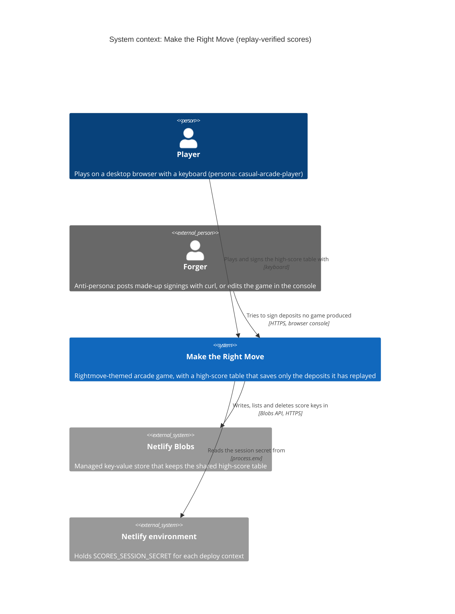
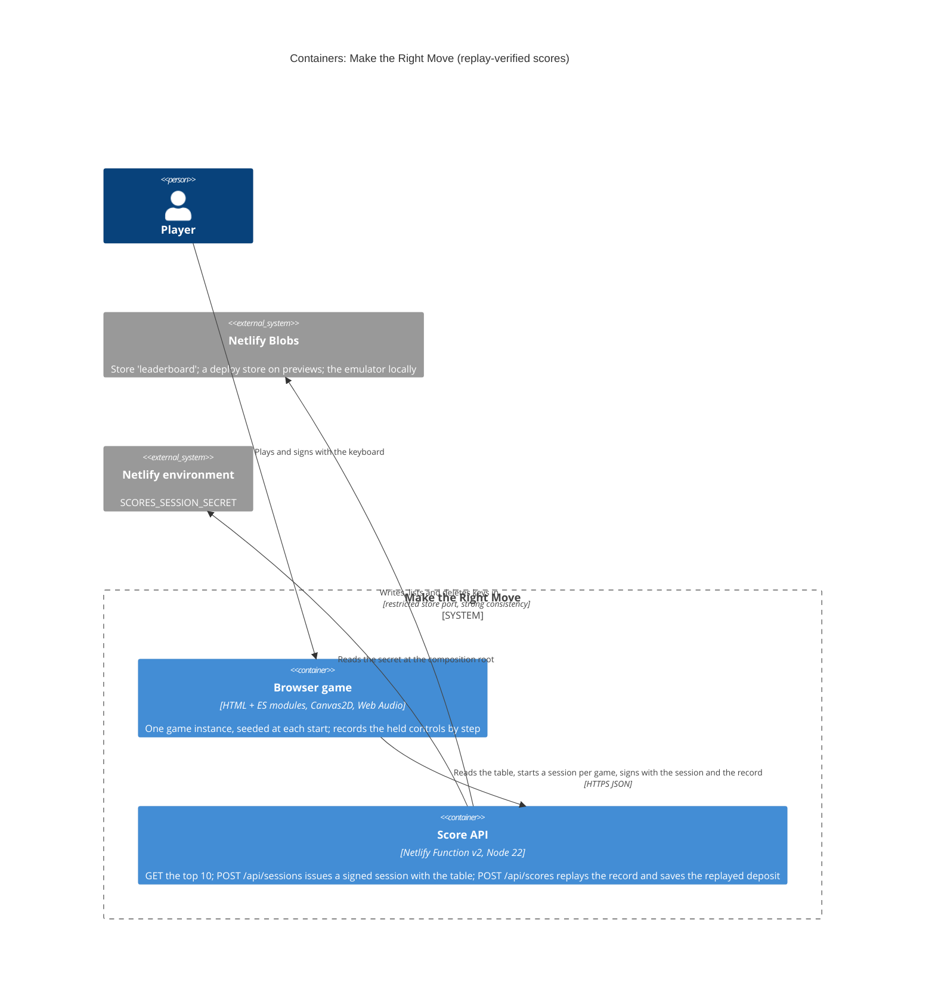
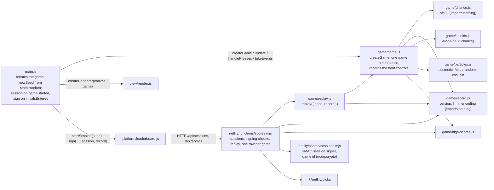

<!-- markdownlint-disable MD024 -->
# Feature delta: rightmove-invaders-replay-verified-scores

The shared high-score table stops trusting the deposit a browser claims. Each game asks the table's server for a **session** as it starts (S2 in the [forged-scores RCA](../../analysis/root-cause-analysis-forged-high-scores.md)), records the keys the player held at each simulation step, and sends that **record** with its signing. The function **replays** the game and saves the deposit the replay produces (S3). A deposit typed into a `curl` or changed in the browser console never reaches the table.

- **Type**: cross-cutting (the rules, the browser's table client and the Score API), a change to live functionality, brownfield. `rightmove-invaders-leaderboard` is in production since `144e23a`, with the plausible ceiling of PR #4 (`4d17123`). Branch `rightmove-invaders-replay-verified-scores`, cut from `main` at `4d17123`.
- **Density**: lean (Tier-1 only). **Research depth**: lightweight; the technical unknowns were probed instead ([probe findings](probe/findings.md)). **JTBD**: yes.
- **No DISCOVER or DIVERGE.** The trigger is an incident: forged deposits on 2026-10-26, analysed by the RCA (5 Whys), which recommends this feature. ADR-007's revisit trigger has fired.
- **SSOT**: [jobs.yaml](../../product/jobs.yaml) (J-TABLE-TRUST, new) · [persona](../../product/personas/casual-arcade-player.yaml) · [journey](../../product/journeys/play-a-session.yaml) (the start step, four error paths, two shared artifacts) · [leaderboard feature delta](../rightmove-invaders-leaderboard/feature-delta.md) · ADR-004 to ADR-008
- **Slices**: [slice 01, a session for every game](slices/slice-01-a-session-for-every-game.md) (walking skeleton) · [slice 02, the table replays the game](slices/slice-02-the-table-replays-the-game.md) · [slice 03, no faster than the clock](slices/slice-03-no-faster-than-the-clock.md)
- **Review**: three cycles on 2026-10-26.
  - **Cycle 1**: the product-owner reviewer rejected DISCUSS (2 blockers, 10 majors), and the architect reviewer asked for a revision of DESIGN (1 blocker, 9 majors). The user decided the three questions they raised (D2 confirmed, D14, D18).
  - **Cycle 2**: DISCUSS was rejected narrowly (one story with 8 scenarios), and DESIGN was conditionally approved (3 majors). The user accepted a deleted row's re-entry within its session's 2 hours (D7, D16).
  - **Cycle 3**: the product-owner reviewer approved DISCUSS. The architect reviewer's last open point, K10's budget with a replay, became D21.
  - **Approval**: the user approved D5–D21 and the DESIGN (ADR-010, ADR-011, DDD-R1–R17) on 2026-10-26. **DISCUSS and DESIGN are closed**; DISTILL is next.

---

## Wave: DISCUSS / [REF] Persona ID

`casual-arcade-player`: Alex Morgan (they/them). Plays for fun in 5–10 minute sessions on a MacBook Air, and checks the shared table after each game. The examples also use other players of the same segment: Priya Shah (long runs) and Sam Taylor (quick games, a tab left open all day).

Two roles appear in the examples, neither a persona of its own:
- **The owner** runs the site, reads the function's log and deletes rows by hand (the leaderboard's DEVOPS moderation guide).
- **A forger, signing as HAX** (the RCA's reproduction): a player who knows the browser console and `curl`. An anti-persona: every story turns them away, and D16 states what still gets through.

## Wave: DISCUSS / [REF] JTBD one-liner

When I look at the shared high-score table, I want every deposit on it to come from a game somebody really played, so that climbing it means something.

| Job | Opportunity | Stories |
|---|---|---|
| J-TABLE-TRUST (new: every row was really played) | 14 | US-01, US-03, US-05 |
| J-TABLE-SIGN (existing: sign quickly with my initials; here, no regression) | 11 | US-02, US-04, US-06 |

**Evidence level: one incident.** On 2026-10-26 a player put deposits of about £9,999,950 on the production table, with a `curl` and from the browser console (the RCA's Vectors A and B), and the owner deleted them (S0). There are no player interviews. The job's dimensions and forces are in `jobs.yaml`.

## Wave: DISCUSS / [REF] Locked decisions

| ID | Decision | Verdict |
|---|---|---|
| D1 | **The table saves the deposit the server replays.** The signing carries the game's record, and the table's server replays it. The deposit the browser claims is checked against the replay: if they differ, the signing is refused (`replay-mismatch`), logged, and nothing is saved. | Locked (user, 2026-10-26) |
| D2 | **The game picks its own seed, and asks for a session as it starts.** The game starts at once, with a seed of its own. In the background it asks the table's server for a session that binds that seed and the time the session was issued. This request takes over from today's table refresh at every game start (ADR-008), and its answer carries the refreshed table. **Choosing the seed helps a program**: the probe's bot scores a median of £46,100 over 100 seeds, and the best of 10 seeds averages £67,300 (+46 %), the best of 100 £75,100 (+63 %). A seed chosen by the server would not stop this: a forger can ask for 10 sessions a minute and keep only the best seed, which gets most of the gain. D16 names it. | Locked (user, 2026-10-26; confirmed the same day with the measured gain) |
| D3 | **A session is a token signed with a secret** (an HMAC), kept in the Netlify environment. The function writes nothing per game, and the restricted table port (ADR-004) stays as it is. Without the secret, the function issues no session and saves no signing, and its log says why. | Locked (user, 2026-10-26) |
| D4 | **The rows already on the production table stay.** The owner checked them after the cleanup (S0), and the key format doesn't change. The owner can still delete any row by hand. | Locked (user, 2026-10-26) |
| D5 | **No new wording or outcome in the game.** Every refused signing ends as today's "Couldn't confirm ALX's signing.", for a forger and for an honest player alike. The game still tells only OK from not OK (ADR-008), and the reason is in the function's log. An honest player should see it only in rare cases: D11, D12, D18, D19 and US-06, and any `too-fast` or `replay-mismatch` that K23 traces to a bug. **Recovery is by reloading the page**, which the release note says. | PO default; approved by the user, 2026-10-26 |
| D6 | **No signing without a session.** A signing with no session, or with a session whose signature doesn't check, is refused and saves nothing. | PO default; approved by the user, 2026-10-26 |
| D7 | **One game, one row.** A game, named by its seed, has at most one row on the table. A signing for a game whose row is on the table is refused (`already-signed`), whatever session it carries, and however many arrive at once. A game *signs* when its row is saved: a refused attempt doesn't use up its session. **A row that has left the table** (pruned, or deleted by the owner) can be signed again with a session still within its 2 hours (D18). | PO default, approved by the user, 2026-10-26; the re-entry within 2 hours was the user's own decision, the same day |
| D8 | **No game faster than the clock.** The game time in a record can't exceed the time since its session was issued, plus an allowance of 10 s for the session's own trip (its 5 s timeout, plus a margin). A longer record is refused (`too-fast`). A forger can compute a 20-minute game offline in seconds, but can sign it no sooner than 20 minutes after its session was issued. **This costs each forged game its length, not each forged row**: sessions can be asked for ahead of time and in parallel, so one wait can unlock several rows, as many as the rate limit lets through (D16). | PO default; approved by the user, 2026-10-26 |
| D9 | **Games of up to 60 minutes of game time are verified.** An honest record of that length always fits the request, at human pace (D20). A longer record is refused before it is replayed (`game-too-long`), so no request can keep the function replaying for long. The probe's bot scores £2,800–£4,700 a minute, so £170,000–£280,000 in 60 minutes, extrapolated from games of up to 17 minutes; an expert may score more. The ceiling of £500,000 (D14) is the owner's judgement, about 1.8 times the probe's best rate over 60 minutes: a verified game above it is refused as `implausible-score`, and K23 traces any such refusal. | PO default; approved by the user, 2026-10-26 |
| D10 | **A game is verified with the rules it was played with.** A record names its rules version. A record from other rules is refused without replay (`rules-changed`), for example when a deploy changed how the game plays while the page was open; a reload fixes it. A change to how the game plays is deliberate: a check on recorded games fails the build when a recorded game replays differently and the version wasn't raised. | PO default; approved by the user, 2026-10-26 |
| D11 | **A game whose session never arrived** (a failure, or no answer within the 5 s timeout) plays as usual, and still asks for initials when its deposit makes the table. Its signing ends "Couldn't confirm". | PO default; approved by the user, 2026-10-26 |
| D12 | **A page loaded before the release** signs in the old shape, is refused, and shows "Couldn't confirm"; a reload fixes it (D5). Accepted for release day. | PO default; approved by the user, 2026-10-26 |
| D13 | **Same rules, same look.** Speeds, timings, scores, art and sound are unchanged. The gameplay draws come from the game's seed instead of `Math.random`, so each game's random sequence is new, and the house erosion compares squared distances instead of calling `Math.hypot`, which decides every cell the same way (to be checked exhaustively: DESIGN's 49-cell test). The particles stay random, because they never touch the gameplay. Pause, M, N, the initials and the table lines are unchanged. | PO default; approved by the user, 2026-10-26 |
| D14 | **The plausible ceiling rises to £500,000**, and applies to the replayed deposit. It moves only once the replay is in place (slice 02): before that, £250,000 (PR #4) is the only check on a deposit. The table's other checks stay: JSON only, the word filter and the £50 step. The game asks for initials only when its deposit makes the table (`makesTheTable`), now up to £500,000. | Locked (user, 2026-10-26) |
| D15 | **Every refusal is logged with a fixed reason** (the RCA's RC4), in the one log line per request the function already writes. The line never carries the record, the seed, the session or its token, initials or an IP (DDD-17). | PO default; approved by the user, 2026-10-26 |
| D16 | **Accepted residual risk, stated in ADR-010: a program that plays well.** The seed is the game's own and the rules are public, so a program can play in real time, or search offline for the inputs that do best with a seed, and try many seeds to keep the best (D2: +46 % for the best of 10). It is still held to the rules of the game, to the game's length in real time (D8), to one row per game (D7), to the session's lifetime (D18), to the rate limit and to the £500,000 ceiling. The rate limit is what bounds how fast. It is counted per IP and per hostname, and a row takes two requests (a session and a signing). K14's baseline measured about 13 accepted a minute at a steady 2 a second, but up to about 78 a minute at 20 a second, because of Netlify's enforcement lag. **So after one wait, one fast IP can sign up to about 39 rows a minute on each hostname that serves production**: the custom domain, `<site>.netlify.app` unless it redirects, and the published deploy's permalink if its ID is known. The user re-accepted this with the measured numbers, 2026-10-26, after the DEVOPS review. The owner still deletes rows by hand. Within its session's 2 hours, the same request can put a deleted row back (accepted by the user, 2026-10-26); after that, only a new session and a new wait can. The moderation guide says to delete again after the 2 hours, or to rotate the secret, which ends every session at once. Ruling the risk out would take anti-bot measures far beyond this project. | PO default; approved by the user, 2026-10-26 |
| D17 | **Slice 02 is over the 1-day carpaccio target** (about 3–3½ days with its enabling tasks), and stays one slice (Scope assessment). | PO default; approved by the user, 2026-10-26 |
| D18 | **A session expires 2 hours after it was issued.** A signing with an older session is refused (`session-expired`). That covers 60 minutes of game time and long pauses; a game left paused for more than about an hour can't be signed. | Locked (user, 2026-10-26) |
| D19 | **Quick restarts can run into the rate limit.** The function allows 10 requests a minute per IP and hostname: about 13 at a steady pace, with Netlify's lag (K14's baseline). A game start made one request before this feature too (the refresh, counted even when the CDN answered it: K14's baseline), so the rate is unchanged. **What changes is the consequence**: a refused refresh cost nothing, but a refused session leaves its game unsignable, and its signing ends "Couldn't confirm" (D11). A player who loses in 4 seconds and restarts 2 seconds later starts about 10 games a minute, and the 11th in that minute gets no session. On the production table such quick games don't qualify, so the exposure is a qualifying game started within a minute of about nine other requests from the same IP (quick games, a signing, a page load, or colleagues behind one office IP). It is accepted; the preview measures it (K14), and if it bites, `/api/sessions` gets a function and a rate limit of its own (ADR-007's existing plan for splitting). | PO default; approved by the user, 2026-10-26 |
| D20 | **Human pace**, for the record's size: up to 15 changes of held keys a second, sustained. The probe's bot that decides every 100 ms makes 6.5–7, one that decides every 50 ms 12–13, and a program that changes keys at every step 26–33. | PO default; approved by the user, 2026-10-26 |
| D21 | **A signing may take a little longer.** The function now replays each game before it saves it. K10's budget (the p95 of a POST and a GET, timed together, on a preview), 1000 ms today with a measured 924 ms, can't also hold a replay. For this feature it becomes **1,250 ms**, with the POST signing a 10-minute record, and the 10-minute replay's own p95 is under **250 ms**. If either misses on slice 02's preview, DESIGN reopens. "Signing ALX…" still shows at once, and the 5 s timeout is unchanged. | PO default; approved by the user, 2026-10-26 |

## Wave: DISCUSS / [REF] Scope assessment

**PASS (right-sized), with one recorded exception: slice 02 is over the 1-day carpaccio target (D17).** The feature has 6 stories in 3 slices. It touches three modules that already talk to each other: the rules (`src/game/`), the browser's table client (`src/platform/leaderboard.js`, wired in `main.js`) and the Score API (`netlify/functions/scores.mjs`). The walking skeleton adds one integration point, the session request, and one piece of configuration, the secret.

**Estimate: about 5½ days of DELIVER.** The stories and their **enabling tasks** (E1–E6): work that ships no value on its own, so it is no story or slice. Each enabling task lands as a precursor commit inside its slice, before its story's value commits, is traced to the story it enables and its job, and has one acceptance line (below, under its story). The carpaccio hard gate doesn't apply, because every slice carries value stories.

| Slice | Story or enabling task | Estimate |
|---|---|---|
| 01 | US-01 | ½ day |
| 01 | US-02 | ½ day |
| 01 | E1: the local secret, and the test seeding route (enables US-01) | 2 h |
| **01** | | **about 1¼ days** |
| 02 | E2: seeded gameplay draws and squared distances (enables US-03) | 2 h |
| 02 | E3: a game the function can create afresh, with the test harnesses moved to it (enables US-03) | ½–1 day |
| 02 | E4: the record, and the layering rules (enables US-03) | 2 h |
| 02 | E5: the recorded-games corpus (enables US-03, US-06) | ½ day |
| 02 | US-03 | 1 day |
| 02 | US-04 (with the ceiling, D14) | ½ day |
| **02** | | **about 3–3½ days** |
| 03 | E6: the lenient clock for the local test boards (enables US-05) | 1 h |
| 03 | US-05 | ½ day |
| 03 | US-06 | ½ day |
| **03** | | **about 1 day** |

**Why slice 02 stays one slice**: replay is worthless without E2–E5, and they are worthless without replay. The slice ships them with the value they enable.

## Wave: DISCUSS / [REF] Player-facing wording

**None new** (D5). Every refused signing uses today's unconfirmed message, `Couldn't confirm ALX's signing.`, on the canvas and in the status mirror. A forger using `curl` gets an error message naming the reason (its shape is in DESIGN). The release note tells players to reload a page left open since before the release.

## Wave: DISCUSS / [REF] Story map and slice order

Backbone, the journey's steps in [play-a-session](../../product/journeys/play-a-session.yaml): **start → play → game over and sign → the table answers**.

| Start | Play | Game over and sign | The table answers |
|---|---|---|---|
| The game asks for its session without waiting (US-02) | The keys held at each step are recorded (US-03) | The signing carries its session (US-02) and its record (US-03) | No session, an altered one or an expired one: refused (US-01) |
| The session's answer refreshes the table (US-02) | *Unchanged*: same rules, same look (D13) | A signing waits for a late session, never the frame (US-02) | The same game twice: refused (US-01) |
| A game without a session still plays (US-02) | | | The claimed deposit isn't the replayed one: refused (US-03) |
| | | | A long game fits and is verified in time (US-04); over 60 minutes, refused |
| | | | Faster than the clock: refused (US-05) |
| | | | Other rules: refused cleanly (US-06) |

**Walking skeleton**: slice 01. It extends the leaderboard's skeleton ("A house-hunter signs the high-score table and another house-hunter sees it") instead of adding a parallel one: the skeleton's game now asks for a session as it starts, its signing carries it, and a signing with no session doesn't reach the table (WS strategy, below).

| Order | Slice | Stories | Why this position |
|---|---|---|---|
| 1 | [01 A session for every game](slices/slice-01-a-session-for-every-game.md) (walking skeleton) | US-01, US-02 | The thinnest end-to-end path, and the RCA's recommended skeleton. It carries the Netlify unknowns: the secret in each deploy context, two paths on one function and its rate limit, and one row per game under simultaneous signings on real Blobs. The probe is evidence on a patched copy of the rules; K21 retires determinism for the shipped code, in slice 02. Turns away the laziest forgery, a `curl` with no game |
| 2 | [02 The table replays the game](slices/slice-02-the-table-replays-the-game.md) | US-03, US-04 | The core value: a forged deposit, by `curl` or console, is refused. The largest slice, because of its enabling tasks |
| 3 | [03 No faster than the clock](slices/slice-03-no-faster-than-the-clock.md) | US-05, US-06 | Closes the forger's last cheap shortcut (a game computed offline, signed at once), and keeps the next gameplay change from refusing honest players without saying why. Both checks need slice 02's record |

**Priority rationale**: value × urgency / effort (days) scores the three slices alike: slice 01, 2 × 5 / 1¼ = 8; slice 02, 5 × 5 / 3 ≈ 8.3; slice 03, 3 × 3 / 1 = 9. So the order follows dependency (slice 02 needs slice 01's session, slice 03 needs slice 02's record) and risk (slice 01 carries the Netlify unknowns).

**Carpaccio taste tests**:
- **Thin**: slices 01 and 03 extend existing components. Slice 02 adds one new concept, the record, and turns the rules into something the function can create afresh: the recorded exception (D17).
- **A new abstraction first**: the record and a game the function can create afresh are enabling tasks E3 and E4: precursor commits inside slice 02, before US-03's value commits, traced to US-03. The hard gate doesn't apply, because the slice carries value stories.
- **Each slice can disprove something**: see each brief's learning hypothesis.
- **Production data**: every slice runs on the real page, in real browsers, against the deploy preview's real function and Blobs, with the preview's own secret.
- **No two slices are the same thing at different scales.** **PASS**, with the slice 02 exception.

## Wave: DISCUSS / [REF] User stories

### US-01: The owner's table turns away a signing that no game asked for

`job_id: J-TABLE-TRUST` · slice 01 · about ½ day, plus E1

On 2026-10-26 a forger signed £9,999,950 as HAX with one `curl` and no game. Since PR #4 the table refuses anything above £250,000, but the same `curl` with £249,950 still lands at #1 for everyone, until the owner deletes it by hand.

#### Elevator Pitch

Before: `curl -X POST https://maketherightmove.fabiodamico.xyz/api/scores -H 'content-type: application/json' -d '{"initials":"HAX","score":249950}'` → 200, and HAX is #1 on everyone's table.
After: the same `curl` → `400 {"error":"session-required"}`; `GET /api/scores` shows the table unchanged; the function's log line for it reads `scores.rejected` with the reason `session-required`.
Decision enabled: the owner decides whether any row left on the table needs deleting, using the log's count of refusals by reason.

**Domain examples**

1. *No session*: the table holds KIM £2,000. HAX posts `{ "initials": "HAX", "score": 249950 }` with no session. It is refused, and the table still holds only KIM.
2. *An altered session*: HAX asks for a session, then moves its issue time an hour earlier, to look like a long game. The signature no longer checks, so it is refused, and nothing is saved.
3. *The same game twice*: Alex signs ALX £1,250. HAX copies that request and sends it again with the initials XAH, then asks for a second session for the same seed and sends it once more. Both are refused, and the table shows ALX £1,250 once.
4. *An old session*: the owner deletes a row HAX signed at 10:00. At 12:30, HAX re-sends the same request. Its session is more than 2 hours old, so it is refused.

**UAT scenarios**

1. *A signing without a session is refused.* Given the high-score table holds KIM £2,000, When a signature of HAX £249,950 arrives with no session, Then it is refused as `session-required`, and the table still holds only KIM £2,000.
2. *A session the table didn't issue is refused* (outline: the issue time changed; the seed changed; the token changed; the token cut short; a session made up from nothing; a session that isn't an object). Given the table holds KIM £2,000, When a signature arrives with `<a session altered this way>`, Then it is refused as `invalid-session`, and the table still holds only KIM £2,000.
3. *A game has one row on the table* (outline: the same session; another session for the same seed). Given Alex's game has signed ALX £1,250, When another signing for that game arrives with `<this session>` and the initials XAH, Then it is refused as `already-signed`, and the table shows ALX £1,250 once, also when read while the refusal is under way.
4. *One game, many signings at once, one row at most.* Given an empty table, When 5 signings for the same game arrive at the same moment, Then the table never shows more than one row for that game, at any moment.
5. *A refused attempt doesn't use up the session.* Given a signing for Alex's game was refused before anything was saved (the store failed to write it: 500, logged `put-failed`), When Alex's game is signed again with the same session, Then ALX is saved.
6. *A session lasts 2 hours* (outline: 1 h 59 min, a game that hasn't signed → saved; 1 h 59 min, a game whose row the owner deleted → saved again, the accepted re-entry of D7 and D16; 1 h 59 min, a game whose row the table pruned → saved again, below the top 10; 2 h 1 min → refused as `session-expired`). Given a session issued `<this long>` ago for `<this game>`, When its signing arrives, Then the outcome is `<as listed>`.
7. *No secret, no session.* Given the function has no secret configured, When a game asks for a session, or a signing arrives, Then no session is issued, nothing is saved, and the log names the missing secret as the reason.

Each refusal scenario above also checks its log line: one line, with its fixed reason, and no session, token, seed, initials or IP.

**Acceptance criteria**

- [ ] A signing with no session, with a session whose signature doesn't check after any field was changed, or with a session older than 2 hours, is refused and saves nothing. (UAT 1, 2, 6)
- [ ] A game has at most one row on the table: a signing for a game whose row is on the table is refused, whatever session it carries. However many arrive at once, the table never shows two rows for one game, even for an instant. (UAT 3, 4)
- [ ] A refused attempt doesn't use up its session, and a row that left the table can be signed again within the session's 2 hours. (UAT 5, 6)
- [ ] With no secret configured, the function issues no session and saves no signing, and its log names the cause. (UAT 7)
- [ ] Every refusal writes one log line with its fixed reason, and never the session, its token, the seed, the record, initials or an IP. (UAT 1–7)
- [ ] A refused signing changes nothing a reader of the table can see, including a read made while the refusal is under way. The one exception is a race between signings of one game arriving at once, which only a forger sends: the row shown for that game can change for a moment, but there is never more than one (UAT 4). (UAT 1–3, 6) A signing whose row was saved but whose answer then failed (the listing after the write failed: 500 `list-failed`) is not a refusal: its row stays, and its game has signed (ADR-008's saved-but-unconfirmed case).

**Enabling task E1** (J-TABLE-TRUST): the local server makes its own secret at each start, and gives the tests a way to put other house-hunters' rows on a test board without a game. *Acceptance*: the existing scenarios that arrange rows pass through it, and it exists only in the local server, never in the function.

**Outcome KPI**: K20 (forgeries are refused).
**Technical notes**: today the body must be exactly `{ initials, score }` (`isValidSignature`, ADR-006), read with a 1 KB cap (DDD-5); it grows here. The session's shape, the reason codes and the status codes are DESIGN's. One row per game can't use a second key family in the store, because D3 keeps the table port as it is (DESIGN DDD-R4). The secret must reach the function in every deploy context that has a table: production, deploy previews and branch deploys. In slice 01 the deposit itself is still unchecked beyond its shape and the £250,000 ceiling: a forger who first asks for a session can still claim £249,950. Slice 02 closes that.
**Dependencies**: none beyond PR #4 (merged).

### US-02: Alex's game gets its session as it starts, without waiting

`job_id: J-TABLE-SIGN` · slice 01 · about ½ day

Alex starts a game a few seconds after the page loads, sometimes just after the site was updated, when the table's server is slow to answer the first time. Today the start never waits on the network, and the table is refreshed in the background (ADR-008). Sessions must not change that.

#### Elevator Pitch

Before: press Enter on the title → the formation appears at once, and the game refreshes the table in the background (`GET /api/scores`).
After: press Enter on the title → the formation appears at once, as today, while one request in the background, `POST /api/sessions`, brings this game's session and the refreshed table; at game over with £1,250, type `alx` and press Enter → "Signing ALX…", then "Signed ALX, #3.".
Decision enabled: Alex decides to sign the moment the prompt appears, without waiting for anything, and starts the next game straight away.

**Domain examples**

1. *Happy path*: the table holds KIM £2,000, LEO £1,500 and TED £1,000. Alex's game asks for its session as it starts, and the answer arrives within a second. Alex loses with £1,250, types `alx`, presses Enter and reads "Signed ALX, #3.".
2. *A slow first answer*: just after a deploy, the first request takes about 1 s. Alex has already pressed Enter, and the formation is marching. The session arrives a second later, and nothing on screen changes.
3. *A quick game*: Sam loses after 4 seconds with £50, which makes the deploy preview's empty table, and types `sam` and Enter before the session's answer is back. "Signing SAM…" shows at once. The signing goes out as soon as the session arrives, and Sam reads "Signed SAM, #1.".
4. *No session*: Alex is on a train, and the session request fails. The game plays on. At game over with £1,250, Alex is asked for initials (the table loaded at page load), signs, and reads "Couldn't confirm ALX's signing." at once.

**UAT scenarios**

1. *Typed initials sign the table through the game's session.* Given the high-score table holds KIM £2,000, LEO £1,500 and TED £1,000, When Alex finishes a game with £1,250, types "alx" and presses Enter, Then the game tells them "Signing ALX…" and then "Signed ALX, #3.", and the ALX row is marked as theirs.
2. *The game starts at once, whatever the session request does* (outline: it answers at once; it answers after 3 s; it fails; it never answers). Given the title screen, When Alex presses Enter while the session request `<does this>`, Then the formation appears and starts marching straight away.
3. *One request per game start.* Given the page has loaded, When Alex starts a game, Then the game makes exactly one request to the table's server for it, and the table rows in its answer replace the ones shown, under the listing-time rule (ADR-008).
4. *A signing waits for a late session.* Given Sam's game is over with £50 on an empty table, and its session request hasn't answered yet, When Sam types "sam" and presses Enter, Then the game tells them "Signing SAM…" at once, and "Signed SAM, #1." once the session has arrived and the signing has been answered.
5. *A game without a session* (outline: the session request failed before the signing → "Couldn't confirm" at once; it fails after the signing was pressed → as soon as it fails; it never answers → when its 5 s timeout ends). Given Alex's game is over with £1,250 and its session request `<did this>`, When Alex signs ALX, Then the game tells them "Couldn't confirm ALX's signing." `<then>`, and the table has no ALX row.

**Acceptance criteria**

- [ ] Starting a game never waits on the session: the formation appears and marches at once, whatever the request does. (UAT 2)
- [ ] Each game start makes exactly one request to the table's server. Its answer refreshes the table as today's refresh did, under the listing-time rule. (UAT 3)
- [ ] A signing carries the session of the game it signs. When that session hasn't arrived yet, the signing waits for it (pending shows at once), and no frame waits. (UAT 1, 4)
- [ ] A game whose session failed or timed out plays as usual, and its signing ends unconfirmed as soon as both have happened: the signing pressed, and the session request failed or timed out (5 s after the game started, at the latest). (UAT 5)
- [ ] The signing lifecycle, the wording and the table's behaviour are otherwise unchanged: the leaderboard's walking skeleton and scenarios, and the typed-initials scenarios, stay green (guardrails). (UAT 1)

**Outcome KPI**: K25 (a game's session comes back quickly); K10 and K15 as guardrails.
**Technical notes**: today `main.js` reads the table on `gameStarted` (`loadTable`) and signs on `initialsEntered` (`signTable`). The seed must be known before the first gameplay draw, which happens as the first wave is set up, so it comes from the game and not from the answer (D2). The session request has the same 5000 ms timeout as every table request (DDD-13), and the signing's own 5000 ms start when it is sent. The function's rate limit is 10 requests per 60 s per IP, across all its requests (ADR-007). Cache hits count toward it: `kpi-contracts.yaml`, K14's baseline, step 9, measured on deploy-preview-1 (2026-10-25). So the session, which replaces the game-start refresh, leaves the count per game unchanged, but it always runs the function (D19, K15).
**Dependencies**: US-01 (the session's issuer and its check).

### US-03: A deposit changed in the browser never reaches the table

`job_id: J-TABLE-TRUST` · slice 02 · about 1 day, plus E2–E5

The RCA's second forgery: during a game, `(await import('/src/game/game.js')).g.score = 4242400` changed the HUD, and the game's own client then signed that deposit. After slice 01, a forger can also ask for a session with `curl` and claim any deposit under £250,000.

#### Elevator Pitch

Before: in the browser console during a game, `(await import('/src/game/game.js')).g.score = 249950` → the HUD shows £249,950, and at game over "Signed HAX, #1.".
After: Alex's honest game, at game over type `alx` and Enter → "Signed ALX, #3." with the deposit the game showed; the same console line, or any other change made to the game in the browser → at game over "Couldn't confirm HAX's signing.", the function's log reads `replay-mismatch`, and the table is unchanged.
Decision enabled: the owner decides, for each `replay-mismatch` in the log, whether it is a forgery to ignore or a determinism bug to fix (K23 investigates each one), knowing that no deposit reached the table without its game.

**Domain examples**

1. *The console*: HAX sets the deposit to £249,950 mid-game, loses with "Offer rejected" and signs. The replay ends at £350, so the signing is refused and nothing is saved.
2. *A record made up by hand*: HAX asks for a session, then posts a record of 30 seconds of standing still, claiming £249,950. The replay ends with £0, so it is refused.
3. *Honest*: Alex's game ends at £1,250. The function replays the record to £1,250, ending at the same step, and Alex reads "Signed ALX, #3.".
4. *Extra homes*: HAX gives the pin 99 homes from the console and plays on for 20 minutes, to £80,000. The replay loses its third home after 3 minutes with £9,350, while the record goes on, so it is refused.

**UAT scenarios**

1. *An honest game's deposit is the deposit the table saves.* Given the table holds KIM £2,000, LEO £1,500 and TED £1,000, When Alex finishes a game with £1,250 and signs ALX, Then the table saves ALX £1,250 at #3, and the game tells them "Signed ALX, #3.".
2. *A deposit the game didn't produce is refused* (outline: changed in the console; claimed by `curl` with a made-up record; a deposit claimed above what the record plays to). Given the table holds KIM £2,000, When a signing claims HAX `<deposit>` with a record that plays to `<replayed deposit>`, Then it is refused as `replay-mismatch`, and the table still holds only KIM £2,000.
3. *A record must end where its game ended* (outline: it stops before game over; it goes on after the replay's game over). Given the table holds KIM £2,000, When a signing's record `<ends this way>`, Then it is refused, and the table still holds only KIM £2,000.
4. *A record that isn't a record is refused before any replay* (outline: not text; unknown key letters; steps out of order; no rules version). Given any table, When a signing carries `<such a record>`, Then it is refused, nothing is saved, and the log shows it was never replayed.
5. *The ceiling, before any replay* (outline: £500,000 claimed with a record that plays to £1,250 → refused as `replay-mismatch`, so the ceiling let it through to the replay; £500,050 claimed → refused as `implausible-score`, and the log shows it was never replayed). Given a valid session and a record, When a signing claims `<deposit>`, Then the outcome is `<as listed>`.
6. *The same game in every browser* (outline: the recorded-games corpus, replayed in each browser; the games the browser scenarios play and sign). Given `<these games>`, When they are replayed in Chromium, Firefox, WebKit and by the function, Then each ends at the same deposit and the same step everywhere, and at the deposit the browser showed.

**Acceptance criteria**

- [ ] The table saves the deposit the replay produces, and only when it equals the deposit claimed. Otherwise the signing is refused as `replay-mismatch`, and nothing is saved. (UAT 1, 2)
- [ ] A record whose replay doesn't reach game over exactly at its last step is refused. (UAT 3)
- [ ] A malformed record is refused before it is replayed. (UAT 4)
- [ ] The deposit must meet the existing rules, a positive multiple of £50, and the new ceiling of £500,000 (D14), which is checked on the claim before any replay. (UAT 5)
- [ ] A game replays to the same deposit and game-over step in Chromium, Firefox, WebKit and the function, and a game played in a browser replays on the function to the deposit the browser showed (K21). (UAT 6)
- [ ] Same rules, same look (D13): the existing rules scenarios and unit properties stay green (guardrails), and squared distances decide every erosion cell as `Math.hypot` did (DESIGN's exhaustive check). (UAT 1, 6)

**Enabling tasks** (J-TABLE-TRUST), each a precursor commit before US-03's value commits, each leaving the suite green:
- **E2**: every gameplay draw from the game's seed; particles on a source of their own; squared distances in erosion. *Acceptance*: the determinism scan (a layering-test rule: outside `particles.js`, `src/game/` and `src/theme/` use no engine-dependent maths, no `Math.random`, no clock) passes, and the erosion check passes.
- **E3**: a game the function can create afresh for each check, with the views and the test harnesses moved to it. *Acceptance*: the suite is green, and the page's modules expose no live game.
- **E4**: the record, kept from the game's start to its game over; the layering rules that let the function import the replay. *Acceptance*: every game recorded in Node replays to game over exactly at its last step, with its deposit; the layering test covers the amended rules.
- **E5**: the recorded-games corpus: bot games of 1 to over 15 minutes, made in Node with a test bot, kept as fixtures. *Acceptance*: it replays in Node in the build gate, and in each of the three browsers (K21).

**Outcome KPI**: K20 (forgeries are refused), K21 (honest games replay to their own deposit).
**Technical notes**:
- **What the record must hold.** At each fixed step, the rules read three controls through `keys.isDown`, in `movePlayer` (`game.js`): left (ArrowLeft or A), right (ArrowRight or D) and fire (Space). Nothing else reaches the gameplay. A paused game runs no steps, and M, N, P and the initials never touch it. So the record is the three held controls by step index, from the game's start to its game over: no presses, pauses, initials or seed. The seed comes from the session alone. The probe measured 0.8–1.6 KB a minute at human pace ([findings](probe/findings.md)).
- **What has to change.** Every gameplay draw is `Math.random` today: 8 sites in `game.js` (enemy fire, the Dream Home) and erosion in `shields.js`. `Math.hypot` is used at `shields.js:43`. The rules live in a module-level `g`, which the views read and the tests reach through `snapshot()` and `tests/unit/support/fresh-game.js`. ADR-006 rule 5 lets `netlify/**` import only `high-scores.js` from `src/`.
- **Whether the console line still runs** (Example 1) is DESIGN's. The story asks only that what it changes never reaches the table.

**Dependencies**: US-01 and US-02 (the session that binds the seed).

### US-04: Priya's long game still signs, in the usual time

`job_id: J-TABLE-SIGN` · slice 02 · about ½ day

Priya Shah is the best player in the office, and a good run lasts 25 minutes. Its record is about 20–40 KB (the probe's 0.8–1.6 KB a minute at human pace), and the table reads at most 1 KB of a signing today.

#### Elevator Pitch

Before: a signing is two fields, well under the table's 1 KB cap.
After: after a 25-minute game worth £120,000, type `pri` and press Enter → "Signing PRI…", then "Signed PRI, #1." within the usual wait, well inside the game's 5 s timeout.
Decision enabled: Priya decides to keep a long run going rather than bank a shorter one, knowing it can still be signed.

**Domain examples**

1. *A long run*: Priya plays 25 minutes for £120,000, about £4,800 a minute (above the probe bot's best), with a record of about 40 KB, and reads "Signed PRI, #1.".
2. *The longest verified game*: a game of 60 minutes of game time would sign. No bot has played one yet (the probe's longest lasted 17 minutes before the formation reached the pin), so K22 measures the longest recorded game and scales it to 60 minutes: under 1 s is expected.
3. *Too long*: a 61-minute record is refused without being replayed (`game-too-long`), and so is a program's record claiming 100 hours.
4. *Too big*: a body over the new cap is refused as `payload-too-large`, and the function stops reading it at the cap.

**UAT scenarios**

1. *A long game signs.* Given an empty table and the corpus's longest game (at least 15 minutes), When it is signed with a session for its seed, Then it is saved with its deposit, at #1.
2. *The 60-minute limit* (outline: a record of exactly 432,000 steps, 60 minutes → it is read and replayed; 432,001 steps → refused as `game-too-long`, and the log shows it was never replayed). Given a valid session, When a signing carries a record of `<this length>`, Then the outcome is `<as listed>`.
3. *The longest record at human pace fits.* Given a generated record of 60 minutes at 15 key changes a second (D20), with its changes spaced to need the most characters (about 119 KB), When it is posted, Then its body is under the cap and it is not refused as `payload-too-large`.
4. *The body cap* (outline: a body exactly at the cap → read and checked; one byte over → refused as `payload-too-large`, and no more than the cap is read). Given a body of `<this size>`, When it is posted, Then the outcome is `<as listed>`.

**Acceptance criteria**

- [ ] An honest record of up to 60 minutes of game time at human pace (D20) fits the request and is verified, and its deposit is saved when it is at most £500,000. (UAT 1, 3)
- [ ] A record of more than 60 minutes is refused without being replayed. (UAT 2)
- [ ] A body over the new cap is refused, and is never read past the cap. (UAT 4)
- [ ] On a deploy preview, the longest recorded game is verified within the game's 5 s signing timeout, and its replay time, scaled to 60 minutes, is under 1 s (K22, measured on slice 02's preview). (UAT 1)

**Outcome KPI**: K22 (a long game is verified in time on Netlify).
**Technical notes**: the probe replayed 72,000 steps (10 minutes) in about 50 ms in Node 22, so about 0.3 s for 432,000 steps (60 minutes) on an M4 Pro; Netlify's CPU is unmeasured. Legacy Free bills invocations, not CPU time. A program that changes keys at every step writes about 4 KB a minute, and the cap doesn't have to hold it for an hour. The encoding and the cap are DESIGN's. The ceiling's move from £250,000 to £500,000 ships here, with the replay (D14), in `high-scores.js`, so the game and the function move together.
**Dependencies**: US-03.

### US-05: A game computed offline can't beat the clock

`job_id: J-TABLE-TRUST` · slice 03 · about ½ day, plus E6

After slice 02, HAX can't claim a deposit: the record has to produce it. But HAX's game uses a seed HAX chose, and the rules are public, so a program can search for a high-scoring record offline, in seconds. The session knows when the game began.

#### Elevator Pitch

Before (after slice 02): HAX asks for a session, computes a 20-minute record worth £80,000 in a few seconds, and posts it a minute later with `curl -X POST …/api/scores` → 200, and HAX is #1.
After: the same `POST /api/scores` → `400 {"error":"too-fast"}`, and the table is unchanged; HAX would have to wait 20 minutes from the session's issue.
Decision enabled: the owner sees that each forged game now costs its forger the game's length in real time, and decides from the log whether the rate limit (D16) needs tightening.

**Domain examples**

1. *Computed offline*: HAX's 20-minute record is signed one minute after its session was issued, and is refused.
2. *Honest and quick*: Alex's 4-minute game is signed 10 s after game over, and is saved.
3. *A long pause*: Alex pauses for 10 minutes mid-game. The time since the session grows, the game time doesn't, and the signing is saved.
4. *A slow session*: the session's answer took 4 s, so the session was issued 4 s after the game started. The game time is up to 4 s longer than the time since the session, inside the allowance, and the signing is saved.

**UAT scenarios**

1. *A record longer than the time since its session is refused.* Given a session issued 60 s ago, When a record of 20 minutes of game time is signed with it, Then it is refused as `too-fast`, and nothing is saved.
2. *The allowance, exactly* (outline: game time = time since the session + the allowance → saved; one second more → refused as `too-fast`). Given a session issued `<so long>` ago, When a record of `<this game time>` is signed, Then the outcome is `<as listed>`.
3. *An honest game is never too fast* (outline: signed at once after a short game; the session issued 4 s after the start; a 10-minute pause). Given Alex's game `<played this way>`, When Alex signs ALX, Then the signing is saved.
4. *The browser's clock plays no part.* Given the same game and signing, When they are sent from a browser whose clock is an hour off, Then the outcome is the same as with a correct clock.

**Acceptance criteria**

- [ ] A record whose game time exceeds the time since its session was issued, beyond the allowance, is refused as `too-fast`, and nothing is saved. (UAT 1, 2)
- [ ] An honest game is never refused as too fast, whatever its pauses, and whatever the session's delay up to its 5 s timeout. (UAT 3)
- [ ] The outcome doesn't depend on the browser's clock. (UAT 4)

**Enabling task E6** (J-TABLE-TRUST): the local server lets the browser scenarios, which play on a fake clock much faster than real time, through the clock check, without weakening production. *Acceptance*: the browser scenarios that sign pass with it, US-05's own scenarios pass without it, and the function has no such switch.

**Outcome KPI**: K20, K23 (honest players are never refused).
**Technical notes**: the check compares the record's game time (steps × 1/120 s) with the function's clock minus the session's issue time, both the server's; the signing carries no time of the browser's. Function instances can disagree by a few ms (ADR-008's accepted edge), well inside the allowance.
**Dependencies**: US-03 (the record's game time is trusted only once it is replayed).

### US-06: A game played on yesterday's rules is turned away cleanly

`job_id: J-TABLE-SIGN` · slice 03 · about ½ day

Sam keeps the game open in a tab all day. If a deploy changes how the game plays while Sam's tab is open, the new function replays Sam's record under new rules, and gets another game. Sam's signing must end with a reload putting things right, and the owner must see a version change in the log, not something that looks like a forgery.

#### Elevator Pitch

Before (after slice 02): a deploy that changes how the game plays while Sam's tab is open → Sam's next signing is refused as `replay-mismatch`, which reads like a forgery in the log.
After: Sam's signing → "Couldn't confirm SAM's signing.", with the log reason `rules-changed`; after a reload, Sam's next game signs as usual.
Decision enabled: the owner tells forgeries from version changes in the log, and picks a quiet moment for a deploy that changes how the game plays.

**Domain examples**

1. *A gameplay deploy*: Sam's tab loaded at 10:00 with rules version 1. Version 2, with faster bolts, is published at 10:05, and Sam signs at 10:10. The signing is refused as `rules-changed`.
2. *A look-only deploy*: new backdrop colours keep version 1, and Sam's signing is saved.
3. *A forgotten version*: a developer changes the enemy fire timing without raising the version. A recorded game now replays to another deposit, and the build fails before anything is deployed.

**UAT scenarios**

1. *A record from other rules is refused without replay.* Given the function runs rules version 2, When a record from version 1 is signed, Then it is refused as `rules-changed`, nothing is saved, and the log shows it was never replayed.
2. *A change to the look keeps the version.* Given the recorded games, When only colours change, Then they replay to their recorded deposits and steps, and the build passes.
3. *A change to the gameplay needs a new version.* Given the recorded games, When a change makes a recorded game replay to another deposit or step and the version wasn't raised, Then the build fails on the recorded games.

**Acceptance criteria**

- [ ] A record names the rules version it was played with, and a record from another version is refused as `rules-changed`, without being replayed. (UAT 1)
- [ ] The recorded-games check fails when a recorded game replays to another deposit or step without a version change, and passes when they all replay as recorded. A gameplay change that no recorded game reaches is not caught: the author adds a recorded game that reaches it (DESIGN; ADR-011). (UAT 2, 3)

**Outcome KPI**: K23 (honest players are never refused, or the log says why).
**Technical notes**: the static files are revalidated on every page load (`max-age=0, must-revalidate`), but an open page keeps the modules it loaded. A change to the art's size changes collisions, so it is a gameplay change. The recorded-games check is K21's corpus, run in the build gate.
**Dependencies**: US-03, E5.

## Wave: DISCUSS / [REF] Outcome KPIs

**Objective**: every deposit on the shared table comes from a game that was really played, with no cost to honest players.

| ID | Who | Does what | Target | Baseline | Measured by | Gate | A miss triggers |
|---|---|---|---|---|---|---|---|
| K20 | Forgers | have every forgery in the catalogue refused | 11 of 11 refused with their reason; 0 rows saved | Today, 2 of 11: a body over the cap, and a deposit above the ceiling | Acceptance scenarios on the real function and Blobs emulator (`@server`, in the build gate), plus the console forgery in the three browsers | hard | No merge |
| K21 | Honest games | replay to the deposit and the game-over step the player saw | 0 mismatches: over the recorded-games corpus (at least 6 bot games made in Node, from 1 minute to at least one of 15 minutes or more, replayed in Node and in each of Chromium, Firefox and WebKit), and over every signing in the browser acceptance suite (games played with the keyboard, replayed by the function) | Probe, 2026-10-26: 7 of 7 games identical in Node, Chromium, Firefox and WebKit, on a patched copy of the rules | The corpus in the build gate and in the browser projects; the browser scenarios | hard | No merge |
| K22 | Honest players whose game lasts up to 60 minutes | have it verified in time on Netlify | On a deploy preview, the corpus's longest game (at least 15 minutes): answered 200 within 5 s on the client, and its `replayMs` in the function's log, scaled to 60 minutes of game time, under 1 s. A 60-minute body (about 119 KB, US-04 UAT 3) adds its upload, which the same run times by posting it (it is refused as `replay-mismatch`, after its replay) | Probe: about 0.3 s for 60 minutes, extrapolated, Node 22 on an M4 Pro; not measured on Netlify | DEVOPS smoke test, on slice 02's preview, before D8 lands (a re-run after slice 03 waits the game's length per session) | hard | No merge (DEVOPS go/no-go) |
| K23 | Honest players in production | are never refused, or the log says why | Every `replay-mismatch`, `too-fast` and `rules-changed` in the 30 days after release is investigated; 0 traced to a determinism bug or a clock problem | 0: none of these reasons exists before release | The function's log, weekly | soft | A fix via `/nw-bugfix` |
| K24 | Forgers in production | leave no row | 0 rows on the production table that the owner judges forged, in the 30 days after release, re-entered rows included (D7) | 2026-10-26: the forged rows of about £9,999,950 the owner deleted at S0; the owner records their count before release (DoD 9) | `GET /api/scores` weekly, the owner's notes of rows deleted and re-entered, and the log's refusals by reason | soft (observational) | Investigate, then decide whether D16's residual risk needs more |
| K25 | Players starting a game | get its session back quickly | p95 of the session request under 1000 ms over 30 paced requests (one every 13 s) on a deploy preview; the first request of a fresh deploy recorded apart | Not measured. K10's POST + GET pairs: p95 924 ms (2026-10-25) | DEVOPS smoke test on slice 01's preview | hard | No merge (DEVOPS go/no-go) |

**The forgery catalogue (K20)**: (1) no session; (2) an altered session; (3) a game signed twice, with the same or another session; (4) an expired session; (5) a claimed deposit that isn't the replayed one; (6) a record that doesn't end at game over; (7) a malformed record; (8) a record over 60 minutes; (9) a record faster than the clock; (10) a body over the cap; (11) a deposit above £500,000.

**Guardrails** (hard, automated or on the preview):
- The leaderboard's walking skeleton and scenarios, and the typed-initials scenarios, stay green in Chromium, Firefox and WebKit, with every signing now verified by replay.
- K10 (the p95 of a POST and a GET, timed together, under 1000 ms on a preview) is re-run, its POST signing with a 10-minute record, and its log lines' `replayMs` are recorded. **The signing path's budget** (D21): K10's p95 under 1,250 ms with that record, and the 10-minute replay's p95 under 250 ms. If either misses, DESIGN reopens. K11 and K14 are re-run too, as the release-check trigger requires for a change to `scores.mjs`. K14's re-run also counts session refusals (429) at quick-game pace (D19).
- K15 (function invocations under 62,500 a month) holds. Today a game start's `GET` is often answered by the CDN cache, which runs no function; the session request always runs it and lists the table. So a game costs at most one more invocation and one more Blobs listing than today. With the brief's basis of 5,000 games a month (Platform and Delivery, "Quotas"): at most one session per game (5,000), a page load per session of play when the cache misses (fewer than 5,000), and a signing for the few that qualify, so under 10,000–15,000 a month, under K15's target. The rate-limit count per game is unchanged, because cache hits count toward it too (`kpi-contracts.yaml`, K14's baseline, step 9).

Proposed IDs: DISTILL registers K20–K25 in [kpi-contracts.yaml](../../product/kpi-contracts.yaml).

**Hypothesis**: we believe that replaying each game on the server, from a session issued as the game starts, will keep forged deposits off the shared table at no cost to honest players. We will know this is true when every forgery in the catalogue is refused (K20), every honest game replays to its own deposit (K21, K23), sessions come back quickly (K25), and no forged row appears in the 30 days after release (K24).

## Wave: DISCUSS / [REF] Definition of Done

1. Every acceptance criterion is verified as DISTILL's traceability says. The automated ones are green in the unit and in-memory projects, and in Chromium, Firefox and WebKit.
2. The leaderboard's walking skeleton is green with its signing verified by replay. `npm test` and `npm run build` are green, with no `@pending` left.
3. The forgery catalogue (K20) and the recorded-games corpus (K21) run in the build gate.
4. The secret is set in Netlify's environment for production and for deploy previews (the owner sets it). The DEVOPS smoke test measures K25 on slice 01's preview, and K22 on slice 02's preview, before the clock check lands (a K22 re-run after slice 03 waits the game's length per session). It re-runs K10, K11 and K14.
5. ADR-007's accepted risk is superseded by ADR-010, which states D16's residual risk. ADR-004 to ADR-008, the brief, OUT-8, OUT-9 and OUT-10, and the leaderboard's `environments.yaml` are amended where DESIGN changes them. When DELIVER builds them, it also brings these up to date:
   - `CLAUDE.md`'s server-boundary rules (`netlify/**` may import `record.js` and `replay.js`; the determinism scan);
   - the leaderboard's `environments.yaml` (`secrets:`, `environment_variables:` and the first `deployment_assumptions` entry, which still say no secrets);
   - the brief's "designed" markers, which become "shipped".
6. The README and the moderation guide say how to set and rotate the secret, and what still gets through (D16). The release note tells players to reload a page left open since before the release (D5, D12).
7. No new runtime dependency in the browser, and the function's only dependency is still `@netlify/blobs`.
8. Manual check by the deliverer on the deploy preview: a few games in Chrome, Firefox and Safari look and play as before (the particles included), and sign.
9. The PO's check on the deploy preview is done. The owner has recorded the count of forged rows deleted at S0, and then K23's and K24's baselines are recorded on release day. The work is merged to `main`.

## Wave: DISCUSS / [REF] Out of scope

- **Anti-bot measures**: reaction-time heuristics on the record, captchas, a seed revealed wave by wave from the server (which would put the network on the frame path). D16 accepts the risk instead.
- **Keeping or showing replays**: storing records, or a "watch the replay" view.
- **Verifying a game played on older rules** (D10 refuses it).
- **Re-checking the rows already on the table** (D4).
- **New player-facing wording or signing outcomes** (D5).
- **Accounts, identity or anything personal** beyond today's three initials.
- **Minifying or obfuscating the JavaScript**, which the RCA rejects, and a bundler.
- **Splitting the rate limit** now (D19 measures first).

## Wave: DISCUSS / [REF] WS strategy

**Strategy C (real local), extending the leaderboard's walking skeleton instead of adding a parallel one.** The skeleton "A house-hunter signs the high-score table and another house-hunter sees it" (`@walking_skeleton @driving_port`) already runs the real page, keyboard, function and Blobs client on the emulator behind `scripts/serve.mjs`. After slice 01, its game asks for a session as it starts and its signing carries it; after slice 02, its signing is replayed. Its steps can stay as they are, because the session and the record are invisible to the player.

- **One new walking-skeleton scenario at the server's driving port** (`@walking_skeleton @driving_port @server`): "A signing that no game asked for doesn't reach the table". It posts a signature with no session to the real function on the emulator, and reads the table back.
- **The local server makes its own secret** (E1), so the skeleton needs no setup, and never uses production's.

## Wave: DISCUSS / [REF] Driving ports

- **HTTP, the Score API**:
  - `POST /api/sessions` (new; DESIGN confirms the path): the game's seed in, its session and the refreshed table out.
  - `POST /api/scores` (changed): the signing now carries its session and its record, besides the initials and the claimed deposit.
  - `GET /api/scores` (unchanged): the page-load read, still cached for 15 s.
- **The keyboard in the game page** (unchanged): what the rules see of it at each step (left, right, fire) is now recorded.
- **Unchanged and not driven by this feature**: page load, window `blur`, `visibilitychange`, and the initials entry.

## Wave: DISCUSS / [REF] Pre-requisites

- **PR #4 merged** (`4d17123`): the plausible ceiling and the `implausible-score` refusal.
- **For DESIGN**:
  - the session's shape, its endpoint, its secret and the reason codes;
  - the record's encoding, the new body cap and how the function keeps the 60-minute limit cheap;
  - one row per game without a second key family (D3), under simultaneous signings;
  - a game the function can create afresh for each check, and what that means for the views (`render.js` imports `g`) and for the test harnesses (`snapshot()`, `fresh-game.js`, `arrange`);
  - where the replay code lives, and the amended layering rule 5;
  - the rules version and the recorded-games corpus (D10, K21);
  - the clock allowance (D8), and how the fake-clock browser tests get through the local server without weakening production (E6);
  - how tests put other house-hunters' rows on a test board without a game (E1).
- **For DEVOPS**: the secret in Netlify's environment for production, deploy previews and branch deploys (the brief's "no secrets" changes); a smoke test that signs real records and measures K22 and K25.
- **For DISTILL**:
  - the forgery catalogue (K20) and the recorded-games corpus (K21);
  - the existing tests that write the rules' state, seed `Math.random` or post `{ initials, score }`: `tests/unit/support/fresh-game.js` (`withDeterministicChance`, `arrange`), `tier-b/signing-rules.js`, `tier-b/entry-rules.js`, the 11 unit specs that import `game.js`, the browser drivers that seed `Math.random` (`leaderboard-game.js`, `game-driver.js`), `leaderboard-game.js`'s `signTheTable`, and the handler and server specs (`scores-handler`, `scores-entry`, `scores-log-leak`, `serve-edges`);
  - the walking-skeleton scenario above.

## Wave: DISCUSS / [REF] Probe results

A probe on 2026-10-26 ([findings](probe/findings.md), scripts alongside) ran against a patched copy of the rules: seeded gameplay draws, particles on their own source, and squared distances in place of `Math.hypot`. It is evidence, not production code.
- **Determinism**: 7 bot games (3.6 to 16.7 minutes of game time, levels 1 to 6) replayed identically, fingerprint for fingerprint every 10 simulated seconds, in Node 22, Chromium 151, Firefox 153 and WebKit 26.5.
- **`Math.hypot` → squared distances**: the same games, fingerprint for fingerprint.
- **Cost**: about 1,500 steps a millisecond in Node. 72,000 steps (10 minutes) take about 50 ms; 60 minutes extrapolates to about 0.3 s on an M4 Pro.
- **Size**: the record, as compact text, is about 2 characters a change: 0.8–1.6 KB a minute at human pace, and up to 4 KB a minute for a program that changes keys at every step.
- **Seed choice** (added after the first review cycle): over 100 seeds, the same bot scores a median of £46,100 (£8,150 to £75,100, the highest in 16.3 minutes; the longest game lasts 17.2 minutes), at £2,800 to £4,700 a minute of game time. The best of 10 seeds averages £67,300 (+46 %), and the best of 100 is £75,100 (+63 %).

## Wave: DISCUSS / [REF] DoR validation

| # | Item | Status | Evidence |
|---|---|---|---|
| 1 | Problem statement clear, in domain language | PASS | Each story opens with the forger's move or the player's situation: £249,950 by `curl`, the console line, a 25-minute record against a 1 KB cap, a 20-minute game computed in seconds, a tab left open across a deploy |
| 2 | Persona with specific characteristics | PASS | Alex Morgan (`casual-arcade-player`), with Priya (long runs) and Sam (quick games, a tab open all day) of the same segment. The owner and the forger HAX are roles, named and described |
| 3 | ≥ 3 domain examples with real data | PASS | 3–4 per story, with real deposits, tables, durations and the RCA's own forgeries |
| 4 | UAT in Given/When/Then, 3–7 per story | PASS | 7, 5, 6, 4, 4 and 3 scenarios, each with one When, covering happy, edge, boundary and error paths; outlines with their examples inline. US-01's log check applies to each of its refusal scenarios, not as one of its own |
| 5 | AC derived from UAT | PASS | Every AC names the UATs it comes from; every UAT feeds at least one AC. The guardrail ACs (US-02 AC 5, US-03 AC 6) name the scenarios and checks that back them |
| 6 | Right-sized | PASS | ½ to 1 day per story, with the enabling tasks listed apart (Scope assessment). Slice 02 is about 3–3½ days, the recorded exception (D17) |
| 7 | Technical notes | PASS | On every story: the body's shape and cap (US-01, US-04), `loadTable`, `signTable` and the timeouts (US-02), the three controls and the `Math.random` and `Math.hypot` sites (US-03), the probe's costs (US-04), the server's clock (US-05), the page's modules across a deploy (US-06) |
| 8 | Dependencies resolved or tracked | PASS | PR #4 merged. US-02 needs US-01; US-03 needs US-01 and US-02; US-04, US-05 and US-06 need US-03; US-06 needs E5. DESIGN, DEVOPS and DISTILL items are listed under Pre-requisites |
| 9 | Outcome KPIs with measurable targets | PASS | K20–K25, each with who, what, a numeric target, a baseline or the reason there is none, a method, a gate and what a miss triggers |
| — | Job traceability (hard check) | PASS | One `job_id` per story and per enabling task; J-TABLE-TRUST is added to `jobs.yaml`, and J-TABLE-SIGN is already there |
| — | Elevator pitch (hard check) | PASS | Every story has Before, After (a real `curl`, console line, endpoint or UI action → an exact observable output) and a Decision enabled that names a choice. No story is `@infrastructure`; the enabling tasks are traced to their stories |

**DoR status: PASSED** (the product-owner reviewer approved DISCUSS in the third review cycle, 2026-10-26). Expansion triggers: *cross-context complexity* fires (three modules, a new secret), and its suggested expansion, `alternatives-considered`, is covered by the alternatives behind D1–D4 and by ADR-010's and ADR-011's "Alternatives considered". No other trigger fires: one persona segment, no regulatory terms, WS strategy C.

## Wave: DISCUSS / [REF] Changed assumptions

The earlier documents are not edited here. Their originals are quoted, and DESIGN amends them:

- **ADR-007, Decision**: "Accepted risk: made-up scores from a script, up to the plausible ceiling" → superseded: a made-up deposit is refused (D1, D6–D10). What is still accepted is narrower: a program that plays well (D16).
- **ADR-007, Alternatives considered**: "Server-side replay of the game from recorded inputs: the only real proof, but it means running the whole game on the server. Far beyond a fan game." → The rules already run without browser APIs, in fixed steps, and a seeded copy replays identically in Node and three engines, at about 50 ms for 10 minutes (probe).
- **ADR-007**: "The body is read with a 1 KB byte cap … The body must be JSON with exactly `{ initials, score }`" → the body carries a session and a record, under a cap DESIGN sets (US-04).
- **ADR-006, ADR-007, the brief, OUT-8 and OUT-10 (PR #4, S1)**: "the plausible ceiling `MAX_PLAUSIBLE_SCORE` (£250,000)" → £500,000, once the replay is in place (D14).
- **ADR-006, rule 5**: "`netlify/**` imports only `src/game/high-scores.js` from `src/`." → The function also imports the rules it replays (US-03).
- **ADR-006, Context**: "`src/game/game.js` can't be imported server side: it holds the module-level game state `g`" → the function needs a game it can create afresh for each check (US-03).
- **ADR-008, Decision**: "When the table is read: on page load, in the background whenever a game starts (`gameStarted`), and from every POST answer." → the game-start read becomes the session request's answer, which is never cached (D2, US-02).
- **Brief, Platform and Delivery**: "Nothing else: no secrets, no environment variables beyond `NODE_VERSION`" → one secret (D3).
- **RCA, S1**: "It must sit above any human run: £250,000 is about 28 perfect waves." → a 60-minute verified game can exceed it (D9), so it rises to £500,000 (D14).
- **RCA, S2**: "When a game starts, the function issues a session: an id, `startedAt` and a seed" → the game picks its seed, and the session binds it with the issue time (D2). "The function refuses a score above `R × elapsed seconds`" → replaced by the replay and the clock check (D1, D8): there is no R to calibrate.
- **RCA, S3 item 3**: "The client records input by step index: held-key changes, presses, typed initials and pauses. That is a few KB for a long game" → only the three held controls by step: presses, pauses and initials never reach the gameplay (US-03). 0.8–1.6 KB a minute at human pace, so 50–100 KB for an hour (probe).
- **RCA, Residual risk**: "a bot that plays well in real time" → also a program that searches offline for the inputs that do best with a seed, and tries many seeds; D8 holds each game to its own length in real time (D16).

## Wave: DISCUSS / [REF] Wave decisions summary

- **Decisions**: D1–D4 (the user, 2026-10-26: replay with refusal on mismatch, the game's own seed with a session at the start, an HMAC token, keep the current rows). D2 was confirmed by the user after the review, with the measured gain from choosing seeds. D14 (the ceiling rises to £500,000) and D18 (a session expires after 2 hours) are the user's, from the first review cycle, and so is accepting that a deleted row can re-enter within its session's 2 hours (D7, D16), from the second. D5–D13, D15–D17 and D19–D21 are PO defaults (D21 from the architect's third review cycle), all approved by the user on 2026-10-26 with the DESIGN.
- **Jobs**: J-TABLE-TRUST (new, opportunity 14, evidence: one incident) and J-TABLE-SIGN (11, no regression).
- **Feature type**: cross-cutting, brownfield. **Walking skeleton**: slice 01, extending the leaderboard's.
- **Constraints**:
  - The frame never waits on the network, and a game start costs one request.
  - Same rules, same look.
  - The table port stays as it is (no second key family).
  - No new runtime dependency.
  - Logs carry fixed reasons only.
- **Risks**:
  - The secret must be set in every Netlify deploy context, or nobody can sign (D3).
  - Netlify's CPU for a long replay is unmeasured (K22).
  - Every future change to how the game plays needs a rules version bump (D10).
  - The browser tests play on a fake clock and need the local server's help with D8 (E6).
  - Quick restarts can meet the rate limit (D19).
  - Slice 02 is about 3–3½ days, over the 1-day target (D17).
  - A program that plays well still gets through (D16).
- **Handoff**: DESIGN (nw-solution-architect), with the decisions, the stories, the probe and the Pre-requisites. DEVOPS gets K22, K25, the secret and the smoke test; K23 and K24 read the log and the public table.

---

## Wave: DESIGN / [REF] DDD list

Scope: application, with the Score API (nw-solution-architect) · mode: propose (user, 2026-10-26) · paradigm: OOP (unchanged, `CLAUDE.md`) · density: lean · evidence: the DISCUSS probe ([findings](probe/findings.md)). The IDs are `DDD-R…`, so they don't clash with the leaderboard's DDD-1…19 or typed-initials' DDD-T1…T14, which stand unless a row here says otherwise. **Status: Accepted (user, 2026-10-26)**, after three review cycles with the architect reviewer. ADRs: [ADR-010](../../product/architecture/adr-010-the-table-replays-every-game.md) (accepted; supersedes ADR-007's accepted risk) and [ADR-011](../../product/architecture/adr-011-deterministic-rules-one-game-per-instance.md) (accepted; amends ADR-006).

| ID | Decision | Rationale |
|---|---|---|
| DDD-R1 | **The session request**: `POST /api/sessions`, on the same function (`config.path: ['/api/scores', '/api/sessions']`), so the same rate-limit rule counts it. JSON `{ "seed": "<32 lowercase hex>" }`, read with a 1 KB cap. The answer is 200 `{ session: { seed, issuedAt, token }, scores, listedAt }`, `no-store`, with the rows and `listedAt` of its own listing (DDD-12). Refusals: 405 `method-not-allowed` (with `Allow: POST`) for any other method; 415 `json-required`; 413 `payload-too-large`; 400 `invalid-seed`; 500 `unexpected`, logged as `secret-missing`, `store-unavailable` or `list-failed`. **Dispatch**: the handler module exports `handleScores` and `handleSessions`, and the default export (and `scripts/serve.mjs`) routes by path. Both take the options they take today, plus `sessions` (the session signer, or null when there is no secret) and `clockAllowanceMs` | D2: one request per game start, which also refreshes the table. All or nothing: a session without rows, or rows without a session, would add a client state for no player value |
| DDD-R2 | **The session token**: HMAC-SHA256 over `v1.{seed}.{issuedAt}`, base64url (43 characters). `issuedAt` comes from the root's clock. The roots build a **session signer**, `{ sign, verify, gameId }`, from the secret (`netlify/scores/sessions.mjs`); the handler never holds the secret. `verify` checks the session's shape first (an object with exactly a 32-hex `seed`, a safe-integer `issuedAt` and a 43-character base64url `token`) and returns false on any mismatch, before `timingSafeEqual` compares two buffers of equal length. **Lifetime** (D18): a session older than 2 hours is refused as `session-expired`; one issued more than the clock allowance in the future is `invalid-session`. **The secret** is `SCORES_SESSION_SECRET` in the Netlify environment: 32 random bytes, base64-encoded. One that isn't canonical base64 of exactly 32 bytes is treated as missing (D3; tightened after the DEVOPS review). It must be 44 characters matching `^[A-Za-z0-9+/]{43}=$`, decode to 32 bytes, and re-encode to the same text, which rules out non-zero padding bits. Locally, `scripts/serve.mjs` draws 32 random bytes at each start | D3. A session has no store footprint. The token binds the seed and the time, not the initials, the deposit or the record (ADR-010, Consequences) |
| DDD-R3 | **The signing**: `POST /api/scores` with exactly `{ initials, score, session, record }`, read with a **128 KB cap** (131,072 bytes), where `record` is `{ rules, steps, keys }`. The checks run in the order of the Signing checks table below, cheapest first; the replay is last but one, and only the write follows it | A record takes about 2 characters a key change (probe). At human pace (D20, 15 changes a second) for 60 minutes, the worst spacing of changes needs about 119 KB (54,000 changes, about 10,800 of them with two-character deltas), so 128 KB leaves about 9 % to spare; the bot's paces need far less. A program that changes keys at every step (26–33 a second) fits about 35–40 minutes, which D9 doesn't owe it |
| DDD-R4 | **One row per game, with the port and the key format unchanged.** A row's id is its **game id**: the first 32 hex characters of the SHA-256 of the seed (`gameId(seed)`), so the key format (ADR-004) and the rows already on the table (D4) are unchanged, and every session for one seed names the same row. **Keeping a key**: after its write, a signing keeps its key only if its own listing shows no other well-formed key with that game id. Otherwise it removes its own key and answers 409 `already-signed`; if that removal fails, it still answers 409, logs `prune-failed`, and leaves the key to pruning (it is a loser, so it never shows). **Ranking**, one rule for every answer and for pruning: per game id, the *winner* is the key signed first (the earliest `at`, then arcade order); the winners, in arcade order, make the table's first 10 rows. **Pruning**, on the 200 path only: the other keys of a game (*losers*) go first, whatever the count, then the lowest winners beyond 20. **Deletes per signing**: at most 5, the 409 path's own removal included. A sequential re-send is not checked before the replay: it writes, lists, removes its key and answers 409, and its key, signed later, never shows. `at` is taken just before the write, so the key with the earliest `at` is the one written first, except in a race between two signings of one game, where a slower write can carry the earlier `at`. A listing that fails after the write leaves the row saved (500 `list-failed`): the game has signed (ADR-008's saved-but-unconfirmed case) | D7 with no second key family (D3). With list-after-write (ADR-004's strong consistency), at most one of two concurrent signings for one game keeps its key: if X keeps, Y wrote after X's listing, so Y's listing shows X's key and Y removes its own. Both may remove theirs, leaving none, and in that race the row shown can change for a moment: only a forger signs one game twice at once. A pre-write check (one more listing) is not added: the honest path already gains the replay, which the signing path's budget must hold (DDD-R9); a re-send costs a replay and three operations, under the rate limit |
| DDD-R5 | **The record** lives in the new pure module `src/game/record.js`, which imports nothing. It holds `RULES_VERSION` (1), `MAX_GAME_STEPS` (432,000, i.e. 60 minutes × 7,200), the control bits (1 left, 2 right, 4 fire), the encoding, `createRecorder()` and `readRecord(record)`, which returns `{ rules, steps, changes }` or null. `keys` is one entry per change: the step delta in base 36, then a capital A–H for the three bits. The first entry is at step 0, every later delta is at least 1, every change comes before `steps`, and `steps` is a safe integer from 1 to `MAX_GAME_STEPS` | Compact text, as probed: about 2 characters a change, and no separators, because the letters close each entry. One module for both sides of the wire, like `high-scores.js` (ADR-006). `readRecord` bounds everything the replay will meet |
| DDD-R6 | **Deterministic rules.** The new pure module `src/game/chance.js`, which imports nothing, has `createChance(seed)`: sfc32 over the seed's four 32-bit words, warmed up 12 draws. **The seed's lifecycle**: `createGame` draws nothing. `startGame` calls `newSeed()` once, then `createChance(seed)`, then emits `gameStarted { seed }`, and only then calls `startWave(0)`, whose Dream Home timer is the game's first draw. A chance is never shared between two games. Every gameplay draw takes `chance.next()`: enemy fire (3 draws), the Dream Home's timers, direction and bonus, and erosion, through `erode(hit, r, chance)`. Erosion compares squared distances (`dx*dx + dy*dy` against `r*r` and `(r - 1.2)²`), which decides as `Math.hypot` did when `r ≥ 1.2` (the radii are 2.2 and 2.8): a unit test checks all 49 cells of the 7 × 7 neighbourhood for both radii. The particles move to `src/game/particles.js`, which keeps `Math.random`, `Math.cos` and `Math.sin` and never touches gameplay; a game created with `particles: false` makes none | D13. The probe played the same games with squared distances, and identical games in four engines. A chance created once per instance would make game 2 depend on game 1's draws: a unit property replays games 1 and 2 of one instance against fresh replays |
| DDD-R7 | **One game per instance**: `createGame({ newSeed, particles = true })` returns `{ g, update, handlePresses, pause, takeEvents, applySettings, applyBestStore, tableAnswered, tableFailed, signingAnswered, signingFailed, snapshot, canPlayAgain, invaderX, invaderY }`. Today's module-level state (`g`, the outbox, the signings on their way, the notice counter, the best store) moves into the closure, along with the chance and the recorder, which stay out of `g` so it stays plain data. The pure exports and constants stay module exports. `main.js` creates the one browser game and exports nothing, so `import()` from the console reaches no live game. `render.js` receives the instance instead of importing `g`. `newSeed` is required: `main.js` draws 128 bits from `Math.random` | The function needs a fresh game per check, and a request can't share module state with the next one. Merging the module's exports with the instance (`{ ...module, ...createGame(…) }`) keeps the test harnesses' `rules.g`, `rules.update` and `rules.IW` working, and `structuredClone(g)` (typed-initials' closed-world check) valid. The seed needs no secrecy (D2), and the browser drivers already make `Math.random` reproducible |
| DDD-R8 | **What is recorded, and how steps are counted.** Step *k* (from 0) is the *k*-th `update` call after `startGame`. In every recorded call, whatever the state (play, dead or clear), `update` reads the three controls once, through one function, `heldControls(keys)`, which `movePlayer` uses too, and records a change. The call that ends the game is the last recorded one, so `steps` is the number of recorded calls. `gameStarted` carries `{ seed }`, and `initialsEntered` carries `{ initials, score, signing, record }`. The record stays inside the instance until the next game starts. `update` is called only with `STEP` (`main.js`); a record of calls with another `dt` (only tests make them) is not signable | DISCUSS US-03's analysis: only these three controls reach the gameplay, and a paused game makes no calls. Reading the controls in one place means the record can't drift from what `movePlayer` saw. A unit property: every game recorded in Node replays to game over exactly at its `steps`, with its deposit |
| DDD-R9 | **The replay**: `src/game/replay.js` exports `replay({ seed, record })` → `{ over, steps, deposit }`. It creates `createGame({ newSeed: () => seed, particles: false })`, presses Enter on the title, then runs one `update(STEP, …)` per step with that step's controls. It stops at game over or at `record.steps`, whichever comes first, and drains the events every step. Pure and synchronous, and never longer than `MAX_GAME_STEPS` steps. **The signing path's budget** (D21): on a deploy preview, a 10-minute record's replay p95 under 250 ms, and K10's p95 (POST with that record, plus GET) under 1,250 ms, re-baselined from today's 1000 ms budget and 924 ms measurement; a miss reopens DESIGN | The probe's replayer, on the real rules. The handler checks its result against `record.steps` and the claimed deposit (Signing checks). A unit property: any record `readRecord` accepts replays without throwing, so no record reaches the catch-all. The probe's 10-minute replay took about 50 ms in Node on an M4 Pro; Netlify's CPU is unmeasured, hence the budget |
| DDD-R10 | **The browser's table client**: `platform/leaderboard.js` gains `startSession(seed)`, which rejects any answer without rows, a `listedAt` or a session for the seed it sent. `sign` now takes `{ initials, score, session, record }`. Each request keeps its 5000 ms timeout (DDD-13), which starts when that request is sent. In `main.js`, on `gameStarted` the session request starts; its rows go to `tableAnswered`, and a failure to `tableFailed`. On `initialsEntered`, the signing goes out once that game's session has arrived, or is settled as failed (`signingFailed`) as soon as the session request has failed. The page-load `GET` stays | D2, D11 and US-02. The rules never see a session: it is the adapter's business. A signing is always for the game just over, because Enter can't start a new game while the entry is open |
| DDD-R11 | **The clock check** (slice 03): `too-fast` when `steps × STEP × 1000 > now() − issuedAt + clockAllowanceMs`, with an allowance of **10,000 ms**, passed by the roots. Production has no test allowance. The local root uses 10,000 ms too, except for a request that carries the cookie `test-clock=lenient` with a `test-board` cookie, which skips the check (E6) | D8: the 5000 ms session timeout, plus margin for clock skew between instances (ADR-008's edge). The browser scenarios play on Playwright's fake clock, so they need the lenient cookie; slice 03's own scenarios don't send it |
| DDD-R12 | **The rules version and the corpus.** A record from another `RULES_VERSION` is refused as `rules-changed`, without replay (slice 03). **The recorded-games corpus** (E5, K21): `tests/fixtures/recorded-games/`, one JSON per game `{ seed, record, deposit, steps }` (no session, token or time), at least 6 games from 1 minute to at least one of 15 minutes or more, under 300 KB in all. A test-support bot (the probe's greedy bot, on the real rules) makes them in Node, with `RECORD_CORPUS=1`. A unit spec replays every game in Node, so the build gate fails when one replays to another deposit or step. A browser spec loads `/src/game/replay.js` into the page and replays every game in Chromium, Firefox and WebKit, which checks the engines against Node. Games played with the keyboard are covered by the browser scenarios, whose every signing the local function replays. Re-recording follows a `RULES_VERSION` bump, with the same command | D10. A bot in Node can play long games, which keyboard-driven browser tests can't (the page exposes no game). Only a change a recorded game reaches is caught: when a change touches a rule the corpus doesn't reach (a rare Dream Home path, say), its author adds a game that reaches it (ADR-011) |
| DDD-R13 | **Layering**: rule 5 becomes "`netlify/**` imports from `src/` only `src/game/high-scores.js`, `src/game/record.js` and `src/game/replay.js`". New rule 7: `game/chance.js` and `game/record.js` import nothing. New rule 8, **the determinism scan**, an allowlist over `src/game/` (except `particles.js`) and `src/theme/`: every `Math` must be followed by `.` and one of `floor`, `ceil`, `round`, `trunc`, `abs`, `min`, `max`, `sign`, `imul`, so a bare `Math` (destructuring, aliasing, `Math['random']`, `globalThis.Math`) fails; and none of `**`, `Date`, `performance` or `crypto` may appear. Unit cases break each form once | The function reaches `game.js`, `shields.js`, `config.js`, `events.js`, `particles.js` and `theme.js` only through `replay.js`. ECMAScript defines the four operations, comparisons, the allowed `Math` functions and the bit operations exactly; every other `Math` function is implementation-approximated or unused. Like the import scan, it reads text, so it can over-report but never miss |
| DDD-R14 | **Observability** (DDD-17 extended): `scores.rejected` gains the reasons `session-required`, `invalid-session`, `session-expired`, `invalid-record`, `rules-changed`, `game-too-long`, `too-fast`, `replay-mismatch` and `already-signed`. `scores.error` gains `secret-missing`. New events are `sessions.issued ok`, `sessions.rejected` (`method-not-allowed`, `json-required`, `payload-too-large`, `invalid-seed`) and `sessions.error` (`secret-missing`, `store-unavailable`, `list-failed`, `unexpected`). Every line that replayed carries `steps` and `replayMs` (K22). A line never carries the session, its token, the seed, the game id, the record, initials or an IP; `scores-log-leak.spec.js` grows to cover them | D15 and the RCA's RC4. `steps` is a game length, not personal data |
| DDD-R15 | **Enabling tasks keep the suite green**, in this order: E2 (seeded chance and squared distances, DDD-R6); E3 (`createGame`, with the harness moved to it, DDD-R7); E4 (the recorder, DDD-R8, and the layering rules, DDD-R13); E5 (the corpus, DDD-R12). Each commit leaves `npm test` green. The browser drivers' games keep a seeded `Math.random`, but its draws now pick the game's seed, so each game's random sequence differs from today's. DISTILL re-checks each driver's choreography (Open questions 1) | Slice 02's enabling tasks are not a slice (DISCUSS, Scope assessment) |
| DDD-R16 | **The ceiling** (D14): `MAX_PLAUSIBLE_SCORE` in `high-scores.js` becomes 500,000 in slice 02, in the same commit that makes the function replay, so `makesTheTable` and the function move together. It is checked on the claim before the replay (Signing checks, row 15) | Before the replay, £250,000 is the only check on a deposit. After it, the ceiling is defence in depth: the owner's judgement, about 1.8 times the probe's best rate over 60 minutes. A verified game above it is refused as `implausible-score`, which K23 traces |
| DDD-R17 | **Tests arrange rows without games** (E1). Handler-level tests build sessions with `createSessionSigner` and a known test secret, and use corpus records, or records they make in Node with `createGame` and a scripted input; they arrange other players' rows through the port, as today. Browser tests arrange them through a route that only `scripts/serve.mjs` serves, `POST /__test/rows` with `{ initials, score }`, for a request with a `test-board` cookie. It writes one key through that board's port, with a random 32-hex id (`newId`): the port's own check of the key's shape, and nothing else, so no ceiling. The function has no such route | `leaderboard-game.js`'s `signTheTable`, `seedSignatures` and `anotherHouseHunterSigns` post `{ initials, score }` today, which slice 01 refuses. The local server is never deployed, as with `test-board` (DDD-16) |

### Signing checks (`POST /api/scores`), in order

The first check that fails decides the answer. Nothing is written before row 17.

| # | Check | Refusal | Log reason |
|---|---|---|---|
| 1 | The method is GET or POST | 405 | `method-not-allowed` |
| 2 | The root has a secret (a POST only; checked before the body is read) | 500 `unexpected` | `secret-missing` |
| 3 | Content type `application/json` | 415 | `json-required` |
| 4 | The body is at most 128 KB, counted as it is read | 413 | `payload-too-large` |
| 5 | The body is JSON | 400 | `invalid-signature` |
| 6 | It has a `session` field | 400 | `session-required` (a page loaded before the release, D12; the RCA's `curl`) |
| 7 | Exactly `{ initials, score, session, record }`, and `{ initials, score }` valid (`isValidSignature`) | 400 | `invalid-signature` |
| 8 | The initials are allowed | 400 | `initials-not-allowed` |
| 9 | The session is an object of the right shape, and its token verifies | 400 | `invalid-session` |
| 10 | The session is at most 2 hours old (D18) | 400 | `session-expired` |
| 11 | The record reads (`readRecord`) | 400 | `invalid-record` |
| 12 | `record.rules` is `RULES_VERSION` (slice 03) | 400 | `rules-changed` |
| 13 | `record.steps ≤ MAX_GAME_STEPS` | 400 | `game-too-long` |
| 14 | Not faster than the clock (slice 03) | 400 | `too-fast` |
| 15 | The claimed deposit is at most the ceiling (£250,000 in slice 01, £500,000 from slice 02), so a refusal costs no replay | 400 | `implausible-score` |
| 16 | The replay is over exactly at `record.steps`, with the claimed deposit (slice 02) | 400 | `replay-mismatch` |
| 17 | `putIfNew` of `s/{9999999 − deposit}-{at}-{initials}-{gameId(seed)}` | 503 | `key-exists` (unchanged) |
| 18 | After the listing, no other key has this game id (DDD-R4) | 409, its key removed (if the removal fails, still 409, logged `prune-failed`, the key left to pruning) | `already-signed` |

The leaderboard's other answers stand: a listing that fails is 500 `list-failed`; a failed tidy-up is still 200, logged `prune-failed`; anything else is 500 `unexpected`. In slice 01 there is no record, so the envelope is `{ initials, score, session }` and rows 11–14 and 16 don't exist yet.

## Wave: DESIGN / [REF] Component decomposition

| Component | Path | Change | What this feature changes |
|---|---|---|---|
| Rules and state | `src/game/game.js` | EXTEND | `createGame` (DDD-R7); the seed's lifecycle and the gameplay draws from the chance (DDD-R6); the recorder in `update`, and `heldControls` (DDD-R8); `gameStarted { seed }` and `initialsEntered { …, record }`. `burst` and `updateParticles` move to `particles.js` |
| Shields | `src/game/shields.js` | EXTEND | `erode(hit, r, chance)`, with squared distances (DDD-R6) |
| Chance | `src/game/chance.js` | CREATE NEW | sfc32 from the 32-hex seed; imports nothing (DDD-R6) |
| Particles | `src/game/particles.js` | CREATE NEW (moved out of `game.js`) | Particles on `Math.random`, `cos` and `sin`, written to `g.particles`; none when `particles: false` (DDD-R6) |
| Record | `src/game/record.js` | CREATE NEW | `RULES_VERSION`, `MAX_GAME_STEPS`, the control bits, the encoding, `createRecorder`, `readRecord`; imports nothing (DDD-R5) |
| Replay | `src/game/replay.js` | CREATE NEW | `replay({ seed, record })` (DDD-R9) |
| High-score rules | `src/game/high-scores.js` | EXTEND (one constant) | `MAX_PLAUSIBLE_SCORE` = 500,000 in slice 02 (DDD-R16). `isValidSignature` still checks `{ initials, score }`; the handler checks the envelope |
| Loop and wiring | `src/main.js` | EXTEND | Creates the one game (`newSeed` from `Math.random`) and hands it to the views. On `gameStarted` it starts the session in place of `loadTable`; on `initialsEntered` it signs with that session and the record (DDD-R10) |
| Rendering | `src/view/render.js` | EXTEND | `createRenderer(canvas, game)`: reads `game.g`, `game.canPlayAgain()` and `game.invaderX/Y` instead of importing them. Nothing drawn changes |
| High-score table client | `src/platform/leaderboard.js` | EXTEND | `startSession(seed)`; `sign` with the session and the record (DDD-R10) |
| Score API | `netlify/functions/scores.mjs` | EXTEND | `handleSessions` and the path dispatch (DDD-R1); the Signing checks table; the replay call; one row per game in the ranking and the prune plan (DDD-R4); the new reasons and fields (DDD-R14). The entry reads the secret and builds the session signer |
| Session signer | `netlify/scores/sessions.mjs` | CREATE NEW | `createSessionSigner(secret)` → `{ sign, verify, gameId }`, with `node:crypto`. Outside `netlify/functions/`, because every top-level file there becomes a function (ADR-006) |
| Restricted table port | `netlify/functions/scores.mjs` (`createTablePort`) | UNCHANGED | D3 |
| Local server | `scripts/serve.mjs` | EXTEND | Routes `/api/sessions`; a random secret per start; `test-clock=lenient` (DDD-R11) and `POST /__test/rows` (DDD-R17), both for test boards only |
| Smoke test | `scripts/smoke-leaderboard.mjs` | EXTEND (DEVOPS) | Signs real records made in Node: scripted games and bot games per signing, and the corpus's longest game for K22, each with a session for its seed, paced under the rate limit (DEVOPS, steps S1–S13) |
| Layering test | `tests/unit/layering.spec.js` | EXTEND | Rules 5, 7 and 8 (DDD-R13) |
| Test support | `tests/unit/support/fresh-game.js` | EXTEND | `loadFreshGame()` returns `{ ...module, ...createGame({ newSeed }) }`, with `newSeed` drawn from `Math.random`, so `withDeterministicChance` keeps fixing the game |
| Recorded games | `tests/fixtures/recorded-games/` | CREATE NEW | The corpus (DDD-R12) |

## Wave: DESIGN / [REF] Driving ports

- **HTTP**:
  - `POST /api/sessions` (new, DDD-R1);
  - `POST /api/scores` (changed: the signing envelope and its checks, DDD-R3);
  - `GET /api/scores` (unchanged: the page-load read, cached for 15 s);
  - locally only, `POST /__test/rows` (DDD-R17).
- **The keyboard** (unchanged): the three controls the rules read at each step are recorded (DDD-R8).
- **Page load, `blur`, `visibilitychange`** (unchanged).

## Wave: DESIGN / [REF] Driven ports + adapters

| Port | Adapter (browser) | Adapter (function) | Change |
|---|---|---|---|
| The shared table, from the browser | `platform/leaderboard.js`, with injected `fetch` and timers | — | EXTEND: `startSession`, and `sign` with the session and the record |
| The restricted table store | — | `createTablePort` over `@netlify/blobs` (Netlify entry, `serve.mjs`) | UNCHANGED (D3) |
| The session signer | — | `createSessionSigner(secret)`: the Netlify entry with `SCORES_SESSION_SECRET`, `serve.mjs` with random bytes | NEW |
| Clock, id source, logger | — | Injected by the roots, as today | The clock also issues and checks sessions; the id source no longer names rows (the game id does) |
| The game's seed | `main.js`: 128 bits from `Math.random` | `replay.js`: the session's seed | NEW (the `newSeed` option) |
| Cosmetic randomness | `particles.js`: `Math.random`, `cos`, `sin` | None (`particles: false`) | Moved |

## Wave: DESIGN / [REF] Technology choices

- No new dependency, in the browser or in the function. HMAC-SHA256, SHA-256 and `timingSafeEqual` come from `node:crypto` (built into Node 22). sfc32 is about ten lines (DDD-R6).
- One environment variable on Netlify, `SCORES_SESSION_SECRET` (32 random bytes, base64), which DEVOPS sets per deploy context.
- Unchanged: vanilla ES modules, Canvas2D, Netlify Functions v2 on Node 22, `@netlify/blobs` 11.1.6, Playwright 1.62.1, playwright-bdd 9.2.1, fast-check 4.10.2.

## Wave: DESIGN / [REF] Decisions table

| ID | Decision |
|---|---|
| DDD-R1 | `POST /api/sessions` on the same function, dispatched by path: seed in, session plus rows out, all or nothing |
| DDD-R2 | HMAC-SHA256 token over seed and issue time; a session signer built by the roots; shape checked before `timingSafeEqual`; a 2-hour lifetime; a secret of 32 random bytes |
| DDD-R3 | The signing is exactly `{ initials, score, session, record }` under 128 KB; the checks run cheapest first, as in the Signing checks table |
| DDD-R4 | Row id = SHA-256 of the seed; a signing keeps its key only if its listing shows no other key for the game, else 409 `already-signed`; one ranking (the first-signed key per game) for answers and pruning; at most 5 deletes per signing |
| DDD-R5 | `src/game/record.js`: version, 60-minute limit, control bits, compact `keys` text, recorder and reader, with every bound the replay meets |
| DDD-R6 | `src/game/chance.js` (sfc32), created at each `startGame` before the first draw; squared distances, checked exhaustively; particles apart, in `particles.js` |
| DDD-R7 | `createGame({ newSeed, particles })`; one game per instance; `main.js` exports nothing; `render.js` receives the game |
| DDD-R8 | Step *k* is the *k*-th `update` call after `startGame`, game-over call included; `heldControls` read once a step, used by `movePlayer`, recorded |
| DDD-R9 | `src/game/replay.js`: a fresh game, Enter, one step per recorded step, no particles; never throws on a record `readRecord` accepted |
| DDD-R10 | The client starts a session on `gameStarted` (its rows refresh the table) and signs with it once it has arrived; each request's timeout starts when it is sent |
| DDD-R11 | `too-fast` beyond a 10 s allowance; no test allowance in production; `test-clock=lenient` for local test boards only |
| DDD-R12 | `rules-changed` without replay; the recorded-games corpus in `tests/fixtures/recorded-games/`, made by a bot in Node on demand, replayed in the build gate and in the three browsers |
| DDD-R13 | Layering rule 5 amended; new rules 7 (two modules import nothing) and 8 (an allowlist of `Math` functions over `src/game/` and `src/theme/`) |
| DDD-R14 | New refusal reasons and session events; `steps` and `replayMs`; nothing secret or personal in the log |
| DDD-R15 | Four enabling tasks, each a commit with the suite green; the drivers re-checked by DISTILL |
| DDD-R16 | `MAX_PLAUSIBLE_SCORE` = 500,000, with the replay, in slice 02 |
| DDD-R17 | Tests arrange rows through the port, or locally through `POST /__test/rows`, never through the function |

## Wave: DESIGN / [REF] Reuse Analysis

Searched `src/**`, `netlify/**`, `scripts/**` and `tests/**` for:
- randomness: `Math.random` (8 gameplay sites and 3 in `burst` in `game.js`, 1 in `shields.js`), and the tests' seeded generators (`fresh-game.js` and the browser drivers' init scripts); `sound/voices.js` has a private LCG for white noise;
- engine-dependent maths: `Math.hypot` (`shields.js:43`), and `cos` and `sin` (particles only); no `Math` in `src/theme/`'s gameplay data;
- module state in the rules: `g`, `outbox`, `onTheirWay`, `noticesShown` and `bestStore`;
- who imports the rules: `main.js`, `render.js`, the unit specs, both tier-B harnesses (through `fresh-game.js`), and `game-driver.js` (constants only);
- ids, clocks and secrets in the function: `newId`, the injected `now`, and no secret anywhere;
- who posts `{ initials, score }`: the client, `leaderboard-game.js`, the handler and server specs, and the smoke test.

| Existing component | File | Overlap | Decision | Contract shape | Universe, and how it is checked | Justification |
|---|---|---|---|---|---|---|
| Rules and state | `src/game/game.js` | The game itself | EXTEND (factory) | bounded-change | The instance's methods are today's exports: `{ ...module, ...instance }` passes every existing unit and tier-B test unchanged (E3) | A separate simulation module would duplicate the rules |
| Shields | `src/game/shields.js` | Erosion | EXTEND | pure | The exhaustive 49-cell check for both radii; a unit test of `erode` with a stub chance | Two lines |
| Noise LCG | `src/sound/voices.js` | A private generator | NOT REUSED → CREATE NEW `chance.js` | pure | Unit property: the same seed gives the same draws, all in [0, 1) | `game/` can't import `sound/` (rule 1), and the noise generator's quality and API are the synth's own |
| Particles in the rules | `src/game/game.js` (`burst`, `updateParticles`) | Particles | MOVE → `particles.js` | bounded-change | The canvas draws the same particles (DoD 8, by hand) | The determinism scan needs a file boundary (DDD-R13) |
| Probe replayer | `docs/feature/…/probe/replay.js` | Replaying a log | CREATE NEW `src/game/replay.js`, after the probe's design | pure | K21's corpus; the forgery catalogue (K20); the never-throws property | The probe ran on a patched copy; the real replay must use the real rules |
| High-score rules | `src/game/high-scores.js` | The claim's shape and the ceiling | EXTEND (one constant) | pure | The existing properties, with the new ceiling | DDD-R16 |
| Loop and wiring | `src/main.js` | Composition | EXTEND | composition root | The browser scenarios | The one place that creates the game and wires the session |
| Rendering | `src/view/render.js` | Reads the rules' state | EXTEND (receives the game) | — | The canvas is unchanged (DoD 8) | It can no longer import a module-level `g` |
| Key codec, ranking, prune plan | `netlify/functions/scores.mjs` | Row ids, ranking, pruning | EXTEND | pure | Unit property: after any interleaving of signings, the rows answered equal the first 10 winners; losers pruned first, at most 5 deletes per signing | DDD-R4 keeps the key format and the port |
| Restricted table port | `netlify/functions/scores.mjs` | Store access | UNCHANGED | — | The existing port tests | D3 |
| Id source | `newId` in `scores.mjs` | Random ids | KEPT for the local seeding route; rows now take the game id | — | — | A row's id must name its game (DDD-R4) |
| Table client | `src/platform/leaderboard.js` | Requests with a timeout and shape checks | EXTEND | composition | Its unit tests, plus `startSession`'s shape check | One more request of the same kind |
| Local server | `scripts/serve.mjs` | A root of the handler | EXTEND | composition root | The acceptance suite | The same root, with one more route, two test-only switches |
| Smoke test | `scripts/smoke-leaderboard.mjs` | Signs on a preview | EXTEND (DEVOPS) | — | Its own unit tests | It must sign real records now |
| Layering test | `tests/unit/layering.spec.js` | Import rules | EXTEND | — | Each new rule broken once and kept once | Same scan, two more rules and an allowlist |
| Test support | `tests/unit/support/fresh-game.js` | Fresh rules per run | EXTEND | — | The suite stays green after E3 | Replaces the `?copy=` import trick |
| Session signer | — | — | CREATE NEW `netlify/scores/sessions.mjs` | pure (plus `node:crypto`) | Unit: any changed field fails `verify`; a token never verifies under another secret; tokens of 42 and 44 characters give false, never an error | Nothing signs anything today |
| Record | — | — | CREATE NEW `src/game/record.js` | pure | Unit property: `readRecord` round-trips what the recorder wrote; malformed text gives null | Shared by both sides, like `high-scores.js` |
| Recorded games | — | — | CREATE NEW `tests/fixtures/recorded-games/`, made by a test-support bot | data | The unit replay spec, and the browser replay spec in each engine | K21 |

## Wave: DESIGN / [REF] C4 diagrams

### System context

Unchanged, apart from one new piece of configuration: the session secret, in the Netlify environment.

### Containers

### Components (module dependency flowchart; the changed parts only)

## Wave: DESIGN / [REF] Open questions

Deferred on purpose, each with its owner and a proposed answer:

1. **The browser drivers' choreography (DISTILL).** `leaderboard-game.js` plays "one shot at the Damp straight above the pin, then standing still", and `game-driver.js` drives the sound scenarios. Both are tuned on today's seeded `Math.random`. After E2, the same seeded `Math.random` picks the game's seed, so each game's random sequence changes. Proposed: DISTILL checks each driver's assumptions on the new sequence (for example, that no bolt lands on the pin before the shot does), and adjusts the drivers' seeds where needed. No scenario text changes. **A test-only trap**: each driver page seeds `Math.random` with one constant, so two pages on one test board that each play a game can draw the same game seed, hence the same game id, and the second signing is refused as `already-signed`. DISTILL gives each page its own `Math.random` seed (or each such game its own board), and one scenario checks that two pages on one board sign two games.
2. **K22 and the clock check on Netlify (DEVOPS).** After slice 03, signing a 60-minute record needs a session at least 60 minutes old. Proposed: measure K22 on slice 02's preview, before D8 lands; a later re-run waits the hour, in the background.
3. **The smoke test (DEVOPS).** K10, K11 and K25 need sessions and real records, and the rate limit is 10 requests a minute per IP, cache hits included. Proposed: the smoke test makes its own records in Node with the same rules (`createGame` and a scripted input, one seed per signing; a game that stands still and fires ends within a couple of minutes). It paces every request at one every 13 s or slower, as K10's run already does, and asks for each signing's session at least that game's length before signing. K11's 20 simultaneous signings need 20 seeds, because one game has one row; it runs, as before, on a throwaway preview without the rate-limit rule. K22 signs the corpus's longest game with a session for its seed.
4. **One secret per deploy context (DEVOPS, the owner).** Proposed: one value for production, and another shared by deploy previews and branch deploys, so that a preview's session can never sign production. Each deploy keeps the secret value it was built with. A page on an older permalink signs to that permalink's own function, which stores the row in its own deploy store (`published=false`). A session that an older production deploy issued verifies on the published deploy only if both were built with the same value of P, and the published deploy then checks the signing with its own code (ADR-005, qualified; corrected after the DEVOPS review). The guide states the rotation steps, and whether a change in Netlify's environment reaches the functions without a redeploy (checked on a preview).
5. **`config.path` with two paths and one rate-limit rule (DEVOPS, before DELIVER's slice 01).** Netlify documents both an array of paths and a per-function rate limit. A one-route probe on a throwaway preview checks that both paths are routed and counted by the one rule. If they aren't, `/api/sessions` moves to a function of its own with the plan's second code rule, and ADR-007's budgets are redone.
6. **The level-backdrops branch (the owner).** If it changes sprite sizes or timings, it changes the gameplay. Proposed: whichever merges second raises `RULES_VERSION` and re-records the corpus.
7. **Tier-B models (DISTILL).** `tier-b/signing-rules.js` treats each `gameStarted` as a load in flight, and the session request is one (its rows go to `tableAnswered`). Proposed: no model change; its pump ignores the new event fields.

## Wave: DESIGN / [REF] Changed assumptions

The earlier documents are amended once the user approves this DESIGN. Their originals are quoted here:

- **ADR-004, Decision**: the key's last field is "a random id" → it is the game id, the SHA-256 of the seed cut to 32 hex characters; the key format is unchanged, and per game id the table keeps the key signed first (DDD-R4). **Consequences**: "a POST is one write, one listing and at most 5 deletes" → plus, on an `already-signed` refusal, the removal of its own key.
- **ADR-005, Consequences**: "Old production deploys can't sign the real table with old code." → still true of their code. A page on an older permalink signs to that permalink's own function and store. A session an older production deploy issued verifies on the published deploy only if both were built with the same value of P, and the published deploy checks the signing with its own code (Open questions 4).
- **ADR-006, Context**: "`src/game/game.js` can't be imported server side: it holds the module-level game state `g`" → `createGame` makes one game per instance (DDD-R7), and the function reaches it through `replay.js`. **Rule 5**: "`netlify/**` imports only `src/game/high-scores.js` from `src/`" → also `record.js` and `replay.js` (DDD-R13). **The ceiling**: "the plausible ceiling `MAX_PLAUSIBLE_SCORE` (£250,000)" → £500,000 (DDD-R16).
- **ADR-007, Decision**: "The body is read with a 1 KB byte cap … The body must be JSON with exactly `{ initials, score }`" → 128 KB and the signing envelope (DDD-R3), and 1 KB for a session request. "A score above the plausible ceiling, £250,000" → £500,000. "**Accepted risk**: made-up scores from a script, up to the plausible ceiling" → superseded by ADR-010. **Worst-case operation counts**: "Per POST: 1 write + 1 listing + up to 5 deletes" → plus one delete on an `already-signed` refusal, and one listing per session request.
- **ADR-008, Decision**: "When the table is read: on page load, in the background whenever a game starts (`gameStarted`)" → the game-start read is the session request's answer, which is never cached (DDD-R1, DDD-R10).
- **Leaderboard DDD-5**: "The body is read with a 1 KB byte cap, 1 KB being 1,024 bytes (else 413)" → as ADR-007. **DDD-7**: "The table is read on page load, in the background on every `gameStarted`, and from every POST answer" → as ADR-008. **DDD-17**: the reasons and events grow (DDD-R14).
- **OUT-8**: "exactly {initials, score}" under "a 1 KB byte cap", with its error list → the envelope under 128 KB, the new reasons, 409 `already-signed`, and 500 `secret-missing`. **OUT-9**: "each POST adds one well-formed key under s/ … other keys are never touched" → a refused `already-signed` signing removes the key it added, and pruning removes a game's other keys first. **OUT-10**: the ceiling, £500,000. A new outcome for the session request (DISTILL registers it).
- **Leaderboard `environments.yaml`**: no secrets → `SCORES_SESSION_SECRET` per deploy context.
- **Brief, Operability**: "One function and one store, with no secrets" → one secret. **Platform and Delivery**: "no environment variables beyond `NODE_VERSION`" → plus `SCORES_SESSION_SECRET`.
- **The RCA, S3 item 5**: "The function imports `src/game/game.js` and its imports" → it imports `replay.js` and `record.js`, which bring the rules with them.
- **This feature's DISCUSS** (the codes it proposed): all are kept, and some are added: `invalid-record` (a malformed record), `invalid-seed` (a malformed session request), `session-expired` (D18) and `secret-missing` (a log reason under 500 `unexpected`). `session-used` became `already-signed` (409), because a game, not a session, has one row.

## Wave: DESIGN / [REF] Wave decisions summary

- **Pattern**: unchanged, a modular monolith with ports and adapters. The rules become a factory, one game per instance, which the browser and the function both create. **Paradigm**: OOP.
- **New modules**: `game/chance.js`, `game/record.js`, `game/particles.js` (moved), `game/replay.js` and `netlify/scores/sessions.mjs`; a test fixture folder. **No new dependency.**
- **Key constraints**:
  - Gameplay maths is exact everywhere: the determinism allowlist (DDD-R13), and the corpus in the build gate (DDD-R12).
  - The table port and the key format are unchanged; a row's id names its game.
  - A game start still costs one request.
  - The frame never waits on the network.
  - The secret never leaves the roots.
- **ADRs**: ADR-010 (the table replays every game; supersedes ADR-007's accepted risk) and ADR-011 (deterministic rules, one game per instance; amends ADR-006). Both accepted (user, 2026-10-26).
- **For DEVOPS**: the secret per deploy context, the `config.path` probe before slice 01, the smoke test with real records and paced requests, K25 on slice 01's preview, K22 on slice 02's preview, and the re-runs of K10, K11 and K14.
- **For DISTILL**: the forgery catalogue (K20), the recorded-games corpus (K21), the `test-clock=lenient` cookie and `POST /__test/rows` in the fixtures, the drivers' choreography, and the new walking-skeleton scenario at the server's port.

---

## Wave: DEVOPS / [REF] Environment matrix

Run on 2026-10-26, after the user accepted DESIGN (nw-platform-architect, lean). Revised the same day after the platform-architect review (no blocker; F-01 to F-23 and N-01 to N-10 answered). The user decided two of its questions: D16 re-accepted with the measured rate, and `--ignore-scripts` for the build (below).

Decisions 1–9 are inherited from the leaderboard's DEVOPS (user, 2026-10-24): Netlify (CDN, Functions v2 on Node 22, Blobs, legacy Free); serverless; the Netlify build gate, with no GitHub Actions; the function's logs and usage emails; atomic deploys with instant rollback; no continuous learning; trunk-based with previews; mutation testing disabled. Machine-readable: [environments.yaml](environments.yaml), which extends the [leaderboard's](../rightmove-invaders-leaderboard/environments.yaml). Pushed so far: only the throwaway probe (draft PR #6, now closed, its branch deleted).

| Environment | `SCORES_SESSION_SECRET` | What this feature changes | Preconditions |
|---|---|---|---|
| production | value **P**, deploy context Production | Sessions issued and checked; every signing replayed from slice 02 | P set, and a production deploy built after it, before slice 01 reaches production |
| deploy-preview | value **V**, deploy context Deploy Previews | As production, on the preview's own empty deploy store | V set before the slice's preview is built; the user's OK to push |
| branch-deploy | value **V**, deploy context Branch deploys | As deploy-preview | As deploy-preview |
| deploy permalinks | the value each deploy was built with | A page on a permalink signs to that permalink's own function and store. A session one deploy issued verifies on another only if both were built with the same value (ADR-005, qualified) | — |
| local | a random 32 bytes per `npm start` | `test-clock=lenient` (DDD-R11) and `POST /__test/rows` (DDD-R17), for test boards only | none |
| `netlify dev` | leave the Local development value empty | Unsupported, as before | Use `npm start` |

What Netlify documents (fetched 2026-10-26):
- **Values apply at deploy time**: "Each deploy, including Deploy Previews and branch deploys, uses the environment variable values that were set at the time of deployment. To apply updated environment variable values, create a new deploy."
- **Per-context values**: Production, Deploy Previews, Branch deploys and Local development.
- **Scopes need Pro**: on legacy Free a variable is visible to the build as well as to the functions (The secret and the build, below).
- **Secrets Controller**: whether legacy Free offers "Contains secret values" isn't documented.
- **Function limits**: a synchronous execution limit of 60 s, 1024 MB of memory, and 6 MB buffered payloads. The configuration docs (docs.netlify.com/build/functions/configuration, "Default values", fetched 2026-10-26) list these as defaults, with no plan named. Even at the older 10 s limit, the worst replay would have about 30 times the headroom, so the conclusion holds either way. The worst replay, 60 minutes, takes about 0.3 s in Node on an M4 Pro (K22 measures it on Netlify), so even a CPU ten times slower leaves about 20 times the headroom. A 128 KB body is 2 % of the payload limit.

## Wave: DEVOPS / [REF] The `config.path` probe (DESIGN Open questions 5)

**Result: one rate-limit counter for both paths. DDD-R1 stands**, and `/api/sessions` needs no function of its own. This is one run, on a probe build; S6's mixed run (8d) repeats it on the shipped config of slice 01.

Netlify documents an array of paths ("To configure multiple paths, set `path` as an array") and a rate-limit rule tied to the function's `path`. It doesn't document whether two paths share one counter, hence the probe.

- **The build**: branch `probe/config-path` (commit `2b7ef0e`, from `main` at `4d17123`; the remote branch is deleted). Its only changes:
  - `config.path` became `['/api/scores', '/api/sessions']`;
  - `/api/sessions` returned a fixed body and opened no store;
  - the `config` contract test followed.

  `npm run build` passed 167 tests.
- **The run**: [`probe/config-path-probe.mjs`](probe/config-path-probe.mjs) ran against `deploy-preview-6` (draft PR #6) at 2026-10-26T21:17Z. It made reads only, about 50 requests, and wrote nothing to Blobs.

| Check | Result |
|---|---|
| Routing | `GET /api/scores` 200 with a table (602 ms, the deploy's first function request); `POST` and `GET /api/sessions` 200 with the probe body (158 and 155 ms); `/api/sessionsx` 404 |
| 40 requests at 2 a second, alternating the paths | **14 accepted in all, 7 per path.** The first 429 came at request 15 (about 7 s in, as K14's measured lag), and every request after it got 429, on both paths. A counter per path would have accepted about 13 on each path |
| 61 s later | Both paths answered 200 |

The probe's verdict logic would call "exactly 10 on each path" inconclusive, so it is weaker against a per-path counter of exactly 10. The run accepted 14 in all, which no per-path counter of 10 would give.

Clean-up: PR #6 is closed without merging, and its branch is deleted. **Owner**: delete `deploy-preview-6`'s deploy in Netlify (Deploys → the deploy → Options → Delete deploy). Until then it stays on the kill switch's list of live function hostnames.

## Wave: DEVOPS / [REF] The session secret: setup, rotation and the build (owner guide)

The owner does this. Nobody else handles the values. Never paste them into a chat, an issue or a log line. "Never committed" is the owner's discipline, not a gate: DELIVER adds `.env*` to `.gitignore` as a guard.

**Setup, once**, before slice 01's pull request is pushed:
1. Generate two values on your own machine: `openssl rand -base64 32`, run twice. Each is 44 characters, 32 random bytes in canonical base64. Call them P (production) and V (previews and branch deploys).
   - The function accepts only canonical base64 of exactly 32 bytes. Anything else counts as missing (DDD-R2).
   - **Generate P and V separately**: one value for all contexts would let a preview sign production, and no smoke step can catch that, because the write guard keeps POSTs off production.
2. **Set them in the UI** (preferred): Project configuration → Environment variables → Add a variable, with key `SCORES_SESSION_SECRET`.
   - Choose **Different value for each deploy context**: Production gets P, Deploy Previews V, and Branch deploys V. Leave Local development empty.
   - If the form offers **Contains secret values**, tick it, and record here whether legacy Free offered it.
   - If the values stay visible, check that Production and Deploy Previews differ.
   - **The CLI instead**: keep the value out of your shell history, with `read -rs P` and then `npx netlify-cli@27.14.2 env:set SCORES_SESSION_SECRET "$P" --context production`. The syntax is unverified: check `env:set --help` first.
3. **V must be set before slice 01's preview is built.** P must be set before slice 01 is merged: the merge's production build is the deploy that picks it up. Before the merge, check in the UI that Production holds a value.
4. **Check it**: the smoke test's first session request on the preview answers 200. A 500 with `sessions.error` `secret-missing` in the function's log means the value is missing in that context, or isn't 32 bytes of canonical base64. **The remedy is to set the value and deploy, never to roll back** (Deployment strategy).

**Rotation**, routinely not needed:
1. Generate a new value, and set it for the context in question.
2. Trigger a deploy of that context. For production: Deploys → Trigger deploy → Deploy project. The new value applies only from that deploy.
   - If the build fails (the test gate can flake), **nothing has rotated**: the old deploy and the old value stay live. Rerun the build.
3. **Check that it took effect**: keep one session issued before the rotation. Once the new deploy is published, `curl` it to the rotated context's `/api/scores`. This is harmless on production too, because check 9 refuses it before anything is written.
   - Use a body whose envelope is valid, with a dummy record of `{}` from slice 02 on.
   - It must answer 400 `invalid-session`.
4. **The effect**: every session issued before the new deploy stops verifying. Games in progress then sign as "Couldn't confirm", so pick a quiet moment.
   - It also ends at once the 2-hour window in which a deleted row can come back (D16). That is the moderation guide's second option.
5. **Rotating V**: list every live preview and branch deploy (the kill switch's list), and redeploy or delete each one. Otherwise each keeps the old V.
6. **After a rotation for a leak, never publish a deploy built before it**: a rollback would bring the leaked value back. Fix forward, or pull the kill switch. A rollback across a routine rotation only invalidates sessions, which is accepted.

**Losing the value** costs nothing: no data depends on it, so set a new one (rotation).

**The secret and the build** (F-09; decided by the user, 2026-10-26). Scopes need Pro, so on legacy Free the build can read `SCORES_SESSION_SECRET` as well as the functions can, P included in production builds. Code that runs in the build could therefore mint production sessions for any seed and issue time:
- **Mitigation**: `NPM_FLAGS = "--ignore-scripts"` in `netlify.toml`'s `[build.environment]`.
  - It lands in slice 01's pull request, before P is set, and its preview's build log shows the flag on the install and a passing gate. Netlify passes `NPM_FLAGS` to its `npm install`.
  - It blocks dependencies' install scripts, the common supply-chain route. None of the four dependencies needs one, because the gate runs no browsers.
- **Kept**: the dependencies stay pinned exactly in `package-lock.json`.
- **Accepted residual risk**: the test gate's own code runs in the build: `@playwright/test`, `playwright-bdd` and `fast-check`, plus `@netlify/blobs`. Rotate on any advisory against one of them.
- **"Contains secret values"** wouldn't change this: code running on Netlify's systems reads the real value.

**Moderation guide additions** (the leaderboard's owner guide, "deleting a row"):
- **A deleted row can come back** within 2 hours of its session's issue, if the same request is sent again (D16). Look again after 2 hours, and delete it again if it's back.
- **To shut every open session at once**, rotate the secret (above).
- **A row's id** is now its game id: the last field of the key, the SHA-256 of the game's seed, cut to 32 hex characters (ADR-004 as amended). Deleting by key is unchanged.

## Wave: DEVOPS / [REF] CI/CD pipeline outline

The leaderboard's pipeline, unchanged in shape. Deltas:

| Stage | Change |
|---|---|
| Install | `NPM_FLAGS = "--ignore-scripts"` (slice 01's pull request; The secret and the build) |
| Test gate (`npm run build`: unit + in-memory) | Gains what DELIVER adds: • the determinism scan (layering rule 8); • the recorded-games corpus replayed in Node (K21), about 6 games, well under a second; • the session signer's units; • the forgery catalogue as `@server` scenarios (K20, including item 4, a session older than 2 hours, on an injected clock); • the `config` contract test with both paths |
| Functions bundling | The function now inlines `src/game/{replay,record,game,shields,chance,particles,config,events,high-scores}.js`, `src/theme/theme.js` and `netlify/scores/sessions.mjs`: about 35 KB of source, all static imports, so no `included_files`. A session request (S2) and a replayed signing (S7) on the preview prove the bundle |
| Post-processing | The rate-limit rule now covers both paths. Read the deploy log's post-processing stage on slice 01's first preview |
| Preview smoke test | Extended: the spec below |
| Browser projects (`npm test`, local) | Gain the corpus replay in Chromium, Firefox and WebKit (K21), and the browser scenarios, whose every signing the local function replays |

**Release-check triggers**, added to the leaderboard's: a change to anything the function now bundles (`src/game/**`, `src/theme/**`, `netlify/scores/**`) re-runs K10 and K22 on a preview. A gameplay change also needs a `RULES_VERSION` bump and a re-recorded corpus (D10).

### Preview smoke test, extended (spec; DELIVER implements it in `scripts/smoke-leaderboard.mjs`)

**Unchanged**: the modes (preview run, burst run, production mode, unpublished check), the write guard, the first-GET rule, and production mode, which stays GET-only. A session request is a POST, so the write guard keeps it off production. N-05 is DELIVER's to check: on the first burst run, that the guard matches Netlify's branch subdomain slug.

**Pacing.** The script's limiter holds every step to at most 10 requests per 60 s per host. Only the steps marked **over-limit** bypass it, with a 61 s wait before and after each. A signing with a fresh session costs three requests (session, POST, GET), so no step interleaves them at 13 s, which would be about 13.8 a minute. A step that signs runs in two phases:
1. **the session phase**: one session request every 13 s, 4.6 a minute;
2. **the pair phase**: a POST and a GET every 13 s, 9.2 a minute.

**Records made in Node**: the script imports `src/game/game.js`, `record.js` and `replay.js`, as it imports `high-scores.js` today.
- **Scripted games** (stand still and hold fire) lasted 13–138 s, median 28.5 s, and scored £1,450–£10,700 over 30 seeds (DEVOPS measurement, Node). The script plays candidate seeds in Node first, in milliseconds, and keeps those whose game lasts at most 30 s.
- **10-minute games** come from the corpus bot (seeds whose game lasts 9–11 minutes).
- **Long games** come from the recorded-games corpus.
- **Sessions**: one session per signing, for that signing's own seed, because one game has one row. A refused attempt doesn't use a session up. Once slice 03 has landed, each signing waits at least its own game's length after its session (D8), and the scheduler uses each game's own length.
- **The secret check** is the first session request: a 500 stops the run.

| # | Slice, mode | Step (leaderboard step it extends) | Pass | KPI |
|---|---|---|---|---|
| S1 | 01, preview | The deploy's first request: GET `/api/scores` (step 1) | 200, empty table (write guard rule 3). **The cold-start sample**, recorded apart | K10, K12 |
| S2 | 01, preview | The first `POST /api/sessions`, with a fresh seed | 200 `{ session, scores, listedAt }`, the session's seed being the one sent; also proves the bundle. A warm sample | K25, K12 |
| S4 | 01, preview | 9 requests: the RCA's `curl` (no session); session A, signed once with its issue time changed, then signed, then signed again; session B for the same game, signed; `GET /api/sessions`; a malformed seed | 400 `session-required`; 400 `invalid-session`; the first 200, the second 409 `already-signed`; 409 `already-signed`; 405 with `Allow: POST`; 400 `invalid-seed`. Each no-store; one row in all | K20 (1–3) |
| S4b | 01, preview | A session, then a POST with blocked initials (step 4) | 400 `initials-not-allowed`: the word filter (check 8) comes before the token (check 9), and only the bundled `high-scores.js` can give it | **K12** |
| S5 | 01, preview | Session phase, 30 fresh seeds (about 6½ min; recorded as K25 samples on a nearly empty table); then pair phase, 30 pairs (about 6½ min): a POST signing (slice 01's shape) + a GET `?table=` (step 6) | p95 of POST + GET < 1000 ms | K10, K25 |
| S3 | 01, preview | After S5, which leaves about 20 keys on the preview table, as production has: 30 session requests, one every 13 s | p95 < 1000 ms | **K25** |
| S6 | 01, preview | Steps 5, 8a, 8b and 9 as before. **8c** (over-limit): a session request every 4 s for 120 s, quick-game pace. **8d** (over-limit): sessions and GETs alternating at 2 a second for 20 s, on the shipped config | As before. 8c: the first 429 comes once the window's accepted count reaches the limit plus the lag (K14: about 13), a session request 61 s later is 200, and the accepted count per window is recorded (D19's exposure). 8d: at most 18 accepted in all, and a 429 on both paths (one counter, confirming the probe; otherwise DDD-R1 reopens) | K14 |
| S6b | 01, preview | With `--production`: one production GET (step 7); with `--permalink`: the preview's permalink GET (step 10) | As before | K12 |
| S7 | 02, preview | Sign the corpus's longest game (at least 15 minutes) with a session for its seed. Then post a generated 60-minute body of the worst spacing (about 119 KB) | The signing answers 200 within 5 s on the client. The owner reads its `scores.signed` line: `replayMs`, scaled to 60 minutes, under 1 s. The 60-minute body's time is recorded: its junk inputs end the game within minutes, so its replay is short and it is refused as `replay-mismatch`; it measures upload and parsing, not a 60-minute replay. After slice 03 it is refused as `too-fast` before any replay, unless its session was asked 60 minutes earlier | **K22**, K21 |
| S8 | 02, preview | Session phase for 30 bot seeds (10-minute games), then pair phase: each POST signs its game, then a GET | p95 of POST + GET < 1,250 ms, and the 10-minute replays' `replayMs` p95 < 250 ms (the owner reads the 30 lines: `netlify logs --function scores --json`) | **K10 under D21**, K21 |
| S9 | 02, preview | One session, then 7 refused signings with it: a claimed deposit that isn't the replayed one; a record that stops before game over; a record that runs past it; a malformed record; 432,001 steps; a body of 128 KB + 1 byte; a claim of £500,050. Then S4b again (the bundle with the rules) | `replay-mismatch`; `replay-mismatch`; `replay-mismatch`; `invalid-record`; `game-too-long`; 413; `implausible-score`. Nothing kept | K20 (5–8, 10, 11), K12 |
| S10 | 02, burst (throwaway preview without the rate-limit rule); **over-limit**, with 61 s waits | 20 sessions for 20 scripted games with distinct deposits; then the 20 signings at once (step 2), and a GET after 61 s (step 3). Then 3 sessions for one game, and its 3 signings at once | All 20 answer 200 with their own ids; each in the true top 10 finds its id; the GET equals the true top 10 (0 lost). The race: at most one 200 among the three, the others 409 (or 503), and the GET after shows at most one row for that game. "Never more than one, at any moment" is the `@server` property (K20, build gate) | K11, K20 (3) |
| S11 | 03, preview | A scripted game of about 30 s signed straight after a fresh session; then the same game under a new session, signed after waiting its length | `too-fast`, then 200 | K20 (9) |
| S12 | 03, preview | A record of another `RULES_VERSION` | `rules-changed`, never replayed | K20 |
| S13 | 03, preview, then on release-check triggers | K10 with the clock check on: the session phase for 30 bot games (about 6½ min), then the pair phase once each game's own length has passed since its session | As S8 | K10 under D21 |

**Production mode and the unpublished check** (K13; the leaderboard's P1–P3 and U1–U3):
- **P1–P3** run on the same day as each slice's merge and each rollback: a GET only, and the log line with `scope=site` and `published=true`. The first log line of a new deploy can show `scope=deploy` for a few seconds (K13's baseline). That transient is expected, and is no reason to roll back.
- **U2** posts what the older permalink's code accepts:
  - `{ initials, score }` on a deploy from before this feature;
  - from slice 01 on, a session from that same permalink;
  - from slice 02 on, also a record.

  It must land in that permalink's own store and never in production (U3).

**Read by hand** from these runs:
- The `sessions.issued` and `scores.signed` lines carry `scope=deploy` and `published=false`, plus `steps` and `replayMs`, and never a seed, a game id, a token or a record.
- The header set of a session answer and of its refusals: `no-store`, `Netlify-Vary: query=table` and `nosniff`.

**Cost and time**:
- **Slice 01's preview run**: about 40 minutes (S1–S4b about 3, S5 about 13, S3 about 6½, S6 about 17 with its waits).
- **Slice 02**: about 20 minutes, plus about 5 for the burst run.
- **Slice 03**: about 35 minutes with S13.
- **Invocations**: a few hundred each. Only 8b can reach 1,200, as before: under 1 % of the month.

**Slice gates**: a slice merges only when every hard KPI below passes on its preview. K13 runs the same day as the merge.

| Slice | Hard KPIs on its preview (steps) | After the merge |
|---|---|---|
| 01 | K25 (S2, S3, S5); K10 (S5); K14 (S6); K12 (S1, S2, S4b, S6b); K20 items 1–3 (S4); K20 and K21 in the build gate | K13 (P1–P3) |
| 02 | K22 (S7); K10 under D21 (S8); K11 (S10); K20 items 3, 5–8, 10 and 11 (S9, S10); K12 (S9); K21 (S7, S8) | K13 |
| 03 | K20 item 9 (S11, S12); K10 under D21 (S13) | K13 |

## Wave: DEVOPS / [REF] Monitoring contracts

The KPI rows are K20–K25 in [kpi-contracts.yaml](../../product/kpi-contracts.yaml), registered here; DISTILL adds their `local_scenarios`. K10, K12, K13 and K14 are the leaderboard's, re-run here.

| KPI | Gate | Instrument | When |
|---|---|---|---|
| K20 Forgeries are refused | hard | The `@server` forgery catalogue in the build gate (all 11, item 4 on an injected clock); on Netlify, S4, S9, S10, S11 and S12 | Every build; each slice's preview (Slice gates) |
| K21 Honest games replay to their own deposit | hard | The corpus replayed in Node (build gate) and in the three browsers (`npm test`); every signing of the browser scenarios; the Netlify replays of S7 and S8 | Every build, every `npm test`, slice 02's preview |
| K22 A long game is verified in time | hard | S7, and its log line's `replayMs` | Slice 02's preview; release-check triggers |
| K23 Honest players are never refused, or the log says why | soft | **The daily check** records the counts of `replay-mismatch`, `too-fast`, `rules-changed` and `session-expired`, with the deploy times, in the owner's notes; each is investigated; the weekly reading summarises them. Netlify's own timeout lines are scanned too | Daily from slice 01's release (`session-expired` exists from slice 01, `replay-mismatch` from slice 02) until 30 days after slice 03's release. Before that release, the day-1 log-retention check (the leaderboard's Observability stack) has been done |
| K24 Forgers leave no row | soft | A weekly GET of the production table, plus the owner's own notes of rows deleted and of rows that came back after a deletion (the only record of a re-entry), plus the log's refusal counts | Weekly for 30 days after release |
| K25 A game's session comes back quickly | hard | S2, S3 and S5 | Slice 01's preview; release-check triggers |
| K10 (re-run; D21's 1,250 ms from slice 02) | hard | S5, S8 and S13 | Each slice's preview |
| K12 (re-run) | hard | S1, S2, S4b, S6b and S9 | Slices 01 and 02 |
| K13 (re-run) | hard | P1–P3, and U1–U3 once | The same day as each merge and each rollback |
| K14 (re-run, with 8c and 8d) | hard | S6 | Slice 01's preview |
| K15 | soft | The daily check, unchanged; expect at most one more invocation per game | Daily |

**New log signals** (the function's log, DDD-R14):

| Signal | Means | Action |
|---|---|---|
| `sessions.error` or `scores.error` `secret-missing` | The secret is missing in this deploy's context, or isn't 32 bytes of canonical base64 | Set it, then deploy. **Never roll back for it** (Deployment strategy) |
| `scores.rejected` `replay-mismatch` | Tampering, or a determinism bug | K23: note it in the daily check and investigate. A cluster right after a deploy suggests a gameplay change without a `RULES_VERSION` bump: **fix forward**, or pull the kill switch (Deployment strategy) |
| `scores.rejected` `too-fast` | A forger, or a clock problem | K23 |
| `scores.rejected` `rules-changed` after a deploy | Pages opened before a gameplay change | Expected for a few hours after such a deploy, then gone |
| A burst of `scores.rejected` `session-required` | Pages loaded before the release (D12), or `curl` forgers | Expected on release day; afterwards, forgers |
| `scores.rejected` `already-signed` | Re-sent requests | Look for a pattern; a deleted row coming back (D16) |
| `replayMs` above 250 at p95 for 10-minute games, or above 1 s for any game | The replay is outgrowing its budget | D21: reopen DESIGN |
| Netlify's own timeout or out-of-memory line for `scores` | A replay that never finished. It sits outside the handler, so it carries no reason of ours | K23: investigate (the limits leave ample headroom) |

**The daily check** gains two steps:
1. scan for `secret-missing` (none expected);
2. record the refusals by reason, which K23 reads.

## Wave: DEVOPS / [REF] Quota and outage risk

- **Per game start**: the session request always runs the function and lists the table, where the game-start GET was often a CDN hit. That is at most one more invocation and one more Blobs listing per game.
  - At the brief's 5,000 games a month: under 10,000–15,000 invocations, against K15's 62,500.
  - The rate-limit count is unchanged, because cache hits counted already (K14's baseline, step 9). The probe showed the session path shares the one rule, and 8d checks it on the shipped config.
- **A spike**: game starts are no longer bounded by the 15 s cache. At about 2.5 invocations a game:
  - **About 800 games a day** spends K15's monthly 62,500 at its daily share.
  - **A day of 20,000 games** would spend about 50,000 invocations, 40 % of the monthly 125,000.

  The response is the daily check's rule, unchanged: if 100 % would come before the 1st, pull the kill switch.
- **Per signing**: the replay's CPU, which legacy Free doesn't bill (it bills invocations), and a body of up to 128 KB, a negligible share of bandwidth.
- **Abuse**: unchanged in kind. A forger spends a session request and a signing per row, under the per-IP, per-hostname limit (D16, re-accepted with K14's measured rate).
- **Smoke-test runs**: a few hundred invocations per slice.

## Wave: DEVOPS / [REF] Deployment strategy

**Netlify atomic deploys with instant rollback**, released **slice by slice**. Each slice's pull request gets its preview run, and merges to `main` only when its gate passes (Slice gates).

**Before slice 01's pull request is pushed** (the owner):
1. Set V, and P too if convenient; P is required by the merge.
2. Confirm and record, in the leaderboard's DEVOPS where its runbook says:
   - the kill-switch deploy and its expiry;
   - the list of live function hostnames, with `deploy-preview-6` until it is deleted;
   - the account's Blobs limits.
3. Record the count of forged rows deleted at S0 (K24).

**Slice 01's release**:
1. The slice's pull request, which carries `NPM_FLAGS`, is pushed, and its preview is built with V.
2. The preview run passes slice 01's gate.
3. The owner checks in the UI that Production holds a value for `SCORES_SESSION_SECRET`.
4. Merge: the production build picks up P.
5. The same day: K13's P1–P3, and the owner plays one game on production. The log must show `sessions.issued ok` with `scope=site` and `published=true`.

**Rollback is not a remedy for a fault in the defence.** A rollback below the slice that closes a hole reopens it for as long as the older deploy is published. The safe fallbacks are to **fix forward**, or to **pull the kill switch**, which takes the table offline. A rollback below slice 02 needs the owner's written decision, in the owner's notes, with the reason. The inherited triggers change:
- **`secret-missing`** is no reason to roll back: set the secret and deploy.
- **The few-second `scope=deploy` transient** after a deploy (K13's baseline) is no reason either. Only a lasting `scope=deploy` on production is.
- **A cluster of `replay-mismatch`** after a deploy calls for a fix forward, or the kill switch.

| Rolled back | Pages loaded on the newer deploy | The defence reopened (K20 items) | Rows on the table |
|---|---|---|---|
| Slice 01 → before | They sign `{ initials, score, session }`, refused as `invalid-signature`; "Couldn't confirm" until a reload | 1–9: any well-formed `{ initials, score }` up to £250,000 is saved again (10 and 11 stay refused: 1 KB cap, £250,000 ceiling) | Unchanged; the old code reads them |
| Slice 02 → slice 01 | They send a record, which slice 01's envelope refuses; the ceiling is back to £250,000 | 5–9: any claim up to £250,000 with a valid session is saved, with no record to check | Unchanged |
| Slice 03 → slice 02 | They sign normally | 9: a game computed offline can be signed at once | Unchanged |
| Across a routine secret rotation | Sessions issued under the newer value stop verifying | None | Unchanged |
| Across a rotation for a leak | — | **Forbidden**: it brings the leaked value back (The session secret, rotation step 6) | — |

| Rolled forward | Pages loaded on the older deploy | Effect |
|---|---|---|
| Before → slice 01 (the release) | They sign `{ initials, score }`, refused as `session-required` (D12) | "Couldn't confirm" until a reload; the release note says so |
| Slice 01 → slice 02 | They sign `{ initials, score, session }`, refused as `invalid-signature` | The same; the release note says so |
| Slice 02 → slice 03 | They sign normally | None |

**The key's meaning changes, and that is an accepted exception.** The leaderboard's DEVOPS says "never change the meaning of the `s/` keys in place". The id field now names a game, not a random id (ADR-004 as amended). The format, the order and the prefix are unchanged, and older code never relied on ids being unique beyond finding its own row, so a rollback reads every row correctly.

**Kill switch**: unchanged (the leaderboard's DEVOPS). A game on the kill-switch deploy makes no table calls.

## Wave: DEVOPS / [REF] Mutation testing strategy

**Disabled**, as in `CLAUDE.md`. No change.

## Wave: DEVOPS / [REF] Observability stack

Unchanged tools: the function's logs, the Usage page, the usage emails and the daily check. What changes:
- **New events, reasons and fields** (DDD-R14): `sessions.*` events, nine new refusal reasons, and `steps` and `replayMs` on every line that replayed.
- **Never logged**: a session, a token, a seed, a game id, a record, initials or an IP. `scores-log-leak.spec.js` grows to cover them.
- **No record is kept** (D16 out of scope), so a `replay-mismatch` can't be replayed from the log. K23's investigation works from counts, timing and deploys, from the daily check.
- **A replay that never finishes** shows only as Netlify's own timeout line, outside the handler. The 60 s limit leaves ample headroom, so the one-line-per-request rule (DDD-17) stands, with no extra "replaying" line.

## Wave: DEVOPS / [REF] Branching strategy

**Trunk-based on `main`, with previews**, unchanged:
- **PR #5** carries the DISCUSS, DESIGN and DEVOPS docs.
- **Each slice** gets a pull request of its own, from a branch of its own, with its own preview run. DISTILL may land with slice 01's pull request.
- **The probe's branch** `probe/config-path` (draft PR #6) was pushed with the user's OK, run, closed, and deleted.
- **Every pushed preview** goes on the kill switch's list of live function hostnames until its deploy is deleted.

## Wave: DEVOPS / [REF] Coexistence matrix

Unchanged tools, and **no new dependency**. HMAC and SHA-256 come from the built-in `node:crypto`. `NPM_FLAGS = "--ignore-scripts"` changes how Netlify installs, and slice 01's preview build checks that the gate still passes with it. The owner uses the Netlify CLI's `env:set` only with `read -rs`, its syntax checked first. Still no husky, pre-commit or GitHub Actions.

## Wave: DEVOPS / [REF] Pre-requisites

DESIGN's open questions for DEVOPS, answered:

| Open question | Answer |
|---|---|
| 2. K22 and the clock check | K22 runs on slice 02's preview, before D8 lands (S7). After slice 03, a re-run asks each session at least its game's length ahead |
| 3. The smoke test | The spec above: records made in Node, one session per signing, a session phase and then a pair phase, both within the limit; the steps by slice, and the slice gates |
| 4. One secret per context | P for production, V for previews and branch deploys. A change applies only through a new deploy (Netlify docs). Each deploy keeps its own value |
| 5. Two paths, one rule | **Measured: one counter** (the probe; 8d confirms it on the shipped config). DDD-R1 stands |

**For the owner**: the "Before slice 01's pull request is pushed" list (Deployment strategy), and the deletion of `deploy-preview-6`'s deploy.

**For DISTILL**:
- as DESIGN listed;
- read [environments.yaml](environments.yaml);
- the smoke test reuses the corpus bot, so the corpus tooling stays importable from `scripts/`;
- K20 item 4 is covered by `@server` on an injected clock (no Netlify step: it would need a 2-hour wait).

**For DELIVER**:
1. `NPM_FLAGS = "--ignore-scripts"` in `netlify.toml`, and `.env*` in `.gitignore` (slice 01).
2. DDD-R2's canonical-base64 check.
3. The smoke-test extension (S1–S13, the two-phase pacing, the over-limit marks, the slice gates).
4. `config`'s contract test for both paths, and the log-leak test extended.
5. Each slice's preview run, with the user's OK to push.
6. DoD 5's list of documents to bring up to date, `CLAUDE.md` included.

## Wave: DEVOPS / [REF] Changed assumptions

- **DESIGN, Open questions 4**: "whether a change in Netlify's environment reaches the functions without a redeploy (checked on a preview)" → answered from Netlify's docs, without a preview: only a new deploy applies a changed value.
- **DESIGN, Open questions 4**: "Older production deploys share production's secret" → each deploy keeps the value it was built with, and a page on a permalink signs to that permalink's own function and store. Corrected in DESIGN, ADR-005 and ADR-010.
- **DESIGN, Open questions 5**: "If they don't, `/api/sessions` moves to a function of its own" → they share one counter (the probe), so it stays on the one function.
- **DESIGN DDD-R2**: "One that doesn't decode to at least 32 bytes is treated as missing" → canonical base64 of exactly 32 bytes.
- **DISCUSS D16 and D19, and ADR-010**: "10 requests a minute per IP" → per IP and per hostname, at the measured rate of about 13 a minute at a steady pace and up to about 78 a minute at 20 a second. That is up to about 39 rows a minute after one wait. The user re-accepted it, 2026-10-26.
- **DISCUSS, Outcome KPIs**: "DISTILL registers K20–K25 in kpi-contracts.yaml" → DEVOPS registers them with their instruments, and DISTILL adds their `local_scenarios`, as with K10–K15.
- **DISCUSS, K23**: "The function's log, weekly" → the daily check records the counts, and the weekly reading summarises them. Log retention is unverified beyond 24 hours.
- **The leaderboard's DEVOPS, Rollback**: a rollback was the first remedy for a misbehaving deploy → not when it would reopen the defence (Deployment strategy above). The rule "never change the meaning of the `s/` keys in place" gains one recorded exception.
- **The leaderboard's environments.yaml**: "no secrets" → `SCORES_SESSION_SECRET`, and `NPM_FLAGS`.

## Wave: DEVOPS / [REF] Wave decisions summary

- **Inherited** (user, 2026-10-24): Netlify serverless, the Netlify build gate, logs and emails, atomic deploys with rollback, trunk-based with previews, mutation testing disabled.
- **The user, 2026-10-26**:
  - the OK to push the throwaway probe, which was run and cleaned up;
  - D16 re-accepted with the measured rate (up to about 39 rows a minute per hostname after a wait);
  - `NPM_FLAGS=--ignore-scripts` for the build, with the rest of the build's access to the secret accepted as residual risk.
- **Measured**: two paths on one function share one rate-limit counter (one run on a probe build; 8d repeats it on the shipped config).
- **From Netlify's docs**:
  - the secret's value applies at deploy time;
  - per-context values are available, and scopes are Pro-only;
  - functions run with a 60 s synchronous limit, 1024 MB and 6 MB payloads.
- **Decided here**:
  - **The secret**: P for production, V for previews and branch deploys, 32 random bytes each in canonical base64, set by the owner and verified after any rotation. After a rotation for a leak, no older deploy is ever published.
  - **The smoke test**: steps S1–S13, in two phases within the limit, with over-limit steps marked, and gates per slice.
  - **K20–K25** are registered in `kpi-contracts.yaml`.
  - **Releases go slice by slice**. Rollback is never a remedy for a fault in the defence: fix forward, or pull the kill switch.
- **Hand-off**: DISTILL (nw-acceptance-designer).
