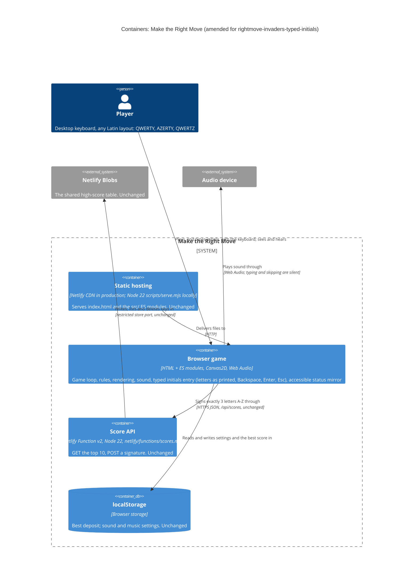
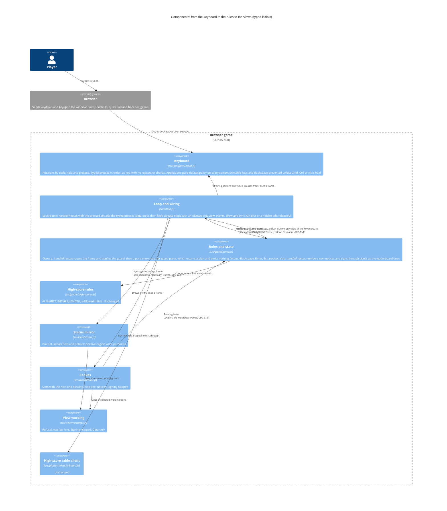

<!-- markdownlint-disable MD024 -->
# Feature delta: rightmove-invaders-typed-initials

A player whose deposit makes the shared high-score table **types** their three initials and presses Enter, instead of choosing each letter with Up and Down. Backspace deletes the last letter and Esc skips signing. Everything after the signing stays as `rightmove-invaders-leaderboard` shipped it: the signing lifecycle, the server contract and the table.

- **Type**: user-facing, a change to live functionality, brownfield (`rightmove-invaders-leaderboard`, in production since `144e23a`). Branch `rightmove-invaders-typed-initials`, cut from `main` at `d55cbf9`.
- **Density**: lean (Tier-1 only). **Research depth**: lightweight (the user took the key decisions). **JTBD**: yes.
- **No DISCOVER or DIVERGE.** The change comes from the user (2026-10-25): "the player should type the letters directly". The jobs are assumptions, and K16–K18 validate them.
- **SSOT**: [jobs.yaml](../../product/jobs.yaml) (J-TABLE-SIGN, J-TABLE-SKIP) · [persona](../../product/personas/casual-arcade-player.yaml) · [journey](../../product/journeys/play-a-session.yaml) (new high-score steps) · [leaderboard feature delta](../rightmove-invaders-leaderboard/feature-delta.md)
- **Slices**: [slice 01, type your initials](slices/slice-01-type-your-initials.md) · [slice 02, skip with Esc](slices/slice-02-skip-with-esc.md)

---

## Wave: DISCUSS / [REF] Persona ID

`casual-arcade-player`: Alex Morgan (they/them). Plays for fun in 5–10 minute sessions on a MacBook Air with a UK keyboard, and grew up with arcade games. The domain examples also use other players of the same segment: Camille Dubois (French AZERTY), Jonas Ziegler (German QWERTZ), Mina Patel, Sam Taylor and Priya Shah.

## Wave: DISCUSS / [REF] JTBD one-liner

When my deposit makes the shared high-score table, I want to type my initials as I would anywhere else and press Enter (or Esc to pass), so I can claim my place in seconds and get back to playing.

| Job | Opportunity | Stories |
|---|---|---|
| J-TABLE-SIGN (sign the table quickly, with exactly my initials) | 11 | US-01, US-02, US-03, US-04 |
| J-TABLE-SKIP (pass on signing with one key) | 9 | US-05 |

**Evidence level: assumption.** It is the product owner's own preference (2026-10-25), with no playtest and no player feedback yet.

## Wave: DISCUSS / [REF] Locked decisions

| ID | Decision | Verdict |
|---|---|---|
| D1 | The player types up to 3 letters. **Enter** signs once 3 letters are in, and Enter with fewer does nothing but the hint of D13. **Backspace** deletes the last letter. | Locked (user, 2026-10-25) |
| D2 | **Only letters type**: Up and Down no longer change letters, and the arrows are ignored during entry. | Locked (user, 2026-10-25) |
| D3 | **Esc skips signing**: the entry closes, nothing is sent, the deposit doesn't enter the table, and Enter starts a new game as usual. | Locked (user, 2026-10-25) |
| D4 | **Initials on the word filter are cleared**: the refusal is shown (reworded in D12), and the entry goes back to empty. | Locked (user, 2026-10-25) |
| D5 | The entry starts **empty** (`_ _ _`), not `A A A`. | Locked (orchestrator default; approved by the user 2026-10-25) |
| D6 | Lowercase is accepted and shown in capitals. Digits, punctuation, accented letters and anything else are ignored. | Locked (orchestrator default; approved by the user 2026-10-25) |
| D7 | During entry **every letter key types its letter**, M, N, P, A and D included, and Space does nothing. The M and N toggles and P (pause) don't apply during entry, and work again once it closes. | Locked (orchestrator default; approved by the user 2026-10-25) |
| D8 | **The letter shown is the one printed on the key the player presses**, so AZERTY and QWERTZ layouts work too. This is a product AC; the mechanism is DESIGN's. | Locked (orchestrator default; approved by the user 2026-10-25) |
| D9 | Unchanged: only a deposit that makes the table is asked; the signing lifecycle (pending → confirmed, off-table or unconfirmed); the server contract (3 letters A–Z, `/api/scores`); the 16-word filter; the accessible initials field and its announcements; Enter restarts after signing. | Locked (orchestrator default; approved by the user 2026-10-25) |
| D10 | Desktop keyboard only: no on-screen keyboard, no mobile, no names longer than 3 letters. | Locked (orchestrator default; approved by the user 2026-10-25) |
| D11 | **Stray-key guard**: for the first 0.6 s of game over, no key acts on the entry (no letter, Backspace, Enter or Esc). A key held down from play never types. 0.6 s is the game's existing wait before Enter can start a new game. | Locked (PO default; approved by the user 2026-10-25) |
| D12 | **Wording** as in "Player-facing wording" below. The game-over announcement keeps `Deposit saved £…` and `Enter your initials`, because the walking skeleton reads them. The accessible field says `A, letter 2 of 3` with no underscores: the field is visually hidden, and screen readers read "_" inconsistently ("underscore", "line" or nothing). The canvas shows `A _ _`. | Locked (PO default; approved by the user 2026-10-25) |
| D13 | Enter with fewer than 3 letters sends nothing, keeps the letters, and says `Type 3 letters to sign.` (this answers D1's "your call"). | Locked (PO default; approved by the user 2026-10-25) |
| D14 | A 4th letter is ignored: it doesn't overwrite and isn't announced. Holding a key down gives one press, with no auto-repeat (Backspace included). Backspace on an empty entry does nothing. | Locked (PO default; approved by the user 2026-10-25) |
| D15 | **Every key press counts once, in the order pressed, however fast**: `a`, `a`, `x` typed within one frame give `AAX`. For the entry, this replaces the leaderboard's "presses of the same key within one frame count once". **The exception**: presses that come after the closing Enter or Esc in the same frame are dropped (DESIGN DDD-T2), so the Enter that signs never also starts a new game, and an `m` typed straight after it never mutes. The live region still changes at most once per frame. | Locked (PO default; approved by the user 2026-10-25; the exception added from DESIGN DDD-T2, 2026-10-26) |
| D16 | A skip isn't a signing: the current signing and its mark are kept (DDD-8), and the local best is saved as usual. A skip has no sound. | Locked (PO default; approved by the user 2026-10-25) |
| D17 | A letter typed with Cmd, Ctrl or Alt/Option held types nothing and keeps its browser default, so browser and system shortcuts are left alone: for example, Windows Alt+F still opens the browser's menu. Alt/Option is a chord like Cmd and Ctrl (confirmed by the user on 2026-10-26; DESIGN DDD-T4). Option characters (å, ß, ü) are ignored either way, because they aren't A–Z letters (D6). Apart from these shortcuts, no key typed during entry may start a browser feature, for example Firefox's quick find on `/` or `'`. | Locked (PO default; approved by the user 2026-10-25; Alt/Option confirmed by the user 2026-10-26) |
| D18 | Slice order: typing first, Esc second, ideally in one release. If slice 01 ships alone, a player who doesn't want to sign types any 3 letters, which is no worse than today, where Enter pressed three times signs `AAA`. | Locked (PO default; approved by the user 2026-10-25) |
| D19 | **No browser feature on any screen**: printable keys and Backspace never start a browser feature on any screen of the game page (the title, play, game over and the entry), not only during the entry. For example, Firefox's quick find on `/` and `'` never opens on the game page, and Backspace never leaves it. **Shortcuts with Cmd, Ctrl or Alt/Option stay the browser's**: a printable key or Backspace with any of them held keeps its browser default and never types (D17), so Windows Alt+F still opens the browser's menu. This widens D17's last sentence; DESIGN applies it in DDD-T8. | Locked (user, 2026-10-25, approved with DESIGN; Alt/Option confirmed by the user, 2026-10-26) |
| D20 | **Losing focus mid-entry**: if the window loses focus or the tab is hidden while the entry is open, the entry stays open, the letters already typed stay, and nothing is typed while the window lacks focus. DESIGN states it in DDD-T1. | Locked (user, 2026-10-26) |

## Wave: DISCUSS / [REF] Scope assessment

**PASS (right-sized), with one recorded exception: slice 01 is over the 1-day carpaccio target.** The feature has 5 stories in 2 slices. It touches one bounded context, the game in the browser: the keyboard adapter, the rules' entry, the status mirror, the canvas and the wording. The Score API, the store, the table client and the word list are untouched. The walking skeleton is inherited, with no new integration point.

**Estimate: about 2 days of DELIVER**, slice 01 about 1.5–2 days and slice 02 about 2 h. This was re-estimated after the Final Wave Review Gate from slice 01's four stories and DISTILL's enable list (DELIVER handoff), which has eight roadmap steps, 01-01 to 01-08. Step 01-01 also carries the Retirement list (the letter-wheel scenarios, steps and helpers, and four unit specs to rewrite), and two new unit tests come with the slice (the keyboard over a plain `EventTarget`, and the rules' letter table). The first estimate, 5–6 h, counted the entry alone. By story: US-01 about 1 day (with the Retirement list), US-02 about ½ day, US-03 and US-04 about ¼ day each.

**Why slice 01 stays one slice**: typed entry must replace the letter wheel in one release, so its four stories can't ship apart.
- US-02 must ship with US-01, or M mutes mid-signature.
- US-04 must ship with US-01, or the wheel's "Change a letter." refusal is left on a typed entry.
- US-03 is the same `e.key` read that US-01 types with; only its checks are extra.

Each slice serves one outcome: slice 01, signing by typing with exactly the letters meant (K16, K17); slice 02, passing on the table (K18, K19). No further split is needed.

## Wave: DISCUSS / [REF] Player-facing wording (approved by the user, 2026-10-25)

DISTILL copies this into its Messages table. Each phrase has one owner (DDD-T9: `messages.js`, `status.js` or `render.js`); the `.feature` files quote it and are checked against it. Apostrophes are ASCII, as in `messages.js`.

| When | Status mirror (live region; `data-hud="initials"` for the field) | Canvas | Slice |
|---|---|---|---|
| Game over, deposit makes the table | `Game over: Offer rejected. Deposit saved £1,250. New high score! Enter your initials: type 3 letters, then press Enter to sign.` Slice 02 adds ` Esc skips.` | `New high score!`, three slots `_ _ _` with the first blinking, and the help line `Type 3 letters   Enter sign   Backspace delete`. Slice 02 adds `   Esc skip` | 01, 02 |
| The field, and its live update on each change | `No letters yet, letter 1 of 3` → `A, letter 2 of 3` → `A L, letter 3 of 3` → `A L X, press Enter to sign` | `A _ _`, then `A L _`, then `A L X`. The next empty slot blinks | 01 |
| Enter with fewer than 3 letters | `Type 3 letters to sign.` Slice 02 changes it to `Type 3 letters to sign, or press Esc to skip.` | The same words under the help line, until the next key the entry acts on (a key it ignores, such as Up, leaves it showing) | 01, 02 |
| Initials on the word filter | `Those initials aren't allowed. Type different ones.`, then the field `No letters yet, letter 1 of 3` | The refusal in red under the help line, until the next key the entry acts on (a key it ignores, such as Up, leaves it showing); the slots are empty | 01 |
| Esc | `Signing skipped. Press Enter to house-hunt again.` | `Signing skipped` where the signing line goes, then the list | 02 |
| Pending, confirmed, off-table, unconfirmed, unavailable | Unchanged: `Signing ALX…`, `Signed ALX, #3.`, `The table filled up before ALX arrived.`, `Couldn't confirm ALX's signing.`, `High-score table unavailable.` | Unchanged | — |

## Wave: DISCUSS / [REF] Story map and slice order

Backbone, the new journey steps in [play-a-session](../../product/journeys/play-a-session.yaml): **qualify → type initials → sign or skip → see the table**.

| Qualify | Type initials | Sign or skip | See the table |
|---|---|---|---|
| The entry opens empty (US-01) | Letters fill the slots, in capitals (US-01) | Enter with 3 letters signs (US-01) | *Inherited*: pending, then confirmed, off-table or unconfirmed; the row marked |
| A tap as the game ends doesn't type (US-02) | Backspace takes back the last letter (US-01) | Enter early: a hint, and nothing sent (US-01) | *Inherited*: the list on game over and on the title |
| *Inherited*: only a deposit that makes the table, and only while the table is available | Only letters type; M, N and P are letters (US-02) | Blocked initials: refused, and the entry emptied (US-04) | |
| | The letter printed on the key (US-03) | Esc skips (US-05) | |

**Walking skeleton**: inherited from the leaderboard (qualify → enter FAB → the table topped by FAB → another house-hunter sees it). This feature only changes how its "enter" step is done (WS strategy, below).

| Order | Slice | Stories | Why this position |
|---|---|---|---|
| 1 | [01 Type your initials](slices/slice-01-type-your-initials.md) | US-01, US-02, US-03, US-04 | The user's request and the higher opportunity (11). It also carries the riskiest assumption: typed letters arrive as printed, in order, without stray game keys, in three engines |
| 2 | [02 Skip with Esc](slices/slice-02-skip-with-esc.md) | US-05 | Opportunity 9, and the smallest. It reuses slice 01's entry key handling and its 0.6 s guard. Ideally shipped in the same release (D18) |

**Priority rationale**: the walking skeleton is inherited, so the riskiest assumption comes first. That is slice 01: layouts, key order and stray keys. Value × urgency / effort favours slice 02 (3 × 3 / 1 = 9, against 5 × 4 / 3 ≈ 6.7), but the tie-break puts the riskiest assumption first, and slice 02 depends on slice 01's key handling.

**Carpaccio taste tests**: neither slice ships a new component (both extend five existing ones), and neither needs a new abstraction first. Each slice can disprove something (see its learning hypothesis), runs on the real page, real keyboards and the preview's real table, and has a same-day dogfood. The two slices aren't the same thing at different scales. **PASS**, with one recorded exception: slice 01 runs about 1.5–2 days, over the 1-day target, and is atomic (Scope assessment).

## Wave: DISCUSS / [REF] User stories

### US-01: Alex types their initials and signs

`job_id: J-TABLE-SIGN` · slice 01 · about 1 day (with the Retirement list)

Alex has just made the shared top 10 with £1,250. To sign ALX on the letter wheel, they press Up 11 times for L, Down 3 times for X (if they know the wheel wraps round; Up 23 times if not) and Enter three times. That is 17 to 37 key presses at the moment they want to enjoy, with the letters right under their fingers.

#### Elevator Pitch

Before: Alex picks each initial on a letter wheel with Up and Down and takes it with Enter: 17 key presses for ALX, or 37 with Up only.
After: at game over with a deposit that makes the table, type `alx` and press Enter → sees `A L X` fill the three empty slots as they type, then "Signing ALX…" and, once the table answers, "Signed ALX, #3." with the ALX row marked in the High scores list.
Decision enabled: Alex sees their initials spelled right before pressing Enter, decides to sign (or to Backspace a typo), and starts the next game straight away.

**Domain examples**

1. *Happy path*: the table holds KIM £2,000, LEO £1,500 and TED £1,000. Alex ends on "Offer rejected" with £1,250 and types `a`, `l`, `x` without Shift. The slots read `A L X`. Enter → "Signing ALX…", then "Signed ALX, #3.".
2. *Typo*: Alex types `A L C`, sees the C, and presses Backspace (`A L _`). They type `x` and press Enter, and ALX is signed.
3. *Too early*: Alex types `A L` and presses Enter, thinking two letters are enough. Nothing is sent, the game says "Type 3 letters to sign." and `A L` stays. They type `x`, press Enter, and ALX is signed.

**UAT scenarios**

1. *Typed initials sign the table.* Given the high-score table holds KIM £2,000, LEO £1,500 and TED £1,000, and Alex's game is over with £1,250, When Alex types "alx" and presses Enter, Then the game tells them "Signing ALX…" and then "Signed ALX, #3.", and the ALX row is marked as theirs.
2. *The entry opens empty.* Given the high-score table is seeded with 9 signatures of £1,000 (a test fixture, so that £1,250 makes it), When Alex finishes a game with £1,250, Then the game tells them "New high score! Enter your initials: type 3 letters, then press Enter to sign." and the initials field reads "No letters yet, letter 1 of 3".
3. *Letters show, and are heard, as they are typed* (outline: "a" alone; "a" and "l" together). Given the entry is open and empty, When Alex types `<letters>`, Then at once the initials field reads `<field>`, and the game tells them `<field>` once, with nothing else about the initials. Examples: "a" → "A, letter 2 of 3"; "a" and "l" together → "A L, letter 3 of 3", so "A, letter 2 of 3" is never heard.
4. *Backspace takes back the last letter, if there is one* (outline: "A L C"; nothing typed). Given Alex has typed `<letters>`, When they press Backspace, Then the initials field reads `<field>`. Examples: "A L C" → "A L, letter 3 of 3"; nothing typed yet → still "No letters yet, letter 1 of 3", and nothing about the initials is announced.
5. *Enter with fewer than 3 letters sends nothing.* Given Alex has typed "A L", When they press Enter, Then nothing is sent to the table, the initials field still reads "A L, letter 3 of 3", and the game tells them "Type 3 letters to sign" (slice 02 adds ", or press Esc to skip.").
6. *A fourth letter changes nothing.* Given Alex has typed "A L X", When they type "q", Then the initials field still reads "A L X, press Enter to sign".
7. *Every press counts once, however fast, and a held key once* (outline). Given the entry is open and empty, When Alex `<does this>`, Then the game tells them `<signing>`. Examples: types "a", "a", "x" and presses Enter, all together → "Signing AAX…"; holds "a" down for a second, then types "l" and "x" and presses Enter → "Signing ALX…"; types "a", "l", "x", presses Enter, then types "m" and presses Enter again, all together → "Signing ALX…" only: the sound stays on and no new game starts, because the presses after the Enter that signs are dropped.

**Acceptance criteria**

- [ ] The entry opens with three empty slots, never `A A A`. The game-over announcement still contains `Deposit saved £…` and `Enter your initials`. (UAT 2)
- [ ] Each letter key types its letter, in capitals, into the next empty slot: the letter shows in the field, and is heard, by the next frame after the key press. (UAT 3)
- [ ] Backspace removes the last letter, and on an empty entry it does nothing. (UAT 4)
- [ ] Enter with 3 letters signs exactly those letters, and the signing lifecycle is unchanged. Enter with fewer letters sends nothing, keeps the letters and says "Type 3 letters to sign." (UAT 1, 5)
- [ ] A 4th letter is ignored, and holding a key down types its letter once. (UAT 6, 7)
- [ ] Every press counts once, in the order pressed, however fast: two quick presses of the same letter give two letters. The exception: presses that come after the closing Enter (or Esc, slice 02) in the same frame are dropped, so the Enter that signs never also starts a new game, and an M typed in the same frame after it never mutes (D15, DESIGN DDD-T2). (UAT 7)
- [ ] Letters typed together are heard together, not one by one: the player hears the field they leave once ("A L, letter 3 of 3"), never each letter in turn. (UAT 3)

**Outcome KPI**: K16 (signing is self-evident).
**Technical notes**: `src/platform/input.js` records only `e.code`, and the rules see a frame's presses as a set, so two presses of one key within a frame count once (leaderboard DESIGN, Driving ports). This story needs every press, in order; DESIGN decides how. The rules still send exactly 3 capital letters, so `isValidSignature` and `/api/scores` don't change. Backspace must never navigate away from the page. *By the next frame* (AC 2) and *at once* (UAT 3) mean the first frame after the key press, which is 17 ms at 60 Hz. It is checked on the fake clock, not by DoD 5: DISTILL's M1 outline `Letters show, and are heard, as they are typed: "<letters>" <spacing>` reads the field one frame of the fake clock after the key press, and checks what the game told the player. A real key press's latency isn't measured (DISTILL, Upstream issues 2). UAT 7's third row (presses after the Enter that signs are dropped) is checked on the rules by DISTILL's M6 "Keys after the Enter that signs, in the same go, are dropped". *Together* (AC 7, UATs 3 and 7) means within one frame: the live region changes at most once per frame (D15, the leaderboard's DDD-14), so letters typed in one frame are announced together, as the field they leave.
**Dependencies**: `rightmove-invaders-leaderboard` in production (done).

### US-02: Only letters type while Mina signs

`job_id: J-TABLE-SIGN` · slice 01 · about ½ day

Mina Patel signs MNP. Each of her letters is also a game key: M mutes, N stops the music, P pauses, and A and D move, Space fires and the arrows move too. At the entry she needs every letter key to be a letter and every other key to do nothing. A key she was still hammering as the formation landed mustn't end up on a public table.

#### Elevator Pitch

Before: Mina can't put M, N or P in her initials by pressing those keys: on the entry today, M turns all sound off and N stops the music.
After: at the initials entry, type `m`, press Up, type `7`, press Space, then type `n` and `p` → sees `M N P` (Up, 7 and Space ignored), and the HUD still shows Sound On and Music On. Once she has signed, M mutes again.
Decision enabled: Mina trusts that only the letters she types reach the table, and decides to type her initials as they are, without working round the game's keys.

**Domain examples**

1. *Game keys as letters*: Mina types `m`, `n`, `p` and gets `M N P`. The sound and the music stay on. After signing, M mutes as usual. In another game she types `a`, `d`, `m`, the two movement keys among them, and gets `A D M`.
2. *Old habits*: Mina presses Up out of habit, then `7`, Space and `.`. Nothing changes, and the field still reads "No letters yet, letter 1 of 3".
3. *A tap as the game ends*: Mina is tapping D to dodge when the formation lands ("Gazumped!"). The tap comes 0.3 s after game over, so no D appears. A `d` typed 1 s after game over does show.

**UAT scenarios**

1. *Game keys type their letters* (outline: "mnp"; "adm"). Given the entry is open and the sound and the music are on, When Mina types `<letters>`, Then the initials field reads `<field>`, and the HUD shows Sound On and Music On. Examples: "mnp" → "M N P, press Enter to sign"; "adm" → "A D M, press Enter to sign".
2. *Keys that aren't letters are ignored* (outline: Up, Down, Left, `7`, Space, `.`, `-`, `/`). Given the entry is open and empty, When Mina presses `<key>`, Then the initials field still reads "No letters yet, letter 1 of 3", and nothing about the initials is announced.
3. *The toggles work again once the entry closes.* Given Mina has signed MNP, When she presses M, Then the sound turns off, and the game tells her "Sound off. Press M to turn it on."
4. *A key tapped as the game ends doesn't type.* Given the game ended 0.3 seconds ago and the entry is open, When Mina types "d", Then the initials field still reads "No letters yet, letter 1 of 3".
5. *Browser shortcuts don't type, and still work* (outline: Ctrl, Cmd, Option on a Mac, Alt on Windows). Given the entry is open and empty, When Mina presses a letter with `<modifier>` held, Then the initials field still reads "No letters yet, letter 1 of 3", and the browser's shortcut still works: for example, Alt+F on Windows still opens the browser's menu.
6. *No browser feature takes the keyboard, on any screen* (outline: `/`, `'` and Backspace, on each of these screens: the initials entry; the game-over screen after Mina has signed MNP; the game-over screen after she has skipped, slice 02; a game-over screen with no entry, where her £150 doesn't make a full table; the title screen; during play). Given Mina is on `<screen>` in Firefox, When she presses `<key>`, Then Firefox's quick find doesn't open, the page stays where it is, and her next key still reaches the game (on the entry, the field still reads "No letters yet, letter 1 of 3"; on a game-over screen, Enter still starts a new game). Checked as the game's decision in three engines, and by hand in real Firefox (Technical notes).
7. *A key held down from play never types.* Given Mina is holding D down to dodge as the formation lands, When she keeps holding it for a second after the game ends, Then the initials field still reads "No letters yet, letter 1 of 3".

**Acceptance criteria**

- [ ] During the entry, every A–Z key types its letter, A, D, M, N and P included. M and N don't toggle the sound or the music, and P doesn't pause. (UAT 1)
- [ ] Arrows, digits, Space, punctuation and every other key that isn't a letter do nothing and announce nothing. Backspace, Enter and Esc have their own meanings. (UAT 2)
- [ ] On every screen of the game page (the title, play, game over and the entry), printable keys and Backspace never start a browser feature, for example Firefox's quick find on `/` or `'`, or Backspace leaving the page (D19). Shortcuts stay the browser's: a printable key or Backspace with Cmd, Ctrl or Alt/Option held keeps its browser default (D17, D19), so Alt+F on Windows still opens the browser's menu. During the entry, the next letter still types. (UAT 5, 6)
- [ ] Once the entry closes (signed, or skipped in slice 02), M, N and the game keys work as before; printable keys and Backspace still never start a browser feature, there and on a game-over screen with no entry. (UAT 3, 6)
- [ ] For the first 0.6 s of game over, no key acts on the entry, and a key held down from play never types (D11). (UAT 4, 7)
- [ ] A letter typed with Cmd, Ctrl or Alt/Option held types nothing, and the shortcut still works (D17). (UAT 5)

**Outcome KPI**: K17 (what you see is what you sign).
**Technical notes**: D7 inverts, for the entry only, `handlePresses`' rule "M and N work on every screen" (`src/game/game.js`). The 0.6 s threshold is the one already in `handlePresses` (`g.overT > 0.6`). Firefox's quick find (`/`, `'`, and typeahead find if the player has turned it on) can take the keyboard away from the page, and Backspace can navigate back in some browsers. UAT 6 is checked two ways. Automatically, as the game's decision: the key press comes back `defaultPrevented`, in three engines (headless engines and synthetic events run no quick find, DISTILL's Upstream issues 3). By hand, in real Firefox with typeahead find also turned on, and Backspace in Firefox and Safari (DoD 5). DESIGN applies it on every screen (DDD-T8, D19). Alt/Option is a chord like Cmd and Ctrl, as the user confirmed on 2026-10-26: for typing only, so holding Option during play still moves and fires (DESIGN DDD-T4). UAT 5's "the shortcut still works" is checked the same way, as the game's decision: the key press keeps its default (not `defaultPrevented`) in three engines. Alt+F on Windows is an example of what that keeps, not a separate manual check.
**Dependencies**: US-01.

### US-03: The letter on Camille's key is the letter she signs

`job_id: J-TABLE-SIGN` · slice 01 · about ¼ day

Camille Dubois plays the shared table from Lyon on a French AZERTY MacBook, and Jonas Ziegler from Berlin on German QWERTZ. On their keyboards A, Q, Z, W, M and Y are printed where a UK keyboard has other letters. A game that read key positions would sign QAM when Camille presses C, A and M.

#### Elevator Pitch

Before: Camille signs CAM on the letter wheel: Up twice and Enter, then Enter, then Up 12 times and Enter, 17 presses, while the letters printed on her AZERTY keys type nothing.
After: on an AZERTY keyboard at the initials entry, press the keys printed C, A and M, then Enter → sees `C A M` in the slots and "Signing CAM…".
Decision enabled: seeing `C A M` as she types, Camille chooses to sign with the letters on her own keys, rather than switching her Mac to a UK layout or passing on the table.

**Domain examples**

1. *AZERTY*: Camille presses the keys printed C, A and M, and gets `C A M`. CAM is signed.
2. *QWERTZ*: Jonas presses the keys printed J, A and Z, and gets `J A Z`, not `J A Y`.
3. *Accents*: Élodie Martin (AZERTY) presses the key printed é, and nothing is typed. She types `e`, `l`, `m` and signs ELM. Jonas's keys printed ü and ß, and the key printed å on Astrid Nilsson's Swedish keyboard, type nothing either.

**UAT scenarios**

1. *Letters on an AZERTY keyboard.* Given Camille's keyboard is French AZERTY and the entry is open, When she presses the keys printed C, A and M, Then the initials field reads "C A M, press Enter to sign".
2. *Letters on a QWERTZ keyboard.* Given Jonas's keyboard is German QWERTZ and the entry is open, When he presses the keys printed J, A and Z, Then the initials field reads "J A Z, press Enter to sign".
3. *Letters outside A–Z are ignored* (outline: é, ü, ß, å). Given `<player>`'s keyboard is `<layout>` and the entry is open and empty, When they press the key printed `<printed>`, Then the initials field still reads "No letters yet, letter 1 of 3", and nothing about the initials is announced. Examples: Élodie, French AZERTY, é; Jonas, German QWERTZ, ü; Jonas, German QWERTZ, ß; Astrid, Swedish, å.
4. *Capitals, however they are typed* (outline: with Shift held, with Caps Lock on, on its own). Given Camille's entry is open and empty, When she presses the key printed C `<how>`, Then the initials field reads "C, letter 2 of 3".

**Acceptance criteria**

- [ ] The letter typed is the one printed on the key pressed, on UK and US QWERTY, French AZERTY and German QWERTZ layouts. (UAT 1, 2; QWERTY through US-01)
- [ ] Lowercase, Shift and Caps Lock all give the capital letter. (UAT 4)
- [ ] Letters outside A–Z (é, ü, ß, å) are ignored, never turned into a plain letter, whether printed on a key (é on AZERTY, ü and ß on QWERTZ, å on a Swedish keyboard) or typed with Option on a Mac, which is a chord and types nothing (US-02 UAT 5). (UAT 3)

**Outcome KPI**: K17.
**Technical notes**: today `input.js` records `e.code`, a key position (AZERTY's printed A arrives as `KeyQ`). The letter wheel hides this, because it uses only the arrows and Enter; an entry that typed by key position would expose it, signing QAM for CAM. D8 is a product AC; the mechanism is DESIGN's. Playwright's `keyboard.press` sends US-layout events, so DISTILL has to produce events whose printed character differs from the key position (its probe found that synthetic key events work in all three engines). A real AZERTY or QWERTZ keyboard in Chrome, Firefox and Safari is a manual check (DoD 5). The movement keys and the M/N/P toggles outside the entry stay positional (Out of scope).
**Dependencies**: US-01.

### US-04: Sam's blocked initials start again empty

`job_id: J-TABLE-SIGN` · slice 01 · about ¼ day

Sam Taylor types A S S for a laugh, and the word filter refuses it (DDD-10, unchanged). Today the letters stay, the first one becomes current, and the game says "Change a letter.". That made sense on a letter wheel. When typing, there is no current letter to change, and Backspace only takes back the last one.

#### Elevator Pitch

Before: Refused initials stay on screen with "Change a letter.", a letter-wheel instruction that doesn't fit typing.
After: at the initials entry, type `ass` and press Enter → sees "Those initials aren't allowed. Type different ones." and three empty slots. Then type `sam` and press Enter → "Signing SAM…".
Decision enabled: Sam knows nothing was sent, and decides on other initials straight away.

**Domain examples**

1. Sam (£300) types `ass` and presses Enter: refused, and the entry is empty. He types `sam`, and SAM is signed.
2. Nadia Azoulay types `naz`, which is on the 16-word list: refused. She types `nad`, and NAD is signed.
3. Sam is refused, then presses Enter at once: "Type 3 letters to sign.", and nothing is sent.

**UAT scenarios**

1. *Refused initials are cleared.* Given Sam's game is over with £300 and the high-score table has room, When Sam types "ass" and presses Enter, Then the game tells him "Those initials aren't allowed. Type different ones.", the initials field reads "No letters yet, letter 1 of 3", and nothing is sent to the table.
2. *Other initials sign.* Given Sam's ASS has just been refused, When he types "sam" and presses Enter, Then the game tells him "Signing SAM…".
3. *The refusal shows until the next key the entry acts on* (outline: "s", Up). Given Sam's ASS has just been refused, When he presses `<key>`, Then `<outcome>`. Examples: "s" → the refusal is gone, and the initials field reads "S, letter 2 of 3"; Up, a key the entry ignores → the refusal still shows, and the field still reads "No letters yet, letter 1 of 3". The refusal shows on the canvas only, so DISTILL checks the Up row on the rules (M6), and DoD 5 checks it by hand.

**Acceptance criteria**

- [ ] Initials on the word filter are refused in the game before anything is sent: no signing, and no request to the table. (UAT 1)
- [ ] The entry empties and says "Those initials aren't allowed. Type different ones.". The refusal shows until the next key the entry acts on (a key it ignores, such as Up, leaves it showing). (UAT 1, 3)
- [ ] Initials typed afterwards sign as usual. (UAT 2)

**Outcome KPI**: K16 (a refused player still signs unaided within the playtest).
**Technical notes**: the 16-word list in `src/game/high-scores.js` and the server's 400 `initials-not-allowed` don't change (D9). The leaderboard's rules-operations row and DISTILL's Messages row for the refusal change (Changed assumptions).
**Dependencies**: US-01.

### US-05: Priya skips signing with Esc

`job_id: J-TABLE-SKIP` · slice 02 · ≤ ½ day

Priya Shah plays on her lunch break, on a screen her colleagues can see. Her £850 makes the table, but she would rather not put her initials on a public table. Today the only way past the entry is to sign, and pressing Enter to get through it signs "AAA". After slice 01 she would have to type three letters.

#### Elevator Pitch

Before: The only way past the initials entry is to sign, and pressing Enter to get through it leaves "AAA" on the shared table.
After: at the initials entry, press Esc → sees "Signing skipped." and "Press Enter to house-hunt again.", with the High scores list unchanged (no £850 row). Enter then starts a new game.
Decision enabled: Priya decides to keep her initials off the public table and gets straight back to playing.

**Domain examples**

1. Priya (£850) presses Esc and sees "Signing skipped.". Nothing is sent, and the table is unchanged. Enter starts a new game.
2. Priya types `p`, `s`, changes her mind and presses Esc. The game skips, and P S is dropped.
3. Alex signed ALX in the last game (confirmed, and marked). This game Alex skips, and the ALX row stays marked.

**UAT scenarios**

1. *Esc skips signing.* Given Priya's game is over with £850 and the high-score table has room, When she presses Esc, Then the game tells her "Signing skipped. Press Enter to house-hunt again.", nothing is sent to the table, and the High scores list shows no £850 row.
2. *Letters already typed are dropped* (outline: partly typed, full). Given Priya has typed `<letters>`, When she presses Esc, Then the game tells her "Signing skipped. Press Enter to house-hunt again." and nothing is sent to the table. Examples: "P S"; "P S H".
3. *Enter plays again after a skip.* Given Priya has skipped signing, When she presses Enter, Then a new game starts.
4. *A skip isn't a signing.* Given Alex's ALX was confirmed and marked in the last game, Alex's best deposit is £1,000, and this game's £1,250 makes the table, When Alex presses Esc, Then ALX's row is still marked as Alex's, and the best deposit reads £1,250, as it does the next time Alex opens the game.
5. *Esc pressed as the game ends doesn't skip.* Given the game ended 0.3 seconds ago and the entry is open, When Alex presses Esc, Then the entry is still open and nothing is announced as skipped.
6. *The hint offers the way out.* Given the entry is open and empty, When Priya presses Enter, Then the game tells her "Type 3 letters to sign, or press Esc to skip."
7. *The invitation to sign says how to skip.* Given the high-score table has room, When Priya's game ends with £850, Then what the game tells her ends with "type 3 letters, then press Enter to sign. Esc skips.", and the canvas help line reads "Type 3 letters   Enter sign   Backspace delete   Esc skip" (the canvas by hand, DoD 5).

**Acceptance criteria**

- [ ] Esc closes the entry at any point (empty, partly typed or full), sends nothing, and says "Signing skipped. Press Enter to house-hunt again."; the canvas shows "Signing skipped". (UAT 1, 2)
- [ ] The deposit doesn't enter the table: the list shows as it does for a deposit that wasn't asked. (UAT 1)
- [ ] Enter then starts a new game, as it does after a signing. (UAT 3)
- [ ] A skip isn't a signing: the current signing and its mark are kept, and the local best is saved as usual (D16). (UAT 4)
- [ ] Esc during the first 0.6 s of game over does nothing (D11). (UAT 5)
- [ ] The prompt ends with "Esc skips.", the canvas help line shows "Esc skip", and the early-Enter hint says "Type 3 letters to sign, or press Esc to skip." (UAT 6, 7)

**Outcome KPI**: K18 (skipping is findable and safe), K19.
**Technical notes**: Esc pauses during play ("P or Esc"). The game-over screen isn't pausable, so Esc has no other meaning there. A skip makes no request to the table and plays no sound. Whether the rules publish an event for it is DESIGN's call. Presses that come after the Esc in the same frame are dropped, as after the Enter that signs (D15, DESIGN DDD-T2).
**Dependencies**: US-01 (the entry's key handling and the 0.6 s guard).

## Wave: DISCUSS / [REF] Outcome KPIs

**Objective**: signing the high-score table is as quick as writing your initials anywhere, and passing on it is just as easy.

**Playtest protocol** (K16–K18): 5 people who match the persona and aren't on the team, at least 1 of whom types on AZERTY or QWERTZ on their own laptop. They play on the pull request's deploy preview, whose table starts empty, so any deposit makes it. Nobody is told how to sign or skip. Each plays two games. After the first game over, they sign. After the second, they are asked to "move on without putting your initials up". Times come from a screen recording, from the prompt appearing to "Signing …" or "Signing skipped.". n is recorded with every result.

An **accidental skip** is an Esc in game 1, when the player was asked to sign, or any skip the player calls unintended. Its exposure is every entry opened in the playtest: n = 10 with 5 playtesters (5 asked to sign and 5 asked to move on), and K18 records the accidental skips as a count out of that n.

| ID | Who | Does what | Target | Baseline | Measured by | Gate | A miss triggers |
|---|---|---|---|---|---|---|---|
| K16 | Playtesters whose deposit makes the table | Sign with their own initials, unaided | 5 of 5, each within 10 s of the prompt | Not measured. Structurally, the letter wheel needs 9 presses for FAB and 17 for ALX (37 with Up only); typing needs 4 | Screen recording, stopwatch | soft (north star) | A fix, opened via `/nw-bugfix` before the release record is written |
| K17 | The same, the AZERTY or QWERTZ tester included | End up with exactly the letters they meant | 0 signatures different from what the player meant | n/a | Asked after each signing, against the preview table | soft | A fix, opened via `/nw-bugfix` before the release record is written |
| K18 | Playtesters asked to move on without signing | Skip with Esc, unaided, and never skip by accident | ≥ 4 of 5 within 10 s; 0 accidental skips out of n entries opened (n = 10 with 5 playtesters) | Today there is no way to skip | Screen recording | soft | A fix, opened via `/nw-bugfix` before the release record is written |
| K19 | Production players | Leave fewer throwaway rows | No new `AAA` row on the production table in the 30 days after release | The `AAA` rows on the production top 10 on release day | `GET /api/scores`, weekly | soft (observational: low traffic) | Investigate, then decide (K19's proxy, below) |

**K19's proxy**: `AAA` rows stand for throwaway signings, because `AAA` is what the letter wheel signs when Enter is pressed three times just to get past the entry. After release, `AAA` has to be typed. A non-zero count means some players still sign `AAA`: either deliberately (their initials, or a joke), or because they wanted to get past the entry and didn't find Esc. Only the second calls for a change. So a miss is **investigated, then decided**: the investigation can ask the playtesters (did anyone want past the entry without finding Esc?), but the public table records no cause for an `AAA` row, so nothing on it says whether a production row was deliberate or a throwaway. The PO then decides whether a change is needed, and if so opens it via `/nw-bugfix`.

**Guardrails** (hard, automated): the leaderboard's walking skeleton and its scenarios (as amended by DISTILL), and the sound feature's M and N scenarios, stay green in Chromium, Firefox and WebKit, and nothing under `netlify/` changes. Proposed IDs: DISTILL registers K16–K19 in [kpi-contracts.yaml](../../product/kpi-contracts.yaml).

**Hypothesis**: we believe that typed initials, with Backspace and Esc, will let casual arcade players sign or pass in seconds. We will know this is true when 5 of 5 playtesters sign unaided within 10 s with exactly their own letters, and at least 4 of 5 find Esc when they want to pass.

## Wave: DISCUSS / [REF] Definition of Done

1. Every acceptance criterion is verified as DISTILL's traceability says, and the automated ones are green in Chromium, Firefox and WebKit.
2. The leaderboard's walking skeleton is green with its entry step typing FAB. `npm test` and `npm run build` are green, with no `@pending` left.
3. No trace of the letter wheel is left: the prompt, the canvas help line, the field and the test drivers all describe typing.
4. K16–K18 were recorded with n from the playtest; K19's baseline was recorded on release day.
5. Manual checks by the deliverer, on the deploy preview: a real AZERTY or QWERTZ keyboard in Chrome, Firefox and Safari; Firefox's quick find (`/`, `'`) doesn't take the keyboard; the canvas slots, the blinking next slot, the help line, the hint, the refusal and "Signing skipped" in the compact game-over layout (the leaderboard's D10 waiver: no test reads the canvas).
6. VoiceOver on macOS speaks the prompt, each letter, the hint, the refusal and the skip.
7. The README's controls describe typing the initials, Backspace and Esc.
8. The server contract, the word list and the signing lifecycle are unchanged, and there is no new dependency.
9. The PO's check on the deploy preview is done, and the work is merged to `main`.

## Wave: DISCUSS / [REF] Out of scope

- An on-screen keyboard, touch or mobile entry (D10).
- Names longer than 3 letters.
- Turning É into E, non-Latin scripts and IME input.
- Moving a cursor inside the initials (arrows to edit the middle letter).
- A timeout that signs or skips by itself, or a way back into the entry after a skip.
- Any change to the word list, the server contract or the table.
- A sound for typing or skipping.
- **Making the game keys layout-aware outside the entry.** On AZERTY, the M toggle today answers the key printed `,`, because it reads `KeyM`'s position. A pre-existing issue, and a candidate follow-up.

## Wave: DISCUSS / [REF] WS strategy

**Inherited, not rewritten, duplicated or retagged.** The leaderboard's walking skeleton ("A house-hunter signs the high-score table and another house-hunter sees it", `@walking_skeleton @driving_port`) already covers this feature's path end to end: the real page and keyboard, and the real function and Blobs client on the emulator behind `scripts/serve.mjs` (old strategy C, real local).

- **DISTILL moves its step `When I enter the initials "FAB"` to typing.** Today the step presses ArrowUp to turn each letter. The new step types `f`, `a`, `b` and presses Enter. It must first let 0.7 s of game time pass (D11), because the step before it can leave as little as 0 s after game over. The step text, and so the feature file, can stay as they are.
- Its reads stay valid: the game-over announcement still contains `Deposit saved £50` and `Enter your initials`, and the list still reads `FAB £50`.

## Wave: DISCUSS / [REF] Driving ports

- **The keyboard in the game page while the initials entry is open**: letter keys, read as the character printed on the key; Backspace, Enter and Esc; every other key ignored. Every press counts once, in order, and presses after the closing Enter or Esc in the same frame are dropped (D15).
- Outside the entry, the game keys are unchanged: Enter, Space, the arrows or A/D, M, N, and P/Esc.
- **On every screen of the game page**, the entry included: printable keys and Backspace never start a browser feature, for example Firefox's quick find on `/` or `'` (D19). Shortcuts with Cmd, Ctrl or Alt/Option stay the browser's: a printable key or Backspace with any of them held keeps its browser default and never types, so Alt+F on Windows still opens the browser's menu (D17, D19; Alt/Option confirmed by the user on 2026-10-26).
- Unchanged and not driven by this feature: window `blur` and `visibilitychange` (during the entry, they leave it open with its letters, D20), page load, and the HTTP `/api/scores` (driven, untouched).

## Wave: DISCUSS / [REF] Pre-requisites

- `rightmove-invaders-leaderboard` in production (`144e23a`; release record `d55cbf9`), with 326 tests green.
- **For DESIGN**:
  - how the printed character reaches the rules (today `input.js` records `e.code` only), with every press kept, in order (D15);
  - amending the leaderboard rows listed under Changed assumptions.
- **For DISTILL**:
  - a way to send key events whose printed character differs from the key position, in three engines (US-03); a 30-minute probe is advisable (slice 01 brief). DISTILL ran it: synthetic key events work in all three engines (DISTILL, Probe results);
  - the existing tests that drive the letter wheel, all of which move to typing: the walking-skeleton step; M4's field (`A A A, letter 1 of 3`); M5's field, cadence (Up pressed 3 times) and refusal scenarios; `steps/domain-types.js` (`INITIALS_PROMPT`, `initialsField`, `INITIALS_FIELD_PATTERN`); `steps/leaderboard-game.js` (`chooseLetter`, `pressUp`); Tier B's entry model (`tier-b/signing-rules.js`); and `tests/unit/status-mirror.spec.js`. This list is incomplete: DESIGN's Open questions, item 4, gives the full list of test files (it adds `tests/unit/answers-while-paused.spec.js`, `tests/unit/malformed-answers.spec.js`, `steps/leaderboard.steps.js` and `steps/high-score-table.steps.js`), and DISTILL's Retirement list says what DELIVER changes in each.
- **For the playtest and the DoD**: the pull request's deploy preview, one real AZERTY or QWERTZ keyboard, and VoiceOver on macOS.

## Wave: DISCUSS / [REF] DoR validation

| # | Item | Status | Evidence |
|---|---|---|---|
| 1 | Problem statement clear, in domain language | PASS | Each story opens with the player's pain: 17–37 presses for ALX, M muting mid-signature, AZERTY's A arriving as Q, "Change a letter" when typing, "AAA" as the only way past the entry |
| 2 | Persona with specific characteristics | PASS | Alex Morgan (`casual-arcade-player`, MacBook Air, UK keyboard), plus named players of the same segment on AZERTY (Camille, Élodie), QWERTZ (Jonas) and a Swedish keyboard (Astrid) |
| 3 | ≥ 3 domain examples with real data | PASS | 3 per story: ALX £1,250 at #3 under KIM £2,000 and LEO £1,500; MNP; CAM and JAZ; ASS → SAM; Priya's £850 |
| 4 | UAT in Given/When/Then, 3–7 per story | PASS | 7, 7, 4, 3 and 7 scenarios, each with one When, covering happy, edge and error paths. Some are outlines with their examples inline: US-01's letters heard, Backspace, and fast, held or after-Enter keys; US-02's game keys (MNP, ADM), ignored keys, modifiers (Ctrl, Cmd, Option, Alt) and browser features on six screens; US-03's letters outside A–Z (é, ü, ß, å) and capitals; US-04's refusal; US-05's dropped letters |
| 5 | AC derived from UAT | PASS | Each AC states an observable outcome and names the UATs it comes from. The first version claimed "Every AC maps to a UAT", which was wrong (Final Wave Review Gate, B1). These ACs had no UAT and now have one: US-01's Backspace on an empty entry (UAT 4), held key (UAT 7) and letters heard together (UAT 3); US-02's browser features (UAT 6) and key held down from play (UAT 7); US-05's full entry (UAT 2), local best (UAT 4), and prompt and help line (UAT 7). Second review cycle (2026-10-26): US-01 AC 2 is now an outcome, "the letter shows in the field, and is heard, by the next frame after the key press" (B-1), from UAT 3; its 17 ms at 60 Hz and the fake-clock check moved to US-01's technical notes, and DISTILL's M1 outline `Letters show, and are heard, as they are typed: "<letters>" <spacing>` checks it. US-01 AC 6's dropped presses after the closing Enter come from UAT 7's third row (DISTILL M6). The Alt/Option in US-02 AC 3 and AC 6 comes from UAT 5's four modifiers, and AC 4's screens after the entry closes (after signing, after a skip, a game over with no entry) from UAT 6's rows. US-03 AC 3's ü, ß and å come from UAT 3's outline. Browser features are checked as the game's decision (`defaultPrevented`) in three engines, and by hand in real Firefox (DoD 5). The canvas-only parts (the slots, the help line, a refusal left showing, "Signing skipped") are checked by hand (DoD 5) |
| 6 | Right-sized | PASS | Stories of ¼ day to 1 day each, with 3–7 scenarios each. Slice 01 is about 1.5–2 days, over the 1-day carpaccio target, and stays one slice because typed entry must replace the wheel in one release (Scope assessment). Slice 02 is about 2 h |
| 7 | Technical notes | PASS | On every story: `e.code` today, the frame's set of presses, "by the next frame" (17 ms at 60 Hz) and its fake-clock check, the 0.6 s threshold, Firefox's quick find and how it is checked, Alt/Option as a chord for typing only, Playwright's US-only key events, the presses dropped after the closing Enter or Esc |
| 8 | Dependencies resolved or tracked | PASS | The leaderboard is live. US-02–US-05 depend on US-01. DESIGN and DISTILL items are listed under Pre-requisites |
| 9 | Outcome KPIs with measurable targets | PASS | K16–K19, each with who, what, a numeric target, a baseline (or why there is none), a method and what a miss triggers |
| — | Job traceability (hard check) | PASS | One `job_id` per story, both jobs in `jobs.yaml` (evidence: assumption) |
| — | Elevator pitch (hard check) | PASS | Every story has Before, After (a real UI action → an exact observable output) and Decision enabled. No story is `@infrastructure` |

**DoR status: PASSED** (re-validated on 2026-10-26, after the second review cycle; all 9 items PASS, item 5 with the evidence above). No expansion trigger fired (one context, one persona segment, no regulatory terms, WS inherited), so the output is lean with no menu. The optional per-wave peer review was not run. The consolidated Final Wave Review Gate ran at the end of DISTILL and returned needs_revision; the first revision answered its findings with text edits only. The second review cycle (B-1, N-1 to N-8) is answered by this revision: text edits, plus the user's two decisions of 2026-10-26 (Alt/Option chords keep their browser default and never type, D17 and D19; the letters already typed stay through a blur, D20).

## Wave: DISCUSS / [REF] Changed assumptions

The leaderboard's documents are not edited. Their originals are quoted here, and DESIGN amends them:

- Leaderboard feature delta, header: "A deposit that makes the top 10 is signed with three initials (A–Z, Up/Down change the letter, Enter takes it)." → The initials are typed; Backspace deletes and Esc skips.
- DESIGN, Rules operations, Game over: "the initials entry opens (letters A A A, the first letter current)" → It opens empty (D5).
- DDD-10: "Blocked initials: the rules refuse the signing, keep the entry open with the letters kept, and ask the player to change them." → The entry is emptied, and the player is asked to type different initials (D4).
- DESIGN, Rules operations, "Third Enter, initials on the word filter": "The entry stays open with the letters kept, and a refusal is shown until the next key. The first letter becomes current (decided in DISTILL)" → Now "Enter with 3 letters on the word filter": the entry stays open, emptied, and the refusal is shown until the next key the entry acts on (DDD-T6).
- DESIGN, Driving ports: "Keyboard in the page: as before, plus Up/Down/Enter while the initials are entered (presses of the same key within one frame count once)." → Letters, Backspace, Enter and Esc; every press counts once, in order (D15).
- DDD-14: "one short live-region update per change of letter or position (at most one per frame)" → One update per change of the typed letters, still at most one per frame.
- DISTILL, Messages: the prompt "New high score! Enter your initials: Up and Down change the letter, Enter takes it.", the field "`F A A, letter 2 of 3`" and the refusal "`Those initials aren't allowed. Change a letter.`" → The wording table above (D12).
- `src/game/game.js`, `handlePresses`: "M and N work on every screen, and never touch the game itself." → Except while the initials are entered (D7).
- Leaderboard evolution document: "No persona, job, journey step or story was written for the table." → J-TABLE-SIGN, J-TABLE-SKIP, the journey's high-score steps and the persona's vocabulary are added now.

**This feature's own DISCUSS text, narrowed after DESIGN** (recorded on 2026-10-26, after the Final Wave Review Gate and the second review cycle; the only changes of substance are the user's two confirmations of 2026-10-26, the last two items):

- US-04 and Player-facing wording: the refusal and the too-few hint show "until the next key" → "until the next key the entry acts on (a key it ignores, such as Up, leaves it showing)". The narrowing comes from DESIGN DDD-T6.
- D15, "Every key press counts once, in the order pressed, however fast": presses after the closing Enter or Esc in the same frame are dropped (DESIGN DDD-T2). Now stated in D15 itself, US-01 AC 6 and UAT 7's third row, Driving ports and US-05's technical notes (second review cycle, 2026-10-26).
- D17 and US-02, "No key typed during entry may start a browser feature" → printable keys and Backspace never start a browser feature on any screen of the game page (D19, DESIGN DDD-T8), as the user approved on 2026-10-25. Driving ports' "Outside the entry, unchanged" and US-02's AC on browser features and the "once the entry closes" AC are amended to match.
- D17, D19, US-02 and Driving ports, "Shortcuts with Cmd or Ctrl stay the browser's" → Cmd, Ctrl and Alt/Option: a printable key or Backspace with any of them held keeps its browser default and never types, so Alt+F on Windows still opens the browser's menu (DESIGN DDD-T4, DDD-T8). Confirmed by the user on 2026-10-26.
- D20, "Locked (orchestrator, 2026-10-26)" → "Locked (user, 2026-10-26)": the user confirmed that the letters already typed stay when the window loses focus during the entry.

## Wave: DISCUSS / [REF] Wave decisions summary

- **Decisions**: D1–D4 (user); D5–D10 (orchestrator defaults); D11–D18 (PO defaults). **The user approved D1–D18 and the wording on 2026-10-25.** D19 records the user's approval, given with DESIGN on 2026-10-25, that printable keys and Backspace never start a browser feature on any screen. **On 2026-10-26 the user confirmed two more**: shortcuts with Alt/Option stay the browser's, exactly as with Cmd and Ctrl, and never type (D17, D19); and D20, the entry and the letters already typed stay through a blur or a hidden tab (Locked, user, 2026-10-26).
- **Jobs**: J-TABLE-SIGN (opportunity 11) and J-TABLE-SKIP (9). Both are assumptions from the PO's own preference, validated by K16–K18.
- **Feature type**: user-facing, brownfield. **Walking skeleton**: inherited from the leaderboard; only its entry step's body changes.
- **Constraints**:
  - The rules still send exactly 3 capital letters, and nothing under `netlify/` changes.
  - Every press counts once, in order, during the entry; presses after the closing Enter or Esc in the same frame are dropped (D15).
  - The global toggles are suspended only while the entry is open.
  - No key acts on the entry in the first 0.6 s of game over.
  - Printable keys and Backspace never start a browser feature, on any screen of the game page; with Cmd, Ctrl or Alt/Option held they keep their browser default and never type (D17, D19).
- **Risks**:
  - No DISCOVER or DIVERGE, and the jobs are unvalidated.
  - Layout-true letters need DISTILL to fake layouts in three engines, plus a manual check on a real keyboard.
  - Firefox's quick find can take the keyboard.
  - The skeleton's step can flake against the 0.6 s guard unless it waits first.
  - Slice 01 is about 1.5–2 days of DELIVER, over the 1-day carpaccio target, because typed entry must replace the wheel in one release (Scope assessment).
- **Review**: the Final Wave Review Gate (2026-10-26) returned needs_revision. The first revision fixed its DISCUSS findings with text edits only, and added D19 (the user's approval of 2026-10-25) and D20. The second review cycle (2026-10-26) found B-1 and N-1 to N-8; this revision fixes them all, and records the user's two decisions of 2026-10-26 (Alt/Option chords; D20 locked by the user).
- **Handoff**: DESIGN (nw-solution-architect), with the stories, the wording, the Changed assumptions and the Pre-requisites. DEVOPS gets K16–K19 only, and needs no new instrumentation: K19 reads the public table.

---

## Wave: DESIGN / [REF] DDD list

Scope: application (nw-solution-architect) · mode: propose · paradigm: OOP · density: lean · no SPIKE. DDD-T1…T13 are **Accepted**: the user approved the DESIGN on 2026-10-25, including DDD-T8's every-screen scope (D19). The revision of 2026-10-26, after the Final Wave Review Gate, keeps every decision and sharpens how each is stated and checked. The same day the user confirmed that Alt/Option chords, like Cmd and Ctrl, never type and keep their browser default for printable keys and Backspace (DDD-T4, DDD-T8), and that blur or a hidden tab keeps the letters (D20, DDD-T1). The second review cycle's revision (2026-10-26) defines the entry step's plan (DDD-T6), fixes the declared delta (Reuse Analysis, Rules row) and narrows `update`'s keyboard to `isDown` (DDD-T14, accepted); only the views' reading of `g` stays waived. The IDs are `DDD-T…`, so they don't clash with the leaderboard's DDD-1…19, which stand unless a row here says otherwise. ADR: [ADR-009](../../product/architecture/adr-009-keyboard-typed-presses-in-order.md) (accepted; revised 2026-10-26).

| ID | Decision | Verdict | One-line rationale |
|---|---|---|---|
| DDD-T1 | **Two channels from one keyboard** (ADR-009). The positional channel keeps its API and its meaning: `isDown(code)`, `takePressed()` (a Set of codes), `endStep()` and `releaseAll()`. New: `takeTyped()` returns every keydown since the last call, in the order it arrived, as `{ key }`. Repeats (`e.repeat`) and chords (Cmd, Ctrl or Alt/Option held) are left out. A typed press carries no `code`, because nothing reads it: DISTILL's steps read `code` only from the DOM events they dispatch or record, and Tier B only from its own commands, to build the positional Set (DDD-T11). `main.js` drains both channels every frame, paused or not, and hands `update` only an `{ isDown }` view, never the keyboard (DDD-T14). **Blur and a hidden tab** (D20, the user's decision; DISTILL's C7b): `releaseAll()`, which `main.js` already calls on both, also empties the typed queue. Nothing is typed while the window lacks focus, because it gets no keydown. The entry stays open with its letters and its notice, because game over isn't pausable, and typing goes on when the player comes back. | Accepted | The printed letter (D8) and every press in order (D15), without touching the game keys (Out of scope) or the fixed step (ADR-000). A press from before a blur never turns up later |
| DDD-T2 | **One rules entry per frame**: `handlePresses(pressed, typed)`, with plain data only: a Set of codes and an array of `{ key }`, never the adapter (DDD-T14). `typed` defaults to none, so the callers that pass one argument still run, but their signing paths must move to typed presses (Open questions, DISTILL 4). A frame that starts with the entry open belongs to the entry: `handlePresses` applies the entry step (DDD-T6) to each typed press, in order, and ignores `pressed`. Any other frame reads `pressed` only, as today. Once a step closes the entry (Enter signs, Esc skips), the frame's remaining presses are dropped. | Accepted | The rules decide what keys mean. The Enter that signs can never also restart, and M, N and P can't leak into the entry (D7) |
| DDD-T3 | **What a letter is** (the entry step, `game.js`): `key` is exactly one character, and that character, **unchanged**, is one of A–Z or a–z. Only then is it uppercased, shown and signed. Any check made after uppercasing or case folding is forbidden, `ALPHABET.includes(key.toUpperCase())` included: `'ı'.toUpperCase()` is `'I'` (the ı trap), and `includes` tests for a substring, so `ab` would pass as `AB`. There is no Unicode normalisation and no case folding, so é, ü, ß, å, ı (dotless i), ſ (long s), K (the Kelvin sign) and a decomposed é are ignored, never turned into a plain letter. Checking first matters for ß too: `'ß'.toUpperCase()` is `'SS'`. Backspace, Enter and Escape are read by `key`, so the numpad Enter signs too. Every other key is ignored. `INITIALS_LENGTH` and `isAllowedInitials` come from `high-scores.js`, whose code doesn't change (DDD-T13). | Accepted | D6, D8 and US-03, with no transliteration. The server contract (3 letters A–Z) and `isValidSignature` are unchanged (D9) |
| DDD-T4 | **Repeats and chords** (the adapter): a held key gives one press (D14), Backspace included. A chord is never typed (D17). For the typed channel only, Alt/Option counts as a chord, like Cmd and Ctrl (the user, 2026-10-26): Option letters (å, ß) are ignored as D6 says, and Windows Alt+letter accelerators are left alone. A chord's default is the default policy's (DDD-T8): with Alt/Option, Cmd or Ctrl held, printable keys and Backspace keep their default, and so does every other shortcut, except Space and the arrows with Alt/Option, which stay prevented as before. So Alt+Left (Back on Windows and Linux) stays blocked, as it is today (pre-existing). The positional channel keeps today's filter (Cmd and Ctrl only), so holding Option during play still moves and fires. | Accepted | Browser and OS shortcuts are left alone, except Space and the arrows with Alt/Option, prevented as today; the game keys don't change |
| DDD-T5 | **The stray-key guard** (the rules: `handlePresses`, before any entry step): while the entry is open and `g.overT ≤ 0.6`, the frame's typed and positional presses are **dropped**, not queued. A key held down from play only repeats, so it never types. | Accepted | D11. A queue would type the very tap the guard exists to stop |
| DDD-T6 | **The entry step** (the rules; its table is under Component decomposition). A pure function exported by `game.js` (the name is a suggestion), `(entry, press) → { entry′, notice′, skip′, signing }`, where `entry` is `g.initials`, `{ letters, notice }`. It reads only its arguments and the constants of `high-scores.js`, calls only the pure `isAllowedInitials`, and **emits no events**. **The plan**: • `entry′`: the letters after the press (0–3 capitals), or null when the press closes the entry. • `notice′`: for the identity rows, **the input notice object itself**, its `n` included; for a press that shows a new notice, a **fresh** `{ kind }` (refused or too-few) **without `n`**; otherwise null. • `skip′`: true for Esc (slice 02) only. • `signing`: the 3 letters to sign, or null. A step asks for at most one signing, and since a closing press drops the rest of the frame (DDD-T2), so does a frame. For every key its table doesn't list, and for the table's identity rows, the plan is the identity: the same letters, the same notice object, `skip′` false and `signing` null. **`handlePresses` is the shell** and applies each plan as it comes: it writes `g.initials` and `g.skipped`, numbers any notice that has no `n` with the counter's next number, and, for a non-null `signing`, supplies the signing's `n` and the `score` and emits `initialsEntered { initials, score, signing: n }`, through the leaderboard's `sign()`. A notice returned unchanged already has its `n`, so it is never renumbered. The operations: • The entry opens empty (D5). • A letter fills the next slot; a 4th is ignored (D14). • Backspace removes the last letter, and does nothing on an empty entry. • Enter with 3 letters signs, or is refused and empties the entry (D4). • Enter with fewer gives the too-few hint and keeps the letters (D13). • Esc skips (slice 02). **A notice (the refusal or the hint) shows until the next key the entry acts on**, that is a letter, Backspace, Enter or Esc that does something. A key the entry ignores changes nothing, the notice included *(clarified in DESIGN: DISCUSS says "until the next key")*. **Notices are numbered globally and monotonically**, like the signing's n. The counter is **module-level in `game.js`, outside `g`**, like the outbox and `onTheirWay`, so neither `blankInitials()` nor `startGame()` resets it; its numbers are exposed as `snapshot().entry.notice.n`. Each new notice takes the next number. So the mirror announces each notice even when its words repeat: Enter pressed twice too early is heard twice, and a hint in game 2 is heard even when game 1's last notice had the same words. | Accepted | One set of rules, in the only module that writes `g`. Because the step is pure and emits nothing, its identity for unlisted keys can be checked class by class, with representatives, and returning the notice object itself keeps its number |
| DDD-T7 | **The Esc skip** (slice 02) is state only. The entry closes, and the rules record that this game over was skipped, in a flag, `g.skipped`, next to `signedThisGame`, that `startGame` clears. There is no signing and no event, so no sound and no request; ADR-001's outbox is unchanged. The current signing, its mark, the settled outcome (`g.settled`) and the table are untouched (DDD-8). The local best was already saved when the game ended. Enter then starts a new game as usual. | Accepted | D3 and D16. Nothing would consume an event, so none is added |
| DDD-T8 | **Browser defaults, on every screen** (the adapter, ADR-009). The every-screen scope is the user's decision (2026-10-25), wider than D17's "during entry"; DISCUSS records it as D19. One pure function exported by `input.js` (the name is a suggestion) decides from the keydown's `key`, `code`, `repeat`, `metaKey`, `ctrlKey` and `altKey` whether its default is prevented or kept. The listener only applies the answer. The full table, the **default policy**, is below. In short: • With no modifier, or Shift only, printable keys (a `key` that is one character) and Backspace are prevented, repeats included. • Space and the arrows (by `code`) are prevented unless Cmd or Ctrl is held, as today. With Alt/Option alone they stay prevented, so Alt+Left (Back on Windows and Linux) stays blocked, as it already is (pre-existing). • With Alt/Option, Cmd or Ctrl held, printable keys and Backspace keep their default, and so does every other shortcut, except Space and the arrows with Alt/Option, which stay prevented as before (the user, 2026-10-26). • Enter, Esc, Tab and every other named key keep their default, with or without a modifier, so Enter still opens a focused footer link. | Accepted | D17 for the entry, and every screen by the user's decision (D19), with no mode and no rule in the adapter: one table over the event's fields. It also stops Firefox's find bar taking the keyboard during play |
| DDD-T9 | **Wording, by owner**: • `messages.js`, for both views: the refusal "Those initials aren't allowed. Type different ones."; the too-few hint, "Type 3 letters to sign." in slice 01 and "Type 3 letters to sign, or press Esc to skip." in slice 02; and "Signing skipped", as a canvas heading and as a sentence for the mirror. • `status.js`, mirror only: the prompt and the field. • `render.js`, canvas only: the slots, the blinking next slot and the help line. "Deposit saved £…" and "Enter your initials" stay in the game-over announcement. | Accepted | D12. Each phrase both views say is declared once |
| DDD-T10 | **The live region changes at most once per frame**, by the existing mechanism. The rules take the whole frame's typed presses before `status.sync` runs, once. So letters typed within one frame are announced together, as the field they leave: "a" and "l" in one frame give "A L, letter 3 of 3". Within one write, the notice comes first, then the field if it changed. The mirror announces a notice when its number differs from the last one it announced, and writes it with `always`, because `set()` skips text that hasn't changed. Numbers are global and never reset (DDD-T6), so a notice in a later game is never taken for an old one. An entry that closes is announced by the game-over announcement ("Signing ALX…", "Signing skipped."). **Accepted edge**: a notice created and cleared within one frame (Enter too early, then a letter, in the same frame) is never shown or announced, because the frame's draw and sync see only the cleared state. | Accepted | DDD-14 carried over, with no new timer or queue in the view |
| DDD-T11 | **The testability seam**: the keyboard listens on the window, reads only `key`, `code`, `repeat`, `metaKey`, `ctrlKey` and `altKey`, and never checks `isTrusted`. So a test can dispatch `new KeyboardEvent('keydown', { key: 'a', code: 'KeyQ', bubbles: true, cancelable: true })`, then its keyup, to stand in for AZERTY, and read `defaultPrevented`. The rules take plain data (`[{ key }]`), so the unit specs and the in-memory model can type without a browser. Tier B's commands carry `code`, from which it builds the positional Set; typed presses carry `{ key }` only. | Accepted | US-03 needs a key that differs from its code, and Playwright's `keyboard.press` sends US-layout events only |
| DDD-T12 | **Earned trust for the keyboard**. A keyboard can't be probed at start-up: it has nothing to report until a key is pressed, and the game never refuses to start over it. Its contract is earned through the catalogued lies below, each with its check. | Accepted | Every browser behaviour the entry relies on is checked somewhere |
| DDD-T13 | **Unchanged**: • `src/game/high-scores.js`: no word, export or behaviour changes (D9 and the guardrail). DELIVER makes one **comment-only** edit there, removing "Up and Down move round it" from the `ALPHABET` line (DoD 3: no trace of the letter wheel) • `netlify/**`, `platform/leaderboard.js`, `platform/storage.js`, `game/events.js`, `sound/**` and `index.html` • the signing lifecycle (DDD-8), the server contract, and ADR-000…008 **Layering**: the five rules hold, and a sixth is added: `platform/input.js` imports nothing. The scan reads imports only, so a browser global used without an import (`window`, `document`, `localStorage`) passes it. `src/game/**` was checked for globals by hand (Reuse Analysis); a globals check in the same scan is a candidate follow-up. | Accepted | The change stays inside one bounded context (DISCUSS, Scope assessment) |
| DDD-T14 | **The rules see only `isDown`; the views' view of `g` is waived**. • **Narrowed, in this feature**: `main.js` passes `update` an `{ isDown }` view of the keyboard, never the keyboard itself, and `update(dt, keys)` uses only `keys.isDown`. So no rules code can drain the typed queue, take the pressed set or release keys. `handlePresses(pressed, typed)` stays data-only, and `takeTyped()` is called by `main.js`, never by the rules. DELIVER adds a unit check that `update` calls only `isDown` (Open questions, DELIVER 2). The unit specs and the in-memory models already pass `{ isDown: () => false }`. • **Waived, pre-existing**: the views read the mutable `g`. `render.js` imports it, and `status.js` receives it from `main.js` each frame; `render.js`'s shield cache also clears `dirty` in `g.shields`, as it already does. This feature adds reads only (the slots, the notices, the skip flag). A read-only view of `g` for the views is a candidate follow-up. | Accepted (the narrowing); the views' part **Waived** (architect, 2026-10-26) | The narrowing is one line of wiring, and leaves the rules no keyboard method but `isDown`. A read-only `g` would change every view, outside this feature's scope |

**Default policy** (DDD-T8): a pure function of the keydown's fields, the same on every screen. The rows are tried in order, and the first that matches answers. `repeat` never changes the answer, so a held `/` can't open quick find. "One character" means a single code point, not a key name.

| The keydown | No modifier, or Shift | Cmd or Ctrl held (AltGr, Ctrl+Alt on Windows, included) | Alt/Option held, without Cmd or Ctrl |
|---|---|---|---|
| Space or an arrow (by `code`) | Prevent | Keep | Prevent (as today) |
| A `key` that is one character (a letter, a digit, `/`, `'`, `é`, `å`…) | Prevent | Keep | Keep |
| Backspace | Prevent | Keep | Keep |
| Enter, Escape, Tab, or any other key name (`F5`, `Home`, `Dead`, `Process`, `Unidentified`, `Shift`…) | Keep | Keep | Keep |

**Catalogued lies** (DDD-T12):

| Lie | How it shows | How the design handles it, and the check |
|---|---|---|
| `code` is a position, not the printed letter | AZERTY's A signs Q; QWERTZ's Z signs Y | The entry reads `key`. Acceptance: synthetic `{ key, code }` pairs (`a`/`KeyQ`, `z`/`KeyY`, `m`/`Semicolon`) in three engines. Manual: a real AZERTY or QWERTZ keyboard in Chrome, Firefox and Safari (DoD 5) |
| Two presses of one key within a frame | A Set merges them | The ordered typed queue. Acceptance: "aax" and Enter within one frame give "Signing AAX…". A unit test of the adapter over a plain `EventTarget` |
| Auto-repeat | A held key types many letters | Only a press with `repeat` false types. Acceptance: Playwright's second `keyboard.down` on a held key carries `repeat` |
| `key` isn't one ASCII letter (`Dead`, `Process`, `Unidentified`, `é`, `ß`, `ı`, `ſ`, `K`, a decomposed é) | A stray or transliterated letter | DDD-T3's check on the unchanged character. The entry step's enumerated unit table, with these values among its press classes |
| Chords (Cmd, Ctrl, Alt/Option; on Windows AltGr is Ctrl+Alt) | A shortcut types a letter, or the page blocks a shortcut | Never typed. With any of them held, printable keys and Backspace keep their default, and so does every other shortcut, except Space and the arrows with Alt/Option, prevented as today (the default policy). Acceptance: a letter with Ctrl, Cmd, Option or Alt held types nothing and keeps its default. Unit: the default policy, enumerated |
| Firefox's quick find (`/`, `'`) and typeahead find | The find bar takes the keyboard | `preventDefault` on printable keys, by the default policy. Automated: `defaultPrevented` on a cancelable synthetic keydown. Manual: real Firefox, with typeahead find turned on too (DoD 5) |
| Backspace navigates back (older browsers, or a pref) | The page is left mid-entry | `preventDefault` on Backspace. Manual, in Firefox and Safari |
| A key tapped as the game ends, or held down from play | A stray letter on a public table | The 0.6 s guard drops presses, and held keys only repeat. Acceptance: "d" 0.3 s after game over, and Esc 0.3 s after game over (slice 02) |
| A screen reader takes keys first | VoiceOver's Quick Nav keys (the arrows, and single letters with single-key Quick Nav on) are handled before the page sees them, so `preventDefault` can't affect them. On Windows, NVDA's and JAWS's browse mode take letter keys | Nothing in the page can change this. Manual: VoiceOver with Safari, during play and on game over (DoD 6; Open questions, DELIVER 4). NVDA and JAWS browse mode on Windows: an accepted risk, outside the persona's platform (a MacBook Air) |
| Synthetic events are untrusted and run no default | A test passes that a real browser would fail | The adapter doesn't check `isTrusted`, and defaults are checked through `defaultPrevented` plus the manual checks. DISTILL's 30-minute probe confirms that dispatch works in three engines |
| A keyup lost on blur, or a press typed just before it | A key stuck down, or a stray letter after the player comes back | `releaseAll()` on blur and on a hidden tab forgets held keys and empties the typed queue; nothing is typed without focus; the entry keeps its letters (DDD-T1). Check: no existing test covers `releaseAll()` (the sound feature's blur and hidden-tab steps check the silence, not the keys), so DELIVER's keyboard unit test adds it: after `releaseAll()`, `isDown` is false for every key that was held, and `takeTyped()` returns nothing |

## Wave: DESIGN / [REF] Component decomposition

What each component gains. The contract shapes, universes and checks are in the Reuse Analysis, and the rejected alternatives in the Decisions table.

| Component | Path | Change | What this feature changes |
|---|---|---|---|
| Keyboard | `src/platform/input.js` | EXTEND | `takeTyped()` (DDD-T1, DDD-T4). The pure default policy, and a listener that only applies it (DDD-T8). `releaseAll()` also empties the typed queue. The positional API and its meaning are unchanged. It imports nothing (the sixth layering rule) |
| Rules and state | `src/game/game.js` | EXTEND | The pure entry step (DDD-T6), and `handlePresses(pressed, typed)`, which routes the frame, applies the guard and then applies the step (DDD-T2, DDD-T5). `g.initials` = `{ letters (0–3 capitals, in the order typed), notice (null, or { kind: refused or too-few, n }) }`, plus `g.skipped` (slice 02). The notice counter is module-level in `game.js`, outside `g` (DDD-T6). `index` and the letter wheel (`turned`) go: the next slot is `letters.length`. `snapshot().entry` is `{ letters, notice: null or { kind, n } }` or null (settled by DISTILL), and the snapshot gains `skipped`. `update(dt, keys)` uses only `keys.isDown` (DDD-T14). The entry's closed world is **all of `g`** except the declared delta, checked around `handlePresses` only (Reuse Analysis, Rules row). The names are suggestions; DELIVER may rename them, along with the views and the tests that read them |
| Loop and wiring | `src/main.js` | EXTEND | Two changes: each frame, `handlePresses(keyboard.takePressed(), keyboard.takeTyped())`; and each fixed step, `update` gets an `{ isDown }` view of the keyboard in place of the keyboard (DDD-T14) |
| Status mirror | `src/view/status.js` | EXTEND | The prompt and the field change (Player-facing wording). Each notice is announced once, by its number: the write that carries it passes `always` when the number changes, because `set()` skips text that hasn't changed (DDD-T10). "Signing skipped." replaces the prompt when Esc closes the entry |
| Rendering | `src/view/render.js` | EXTEND | The slots, the blinking next slot, the help line, the hint, the refusal and "Signing skipped". The Rendering universe below lists what changes and what must not, and is DoD 5's canvas checklist |
| View wording | `src/view/messages.js` | EXTEND | DDD-T9 |
| High-score rules | `src/game/high-scores.js` | Comment only (DELIVER) | The stale "Up and Down move round it" goes; no code changes (DDD-T13) |
| Layering test | `tests/unit/layering.spec.js` | EXTEND (DELIVER) | The sixth rule: `src/platform/input.js` imports nothing |
| README | `README.md` | EXTEND (DELIVER, at close-out) | The controls: type the initials, Backspace, Enter and Esc (DoD 7) |

### Rules operations: the entry step (`src/game/game.js`)

This table specifies the entry step, and is its unit test's oracle (Reuse Analysis). The middle column is the step's plan, `{ entry′, notice′, skip′, signing }` (DDD-T6); where a row doesn't name `skip′` or `signing`, they are false and null. Rows marked *identity* return the identity plan: the same letters, **the input notice object itself**, `skip′` false and `signing` null; so does every key the table doesn't list. Rows marked *routing* are `handlePresses`' own, before or after any step, and have no plan. The last column is the delta once `handlePresses` has applied the plan. The step emits no events; only `sign()`, called by `handlePresses`, emits one. Everything not listed here is as the leaderboard's Rules operations say.

| Operation | The step's plan | Delta, as `handlePresses` applies it |
|---|---|---|
| Game over, and `makesTheTable` | (not a step) | The entry opens **empty**: no letters and no notice (D5). Everything else as before |
| *Routing*: a frame while the entry is open and `g.overT ≤ 0.6` | (no step) | Nothing: the frame's typed and positional presses are dropped (D11) |
| *Routing*: a frame while the entry is open | (one step per typed press) | `pressed` is ignored: no M or N toggle, no pause, no restart (D7). The step is applied to each typed press, in order, as below |
| A letter, with fewer than 3 in | `entry′`: the letters plus its capital; `notice′`: null | Appended, in capitals; the notice is cleared |
| A letter, with 3 in | *Identity* | Nothing changes (D14) |
| Backspace, with letters in | `entry′`: the letters without the last; `notice′`: null | The last one removed; the notice is cleared |
| Backspace, on an empty entry | *Identity* | Nothing changes (D14) |
| Enter, 3 letters, allowed | `entry′`: null; `notice′`: null; `signing`: the 3 letters | The entry closes. `sign()` signs them as the leaderboard's "Third Enter, initials allowed" does: a new signing n is pending and becomes the current one, and `initialsEntered { initials, score, signing: n }` is emitted. The rest of the frame is dropped |
| Enter, 3 letters, on the word filter | `entry′`: no letters; `notice′`: a fresh `{ kind: refused }`, without `n` | No signing and no event. The entry is **emptied**, and its refusal takes the next notice number (D4) |
| Enter, fewer than 3 | `entry′`: the same letters; `notice′`: a fresh `{ kind: too-few }`, without `n`, even when a hint is already on show | Nothing is sent. The letters are kept, and the hint takes the next notice number (D13) |
| Esc (slice 02) | `entry′`: null; `notice′`: null; `skip′`: true. *In slice 01: identity* | The entry closes and `g.skipped` is set. No signing, no event, no sound. The signing, its mark, `g.settled`, the table and the best are unchanged (D3, D16). The rest of the frame is dropped |
| Any other key | *Identity* | Nothing changes, the notice and its number included |
| *Routing*: Enter once the entry has closed (signed or skipped), with `g.overT > 0.6` | (no step) | A new game, as today; `g.skipped` is cleared |

### Signing-status lifecycle: the entry rows

These rows replace the leaderboard's entry rows. The rows from pending on are unchanged.

| From | Trigger | To | Status mirror (and the canvas, on game over) |
|---|---|---|---|
| no entry | Game over, and `makesTheTable` | entering, empty | The prompt (Player-facing wording); the field reads "No letters yet, letter 1 of 3" |
| entering | A letter or Backspace that changes the letters | entering | The field, for example "A, letter 2 of 3" |
| entering | Enter, fewer than 3 | entering | "Type 3 letters to sign." (slice 02: "…, or press Esc to skip.") |
| entering | Enter, 3, blocked | entering, empty | "Those initials aren't allowed. Type different ones. No letters yet, letter 1 of 3" |
| entering | Enter, 3, allowed | pending (n) | "Signing ALX…", then the leaderboard lifecycle, unchanged |
| entering | Esc (slice 02) | skipped: no signing, and an earlier signing unchanged | "Signing skipped. Press Enter to house-hunt again." |

### Rendering universe (DoD 5's canvas checklist)

No test reads the canvas (the leaderboard's D10 waiver), so DoD 5 checks it by hand on the deploy preview, screen by screen, against `main`. Every element in the first list keeps its place, size, colour, words and blink. Only the elements in the second list change.

**Must not move or change**
- **Title**: "Make the", "Right Move", the tagline, the hurdle legend and the attract-mode High scores (taking turns every 5 s), the blinking "Press Enter to start", and the controls line, exactly as `src/view/render.js:148` draws it: `Arrows / A D  move     Space  fire     P  pause     M  sound     N  music`.
- **Play** (respawning, "Wave cleared!" and paused included): the houses, the formation, the Dream Home, the pin, the shot, the bolts, the particles, the floating texts, the lives, the banner and the "Paused" overlay. A letter, `/` or Backspace pressed during play changes nothing on screen.
- **Game over**: the overlay, the reason, "Deposit saved £…", "Reached …", "New best!", the signing line of a signing made at this game over, the High scores list, "High-score table unavailable", the blinking "Press Enter to house-hunt again" (after 0.6 s), and the choice of the classic or the compact layout. While the entry is open, the "New high score!" heading stays in its place.
- **HUD**, on every screen: "Deposit saved", "Property ladder" and "Best" with their values, and "Sound off" and "Music off". M or N typed into the entry never makes them appear or go.
- **Table rows**, on the title and on game over: rank, initials, deposit and row spacing, and the confirmed current signing's row in green, still green after a skip. A skipped deposit adds no row.

**Changes** (the game-over screen, while the entry is open or just after it closes)
- **The slots**: three, `_` when empty, filled in capitals in the order typed (`A _ _`, `A L _`, `A L X`), where the wheel's letters were.
- **The blinking next slot**: the first empty slot blinks; none blinks once all 3 are in.
- **The help line**: `Type 3 letters   Enter sign   Backspace delete`, plus `   Esc skip` in slice 02, in place of the wheel's.
- **The hint**: `Type 3 letters to sign.` (slice 02: `…, or press Esc to skip.`) under the help line, until the next key the entry acts on.
- **The refusal**: `Those initials aren't allowed. Type different ones.` in red under the help line, over empty slots, until the next key the entry acts on.
- **"Signing skipped"** (slice 02): on the signing line, then the list, in the layout the existing rule picks (compact when the table has rows), overlapping neither "New best!" nor the list.

## Wave: DESIGN / [REF] Driving ports

- **The keyboard in the page, while the initials entry is open**: the letters, read as printed (`key`), plus Backspace, Enter and Esc. Every press counts once, in order (D15). Repeats and chords don't type, and no key acts in the first 0.6 s of game over.
- **The keyboard in the page, outside the entry**: unchanged, by position (Enter, Space, the arrows or A/D, M, N, and P/Esc).
- **On every screen**: printable keys and Backspace never start a browser feature (DDD-T8; the user's decision, D19).
- Unchanged, and not driven by this feature: window `blur` and `visibilitychange`, page load, and the server's HTTP `/api/scores`.

## Wave: DESIGN / [REF] Driven ports + adapters

| Port | Adapter | Change | In acceptance tests |
|---|---|---|---|
| Accessibility tree | `src/view/status.js` | The prompt, the field, the notices, "Signing skipped." | Real, and asserted on (`data-hud="initials"`, the live region and its writes) |
| Screen | `src/view/render.js` | The slots, the help line, the notices, "Signing skipped" | Real, not asserted on (the D10 waiver; manual: the Rendering universe, DoD 5) |
| Shared high-score table (client) | `src/platform/leaderboard.js` | None: a signing still sends exactly 3 capital letters | Real, through `scripts/serve.mjs`, as in the leaderboard |
| Audio output | `src/sound/synth.js` | None: typing and skipping make no sound | The journal, unchanged |
| Persistence | `src/platform/storage.js` | None: the best is saved at game over, before the entry | Unchanged |

**Contract tests for external integrations**: none new. The only external integration, Netlify Blobs behind the Score API, is untouched, and the leaderboard's annotation stands.

## Wave: DESIGN / [REF] Technology choices

- Unchanged: vanilla ES2022 modules, Canvas2D, no bundler, and **no new dependency**, runtime or dev.
- From the UI Events standard: `KeyboardEvent.key`, `code` and `repeat`, supported in every target browser.
- Rejected: `navigator.keyboard.getLayoutMap()` (Chromium only), a hidden `<input>` read through `beforeinput` (ADR-009), and dependency-cruiser for the sixth rule (the hand-rolled scan already covers it).

## Wave: DESIGN / [REF] Decisions table

The decisions themselves are in the DDD list. This table holds only what was rejected, and why.

| ID | Alternatives rejected |
|---|---|
| DDD-T1 | `takePressed()` as an ordered list (changes every one-shot rule, and the game outside the entry); `e.key` in the existing Set (still loses duplicates and order); `keypress` (deprecated, and cancelled by the default policy, ADR-009); a hidden `<input>` (focus, the accessibility tree, event merging); `getLayoutMap()` (Chromium only); a layout table the player picks (a new setting, and wrong for any layout not in it, ADR-009); `code` in each typed press (nothing reads it) |
| DDD-T2 | `main.js` withholding `pressed` during the entry (the wiring would decide what keys mean); a separate `handleTyped` called before `handlePresses` (the Enter that signs would also restart, since `g.overT > 0.6`); handing `handlePresses` the keyboard itself (a write-capable parameter, DDD-T14) |
| DDD-T3 | `toUpperCase()` before the check (ß gives SS, ı gives I); `ALPHABET.includes` on an uppercased `key` (the ı trap, and a substring test); a case-insensitive Unicode regex (it matches ſ and K); NFD, then stripping the accents (transliteration, out of scope) |
| DDD-T4 | Typing Alt chords (Windows Alt+letter would type, and its accelerator would be blocked); adding Alt to the positional filter (holding Option during play would stop the pin) |
| DDD-T5 | Queued until 0.6 s (types the stray tap); dropping letters but keeping Enter, Esc and Backspace (contradicts D11) |
| DDD-T6 | The entry rules inline in `handlePresses` (the identity for unlisted keys could then be checked only through all of `g`, never enumerated); any key clears a notice (a key the entry ignores would then do something); notices without numbers (a second early Enter would be silent); numbers per entry, reset by `blankInitials()` (game 2's first hint could match game 1's last number, and be silent); the counter in `g` (it would join the entry's delta for no reader's sake); a step that numbers its notices or emits `initialsEntered` itself (it would need the counter or the outbox, and stop being pure); a fresh notice object for the identity rows (the shell would renumber it, and a key the entry ignores would announce the notice again) |
| DDD-T7 | A new `initialsSkipped` event (nothing consumes it: no sound and nothing sent, D16); `initialsEntered` with a skip flag (`main.js` would have to filter it, and a stray POST would be one bug away) |
| DDD-T8 | Only while the entry is open, through a mode set by `main.js` or a predicate on the rules' state (a mode in the adapter that mirrors a rule, and quick find would still take the keyboard during play; the user chose every screen); the policy inline in the listener (checkable only by dispatching events, one at a time); also preventing Enter (a focused footer link would stop opening); preventing printable keys and Backspace with Alt/Option too (it would block Option shortcuts and Windows Alt+letter accelerators; the user chose to keep them, 2026-10-26); letting Space and the arrows keep their default with Alt/Option (a change to today's game keys, outside the scope) |
| DDD-T9 | Everything in `messages.js` (the help line and the field are each said by one view only) |
| DDD-T10 | A queue of announcements, one per letter (more than one write per frame, against DDD-14) |
| DDD-T11 | Real layouts in the test run (Playwright has none); CDP's `Input.dispatchKeyEvent` (Chromium only) |
| DDD-T12 | A start-up key probe (there is nothing to probe before a key press, and the game must never refuse to start) |
| DDD-T13 | Moving the letter check into `high-scores.js` (its code must not change, and the server needs no key semantics); leaving its stale comment (DoD 3); dependency-cruiser or ESLint for the sixth rule or for globals (a new dev dependency; the hand-rolled scan covers imports) |
| DDD-T14 | Waiving `update`'s keyboard too (the rules could still drain the typed queue, take the pressed set or release keys, though the narrowing costs one line of wiring); handing `update` the pressed and held keys as data (it changes the fixed step and every spec that passes a keyboard, against ADR-000); a read-only view of `g` for the views in this feature (it changes every view, outside the scope) |

## Wave: DESIGN / [REF] Reuse Analysis

Searched `src/**` for:
- key handling: `keydown`, `e.code`, `takePressed`, `isDown`. There are two keydown listeners: the keyboard's, and `main.js:46`'s `synth.unlock`, which reads no key and prevents no default
- the entry: `initials`, `ALPHABET`, `refuse`, `blankInitials`
- the wording: `messages.js`, `INITIALS_HELP`
- browser globals in `src/game/**`: none found, by hand (the import scan can't see globals, DDD-T13)

No new component is needed.

Contract shapes, as in the leaderboard plus one: **pure** · **bounded-change** (a declared universe and delta) · **unbounded-preservation** (a pure function returns a plan, and a thin shell only applies it, so nothing the plan doesn't name can change) · **composition root** / **static**. The two unbounded-preservation contracts are the ones DISTILL's `@contract-shape:unbounded-preservation` scenarios exercise: keys that don't type, chords, a fourth letter, Backspace on an empty entry, and the skip.

| Existing component | File | Overlap | Decision | Contract shape | Universe, and how the crafter checks it | Justification |
|---|---|---|---|---|---|---|
| Keyboard | `src/platform/input.js` | Keydown and keyup, the Cmd/Ctrl filter, `preventDefault` for Space and the arrows | EXTEND | **unbounded-preservation**: the pure default policy (DDD-T8), with the listener as its shell | The policy alone decides each default; the listener applies its answer and writes only its own sets and the typed queue. Checks: (1) a unit test enumerates the policy over each class, with representatives: each key class of the default policy's table × no modifier, Shift, Cmd, Ctrl, Alt, Ctrl+Alt × `repeat` false and true; (2) a unit test over a plain `EventTarget` checks that each event's `defaultPrevented` equals the policy's answer, the typed order with duplicates, no repeat or chord typed, the positional results unchanged, and `releaseAll()` forgetting held keys and emptying the typed queue | It is the listener that reads keys; a second one would split the ordering and the filters. `main.js:46` also listens to keydown, only to unlock the audio |
| Rules and state | `src/game/game.js` | `handlePresses`, `enterInitials`, `refuse`, `blankInitials`, `sign`, `g.overT`, `isPausable`, `update`'s keyboard argument | EXTEND | **unbounded-preservation**: the pure entry step (DDD-T6), with `handlePresses` as its shell | Closed world: **all of `g`**, checked around each `handlePresses(pressed, typed)` call made with the entry open, and only there. `update` is outside the universe: it advances `g.t`, `g.overT` and the particles, and reads the keyboard through `isDown` only (DDD-T14). **The declared delta is exactly the keys of `g` the entry writes: `initials`, `skipped`, `signing` and `signedThisGame`**, the last two only through `sign()`. Every other key of `g`, `settled` included, must come out unchanged. Outside `g`, so outside this comparison, and all module-level in `game.js`: the outbox and `onTheirWay`, which the entry writes only through `sign()` (checked by `takeEvents()`: at most one `initialsEntered` per frame, none from the step itself), and the notice counter (checked through `snapshot().entry.notice.n`). Checks: (1) a unit test enumerates the entry step over each class, with representatives, against the Rules operations table: entry states (empty; 1, 2 or 3 letters, 3 allowed or on the word filter; no notice, a hint or a refusal) × press classes (a lower- and an upper-case ASCII letter, every DDD-T3 trap, Backspace, Enter, Esc in each slice, other key names), plus a property that every other `key` gives the identity plan, its `notice′` the very object passed in; (2) around each such `handlePresses` call, the in-memory tier's examples (M6) and Tier B's model (`tier-b/entry-rules.js`) deep-compare every key of `g` outside the delta before and after (`isDeepStrictEqual` on a structured clone), not only the fields `snapshot()` exposes, and check the delta against the oracle; (3) a unit check that `update` calls only `isDown` on the keyboard it is given (DDD-T14) | The only writer of `g`, and the entry already lives here |
| Loop and wiring | `src/main.js` | The per-frame `handlePresses(keyboard.takePressed())`, and `update(STEP, keyboard)` in the fixed step | EXTEND | composition root | One more argument per frame, and an `{ isDown }` view of the keyboard for `update` in place of the keyboard (DDD-T14); `leaveGame` already calls `releaseAll()` | Wiring only |
| Status mirror | `src/view/status.js` | `INITIALS_HELP`, `initialsField`, `initialsAnnouncement`, `set(…, always)` | EXTEND | bounded-change | The `[data-hud]` fields and the live region. `set()` skips a write whose text hasn't changed, so the live-region write that carries a notice passes `always` when the notice's number differs from the last one announced: a hint with the same words is written, and heard, again. `status-mirror.spec.js`, rewritten in DELIVER (DISTILL's Retirement list): the field, one write per frame, each notice once by its number, within a game and across two | The field and the cadence already exist; only the words and the notice change |
| Rendering | `src/view/render.js` | `drawInitialsEntry`, `drawGameOver`, `blink` | EXTEND | bounded-change (pixels) | The Rendering universe (Component decomposition), checked by hand (D10, DoD 5) | The slots and the blink exist; the letter wheel becomes typed slots |
| View wording | `src/view/messages.js` | `INITIALS_REFUSED`, and the `PLAY_AGAIN` / `PLAY_AGAIN_SENTENCE` pattern | EXTEND | pure | Data, read by both views | The established home for the phrases both views say |
| High-score rules | `src/game/high-scores.js` | `ALPHABET`, `INITIALS_LENGTH`, `isAllowedInitials` | NONE (reused as is; one comment edit in DELIVER) | pure | Code unchanged, and already imported by `game.js`; its diff is one comment line | Its code must not change (D9); the server contract stays |
| Event vocabulary | `src/game/events.js` | `INITIALS_ENTERED` | NONE | pure | Unchanged | Nothing would consume a skip event, so there is none |
| Layering test | `tests/unit/layering.spec.js` | The import scan and its list of rules | EXTEND | pure (test) | One more rule row. Globals are not covered (DDD-T13) | Keeps the keyboard from ever reading the rules' state (ADR-009) |
| Page | `index.html` | `data-hud="initials"` | NONE | static | Unchanged | The field already exists |

**No CREATE NEW**: both plan functions are exports of the modules that already own their decisions, and there is no new file under `src/`.

## Wave: DESIGN / [REF] C4 diagrams

**System context**: unchanged. See the [brief's System context](../../product/architecture/brief.md#c4-system-context).

**Containers**, amended for this feature (the brief's container diagram, with the typed entry):

**Components**: the keyboard → rules → views path inside the browser game.

## Wave: DESIGN / [REF] Changed assumptions

The originals are quoted verbatim, with their path, and the new assumption follows the arrow. The leaderboard's documents and the code are not edited by DESIGN. The list starts from DISCUSS's Changed assumptions.

`docs/feature/rightmove-invaders-leaderboard/feature-delta.md`:
- **Header**: "A deposit that makes the top 10 is signed with three initials (A–Z, Up/Down change the letter, Enter takes it)." → The initials are typed, as printed on the key. Backspace deletes, and Esc skips (slice 02).
- **DESIGN, Rules operations, Game over**: "As before, plus the initials entry opens (letters A A A, the first letter current) only if `makesTheTable(table state, deposit)` is true." → It opens empty, with no current letter: the next slot is the first empty one (DDD-T6).
- **DESIGN, DDD-10**: "Blocked initials: the rules refuse the signing, keep the entry open with the letters kept, and ask the player to change them. The server refuses them too (400 `initials-not-allowed`)." → The entry stays open, **emptied**, and asks the player to type different initials. The server is unchanged (D4).
- **DESIGN, Rules operations**: "Third Enter, initials allowed | The entry closes. A new signing `{ initials, n, pending }` becomes the current signing and replaces the earlier one, including its highlight." → "Enter with 3 letters, allowed", otherwise unchanged. The rest of that frame's presses are dropped (DDD-T2).
- **DESIGN, Rules operations**: "Third Enter, initials on the word filter | No signing and no event. The entry stays open with the letters kept, and a refusal is shown until the next key. The first letter becomes current (decided in DISTILL)" → "Enter with 3 letters on the word filter": no signing and no event. The entry stays open, emptied, and the refusal shows until the next key the entry acts on (DDD-T6).
- **DESIGN, Signing-status lifecycle**: the rows "no entry | Game over, and `makesTheTable` is true | entering | "New high score! Enter your initials: Up and Down change the letter, Enter takes it."", "entering | Up/Down | entering | Initials field and announcement, for example "F A A, letter 2 of 3"" and "entering | Third Enter, blocked word | entering | "Those initials aren't allowed. Change a letter."" → The entry rows under Component decomposition.
- **DESIGN, Driving ports**: "**Keyboard in the page**: as before, plus Up/Down/Enter while the initials are entered (presses of the same key within one frame count once). Enter restarts from every signing status." → While the entry is open: the letters as printed, plus Backspace, Enter and Esc, with every press counting once, in order (DDD-T1, DDD-T2). Enter still restarts from every signing status.
- **DESIGN, DDD-14**: "Accessibility: a `data-hud="initials"` field while entering, one short live-region update per change of letter or position (at most one per frame), announcements of signing outcomes whenever they arrive, and `aria-current` on the confirmed row in the High scores list." → One update per frame that changes the typed letters or shows a notice, still at most one per frame. Each notice is announced, even when its words repeat (DDD-T6, DDD-T10).
- **DESIGN, Component decomposition, Status mirror**: "Announces the chosen letter, the refusal, each settled outcome once when it arrives (in any game state, including a replaced signing's) and "High-score table unavailable"" → It announces the typed letters (the field), each notice once, each settled outcome once, "High-score table unavailable." and "Signing skipped.".
- **DISTILL, Messages**:
  - "`New high score! Enter your initials: Up and Down change the letter, Enter takes it.`" → the prompt in Player-facing wording
  - "`F A A, letter 2 of 3` (letters spaced, position 1–3); empty when not entering" → "No letters yet, letter 1 of 3" … "A L X, press Enter to sign"; still empty when not entering
  - "`Those initials aren't allowed. Change a letter.` The letters are kept, and the **first** letter becomes current" → "Those initials aren't allowed. Type different ones.", and the entry is empty
  - "Cadence: one live-region update per change of letter or position, so presses of the same key within one frame give one update." → One update per frame; presses within one frame each count, and are announced together (DDD-T10)
- **DISTILL, Driving adapter coverage**: "Keyboard: Up/Down/Enter on the initials | M5 initials field, cadence outline, refusal; every signing" → Letters, Backspace, Enter and Esc, with synthetic events whose key differs from their code for the layouts (DDD-T11).
- **Leaderboard evolution document**: "No persona, job, journey step or story was written for the table." → Done in DISCUSS (J-TABLE-SIGN, J-TABLE-SKIP, the journey's steps); nothing for DESIGN.

`docs/product/outcomes/registry.yaml`:
- **OUT-11** input: "third Enter on the initials entry", and output "blocked initials keep the entry open"; **OUT-14** output: "data-hud=initials field reads "F A A, letter 2 of 3" while entering (empty otherwise); one live-region update per change of letter or position, at most one per frame (same-key presses within a frame count once)" → Amended by DISTILL (2026-10-25), each amendment marked "amended by typed-initials"; OUT-15 and OUT-16 were registered beside them.

The code (DELIVER changes it; the quotes record what DESIGN overturns):
- `src/game/game.js` 33–34 (the state's `initials`): "{ letters, index (the letter being chosen), refused (the last Enter's initials are on the word filter, shown until the next key) }" → `{ letters, notice }`, beside `g.skipped`; the global notice counter is module-level, outside `g` (DDD-T6).
- `src/game/game.js` 121 (`snapshot()`'s comment): "entry: { letters: 'AAA', index } or null" → the shape DISTILL settled, `{ letters, notice: null or { kind, n } }` or null, plus `skipped`.
- `src/main.js` 91 (the fixed step): "update(STEP, keyboard)" → `update` gets an `{ isDown }` view of the keyboard, never the keyboard (DDD-T14). `src/game/game.js` 228, "export function update(dt, keyboard)", keeps its body: it already calls only `isDown`.
- `src/game/game.js` (`handlePresses`): "// M and N work on every screen, and never touch the game itself." → Except while the initials entry is open (D7, DDD-T2).
- `src/game/game.js`: "// Arcade initials: every letter starts at A, Up and Down move it round the alphabet, Enter takes it and moves on." → Typed initials (DDD-T6).
- `src/game/game.js` 175–176 (`refuse`): "The letters are kept and the first one is current again, so one can be changed." → The entry is emptied and shows a refusal notice (D4, DDD-T6).
- `src/view/render.js` 177–181 (`drawInitialsEntry`): "const { letters, index, refused } = g.initials;", then each letter drawn with "if (i !== index || blink())", the one at `index` in green → three slots, the first empty one blinking (the Rendering universe).
- Stale for the same reason, without a quote: `game.js` 151 ("Enter takes a letter here"), `render.js` 175–176, 183 (the wheel's help line) and 209, and `status.js` 9 (`INITIALS_HELP`), 16–17 (`initialsField`) and 19.
- `src/view/status.js`: "The rules see a frame's presses once, so presses of the same key within a frame are one change." → Every press counts; letters typed within one frame are announced together (DDD-T10).
- `src/platform/input.js`: "// Keys pressed since the last call, for one-shot actions such as Enter or P." → Still true of the positions; `takeTyped()` is added beside it (DDD-T1).
- `src/game/high-scores.js`: "export const ALPHABET = 'ABCDEFGHIJKLMNOPQRSTUVWXYZ';  // arcade initials, Up and Down move round it" → DELIVER removes "Up and Down move round it", a comment-only edit: no word, export or behaviour changes (D9, DDD-T13).

`docs/product/architecture/` (amended in place, marked "typed-initials"):
- `brief.md`:
  - "| Keyboard | `src/platform/input.js` | Held and latched keys | Shipped |" → the row now describes the typed presses as well
  - "browser keyboard (`platform/input.js`), including Up/Down/Enter for the initials" → the typed initials (ADR-009)
  - "1. `handlePresses` for one-shot keys (Enter, P/Esc, M, N)." → `handlePresses(pressed, typed)`
  - the Rules, Rendering, Status mirror and View wording rows gain a typed-initials note
  - ADR-009 is listed, and the sixth layering rule is added
  - the enforcement notes: `update` narrowed to an `{ isDown }` view, and the views' reading of `g` waived (DDD-T14)
- ADR-006: "**Five layering rules**" → a sixth is added by ADR-009 and the brief. ADR-006 itself isn't edited, and its five rules stand.

## Wave: DESIGN / [REF] Open questions

**For DISTILL**:
1. **The 30-minute probe** (slice 01 brief), not run in DESIGN. In Chromium, Firefox and WebKit under Playwright, check that:
   - a `KeyboardEvent('keydown', { key: 'a', code: 'KeyQ', bubbles: true, cancelable: true })` dispatched on the window (through `page.evaluate` or `page.dispatchEvent`) reaches a window listener with those `key` and `code` values;
   - `repeat: true`, `ctrlKey`, `metaKey` and `altKey` arrive as given;
   - `defaultPrevented` reads true for `/`, `'` and Backspace once the game's listener has run.

   If an engine fails, CDP's `Input.dispatchKeyEvent` works in Chromium only: the AZERTY and QWERTZ scenarios would then run there alone, and the other engines would rely on the manual check. The slice brief also asks what each browser reports, on a real Mac, for the É key and for an Option letter.
2. **Each synthetic keydown needs its keyup.** Otherwise `held` keeps the code, and a QWERTZ "a" (on `KeyA`) would move the pin left in the next game.
3. **The guard and the walking skeleton**: the walking-skeleton step must type only after 0.7 s of game time (DISCUSS). `leaderboard-game.js` already waits `SETTLE_MS` (700 ms) once game over is announced; keep that wait before typing.
4. **More test code drives the letter wheel** than the DISCUSS list names: `tests/unit/answers-while-paused.spec.js` (lines 51–53) and `tests/unit/malformed-answers.spec.js` (lines 123–126) sign with ArrowUp and Enter sets; the leaderboard's `steps/high-score-table.steps.js` holds the wheel's steps (`I choose the letter {word} and move on to the next letter`, `I press Up {int} times {pressSpacing}`, and the two Thens about the letters chosen); and `steps/leaderboard.steps.js` holds the skeleton's entry step, through `steps/initials-entry.js`. Callers that pass only a Set to `handlePresses` still run (DDD-T2), but their signing paths must move to typed presses: the entry reads only `typed`, so a Set alone never signs.
5. **The new shape of `snapshot().entry`** (the letters, 0 to 3, and the notice, `null` or `{ kind, n }`, its `n` from the module-level counter) and the skip flag, `skipped`, for Tier B and the status-mirror spec.
6. **The rules' letter table** (DDD-T3): which values type and which are ignored, including the traps (ß, ı, ſ, K, a decomposed é, `Dead`, `Process`, `Unidentified`, a space, the digits, `/`).
7. **Outcomes**: OUT-11 ("third Enter", "blocked initials keep the entry open") and OUT-14 ("F A A, letter 2 of 3", "same-key presses within a frame count once", "Change a letter.") are amended by DISTILL, and OUT-15 (the typed initials) and OUT-16 (the skip) are registered.
8. Optional: a scenario where a key the entry ignores (Up) leaves a refusal on show (DDD-T6's clarification). Done by DISTILL (M6).

**For DISTILL, from the Final Wave Review Gate (2026-10-26)**:
9. **A two-game notice scenario** (DDD-T6, DDD-T10): game 1 shows a too-few hint and is then signed; in game 2, Enter pressed too early is announced again, with the same words. It fails if the numbers restart with each entry.
10. **The whole-`g` closed world** (Reuse Analysis, Rules row): around each `handlePresses(pressed, typed)` call made with the entry open, and never around `update`, which is outside the universe, M6's examples and Tier B's frame commands deep-compare every key of `g` outside the declared delta, before and after, besides the `snapshot()` universe they check today. The delta is the Rules row's four keys; `settled` is not among them, so it must come out unchanged, and the notice counter is outside `g`, read through `snapshot().entry.notice.n`. The comparison only reads `g` (a structured clone before, `isDeepStrictEqual` after). It is the one exception to `tier-b/entry-rules.js`'s "never from g's fields", and stays limited to this comparison.
11. Optional (C7b): a browser scenario where the window blurs mid-entry and comes back: the letters typed before stay, and the next letter types after them (DDD-T1).

**For DELIVER**:
1. The sixth layering rule (`platform/input.js` imports nothing), with a broken case and a kept case, like the other five.
2. The unit tests (Reuse Analysis):
   - **the default policy, enumerated** over each class, with representatives: each key class of its table × no modifier, Shift, Cmd, Ctrl, Alt, Ctrl+Alt × `repeat` false and true;
   - **the entry step, enumerated** over each class, with representatives (every entry state × every press class, DDD-T3's traps among them) against the Rules operations table, its plan `{ entry′, notice′, skip′, signing }` compared whole, plus a property that every other `key` gives the identity plan, its `notice′` the very object passed in;
   - **`update` calls only `isDown`** (DDD-T14): `update` is handed a keyboard that records each member read, over play steps that move and fire, and `isDown` is the only member read;
   - **`createKeyboard` over a plain `EventTarget`**: the typed order, duplicates included; no repeat or chord typed; each event's `defaultPrevented` equal to the policy's answer; the positional results unchanged; and `releaseAll()` forgetting held keys and emptying the typed queue (no existing test covers `releaseAll()`).
3. The manual checks (DoD 5):
   - a real AZERTY or QWERTZ keyboard in Chrome, Firefox and Safari
   - Firefox's quick find on `/` and `'`, also with "Search for text when you start typing" turned on
   - Backspace staying on the page in Firefox and Safari
   - the canvas, screen by screen, against the Rendering universe (Component decomposition): what must not move or change, and what changes
4. The manual checks (DoD 6), with VoiceOver on macOS:
   - it speaks the prompt, each letter, the hint, the refusal and the skip
   - with Safari, during play and on game over: with Quick Nav off, the arrows move the pin, Space fires and typed letters reach the entry; with Quick Nav and single-key Quick Nav on, record which keys VoiceOver takes first (expected: its own, which `preventDefault` can't change)
   - NVDA and JAWS browse mode on Windows aren't checked: an accepted risk, outside the persona's platform
5. The wording depends on the slice: slice 01 ships the hint without Esc, and the help line without "Esc skip".
6. The README controls (DoD 7), and the comment-only edit to `src/game/high-scores.js` (DDD-T13): its diff is one comment line.
7. Candidate follow-ups, not in this feature: a browser-globals check in the layering scan (DDD-T13); a read-only view of `g` for the views (DDD-T14); layout-aware game keys (DISCUSS, Out of scope).
8. Not designed: the default policy doesn't read the event's target, so an editable element added to the page later (it has none) would need the target's editability as a new input to the policy, and a revision of ADR-009.

**For DEVOPS**: nothing new. There is no new instrumentation, and K19 reads the public table.

## Wave: DESIGN / [REF] Wave decisions summary

- **Pattern**: unchanged. A modular monolith with ports and adapters, and the OOP paradigm (`CLAUDE.md`). Two pure plan functions sit inside the existing modules: the keyboard reports presses and applies one pure default policy, and the rules decide through one pure entry step that `handlePresses` applies (ADR-009, accepted).
- **Changes**:
  - **New**: ADR-009. No new source file.
  - **Extended**: `platform/input.js`, `game/game.js`, `main.js`, `view/status.js`, `view/render.js` and `view/messages.js`; in DELIVER, also `tests/unit/layering.spec.js` and the README, and one comment in `high-scores.js`.
  - **Unchanged**: everything server side, `high-scores.js`'s code, `leaderboard.js`, `events.js`, storage and sound.
- **Constraints**:
  - The game keys stay positional, and `isDown` and the fixed step are unchanged.
  - Both keyboard channels are drained every frame, and `releaseAll()` empties both on blur or a hidden tab.
  - A frame that starts with the entry open belongs to the entry, and `handlePresses` takes data only.
  - `update` gets only an `{ isDown }` view of the keyboard, never the keyboard (DDD-T14).
  - The guard drops presses.
  - The rules still send exactly 3 capital letters.
  - Six layering rules (five, plus `platform/input.js` imports nothing).
- **Quality attributes**:
  - **Responsiveness**: a keydown is taken by the next frame's `handlePresses` and shown by the same frame's sync, so it shows within one frame. The only added work is one pure policy call per keydown and a loop over a few presses.
  - **Accessibility**: one live-region write per frame, and each notice once, by a number that never restarts. A screen reader's own keys come first (VoiceOver's Quick Nav, a manual check; Windows browse mode, an accepted risk).
  - **Portability**: `key`, `code` and `repeat` in all three engines, with the layouts checked by hand.
  - **Testability**: the two plan functions are enumerated by unit tests, over each class, with representatives; the entry's closed world is all of `g`, checked around `handlePresses`, with a delta of four keys; the rules take plain data, and `update` only `isDown`; synthetic events stand in for layouts.
  - **Maintainability**: one module per concern, and no new file.
- **Upstream**: one DISCUSS change, for DDD-T8's every-screen policy, which is the user's decision (2026-10-25): the product owner amends US-02 AC 4, the browser-feature AC and DISCUSS's Driving ports, and adds D19. It is recorded in DISCUSS itself, so there is no `design/upstream-changes.md`. Three clarifications as well, all compatible with the ACs:
  - a notice clears on the next key the entry acts on (DDD-T6);
  - presses after the closing Enter or Esc within the same frame are dropped (DDD-T2);
  - Alt/Option chords never type (DDD-T4), and keep their default for printable keys and Backspace, as Cmd and Ctrl do (confirmed by the user, 2026-10-26).
- **Outside the entry** (DDD-T8, the user's decision): Firefox's quick find and typeahead find never open from the game page, and Backspace never navigates back, on any screen.
- **Review**: the per-wave peer review was not run. The Final Wave Review Gate (2026-10-26) returned needs_revision; the first revision answered its DESIGN findings and changed no decision. The second review cycle's findings (N-1, H-1, H-2, M-1, M-2, L-1…L-7) are answered in the final revision, the same day: `update` is narrowed to an `{ isDown }` view, a decision changed from waived to accepted (DDD-T14); the entry step's plan is `{ entry′, notice′, skip′, signing }` and emits nothing (DDD-T6); the declared delta is four keys of `g`, checked around `handlePresses` only (Reuse Analysis, Rules row); and the Alt defaults are stated as the default policy has them (DDD-T4, DDD-T8). A self-check against the critique dimensions found no new technology, a rejected alternative for every decision (seven in ADR-009), and testability addressed.
- **Outcomes check**: `nwave-ai outcomes check-delta` could not be run in this session (no shell). DISTILL registered OUT-15 and OUT-16 and amended OUT-11 and OUT-14.
- **Handoff**: DISTILL (nw-acceptance-designer) for Open questions 9–11 (the two-game notice, the whole-`g` check around `handlePresses` with the corrected delta, the optional blur scenario), then DELIVER, with the DDD list, the entry step's table, the default policy, the Rendering universe, the catalogued lies and the Open questions. DEVOPS: nothing new.

---

## Wave: DISTILL / [REF] Inputs and reconciliation

Run on 2026-10-25 (nw-acceptance-designer, lean, no expansion menu) against DISCUSS `8a01ef8` and DESIGN `171b9e0`; **revised on 2026-10-26** after the Final Wave Review Gate (DISTILL: needs_revision, 1 blocker, 3 high and 8 low), and again after the second cycle (DISTILL: conditionally_approved, findings N1–N7), against DISCUSS and DESIGN as revised that day (D19, D20, the outline UATs, DDD-T1's `{ key }`, global notice numbers, the whole-`g` closed world, Open questions 9–11). `[lang-mode] javascript` (Playwright 1.62.1, playwright-bdd 9.2.1, fast-check 4.10.2) · `[policy-mode] inherit` (three rows appended, one amended) · `[port-mode] inherit` ([tests/common/state-delta.js](../../../tests/common/state-delta.js)) · deliverable type `application` (no `.nwave/des-config.json`).

- **Read**: this feature delta (DISCUSS and DESIGN, as revised), both slice briefs, [ADR-009](../../product/architecture/adr-009-keyboard-typed-presses-in-order.md), the [brief](../../product/architecture/brief.md), the [journey](../../product/journeys/play-a-session.yaml), [kpi-contracts.yaml](../../product/kpi-contracts.yaml), the [outcomes registry](../../product/outcomes/registry.yaml), the [ATDD policy](../../architecture/atdd-infrastructure-policy.md), the leaderboard's DISTILL sections and suite, the unit specs that sign, and the code. The brief has no "For Acceptance Designer" section; the driving ports come from its Ports section and DESIGN's Driving ports, which agree.
- **DEVOPS is missing: WARN.** It was skipped on purpose (no platform, server or Netlify change); the scenarios run in the leaderboard's `local` environment under the existing policy.
- **Reconciliation: one discrepancy, resolved by the user (2026-10-26).** D1–D20 were re-checked against DDD-T1…T14 and ADR-009. DISCUSS's D19 and US-02 AC 3 named only Cmd and Ctrl shortcuts as staying the browser's, while DESIGN's default policy (DDD-T4, DDD-T8) also keeps the default of a printable key or Backspace pressed with Alt/Option. The user decided that with Alt/Option, as with Cmd/Ctrl, those keys keep their browser default and never type. DISCUSS D19 and US-02 AC 3 are being amended to exempt Alt/Option, and M2's Option and Alt rows test it. Nothing else contradicts: D19 (every screen) is DDD-T8, and D20 (losing focus, confirmed by the user) is DDD-T1's `releaseAll()`.
- **DESIGN's last changes, applied**: `update` receives an `{ isDown }` view (the Tier B models already pass one); the entry step returns `{ entry′, notice′, skip′, signing }` and no events; the notice counter is module-level in `game.js`, outside `g`, read as `snapshot().entry.notice.n`; and the closed-world delta is exactly the keys of `g` the entry writes, `initials`, `skipped`, `signing` and `signedThisGame` (`settled` is out of it, so the deep compare covers it; the outbox and `onTheirWay` are module-level, so they are checked through `takeEvents()` instead).
- **Setup note**: this checkout's `node_modules` lacked `@netlify/blobs` (in the lockfile, not installed); `npm ci` fixed it. No tracked file changed.

## Wave: DISTILL / [REF] Probe results

The 30-minute probe (DESIGN open question 1), run in Playwright against the real page: a throwaway spec in the session scratchpad, deleted afterwards. A recorder on `window`, added after the page loaded (so after the game's own listener), read each keydown.

| Check | Chromium | Firefox | WebKit |
|---|---|---|---|
| `new KeyboardEvent('keydown', { key, code, bubbles: true, cancelable: true })` on `window`, then its keyup, reaches the page's real keyboard adapter | Yes: a synthetic `,` on `KeyM` (AZERTY's M toggle) turned the sound off, `m` on `Semicolon` didn't, and a synthetic Enter started a game | Yes, the same | Yes, the same |
| `a`/`KeyQ`, `z`/`KeyY`, `m`/`Semicolon`, `é`/`Digit2`, `A`/`KeyA` arrive with `key` and `code` as given | Yes (`isTrusted` false) | Yes | Yes |
| `repeat: true`, `ctrlKey`, `metaKey` and `altKey` (`å`/`KeyA`) arrive as given | Yes | Yes | Yes |
| `defaultPrevented` reads back | Yes: Space came back prevented (the adapter's existing policy) and `dispatchEvent` returned false; `/`, `'` and Backspace came back not prevented (DDD-T8 isn't built yet) | Yes, the same | Yes, the same |
| Playwright `keyboard.press('KeyQ')` / `keyboard.type('a')` | `q`/`KeyQ`, `a`/`KeyA` (US layout, trusted) | the same | the same |
| `keyboard.press('Shift+KeyC')` · `CapsLock` then `KeyA` · `Control+KeyA` · `Meta+KeyA` | `C` · `a` (Caps Lock doesn't change `key`) · `a` with `ctrlKey` · `a` with `metaKey` | the same | the same |
| A second `keyboard.down('KeyD')` while D is held | `repeat: true` | the same | the same |
| `keyboard.press('é')` | Error: unknown key | the same | the same |

**Mechanism chosen**: Playwright's real key presses for everything a US QWERTY keyboard types (letters, Shift, Ctrl and Cmd chords, Backspace, Enter, Esc, punctuation, repeats via a second `keyboard.down`), and synthetic keydown plus keyup on `window` for what it can't: the AZERTY and QWERTZ letters, `é`, `ü`, `ß`, Option's `å` and Windows' Alt+A (`a`, each with `altKey`) and a Caps Lock capital. All three engines run the layout scenarios; CDP isn't needed. `defaultPrevented` is read by the after-load recorder. **Not probed** (needs a real Mac and keyboard): what each browser reports for the AZERTY É key and for an Option letter; that stays with DoD 5's manual checks. Found later, in the revision: Playwright's fake clock belongs to the browser context, so a second tab opened by a test shares it and must run it to draw.

## Wave: DISTILL / [REF] Scenario list with tags

46 scenarios (72 runs) in [tests/e2e/rightmove-invaders-typed-initials/acceptance/](../../../tests/e2e/rightmove-invaders-typed-initials/acceptance/), every run `@pending`: 39 browser scenarios (61 runs per engine; 55 of them play a whole game, 6 don't: the title and play rows) and 7 in-memory (11 runs). Two outlines carry `@pending` on each Examples block instead of on the scenario, so that DELIVER enables each block on its own: M2's game-over outline (01-06 and 02-01) and M6's guard outline (01-05 and 02-01). Every scenario has exactly one When. The leaderboard's `@walking_skeleton` stays the only walking skeleton.

- **Per story** (a scenario with several story tags counts for each; Examples-block tags aside): US-01 16 scenarios (21 runs), US-02 16 (33), US-03 5 (8), US-04 7 (7), US-05 9 (10). By first story tag: US-01 16, US-02 13, US-03 4, US-04 5, US-05 8.
- **Error and edge share**: `@error` or `@edge`, **32 of 46 scenarios (70%)**, 57 of 72 runs (79%). Strictly `@error` alone: 18 of 46 scenarios (39%, below 40%), 37 of 72 runs (51%). The 40% target is met by error or edge paths; tagged strictly, error paths alone fall 1 point short, the edge paths being boundaries (the guard, the fourth letter, held keys) rather than errors.
- **By tag**: `@slice-01` 37 (62 runs), `@slice-02` 9 (10 runs, plus the two Examples blocks tagged `@US-05 @slice-02`: M2's after-skip row and M6's Esc row), `@real-io` 39, `@in-memory` 7, `@property` 4, `@kpi` 9 scenarios, 10 runs (`@kpi-K16` 2, `@kpi-K17` 4, `@kpi-K18` 3, `@kpi-K19` 1). `@DDD-T…` names the decision a scenario checks; `@contract-shape:…` its contract shape. M1, M2 and M5 carry `@sizing-review-needed`: DELIVER may split each.

| File | Scenario | Tags (all also `@pending`, on the scenario or on each Examples block) |
|---|---|---|
| M1 typing | Typed initials sign the table | `@US-01 @slice-01 @kpi @kpi-K16 @real-io @contract-shape:bounded-change` |
| M1 typing | The entry opens empty | `@US-01 @slice-01 @real-io @contract-shape:bounded-change @DDD-T6` |
| M1 typing | Letters show, and are heard, as they are typed: "<letters>" <spacing> (outline ×3: a in one frame; a and l in one frame; a and l a frame apart) | `@US-01 @slice-01 @real-io @edge @contract-shape:bounded-change @DDD-T10` |
| M1 typing | Backspace takes back the last letter | `@US-01 @slice-01 @real-io @contract-shape:bounded-change` |
| M1 typing | Backspace on an empty entry does nothing | `@US-01 @slice-01 @real-io @edge @contract-shape:unbounded-preservation` |
| M1 typing | Enter with fewer than 3 letters sends nothing | `@US-01 @slice-01 @real-io @error @contract-shape:bounded-change @DDD-T6` |
| M1 typing | Enter pressed again too early gives the hint again | `@US-01 @slice-01 @real-io @error @edge @contract-shape:bounded-change @DDD-T6` |
| M1 typing | Enter pressed too early in my next game gives the hint again | `@US-01 @slice-01 @real-io @edge @contract-shape:bounded-change @DDD-T6 @DDD-T10` |
| M1 typing | A fourth letter changes nothing | `@US-01 @slice-01 @real-io @edge @contract-shape:unbounded-preservation` |
| M1 typing | Holding <key> down for a second acts on the initials once (outline ×3: A then "lx", "Signing ALX…"; X after "a" then "q", "Signing AXQ…"; Backspace after "alx" then "c", "Signing ALC…") | `@US-01 @slice-01 @real-io @edge @contract-shape:bounded-change @DDD-T4` |
| M1 typing | Fast typing keeps every letter, in order | `@US-01 @slice-01 @kpi @kpi-K17 @real-io @edge @contract-shape:bounded-change @DDD-T1` |
| M1 typing | My letters stay when I <leaving> mid-entry, and a key caught by it doesn't count (outline ×2: another window, a hidden tab) | `@US-01 @slice-01 @real-io @edge @contract-shape:bounded-change @DDD-T1` |
| M2 only letters | Game keys type their letters (outline ×2: "mnp", "adm") | `@US-02 @slice-01 @kpi @kpi-K17 @real-io @contract-shape:bounded-change @DDD-T2` |
| M2 only letters | Keys that aren't letters don't type (one game: Up, Down, Left, 7, Space, full stop, hyphen, slash) | `@US-02 @slice-01 @real-io @error @contract-shape:unbounded-preservation` |
| M2 only letters | The game keys work again once the entry closes | `@US-02 @slice-01 @real-io @contract-shape:bounded-change @DDD-T2` |
| M2 only letters | A letter typed <gap> after the game ends <outcome> (outline ×2: 0.3 s, 0.7 s) | `@US-02 @slice-01 @real-io @error @edge @contract-shape:bounded-change @DDD-T5` |
| M2 only letters | A key held down from play never types | `@US-02 @slice-01 @real-io @error @contract-shape:unbounded-preservation @DDD-T4 @DDD-T5` |
| M2 only letters | A letter typed with <modifier> held types nothing, and the game leaves the shortcut to the browser (outline ×4: Ctrl, Cmd, Option, Alt) | `@US-02 @slice-01 @real-io @error @contract-shape:unbounded-preservation @DDD-T4 @DDD-T8` |
| M2 only letters | The <key> key never starts a browser feature while I sign (outline ×3: slash, apostrophe, Backspace) | `@US-02 @slice-01 @real-io @error @contract-shape:bounded-change @DDD-T8` |
| M2 only letters | The <key> key never starts a browser feature on the title screen (outline ×3) | `@US-02 @slice-01 @real-io @error @contract-shape:unbounded-preservation @DDD-T8` |
| M2 only letters | The <key> key never starts a browser feature during play (outline ×3) | `@US-02 @slice-01 @real-io @error @contract-shape:unbounded-preservation @DDD-T8` |
| M2 only letters | The slash, apostrophe and Backspace keys never start a browser feature on the game-over screen <situation> (outline ×3, one game each: the three keys in turn, then Enter, which still starts a new game; after a deposit that doesn't make a full table, after signing MNP; after skipping, `@US-05 @slice-02`) | `@US-02 @slice-01 @real-io @error @contract-shape:unbounded-preservation @DDD-T8` (`@pending` per Examples block) |
| M2 only letters | The game leaves Enter to the browser, so a focused link can still open with it | `@US-02 @slice-01 @real-io @edge @contract-shape:bounded-change @DDD-T8` |
| M3 as printed | Letters on a French AZERTY keyboard ("Signing CAM…") | `@US-03 @slice-01 @kpi @kpi-K17 @real-io @contract-shape:bounded-change @DDD-T1 @DDD-T11` |
| M3 as printed | Letters on a German QWERTZ keyboard ("Signing JAZ…") | `@US-03 @slice-01 @kpi @kpi-K17 @real-io @contract-shape:bounded-change @DDD-T1 @DDD-T11` |
| M3 as printed | The key that types <character> on a <layout> keyboard types nothing (outline ×4: é on AZERTY, ü and ß on QWERTZ, å on Swedish, each sent as the character itself) | `@US-03 @slice-01 @real-io @error @contract-shape:unbounded-preservation @DDD-T3 @DDD-T11` |
| M3 as printed | Capitals, however they are typed (one game: Shift, Caps Lock, on its own) | `@US-03 @slice-01 @real-io @edge @contract-shape:bounded-change @DDD-T3` |
| M4 refused | Refused initials are cleared | `@US-04 @slice-01 @real-io @error @contract-shape:bounded-change @DDD-T6` |
| M4 refused | Other initials sign after a refusal | `@US-04 @slice-01 @kpi @kpi-K16 @real-io @contract-shape:bounded-change` |
| M4 refused | The refusal is over with the next letter | `@US-04 @slice-01 @real-io @edge @contract-shape:bounded-change @DDD-T6` |
| M4 refused | Enter straight after a refusal sends nothing | `@US-04 @slice-01 @real-io @error @contract-shape:bounded-change @DDD-T6` |
| M5 skip | Esc skips signing (and the game makes no sound for it, and my best deposit is kept for my next visit) | `@US-05 @slice-02 @kpi @kpi-K18 @kpi-K19 @real-io @contract-shape:unbounded-preservation @DDD-T7` |
| M5 skip | Letters already typed are dropped: "<typed>" (outline ×2: ps, psh) | `@US-05 @slice-02 @real-io @edge @contract-shape:unbounded-preservation @DDD-T7` |
| M5 skip | Enter plays again after a skip | `@US-05 @slice-02 @real-io @contract-shape:bounded-change @DDD-T7` |
| M5 skip | The game keys work again after a skip | `@US-05 @slice-02 @real-io @contract-shape:bounded-change @DDD-T2 @DDD-T7` |
| M5 skip | An earlier signing keeps its mark | `@US-05 @slice-02 @real-io @edge @contract-shape:unbounded-preservation @DDD-T7` |
| M5 skip | Esc pressed as the game ends doesn't skip | `@US-05 @slice-02 @kpi @kpi-K18 @real-io @error @contract-shape:unbounded-preservation @DDD-T5` |
| M5 skip | The hint offers the way out | `@US-05 @slice-02 @real-io @error @contract-shape:bounded-change @DDD-T6` |
| M5 skip | The invitation to sign says how to skip | `@US-05 @slice-02 @kpi @kpi-K18 @real-io @contract-shape:bounded-change` |
| M6 rules | Whatever I type, my initials are the first three letters, in capitals, less any I took back | `@US-01 @US-02 @slice-01 @in-memory @property @contract-shape:bounded-change @DDD-T3 @DDD-T6` |
| M6 rules | A key that isn't a letter A to Z never changes my initials | `@US-02 @US-03 @slice-01 @in-memory @property @error @contract-shape:unbounded-preservation @DDD-T3` |
| M6 rules | Only three letters A to Z, never on the word filter, ever leave for the table | `@US-01 @US-04 @slice-01 @in-memory @property @error @contract-shape:bounded-change @DDD-T3` |
| M6 rules | Whatever I type, press and wait whenever a game ends, the entry and the game keys follow the rules | `@US-01 @US-02 @US-04 @US-05 @slice-02 @in-memory @property @contract-shape:bounded-change @DDD-T2 @DDD-T5 @DDD-T6 @DDD-T7` |
| M6 rules | <keys> pressed <gap> after the game ends <outcome> (outline ×5: a and Enter at 0.6 s and 0.61 s; Esc at 0.6 s, `@US-05 @slice-02`) | `@US-02 @slice-01 @in-memory @error @edge @contract-shape:bounded-change @DDD-T5` (`@pending` per Examples block) |
| M6 rules | A key the entry ignores leaves the refusal on show | `@US-04 @slice-01 @in-memory @edge @contract-shape:unbounded-preservation @DDD-T6` |
| M6 rules | Keys after the Enter that signs, in the same go, are dropped | `@US-01 @US-02 @slice-01 @in-memory @edge @contract-shape:bounded-change @DDD-T2` |

**Traceability to DISCUSS's UATs** (as revised: 7, 7, 4, 3 and 7, several of them outlines): all 28 are covered, every outline row included. The deposits are £50 throughout (Upstream issues 1).
- **US-01**: UAT 1 → "Typed initials sign the table"; 2 → "The entry opens empty"; 3 (a; a and l together) → "Letters show, and are heard…" rows 1–2 (row 3, a frame apart, is extra); 4 (A L C; nothing typed) → "Backspace takes back…" and "Backspace on an empty entry…"; 5 → "Enter with fewer…"; 6 → "A fourth letter…"; 7: "aax" and Enter together → "Fast typing…"; "a" held for a second, then "l", "x" and Enter → "Holding <key> down for a second…" row 1 ("Signing ALX…"); "alx", Enter, "m", Enter in one frame → M6 "Keys after the Enter that signs, in the same go, are dropped" (only ALX leaves).
- **US-02**: UAT 1 (with A and D) → "Game keys type their letters", rows "mnp" and "adm"; 2 (eight keys) → "Keys that aren't letters don't type", one game; 3 → "The game keys work again once the entry closes"; 4 → "A letter typed <gap>…" (the 0.7 s row is extra); 5 (outline: Ctrl, Cmd, Option, Alt) → the modifier outline, row for row; 6 (`/`, `'` and Backspace on the entry, the title, play, and a game over with no entry) → the four "never starts a browser feature" outlines; its three game-over rows (a deposit that doesn't make a full table, after signing MNP, after skipping) are the game-over outline's rows, in the same words, each ending with "Enter still starts a new game"; 7 → "A key held down from play never types".
- **US-03**: UAT 1 → AZERTY; 2 → QWERTZ; 3 (outline: é, ü, ß, and å on Astrid's Swedish keyboard) → "The key that types <character>…", row for row, each character sent by its own key (å is also sent through Option in M2's modifier outline); 4 (Shift, Caps Lock, on its own) → "Capitals, however they are typed", the three ways in one game.
- **US-04**: UAT 1 → "Refused initials are cleared"; 2 → "Other initials sign…"; 3 (s; Up) → "The refusal is over with the next letter" and, on the rules, M6 "A key the entry ignores leaves the refusal on show".
- **US-05**: UAT 1 → "Esc skips signing"; 2 (P S; P S H) → "Letters already typed are dropped"; 3 → "Enter plays again…"; 4 → "An earlier signing keeps its mark" and "Esc skips signing" (the best kept for the next visit: Upstream issues 1); 5 → "Esc pressed as the game ends…"; 6 → "The hint offers the way out"; 7 → "The invitation to sign…" (the canvas help line by hand).
- **D20** → "My letters stay when I <leaving> mid-entry…". **DESIGN open questions 9 and 10** → "Enter pressed too early in my next game…" and M6's closed world.

## Wave: DISTILL / [REF] WS strategy

**Inherited, not rewritten, duplicated or retagged.** The leaderboard's "A house-hunter signs the high-score table and another house-hunter sees it" (`@walking_skeleton @driving_port`) stays this feature's only walking skeleton and stays green now. Its feature file doesn't change. Its reads stay valid: the typed prompt still contains `Deposit saved £50` and `Enter your initials`, and the list still reads `FAB £50`.

**The DELIVER switch.** `INITIALS_ENTRY` in [the leaderboard's domain-types.js](../../../tests/e2e/rightmove-invaders-leaderboard/acceptance/steps/domain-types.js) is `EntryMethod.LETTER_WHEEL` today. **DELIVER's first action, in roadmap step 01-01 (the commit that ships the typed entry), is to set it to `EntryMethod.TYPED`.** Four things read it:
- the skeleton's `When I enter the initials {string}` ([steps/initials-entry.js](../../../tests/e2e/rightmove-invaders-leaderboard/acceptance/steps/initials-entry.js)): typed, it lets 0.7 s of game time pass (D11: the previous step can return as little as 0 s after game over), types the letters in lowercase, a 50 ms frame each, then Enter;
- the page driver's signing (`LeaderboardGame.enterLetters`, used by every leaderboard scenario that signs): typed, a letter per frame, then Enter, after the 0.7 s its callers already let pass;
- the prompt the driver waits for (`Message.INITIALS_PROMPT`): typed, slice 01's words, which slice 02's prompt starts with;
- the leaderboard's Tier B (`tier-b/signing-rules.js`): typed, the entry is `{ letters, notice }`, the typed presses are handed over as `[{ key }]`, Enter signs, and the 0.6 s guard is let pass at every game over. The wheel's command list (and so its seeded runs) is unchanged.

The typed paths ran on the scratch typed build with the switch flipped (DELIVER handoff), the walking skeleton in all three engines. After the flip, the wheel paths and the switch itself are deleted on the Retirement list's schedule.

**Tier B applies (Mandate 10)**: the entry is a journey of more than 3 chained steps, and its input space is rich (every key a browser can report, any number per frame, any timing around the 0.6 s). [tier-b/entry-rules.js](../../../tests/e2e/rightmove-invaders-typed-initials/acceptance/tier-b/entry-rules.js) runs a fast-check model-based test (`fc.commands`) over the real rules, with DESIGN's entry operations as the oracle and 13 witness states. After every command it checks a state delta over the universe `entry, skipped, screen, signing, sent, toggles, gamesStarted, noticesAnnounced` and, around every `handlePresses` call made with the entry open (never `update`), the **whole-`g` closed world**: every key of `g` outside the entry's delta (`initials`, the skip flag, `signing`, `signedThisGame`; `settled` is compared) is deep-compared before and after, and the outbox, read through `takeEvents()`, holds at most one `initialsEntered` and nothing else (DESIGN open question 10, H-2). Its composition root (`InMemoryEntry`) shares the browser driver's method names.

## Wave: DISTILL / [REF] Adapter coverage table

| Adapter | @real-io scenario | Covered by |
|---|---|---|
| Keyboard (`src/platform/input.js`): the typed channel, repeats, chords, the default policy, `releaseAll()` | YES | M1–M5 through the real page: typed order within a frame (M1 "fast typing"), repeats (M1 holding, M2 held from play), Ctrl, Cmd, Option and Alt chords (M2), `defaultPrevented` on `/`, `'`, Backspace, Enter and chords, on the entry, the title, play and a game over with no entry (M2), synthetic layouts (M3), a press caught by a blur or a hidden tab (M1). DELIVER adds the policy's enumeration and the `EventTarget` unit test |
| Accessibility tree (`src/view/status.js`): the prompt, the field, the notices across games, "Signing skipped." | YES | M1 (field, cadence, prompt, hints within a game and across two), M2–M4, M5 (skip, hint, prompt) |
| High-score table client (`src/platform/leaderboard.js`) and the Score API through `scripts/serve.mjs` | YES (unchanged) | M1 "Typed initials sign the table" (confirmed, rank, marked row), M4 "Other initials sign", M5 "An earlier signing keeps its mark"; "nothing is sent" counts the page's requests at the `page.route` dispatcher |
| Persistence (`src/platform/storage.js`) | YES (unchanged) | M5 "Esc skips signing": the best deposit shown by a second tab of the same browser (D16) |
| Audio output (`src/sound/synth.js`) | YES (unchanged) | M5 "Esc skips signing": no sound started, read from the synth's journal. After game over the director plays only the doorbell (on a new game), so this guards against a skip that plays a cue |
| Rules and state (`src/game/game.js`) | n/a (pure core) | M6 (Tier B, three properties and three examples, with the whole-`g` closed world), and every browser scenario |
| Canvas (`src/view/render.js`) | WAIVED (leaderboard D10) | Manual, DoD 5, against DESIGN's Rendering universe |
| View wording (`src/view/messages.js`) | YES (through the mirror) | Every wording scenario |

## Wave: DISTILL / [REF] Driving adapter coverage

| DESIGN driving port | Scenario(s) |
|---|---|
| Keyboard while the entry is open: letters as printed, in order, once per press | M1 (typing, order, fourth letter, holding), M2 (game keys as letters), M3 (AZERTY, QWERTZ, capitals) |
| Keyboard while the entry is open: Backspace, Enter, Esc | M1 (Backspace, Enter early, twice, across games), M4 (refusal, Enter after it), M5 (Esc from empty, partly typed and full; Enter and M after a skip) |
| Repeats, chords and the first 0.6 s ignored | M1 holding, M2 (held from play; Ctrl, Cmd, Option, Alt; 0.3 s vs 0.7 s), M5 (Esc at 0.3 s), M6 (0.6 s vs 0.61 s) |
| Keyboard outside the entry, unchanged (by position) | M2 and M5 "The game keys work again…"; the inherited suite (Enter restarts, M5's Enter outline) and the sound feature (M, N) |
| On every screen: printable keys and Backspace never start a browser feature (D19) | M2's four outlines: during the entry, on the title, during play, and on the game-over screen with no entry (after a deposit that doesn't make a full table, after signing, after skipping) |
| Window `blur` and `visibilitychange` during the entry (D20) | M1 "My letters stay when I <leaving> mid-entry…" |
| The walking skeleton's entry step | The inherited skeleton, through the switch |

## Wave: DISTILL / [REF] Scaffolds

**None needed (Mandate 7).** No new step imports a production symbol that doesn't exist yet. The in-memory tier calls `handlePresses(pressed, typed)`, which exists and ignores the second argument today, and `snapshot()`, which exists; the new `snapshot().entry` shape and `snapshot().skipped` are asserted, so the scenarios fail on assertions (RED), never on a missing import (BROKEN). No acceptance test imports `takeTyped`: the keyboard is driven through the real page. Nothing under `src/` changed; `grep -rn __SCAFFOLD__ src netlify` finds nothing.

Fields settled by DISTILL (DESIGN open question 5), which the scenarios assert: `snapshot().entry` = `null` or `{ letters: '' to 'ABC' (capitals, in the order typed), notice: null | { kind: 'refused' | 'too-few', n } }`, and `snapshot().skipped` (boolean, true from Esc until the next game starts). Adding `skipped` changes a fresh `snapshot()`, so `tests/unit/high-scores.spec.js` (line 111) gains `skipped: false` (Retirement list). DELIVER may rename the fields along with `tier-b/entry-rules.js` (including its `ENTRY_DELTA`) and `tier-b/signing-rules.js`.

## Wave: DISTILL / [REF] Test placement

`tests/e2e/rightmove-invaders-typed-initials/acceptance/` follows the leaderboard and the sound feature: one `milestone-N-<topic>.feature` per story (M1–M5) plus M6 for the rules on their own, steps under `steps/`, Tier B under `tier-b/`. `playwright.config.js` needed no change: its globs pick the new files up, `@in-memory` scenarios run in the `in-memory` project (and so in `npm run build`), and `@pending` keeps them skipped until `RUN_PENDING=1`.
- **Fixtures**: [steps/fixtures.js](../../../tests/e2e/rightmove-invaders-typed-initials/acceptance/steps/fixtures.js) extends the leaderboard's `test`, overriding `game` with `TypedEntryGame` and adding `entryRules`; playwright-bdd picks the topmost of test instances that extend each other.
- **Vocabulary**: [steps/domain-types.js](../../../tests/e2e/rightmove-invaders-typed-initials/acceptance/steps/domain-types.js) holds frozen domain values (layouts and their moved keys, named keys, modifiers, ways of leaving the game, HUD states, entry notices, the phrases the drivers recognise). Its two lookups, `printedKey` and `keyNamed`, are pure derivations over those tables, accepted there as the leaderboard's `Message.initialsField` is. [steps/parameter-types.js](../../../tests/e2e/rightmove-invaders-typed-initials/acceptance/steps/parameter-types.js) adds `keyboardLayout`, `heldModifier`, `hudState`, `entryNotice`, `keyName`, `keyNames` and `leaving`.
- **Drivers** hold all the logic: [steps/typed-entry-game.js](../../../tests/e2e/rightmove-invaders-typed-initials/acceptance/steps/typed-entry-game.js) (`TypedEntryGame extends LeaderboardGame`) and [tier-b/entry-rules.js](../../../tests/e2e/rightmove-invaders-typed-initials/acceptance/tier-b/entry-rules.js). The two step files are one delegating call per body, with no control flow.
- **Held keys**: "held for a second" is the first keydown, then a repeat every 100 ms of game time for a second (Playwright marks a keydown of a key already down as a repeat), then the keyup.
- **Characters on their own keys**: `keyTyping(layout, character)` finds the key of a layout that sends a character (é on AZERTY's `Digit2`, ü on QWERTZ's `BracketLeft`, ß on `Minus`, å on a Swedish keyboard's `BracketLeft`), and the driver dispatches it as the key event that keyboard sends.
- **Game-over timing to the frame**: the driver stands still until "No homes left" (said 1.4 s, the respawn time, before an "Offer rejected" game over), then runs the clock a frame at a time until "Game over"; so "0.3 seconds ago" is 0.30–0.32 s of game time.
- **The 0.6 s rows** (M6) land exactly on the boundary: the rules add the wait to an `overT` of 0 in one step, and 0 + 0.6 is exactly 0.6, so `≤ 0.6` is tested as written; the journey's model adds the same seconds in the same order, so its `overT` matches the rules' to the last bit.
- fast-check uses seed 20261023 unless `FC_SEED` is set; 100 runs per property.

## Wave: DISTILL / [REF] Messages

The player-facing wording, from DISCUSS's Player-facing wording (D12, DDD-T9). Each phrase has one owner (DDD-T9: messages.js, status.js or render.js); the .feature files quote it and are checked against it. The drivers hold only what they recognise. Apostrophes are ASCII. The canvas wording is a manual check (the leaderboard's D10 waiver).

| When | Status mirror (live region; `data-hud="initials"` for the field) | Slice | Scenarios |
|---|---|---|---|
| Game over, deposit makes the table | `Game over: Offer rejected. Deposit saved £50. New high score! Enter your initials: type 3 letters, then press Enter to sign.` (`New best!` comes before `New high score!` on a new best, as today). Slice 02 adds ` Esc skips.` | 01, 02 | M1 "The entry opens empty", M5 "The invitation to sign says how to skip" |
| The field, and its live update | `No letters yet, letter 1 of 3` → `A, letter 2 of 3` → `A L, letter 3 of 3` → `A L X, press Enter to sign`; empty when not entering. At most one write per frame: letters typed within one frame are announced together, as the field they leave | 01 | M1, M2, M3 |
| Enter with fewer than 3 letters | `Type 3 letters to sign.`; slice 02: `Type 3 letters to sign, or press Esc to skip.` Announced again each time, even with the same words, in the same game or the next. Slice-01 scenarios check `Type 3 letters to sign`, which both contain | 01, 02 | M1, M4, M5 "The hint offers the way out" |
| Initials on the word filter | `Those initials aren't allowed. Type different ones. No letters yet, letter 1 of 3` (the notice first, then the field) | 01 | M4 |
| Esc | `Signing skipped. Press Enter to house-hunt again.` | 02 | M5 |
| Pending, confirmed, off-table, unconfirmed, unavailable | Unchanged: `Signing ALX…`, `Signed ALX, #3.`, `The table filled up before ALX arrived.`, `Couldn't confirm ALX's signing.`, `High-score table unavailable.` | — | M1, M3, M4, the inherited suite |

## Wave: DISTILL / [REF] Pre-requisites

- **DESIGN**: DDD-T1…T14 and ADR-009, in particular `takeTyped()` returning `{ key }` and `releaseAll()` emptying it (DDD-T1), `handlePresses(pressed, typed)` with plain data (DDD-T2), the default policy on every screen (DDD-T8), the guard (DDD-T5), the entry step, which returns `{ entry′, notice′, skip′, signing }` and no events, and globally numbered notices from a module-level counter (DDD-T6), the skip flag (DDD-T7), and one mirror write per frame (DDD-T10).
- **Contracts the tests assume** (DELIVER may rename, with the tests): `snapshot().entry` and `snapshot().skipped` as under Scaffolds; `initialsEntered` unchanged; the page keeps `data-hud="initials"`, `"sound"`, `"music"` and `"best"`, and `role=status`; the keyboard listens on `window` and never checks `isTrusted` (DDD-T11); `window.makeTheRightMove.audio.journal` (ADR-003) unchanged.
- **Environment**: the leaderboard's `local` environment (`npm start`, the Blobs emulator, a table per `test-board` cookie), Chromium, Firefox and WebKit. DEVOPS: none (skipped).
- **KPIs**: K16–K19 are registered as soft gates in [kpi-contracts.yaml](../../product/kpi-contracts.yaml), with the playtest protocol and their `@kpi-K…` scenarios.
- **Outcomes**: OUT-15 (the typed entry) and OUT-16 (the skip) registered with `nwave-ai outcomes register`; OUT-11 and OUT-14 amended in place, each marked "amended by typed-initials".
- **Policy**: in the [ATDD policy](../../architecture/atdd-infrastructure-policy.md), the keyboard row is amended with what the probe found, and three rows are added: synthetic key events for layouts, the `defaultPrevented` recorder, and the typed entry's rules on their own.

## Wave: DISTILL / [REF] RED classification

Each `@pending` scenario run once with `RUN_PENDING=1` against the current code (the letter wheel), after each revision (the second-cycle rows re-run on their own): the 61 browser runs in Chromium, the 11 in-memory runs in the `in-memory` project. **72 of 72 fail, all MISSING_FUNCTIONALITY.** 62 fail at a Then about the typed entry or the every-screen default. 9 browser runs and 1 in-memory run fail earlier, at an arranging Given that checks a typed behaviour took and names it: a typed signing, a refusal or a skip that never happened. No failure is an import, a fixture, a timeout or a setup error. "None fails on setup" means exactly that: these arranging failures are the missing behaviour, reported where the arrangement first needs it.

| Scenario (runs) | First failure, and what the wheel did instead | Class |
|---|---|---|
| M1 Typed initials sign the table | "Signing ALX…" never said; the field read `A A A, letter 2 of 3` | MISSING_FUNCTIONALITY |
| M1 The entry opens empty | the typed prompt never said (the wheel's was) | MISSING_FUNCTIONALITY |
| M1 Letters show, and are heard… (3) | at once, the field read `A A A, letter 1 of 3` | MISSING_FUNCTIONALITY |
| M1 Backspace takes back the last letter · Backspace on an empty entry (2) | field `A A A, letter 1 of 3` | MISSING_FUNCTIONALITY |
| M1 Enter with fewer than 3 letters sends nothing | the hint never said; Enter took a letter (`A A A, letter 2 of 3`) | MISSING_FUNCTIONALITY |
| M1 Enter pressed again too early | the hint said 0 times, not 2 | MISSING_FUNCTIONALITY |
| M1 Enter pressed too early in my next game | arranging: typing "x" and Enter sent no signing | MISSING_FUNCTIONALITY (arranging) |
| M1 A fourth letter | field `A A A, letter 1 of 3` | MISSING_FUNCTIONALITY |
| M1 Holding A / X / Backspace down for a second (3) | "Signing ALX…" / "Signing AXQ…" / "Signing ALC…" never said; the wheel took a letter on Enter | MISSING_FUNCTIONALITY |
| M1 Fast typing keeps every letter, in order | "Signing AAX…" never said | MISSING_FUNCTIONALITY |
| M1 My letters stay when I switch window / hide the tab (2) | field `A A A, letter 1 of 3`, not `A X, letter 3 of 3` | MISSING_FUNCTIONALITY |
| M2 Game keys type their letters: "mnp" / "adm" (2) | field `A A A, letter 1 of 3` (M and N toggled instead) | MISSING_FUNCTIONALITY |
| M2 Keys that aren't letters don't type | after Up the field read `B A A`, and so on | MISSING_FUNCTIONALITY |
| M2 The game keys work again once the entry closes | arranging: typing "mnp" and Enter sent no signing | MISSING_FUNCTIONALITY (arranging) |
| M2 A letter typed 0.3 s / 0.7 s after the game ends (2) · A key held down from play | field `A A A, letter 1 of 3` | MISSING_FUNCTIONALITY |
| M2 A letter typed with Ctrl / Cmd / Option / Alt held (4) | field `A A A, letter 1 of 3` | MISSING_FUNCTIONALITY |
| M2 The slash / apostrophe / Backspace key, while I sign (3) | field `A A A, letter 1 of 3`, not `A, letter 2 of 3` | MISSING_FUNCTIONALITY |
| M2 The slash / apostrophe / Backspace key, on the title and during play (6) | the key was left to the browser (not prevented: D19 isn't built) | MISSING_FUNCTIONALITY |
| M2 The game-over screen, after a deposit that doesn't make a full table | `/` was left to the browser (not prevented: D19 isn't built) | MISSING_FUNCTIONALITY |
| M2 The game-over screen, after signing / after skipping (2) | arranging: typing "mnp" and Enter sent no signing / the skip never said | MISSING_FUNCTIONALITY (arranging) |
| M2 The game leaves Enter to the browser | Enter left to the browser (as today), but the field read `A A A, letter 2 of 3` | MISSING_FUNCTIONALITY |
| M3 Letters on AZERTY / QWERTZ (2) | "Signing CAM…" / "Signing JAZ…" never said | MISSING_FUNCTIONALITY |
| M3 The key that types é / ü / ß / å (4) · Capitals | field `A A A, letter 1 of 3` | MISSING_FUNCTIONALITY |
| M4 Refused initials are cleared | the new refusal never said | MISSING_FUNCTIONALITY |
| M4 Other initials sign · The refusal is over · Enter straight after a refusal (3) | arranging: the refusal never said | MISSING_FUNCTIONALITY (arranging) |
| M5 Esc skips signing · Letters already typed are dropped (2) · An earlier signing keeps its mark (4) | "Signing skipped. Press Enter to house-hunt again." never said | MISSING_FUNCTIONALITY |
| M5 Enter plays again after a skip · The game keys work again after a skip (2) | arranging: the skip never said | MISSING_FUNCTIONALITY (arranging) |
| M5 Esc pressed as the game ends | field `A A A, letter 1 of 3` | MISSING_FUNCTIONALITY |
| M5 The hint offers the way out · The invitation to sign (2) | the slice 02 hint / prompt never said | MISSING_FUNCTIONALITY |
| M6 the four properties (4) | `snapshot().entry` is `{ letters: 'AAA', index: 0 }`, not the typed shape; a fresh `snapshot()` has no `skipped` | MISSING_FUNCTIONALITY |
| M6 a / Enter / Esc at 0.6 s, a / Enter at 0.61 s (5) · Keys after the signing Enter | state delta: the entry is the wheel's | MISSING_FUNCTIONALITY |
| M6 A key the entry ignores leaves the refusal on show | arranging: typed ASS and Enter weren't refused | MISSING_FUNCTIONALITY (arranging) |

## Wave: DISTILL / [REF] Retirement list for DELIVER

**Schedule** (finding H1): each letter-wheel scenario is deleted in the step that enables its typed replacement. Until then it is parked with `@pending` in its own feature file, so the suite stays green. Every item below was run on the scratch typed build with the switch flipped: exactly these leaderboard scenarios and unit specs failed, and everything else passed (DELIVER handoff).

1. **01-01, first action: flip the switch**: `INITIALS_ENTRY = EntryMethod.TYPED` in `tests/e2e/rightmove-invaders-leaderboard/acceptance/steps/domain-types.js`. In the same commit:
   - delete M4 "A deposit is asked for initials while the table has room" (field `A A A, letter 1 of 3`): its replacement, M1 "The entry opens empty", is enabled in 01-01;
   - **park** (add `@pending` to) three scenarios in `milestone-5-signing-outcomes.feature`: "The initials field tells me the letters and which one I am choosing" (line 65), "Up pressed 3 times <spacing> is announced <count> times…" (line 72, the outline), and "Initials on the word filter are refused, and I can change a letter" (line 57);
   - delete the letter-wheel branch of `LeaderboardGame.enterLetters`, `chooseOnTheLetterWheel` and the method table in `steps/initials-entry.js`, every `TYPED ?` branch's wheel side in `tier-b/signing-rules.js` with `rotate`, `turn`, `takeLetter`, the wheel's `typeLetter`, `pressUp`, `pressDown` and the `TYPED` constant, and then `EntryMethod`, `INITIALS_ENTRY` and the prompt table in `domain-types.js` (`Message.INITIALS_PROMPT` becomes the typed prompt);
   - rewrite four unit specs, which fail once the typed entry lands (below).
2. **01-02, with M1 "Letters show, and are heard…"**: delete the parked field scenario and cadence outline; their steps in `steps/high-score-table.steps.js` (finding L1: the wheel's steps live there, not in `leaderboard.steps.js`): line 31 `I choose the letter {word} and move on to the next letter`, line 32 `I press Up {int} times {pressSpacing}`, line 44 `the letters I chose were announced {int} times`; and their helpers: `chooseLetter`, `chooseLetterAndMoveOn`, `pressUp`, `expectInitialsAnnouncedTimes`, `INITIALS_FIELD_PATTERN` and the `ALPHABET` import of `leaderboard-game.js`. Keep `PressSpacing`: typed-initials uses it.
3. **01-08, with M4 "Refused initials are cleared"**: delete the parked refusal scenario; its steps in `steps/high-score-table.steps.js`, line 30 `I sign the table with initials on the word filter` and line 43 `the initials field still shows those initials, with letter {int} of 3 to change`; and their helpers: `signWithBlockedInitials`, `expectBlockedInitialsKept` and `Message.initialsField`. Then `npx bddgen export --unused-steps` must list none.
4. **Unit specs, the crafter's to rewrite in 01-01** (DISTILL didn't touch them). Every unit spec that makes the table available and then ends a game (so the entry opens) was found by grep, and the scratch typed build's `unit` run failed exactly these four (5 tests):
   - `tests/unit/answers-while-paused.spec.js` (lines 51–53) and `tests/unit/malformed-answers.spec.js` (lines 123–126): they sign with ArrowUp and Enter sets right after game over. They must first let 0.6 s of game over pass (`update(0.7)`), then hand over typed presses, `handlePresses(new Set([code]), [{ key }])` (DDD-T1: `{ key }` only), or the guard drops them and the entry never signs.
   - `tests/unit/status-mirror.spec.js`: its entry model (`NEW_ENTRY`, `rotate`, `keysDo`, `FIELD`, `REFUSAL`, `ABOUT_THE_INITIALS`, `signLetters`, `playAndSign`) moves to typed presses: the field wording, one write per frame, each notice once by its number, within a game and across two, and "Signing skipped." (slice 02). Its restarts press Enter as a positional Set alone, which restarts only when no entry is open: `playAndSign` (lines 110–111), `startNewGame` (lines 122–123) and `openEntry` (lines 219–220).
   - `tests/unit/high-scores.spec.js` (line 111): a fresh `snapshot()` gains `skipped: false`.
   - `formation-play-only.spec.js` and `pause-events.spec.js` never make the table available, so the entry never opens; they stay as they are.
   - New, in the steps the DELIVER handoff names: the sixth layering rule (01-06); the default policy, enumerated, and `createKeyboard` over a plain `EventTarget`, `releaseAll()` included (01-06); the entry step's enumerated table (01-07).
5. **Slice 02 needs no test change**: the slice-01 scenarios check the hint as `Type 3 letters to sign` and the prompt as slice 01's words, which slice 02's wording contains.

## Wave: DISTILL / [REF] DELIVER handoff

**Enable order** (one scenario at a time: run it with `RUN_PENDING=1 npx playwright test --project=chromium --grep "<title>"` first; a step is done when its scenarios are green in the three browsers and `npm test` and `npm run build` stay green):

- **Slice 01**
  1. **01-01 Typed letters and Enter sign, the switch, and the retirement start** (DDD-T1, DDD-T2, DDD-T6 in part, DDD-T9 in part): `takeTyped()` (`{ key }`), `handlePresses(pressed, typed)`, letters into an empty entry, Enter with 3 signs, the field and the typed prompt, `snapshot().entry` and `skipped`. Flip `INITIALS_ENTRY`, then do Retirement list item 1 (one deletion, three parked scenarios, the wheel paths, four unit specs). Enable M1 "Typed initials sign the table" and "The entry opens empty". The walking skeleton must stay green, now typing FAB.
  2. **01-02 Letters show and are heard, Backspace, a fourth letter, held keys, fast typing**: M1 "Letters show, and are heard…" (×3), "Backspace takes back…", "Backspace on an empty entry…", "A fourth letter…", "Holding <key> down for a second…" (×3, each ending in a signing), "Fast typing…". Then Retirement list item 2.
  3. **01-03 Enter too early** (notices numbered globally): M1 "Enter with fewer than 3 letters…", "Enter pressed again too early…", "Enter pressed too early in my next game…"; M6 "Keys after the Enter that signs…".
  4. **01-04 Only letters type** (D7): M2 "Game keys type their letters" (×2), "Keys that aren't letters don't type", "The game keys work again…"; M6's first two properties. The letter check is DDD-T3's predicate on the raw key: `key` is exactly one of A–Z or a–z, tested before uppercasing (never `toUpperCase()` first: ß, ı, ſ and K would pass).
  5. **01-05 The stray-key guard and losing focus** (DDD-T5, D20): M2 "A letter typed <gap>…" (×2), "A key held down from play…"; M1 "My letters stay when I <leaving>…" (×2: `releaseAll()` empties the typed queue); M6 "<keys> pressed <gap>…" (the four slice-01 rows: remove the `@pending` of their Examples block only).
  6. **01-06 Chords and browser defaults on every screen** (DDD-T4, DDD-T8, D19): M2's modifier outline (×4), the three "never starts a browser feature" outlines (×9), the game-over outline's first Examples block (×2: remove its `@pending`) and "The game leaves Enter to the browser…"; the sixth layering rule; the default policy's enumeration and the keyboard's `EventTarget` unit test.
  7. **01-07 Letters as printed** (DDD-T3, DDD-T11): all of M3; the entry step's enumerated unit table.
  8. **01-08 Refused initials** (D4): all of M4; M6 "A key the entry ignores leaves the refusal on show" and "Only three letters A to Z…". Then Retirement list item 3.
- **Slice 02**
  1. **02-01 Esc skips** (DDD-T7, slice 02 wording): all of M5, including the best kept for the next visit (B1), the silent skip, the full entry and the game keys after a skip; M2's game-over outline, its after-skip Examples block; M6's journey property and the Esc Examples block of the guard outline.

**Splitting 01-01 (finding H1): not split, by choice.** A "flip and retire" step can't come before the typed core: the flip without the core breaks the walking skeleton and every leaderboard scenario that signs. The core without the flip breaks them too, since the wheel stops working. So 01-01 is the smallest step that is green on its own. What H1 asks for is done instead: 01-01 deletes only the one wheel scenario whose replacement it enables. It parks the refusal and cadence scenarios (and the field scenario, whose replacement shares the cadence outline) until 01-02 and 01-08 enable their replacements, so no behaviour goes untested in between.

**Done when**: every scenario is enabled and green in the three browsers and the build gate; no `@pending` is left; `npx bddgen export --unused-steps` lists none; `INITIALS_ENTRY` and the letter-wheel helpers are gone; and the manual checks (DoD 5–6) are done.

**Test-the-tests evidence (finding H2)**: a scratch copy of the repo, never the checkout. It had a throwaway typed implementation following DESIGN as revised: `{ key }`-only presses, `releaseAll()` emptying the queue, global notice numbers, and a mirror that remembers the last number it announced. The switch was flipped. Deleted at the end of the session.
- **Projects run on the typed build**:
  - `unit`: 72 tests, 67 passed. The 5 that failed are in exactly the four unit specs of Retirement list item 4.
  - `in-memory`: all passed: the 11 typed-initials runs, the leaderboard's Tier B on its typed branch, and every other in-memory scenario.
  - Chromium: the whole suite with `RUN_PENDING=1`: 121 runs, 115 passed. One of the 6 failures was a test bug in a new scenario, fixed and re-run green ("Esc skips signing": the second tab shares the context's paused fake clock, so it now runs the clock before reading the best). The other 5 are exactly the retirement list's leaderboard runs.
  - Firefox and WebKit: every typed-initials browser scenario and the walking skeleton, typing FAB: 112 of 112 passed (56 in each engine: the 55 browser runs and the skeleton).
- **Broken variants, each failing at least one scenario**:
  - In-memory: 16 variants, each run against the 11 in-memory runs and each caught. The guard `<` for `≤`; no guard; upper-casing before the letter check; a Unicode letter check; toggles during the entry; a too-few hint keeping its number; notices numbered per entry (caught by the journey, across games); a refusal keeping the letters; Backspace clearing the notice on an empty entry; a fourth letter overwriting; the rest of the frame not dropped after the signing Enter; Esc not flagging the skip; Esc dropping the earlier signing; and three whole-`g` breaches (Esc clearing "New best!", an early Enter moving the game-over clock, a letter writing the settings).
  - Browser (Chromium): 13 variants. From the first round: repeats typed, chords typed, Backspace not prevented, Enter prevented, chords prevented, a repeated notice not announced again, the field announced with every letter. From the revision: `releaseAll()` keeping typed presses (caught by both leave rows), notices numbered per entry (by "…in my next game"), Esc forgetting the best (by the next-visit check), Esc ringing the doorbell (by the sound check), printable keys prevented only when they are letters, and Backspace's default kept (both by the title and play outlines).
  - One variant survived and was replaced, as recorded: a shot emitted on Esc is never heard after game over, by the director's design.
- **Not run on the typed build**: the leaderboard's other scenarios in Firefox and WebKit (they run in the checkout's full suite on the wheel, and DELIVER runs all three engines at every step).

- **Second cycle** (the rows N1, US-01 UAT 7, US-02 UAT 1 and US-03 UAT 3 added or changed): on a rebuilt typed build, all 61 typed-initials browser runs passed in Chromium, and the new rows in Firefox and WebKit (24 of 24; the game-over outline, reworded to DISCUSS's full table, again in all three engines: 9 of 9). The `in-memory` project passed (67 of 67). Two more variants were caught: an entry that reopens after a signing (by the third property's new per-action delta, once its generator could put two sets of initials and two Enters in one go), and Esc publishing a `paused` event (by the outbox check).

**Mandate 12**:
1. `steps/domain-types.js` holds frozen domain values: `KeyboardLayout`, `NamedKey`, `Modifier`, `Leaving`, `HudState`, `EntryNotice`, `Message`.
2. The drivers take the typed values (`keyName` → `{ name, key }`, `keyNames` → a list of them, the layout objects, `Modifier`, `Leaving`, `HudState`, `EntryNotice`, `PressSpacing`).
3. Every step body is one delegating call with no control flow (checked mechanically).
4. Step-reuse ratio, for information: 211 step lines over 72 distinct step definitions (60 new, 12 reused from the leaderboard), **2.9×**: the natural ceiling for two driving shapes and an in-memory tier.

**Completeness (15-item check)**: **15 of 15, COMPLETE**. C7b, the one gap at hand-off, is now covered by the blur and hidden-tab outline (D20).
- C1a: the empty entry, Backspace on it, Enter with none, and a £0 deposit in the journey.
- C1b: the guard at 0.6 and 0.61 s, and at 0.3 and 0.7 s in the browser; 2, 3 and 4 letters.
- C2a: the entry's state machine is in `tier-b/entry-rules.js`.
- C2b: illegal events from every state.
- C3: 0–4 letters; 1–5 presses a frame; 0–12 frames; 1 or 2 games.
- C4a: Enter twice too early, in one game and across two; held Backspace; Esc after a skip.
- C4b: Backspace on an empty entry; Esc with nothing typed.
- C5a: both slices, three layouts, Ctrl, Cmd, Option, Alt, Shift and Caps Lock, and three screens.
- C5b: Shift and Caps Lock change only the case; the positions are ignored during the entry; the whole-`g` closed world.
- C6a: the traps and arbitrary graphemes.
- C6b: the refusal and the too-few hint.
- C6c: only valid initials ever leave.
- C7a: inherited: the table's trouble paths sign through typing once the switch flips.
- C7b: blur and a hidden tab mid-entry.
- C7c: N/A, one player per page.

## Wave: DISTILL / [REF] Upstream issues

None blocks DELIVER. One discrepancy with DISCUSS was found and is resolved: D19 and US-02 AC 3 named only Cmd and Ctrl, while DESIGN also keeps Alt/Option's default; the user decided for DESIGN (2026-10-26), and DISCUSS is being amended (Inputs and reconciliation).
1. **Deposits are £50, not DISCUSS's £1,250, £850 or £150.** The page driver plays one shot at the Damp above the pin. The ranks are kept by seeding the table, and US-02 UAT 6's "£150 doesn't make a full table" is £50 against 10 signatures of £100. Because of that, US-05 UAT 4's single scenario (a mark from the last game, a best of £1,000 raised to £1,250) is two checks: the mark in "An earlier signing keeps its mark", and the best kept for the next visit in "Esc skips signing". The latter is the first game, where £50 is a new best, since a second £50 can't raise the first game's.
2. **"At once" (US-01) is checked on the fake clock**: the field is read after exactly one frame. A real key press's latency isn't measured.
3. **"No browser feature" (US-02, D19) is testable only as the game's decision** (`defaultPrevented`): headless engines and synthetic events run no quick find. Firefox's quick find, typeahead find and Backspace navigation stay manual (DoD 5). Every screen has a scenario: the entry, the title, play, and the game-over screen with no entry (after a deposit that doesn't make a full table, as DISCUSS words it, after signing and after skipping).
4. **Real layouts and the Option and É keys (US-03) are stood in for by synthetic events.** What a real Mac reports stays manual (DoD 5).
5. **"The refusal shows until the next key the entry acts on" (US-04) is visible on the canvas only.** The browser scenario checks that the next letter doesn't repeat it; the Up row is checked on the rules (M6) and by hand.
6. **"Nothing typed without focus" (D20) is testable only as a key caught by the blur**: a test can't type into an unfocused window, and a synthetic keydown would still reach the listener. The scenario presses a key and leaves the game in the same instant, and checks that the press is dropped while the letters typed before stay.
7. **K16–K18 are playtest measures**, so no automated scenario can pass them. Their `@kpi-K…` scenarios check only the behaviour each depends on.
8. **The architecture brief has no "For Acceptance Designer" section**; DISTILL used its Ports section, which agrees with DESIGN's Driving ports.

## Wave: DISTILL / [REF] Revision after the Final Wave Review Gate

| Finding | Fixed | Where |
|---|---|---|
| B1: no scenario for "the local best is saved as usual" (D16) | Yes | M5 "Esc skips signing": `And my best deposit of "£50" is kept for my next visit`, read by a second tab; enabled in 02-01 |
| H1: delete the wheel refusal and cadence scenarios only with their replacements; consider splitting 01-01 | Yes | Retirement list (01-01 parks them with `@pending`; 01-02 and 01-08 delete them); 01-01 not split, with the reason (DELIVER handoff) |
| H2: say which projects ran on the typed build; run `unit` there; list the unit specs that sign or restart | Yes | DELIVER handoff (unit, in-memory, Chromium, Firefox and WebKit); Retirement list item 4 (four specs; `high-scores.spec.js` was found by the `unit` run, not by the grep) |
| H3: one game for the eight ignored keys | Yes | M2 "Keys that aren't letters don't type". Up and `/` add no branch of their own there: the arrows are covered as named keys, and `/`'s default by the three default outlines |
| L1: the wheel steps are in `high-score-table.steps.js` | Yes | Retirement list items 2 and 3, with line numbers |
| L2: no Given on the property scenarios | Yes | M6: the precondition is in the feature's comment; the Given stays on the three examples |
| L3: AZERTY and QWERTZ sign | Yes | M3: Enter, then "Signing CAM…" and "Signing JAZ…" |
| L4: Esc from a full entry, a game key after a skip, the sound | Yes | M5: "P S H" row; "The game keys work again after a skip"; "the game makes no sound for it" (the journal) |
| L5: losing focus mid-entry (C7b, D20, open question 11) | Yes | M1 "My letters stay when I <leaving> mid-entry…" (blur, hidden tab) |
| L6: compound Whens, M6 in player terms, the browser wording | Yes | "type and press Enter" is now a Given then a When (M1, M3, M4); M6 reworded ("in one go", "my initials"); "the key did nothing outside the game", "Enter can still open a focused link", "the shortcut still works", with the `defaultPrevented` detail in a step comment. "aax and Enter, all within one frame" stays one When: it is one action |
| L7: qualify "none fails on setup", "Chromium only", the strict `@error` share; run the typed skeleton in three engines | Yes | RED classification (arranging failures named); test-the-tests (projects and engines named); Scenario list (`@error` alone 38%); the typed skeleton ran in Firefox and WebKit |
| L8 (a): else-if in Tier B's 'game' action | Yes | `checkOnlyValidInitialsLeave` |
| L8 (b): a witness counter in `checkNonLetters` | Yes | runs after letters, and runs with a trap that looks like a letter, each required |
| L8 (c): `noticesAnnounced` is a proxy | Yes | documented in the header of `tier-b/entry-rules.js` |
| L8 (d): the 0.6 s rows | Yes | commented (exact float, 0 + 0.6) in the feature, Tier B and Test placement |
| L8 (e): `printedKey` and `keyNamed` | Accepted, with a note | `steps/domain-types.js` |
| DISCUSS revision: traceability; US-02 UAT 6 (title, play); US-05 UATs 2 and 4 | Yes | Traceability (28 UATs); M2's title and play outlines; M5 |
| DESIGN open question 9: two-game notice | Yes | M1 "Enter pressed too early in my next game…"; the Tier B journey counts notices across games |
| DESIGN open question 10: the whole-`g` closed world | Yes | Tier B (every frame that starts with the entry open) and M6's examples ("nothing else in the game changed") |
| DESIGN L-2: `takeTyped()` returns `{ key }` | Yes | Tier B (both files) hands `[{ key }]` and builds the positional Set from the codes; Retirement list item 4 |
| **Second cycle** (conditionally_approved) | | |
| N1: D19 at game over with no entry | Yes | M2 game-over outline: a deposit that doesn't make a full table, after signing MNP, after skipping (`@US-05 @slice-02`); one game each, the three keys in turn, then Enter starts a new game (DISCUSS UAT 6); `@pending` per Examples block (01-06, 02-01) |
| N2: no Given on M6's properties | Accepted | M6's comment: each property run builds its own game, so no Given applies |
| N3: line references | Yes | Retirement list: the field scenario at line 65; `status-mirror.spec.js`'s `playAndSign` (110–111), `startNewGame` (122–123) and `openEntry` (219–220) |
| N4: the letter check | Yes | DELIVER handoff, 01-04: DDD-T3's raw-key predicate, before uppercasing |
| N5: M6's guard outline | Yes | `@pending` moved to each Examples block (the slice-01 block enabled in 01-05, Esc in 02-01); the hand-off stays green, since both are still pending |
| N6: observed facts | Yes | "the game keeps the <key> key from the browser", "the game leaves Enter to the browser", "the game leaves the shortcut to the browser" |
| N7: a per-action delta in the third property | Yes | each action may append at most one signing, of three allowed letters, and only a keypress action; plus an action with two sets of initials in one go |
| DISCUSS: US-01 UAT 7 (held "a"; "alx", Enter, "m", Enter in one frame) | Yes | M1 holding outline row 1; M6 "Keys after the Enter that signs…" (traceability) |
| DISCUSS: US-02 UATs 1, 5 and 6; US-03 UAT 3 | Yes | "mnp" and "adm"; the modifier outline; the game-over outline (DISCUSS's words); é, ü, ß and å, each on its own key |
| DISCUSS: the Messages sentence | Yes | Messages: each phrase has one owner, and the `.feature` files quote it |
| DESIGN H-2: the closed-world delta | Yes | `ENTRY_DELTA` = `initials`, `skipped`, `signing`, `signedThisGame`; the compare wraps `handlePresses` only; the outbox through `takeEvents()`; the counter through `snapshot().entry.notice.n` |
| Decision (user): Alt/Option keep their default | Yes | Inputs and reconciliation, Upstream issues (the discrepancy, resolved) |

## Wave: DISTILL / [REF] Suite at hand-off

`PORT=4174 CI=1 npm test` (bddgen, then every project), 2026-10-26, after the second-cycle fixes: **326 passed, 0 failed, 0 skipped**, in 13.9 min. That is `unit` 72, `in-memory` 56, and Chromium, Firefox and WebKit 66 each. The walking skeleton is green in all three engines through the switch, still on the letter wheel. The 194 new `@pending` runs (61 per browser engine and 11 in-memory) are filtered out by the config's `grepInvert`, so they count as neither run nor skipped. `npx bddgen export --unused-steps` lists none. No file under `src/` or `netlify/` changed.

The consolidated Final Wave Review Gate is the orchestrator's to re-dispatch. DISTILL's self-check against the critique dimensions found:
- 70% error or edge scenarios;
- one When per scenario;
- no technical terms in the scenarios or steps (the technical notes are `#` comments and step comments);
- every story and UAT covered;
- the walking skeleton inherited, and user-centred;
- outcomes asserted at the ports: the live region, the field, the HUD, the table, the requests sent, the sound journal, the next visit's best, `snapshot()`, the events and the whole of `g`.

---

## Wave: DELIVER / [REF] Implementation summary

Delivered on 2026-10-26 on branch `rightmove-invaders-typed-initials`, from `81498c0` (the roadmap, on DISTILL's `62025b3`) to `96a2146`: 9 roadmap steps in 2 slices, an L1–L6 refactor, a fix for three flaky checks and one review revision. The branch is not pushed and not merged to `main`. The summary and lessons are in the [evolution document](../../evolution/rightmove-invaders-typed-initials-evolution.md).

The entry follows DESIGN (DDD-T1…T14, ADR-009). The DELIVER amendments are under Changed assumptions.
- **Keyboard** (`src/platform/input.js`, imports nothing):
  - `takeTyped()`: every keydown since the last call, in order, as `{ key }`, without repeats or Cmd, Ctrl and Alt/Option chords.
  - `preventsDefault(keydown)`: the pure default policy. The listener applies it on every screen.
  - `releaseAll()` also empties the typed queue. The positions and their Cmd/Ctrl filter are unchanged.
- **Rules** (`src/game/game.js`):
  - `handlePresses(pressed, typed)`: a frame that starts with the entry open belongs to the entry. It ignores the positions, drops everything while `g.overT ≤ 0.6` (`STRAY_KEY_GUARD_S`), and otherwise runs each typed press through the entry step. A press that closes the entry drops the rest of the frame.
  - `entryStep(entry, { key })`: the pure entry step. It returns the plan `{ letters, notice, skip, signing }` (`letters` is null once the entry closes) and emits nothing. Its rows are `typeLetter`, `takeBackLetter`, `enter` and `skipSigning`; any other key leaves the entry as it is, its notice the very object passed in. A letter is `/^[A-Za-z]$/` on the raw key, checked before uppercasing.
  - `applyPlan`, the shell: it writes `g.initials` (`{ letters, notice }`) and `g.skipped`, numbers each new notice from the module-level `noticesShown`, and signs through `sign()`.
  - `canPlayAgain()`: game over, no entry open, past the guard. It is the one rule for "Enter plays again", and `render.js` reads it too.
  - `snapshot().entry` is `{ letters, notice }` or null, and `snapshot().skipped` is new. `update(dt, keys)` reads only `keys.isDown`.
- **Wiring** (`src/main.js`): `handlePresses(keyboard.takePressed(), keyboard.takeTyped())` every frame, paused or not; `update` gets a frozen `{ isDown }` view of the keyboard.
- **Views**:
  - `status.js`: the typed prompt, ending "Esc skips."; the field, "No letters yet, letter 1 of 3" … "A L X, press Enter to sign"; each notice once, by its number, written with `always`; and "Signing skipped. Press Enter to house-hunt again." in place of the prompt after a skip.
  - `render.js`: three slots with the next one blinking; the help line `Type 3 letters   Enter sign   Backspace delete   Esc skip`; the hint (white) and the refusal (red) under it; "Signing skipped" on the signing line.
  - `messages.js`: `INITIALS_NOTICES` (the too-few hint and the refusal; it replaces `INITIALS_REFUSED`), `SIGNING_SKIPPED` and `SIGNING_SKIPPED_SENTENCE`.
- **Unchanged**: `high-scores.js` except one comment line; `netlify/**`, `scripts/**`, `leaderboard.js`, `storage.js`, `events.js`, `sound/**`, `theme/**` and `index.html`; `package.json` and the lockfile. No new file under `src/`, and no new dependency.

| Slice | Steps (commit) |
|---|---|
| 01 Type your initials | 01-01 (`e8fe3ee`; the switch flipped, the retirement begun) · 01-02 (`5a49b65`) · 01-03 (`2442abe`) · 01-04 (`a5bc496`; all five passed as soon as they were enabled) · 01-05 (`210990c`) · 01-06 (`f05027a`) · 01-07 (`2f26b25`; all of M3 passed as soon as it was enabled) · 01-08 (`923b2df`; the retirement ends) |
| 02 Skip with Esc | 02-01 (`ed5a0d6`) |
| — | L1–L6 refactor (`3698a36`) |
| — | Three flaky checks made certain (`f081ed8`) |
| — | Review revision (`96a2146`) |

No step needed a fix cycle. The DES execution log is committed with this record, not after each step.

## Wave: DELIVER / [REF] Files modified

`git diff --stat 62025b3..96a2146`: 35 files, +1,287 / −421, with the roadmap (`81498c0`) and the execution log's empty start. Without the roadmap commit (`81498c0..96a2146`): 33 files, +981 / −421.

**Production**:

| File | Change | Commits |
|---|---|---|
| `src/game/game.js` | `handlePresses(pressed, typed)`, the guard, `entryStep` and its shell, numbered notices, `g.skipped`, `canPlayAgain()`, the new `snapshot()` shape (+98 / −38) | `e8fe3ee` `5a49b65` `2442abe` `210990c` `ed5a0d6` `3698a36` |
| `src/platform/input.js` | `takeTyped()`, `preventsDefault`, `releaseAll()` empties the queue (+33 / −7) | `e8fe3ee` `5a49b65` `210990c` `f05027a` |
| `src/main.js` | Both channels each frame; the `{ isDown }` view for `update` (+3 / −2) | `e8fe3ee` |
| `src/view/status.js` | The prompt, the field, notices by number, the skip sentence (+34 / −18) | `e8fe3ee` `2442abe` `ed5a0d6` `3698a36` |
| `src/view/render.js` | The slots, the help line, the hint and the refusal, "Signing skipped", the play-again blink on `canPlayAgain()` (+18 / −12) | `e8fe3ee` `2442abe` `ed5a0d6` `3698a36` |
| `src/view/messages.js` | `INITIALS_NOTICES`, `SIGNING_SKIPPED`, `SIGNING_SKIPPED_SENTENCE` (+12 / −1) | `2442abe` `923b2df` `ed5a0d6` |
| `src/game/high-scores.js` | Comment only: "Up and Down move round it" removed (DDD-T13) | `923b2df` |

**Tests**:

| File | Change | Commits |
|---|---|---|
| `tests/e2e/rightmove-invaders-typed-initials/acceptance/milestone-*.feature` (6 files) | `@pending` removed, nothing else | One or more per step |
| `…/typed-initials/acceptance/steps/domain-types.js` | A comment no longer names the deleted `Message.initialsField` | `96a2146` |
| `tests/e2e/rightmove-invaders-leaderboard/acceptance/milestone-4-who-is-asked.feature` | The wheel's field scenario deleted (Retirement item 1) | `e8fe3ee` |
| `…/leaderboard/acceptance/milestone-5-signing-outcomes.feature` | Three wheel scenarios parked, then deleted (items 2 and 3) | `e8fe3ee` `5a49b65` `923b2df` |
| `…/leaderboard/acceptance/steps/` (`domain-types.js`, `initials-entry.js`, `leaderboard-game.js`, `leaderboard.steps.js`, `high-score-table.steps.js`) | The switch flipped, then deleted; the skeleton's step and `enterLetters` type; the wheel's steps and helpers deleted; `pauseTheClock()` | `e8fe3ee` `5a49b65` `923b2df` `f081ed8` |
| `…/leaderboard/acceptance/tier-b/signing-rules.js` | The typed entry; the wheel's side deleted | `e8fe3ee` |
| `tests/unit/answers-while-paused.spec.js`, `malformed-answers.spec.js` | Sign by typing, after 0.7 s of game over | `e8fe3ee` |
| `tests/unit/high-scores.spec.js` | A fresh `snapshot()` has `skipped: false` | `e8fe3ee` `3698a36` |
| `tests/unit/status-mirror.spec.js` | The typed entry model; notices by number, in one game and across two; the refusal; the skip, with its witness set (3 tests → 6) | `e8fe3ee` `5a49b65` `2442abe` `923b2df` `ed5a0d6` `3698a36` `96a2146` |
| `tests/unit/layering.spec.js` | The sixth rule, broken once and kept once | `f05027a` |
| `playwright.config.js` | Firefox and WebKit project timeouts, 45 s and 60 s | `f081ed8` `96a2146` |

The new unit specs are 3 files with 17 tests, mostly fast-check properties, each replayable with `FC_SEED`:

| Spec | Proves | Commits |
|---|---|---|
| `keyboard.spec.js` (4) | Over a plain `EventTarget`: typed order, duplicates kept, no repeat or chord typed, positions as before, and each `defaultPrevented` equal to the policy; `releaseAll()` forgets held keys and empties the queue; the policy enumerated over its rows × none, Shift, Cmd, Ctrl, Ctrl+Alt, Alt × repeat; a repeat never changes the answer | `e8fe3ee` `210990c` `f05027a` `f081ed8` `96a2146` |
| `entry-step.spec.js` (12) | The entry step against DESIGN's Rules operations table, its plan compared whole, over every entry state and press class (DDD-T3's traps included); any other key gives the identity plan, its notice the very object passed in; word-filter initials never sign | `e8fe3ee` `5a49b65` `2442abe` `2f26b25` `923b2df` `ed5a0d6` `3698a36` |
| `update-keyboard.spec.js` (1) | `update` reads only `isDown`, over play steps that move and fire (DDD-T14) | `e8fe3ee` |

**Docs**:

| File | Change | Commits |
|---|---|---|
| `README.md` | The controls: type the initials, Backspace, Enter signs, Esc skips; the `messages.js` row | `923b2df` `ed5a0d6` |
| `CLAUDE.md` | The sixth layering rule: `platform/input.js` imports nothing (ADR-009) | `f05027a` |
| `docs/feature/rightmove-invaders-typed-initials/deliver/roadmap.json` | The roadmap | `81498c0` |
| `docs/feature/rightmove-invaders-typed-initials/deliver/execution-log.json` | The DES log, 27 events | This record |
| `docs/product/journeys/play-a-session.yaml`, `architecture/brief.md`, `architecture/adr-009-…md`, `outcomes/registry.yaml`, `kpi-contracts.yaml` | What shipped, and what is still pending | This record |

**Unchanged in DELIVER**: DISTILL's typed-initials steps, drivers, fixtures, parameter types and Tier B (`tier-b/entry-rules.js`); everything under `netlify/` and `scripts/`; `index.html`, `netlify.toml`, `package.json` and `package-lock.json`.

## Wave: DELIVER / [REF] Scenarios green count

**46 of 46** typed-initials scenarios (**72 of 72** runs: 61 in each browser and 11 in-memory), plus the leaderboard's walking skeleton, now typing FAB, in three browsers: green on 2026-10-26. By slice, as DISTILL counted: `@slice-01` 37 scenarios (62 runs, two of them the `@slice-02` Examples rows of M2's game-over outline and M6's guard outline) and `@slice-02` 9 (10 runs).

`PORT=4174 CI=1 npm test` at `f081ed8`: **525 passed**, 0 failed, 0 skipped, 0 flaky, in 26.2 min. `96a2146` changed only unit specs and comments: the unit project passed 92, and `npm run build` (bddgen, then unit and in-memory) passed 159.

| Feature file | Scenarios | Runs | Project | Green |
|---|---|---|---|---|
| walking-skeleton (the leaderboard's, inherited) | 1 | 3 | chromium, firefox, webkit | 3 |
| milestone-1-typing-the-initials | 12 | 17 × 3 | browsers | 51 |
| milestone-2-only-letters-type | 11 | 24 × 3 | browsers | 72 |
| milestone-3-letters-as-printed | 4 | 7 × 3 | browsers | 21 |
| milestone-4-refused-initials | 4 | 4 × 3 | browsers | 12 |
| milestone-5-skip-with-esc | 8 | 9 × 3 | browsers | 27 |
| milestone-6-entry-rules | 7 | 11 | in-memory (`@in-memory`) | 11 |

The whole suite, by project:

| Project | Tests | Green |
|---|---|---|
| unit | 92 (29 specs: the 3 new ones have 17 tests, and `status-mirror.spec.js` grew from 3 to 6) | 92 |
| in-memory | 67 (11 typed-initials, 33 leaderboard, 23 sound) | 67 |
| chromium | 122 (61 typed-initials; 27 leaderboard, its walking skeleton included; 33 sound; the game's walking skeleton) | 122 |
| firefox | 122 | 122 |
| webkit | 122 | 122 |
| **Total** | **525** | **525** |

The leaderboard's browser share fell from 32 to 27 runs per engine: the retirement deleted its 4 wheel scenarios (5 runs), each replaced by a typed scenario (Changed assumptions). No `@pending` tag is left in any feature file. `npx bddgen export --unused-steps` lists none. The DISTILL RED baseline had 72 of 72 runs failing (MISSING_FUNCTIONALITY, Chromium and in-memory); all 72 now pass, and so do the Firefox and WebKit runs.

## Wave: DELIVER / [REF] DoD check

Checked against DISCUSS's Definition of Done (9 items). DISTILL's "Done when" adds only what items 1–3 and 5–6 already cover.

| # | Item | Status | Evidence |
|---|---|---|---|
| 1 | Every acceptance criterion verified as DISTILL's traceability says; the automated ones green in Chromium, Firefox and WebKit | **Met** for the automated ACs · the manual ones are items 5 and 6 | 46 of 46 scenarios, 72 of 72 runs; all 28 UATs traced (DISTILL, Scenario list); the unit specs DESIGN asked for (Files modified) |
| 2 | The leaderboard's walking skeleton green, typing FAB; `npm test` and `npm run build` green; no `@pending` left | **Met** | The skeleton in 3 engines since 01-01 (`e8fe3ee`); 525 passed at `f081ed8`; build 159 after `96a2146`; no `@pending` tag in any feature file |
| 3 | No trace of the letter wheel: the prompt, the canvas help line, the field and the test drivers describe typing | **Met** in code · the canvas by eye is item 5 | `EntryMethod`, `INITIALS_ENTRY` and every wheel step and helper deleted (01-01, 01-02, 01-08); no "letter wheel", "Up and Down", `chooseLetter` or "Change a letter" in `src/`, `tests/`, `README.md` or `index.html`; `high-scores.js`'s last mention removed (`923b2df`) |
| 4 | K16–K18 recorded with n from the playtest; K19's baseline recorded on release day | **K19 met · K16–K18 not run** | K19's baseline on release day (2026-10-26): 3 rows on the production top 10 (ALF, CAR, FAB), 0 `AAA`. The PO chose to merge without the K16–K18 playtest |
| 5 | Manual checks on the deploy preview: a real AZERTY or QWERTZ keyboard in Chrome, Firefox and Safari; Firefox's quick find (`/`, `'`) and typeahead find; Backspace in Firefox and Safari; the canvas (slots, blinking slot, help line with "Esc skip", hint, refusal, "Signing skipped") in the compact layout | **In part** | The PO typed on a real AZERTY or QWERTZ keyboard on PR #2's deploy preview, and it worked (2026-10-26). The canvas, checked on the same preview in the desktop app's built-in browser (Chromium) after the merge, 2026-10-26: three slots with the next one blinking, a lowercase f drawn as F, the help line `Type 3 letters   Enter sign   Backspace delete   Esc skip`, the too-few hint (letters kept), ASS refused with the entry emptied and nothing sent, and after Esc `Signing skipped` then the blinking `Press Enter to house-hunt again`; nothing overlaps. `Signing skipped` is small (8 px, dim) just above "High scores", in the signing line's place and size. Not done by hand: quick find, typeahead find, Backspace in Firefox and Safari. The game's side of quick find and Backspace (`defaultPrevented`) is checked automatically in 3 engines |
| 6 | VoiceOver on macOS speaks the prompt, each letter, the hint, the refusal and the skip | **Not done** | Not tried by hand before the merge. The live region's words are checked automatically (`status-mirror.spec.js` and the scenarios that read it); what VoiceOver speaks, and Quick Nav, are not |
| 7 | The README's controls describe typing the initials, Backspace and Esc | **Met** | `923b2df` (typing, Backspace, Enter) and `ed5a0d6` (Esc) |
| 8 | The server contract, the word list and the signing lifecycle unchanged; no new dependency | **Met** | `git diff 62025b3..96a2146 -- netlify/ package.json package-lock.json` is empty; `high-scores.js` differs by one comment line; the leaderboard's lifecycle scenarios (M5–M7 in 3 engines, M8 in-memory) green |
| 9 | The PO's check on the deploy preview, and the work merged to `main` | **Met** | The PO tried PR #2's deploy preview ("it works") and chose to merge with items 4–6 open; merged as `346d635` on 2026-10-26 |

## Wave: DELIVER / [REF] Demo evidence

This is a browser game with no CLI, so each story's elevator pitch is demonstrated by the acceptance scenarios that play it, on the real page and keyboard, in Chromium, Firefox and WebKit. All are green in the final `PORT=4174 CI=1 npm test` run (525 passed, at `f081ed8`).

| Story | The pitch's "After" | Scenario(s) |
|---|---|---|
| US-01 | Type `alx` and press Enter: `A L X` in the slots, "Signing ALX…", then "Signed ALX, #3." and the ALX row marked | M1 "Typed initials sign the table" (2 rows of £1,000 seeded, so £50 ranks #3); "The entry opens empty"; "Letters show, and are heard, as they are typed" |
| US-02 | Type `m`, Up, `7`, Space, `n`, `p`: `M N P`, with Sound On and Music On; once signed, M mutes | M2 "Game keys type their letters: "mnp""; "Keys that aren't letters don't type" (Up, Down, Left, 7, Space, full stop, hyphen, slash, one after another); "The game keys work again once the entry closes" |
| US-03 | On AZERTY, the keys printed C, A and M, then Enter: `C A M` and "Signing CAM…" | M3 "Letters on a French AZERTY keyboard"; "Letters on a German QWERTZ keyboard" ("Signing JAZ…"), with synthetic key events |
| US-04 | Type `ass` and press Enter: "Those initials aren't allowed. Type different ones." and empty slots; then `sam` and Enter: "Signing SAM…" | M4 "Refused initials are cleared"; "Other initials sign after a refusal" |
| US-05 | Press Esc: "Signing skipped." and "Press Enter to house-hunt again.", with no new row; Enter starts a new game | M5 "Esc skips signing" (no request, 3 rows still shown, no sound, the best kept for the next visit); "Enter plays again after a skip" |
| WS | The leaderboard's walking skeleton: a fresh table, a £50 deposit, `f`, `a`, `b` typed and signed, and a second browser context sees FAB £50 at the top | "A house-hunter signs the high-score table and another house-hunter sees it" (`@walking_skeleton @driving_port`) |

The deposits are £50, not the pitches' £1,250 or £850 (DISTILL, Upstream issues 1). What the pitches show on the canvas (the slots, "Signing skipped") is DoD 5's, by hand. The raw list output was captured in the delivery session and is not committed. To re-run one: `npx bddgen && PORT=4174 npx playwright test --reporter=list -g "<title>"`. By hand: `npm start`, open http://localhost:4173, play to game over with a deposit (the local table starts empty, so any deposit makes it), then type your initials and press Enter, or press Esc.

## Wave: DELIVER / [REF] Quality gates

| Gate | Result |
|---|---|
| Roadmap review | Conditionally approved by nw-acceptance-designer-reviewer (0 blockers); H1, H2, L3, L6, L7, L8 and L9 applied by the orchestrator. `des-roadmap validate` and `des-verify-integrity --roadmap-only` exit 0 |
| Per-step TDD (DES RED → GREEN → COMMIT) | 9 of 9 steps, no fix cycle |
| Integration gate at `ed5a0d6` (before the refactor) | 523 passed, 2 failed: both WebKit timeouts at the 90 s limit, under load, in "my deposit of £50 makes the high-score table". Both passed alone (40 s, 56 s). Fixed by the per-project timeouts in `f081ed8` |
| Full suite and build gate | `PORT=4174 CI=1 npm test`: 525/525 at `f081ed8` (0 skipped, 0 flaky, 26.2 min). After `96a2146`: unit 92/92, `npm run build` 159/159, no unused steps |
| Design compliance | Every production file is in DESIGN's component table; no new file under `src/`; no new dependency; the six layering rules green (`layering.spec.js`) |
| Refactor L1–L6 | `3698a36`: L1/L4 `canPlayAgain()`, the one source for the 0.6 s guard on "Enter plays again"; L2 `typeLetter` and `takeBackLetter` extracted, and `initialsField()` with guard clauses; L3–L6 needed nothing. No assertion, universe or generator changed |
| Adversarial review (nw-software-crafter-reviewer) | **NEEDS_REVISION**, with 0 behavioural, layering or test-integrity defects. Its 2 blockers asked for the contract-shape mandate's Python forms: `CONTRACT_SHAPE:` in test docstrings, checked by a Python CLI this repo doesn't have, and an "Outcome anchor" line per scenario. The orchestrator ruled them not applicable in that form: this repo declares contract shapes in DESIGN's component table (Reuse Analysis) and as `@contract-shape:…` tags on all 46 typed-initials scenarios, and anchors scenarios to stories with `@US-0N`. The revision `96a2146` applied the useful suggestions (Changed assumptions); one was not applied |
| Mutation testing (Phase 5) | **Skipped**: disabled per `CLAUDE.md`. The crafters ran hand mutations in 7 of the 9 steps instead, each caught by a test and reverted (the step commits) |
| DES integrity | `des-verify-integrity`: "All 9 steps have complete DES traces", exit 0 |
| Build-gate stability | Two keyboard properties missed rare witnesses (6 runs in 500; about 3 in 1,000), and a slow page load could break the fake clock. Fixed in `f081ed8` with no generator, universe or assertion changed; the keyboard spec then passed 2,000 of 2,000 (`--repeat-each=500`) |
| Not run | DoD 4–6 (the playtest, the manual checks, VoiceOver); CI (there is none: the Netlify build, unit and in-memory, is the only automated gate) |

## Wave: DELIVER / [REF] Pre-requisites

**What the implementation depended on**:
- DISTILL: the 46 scenarios, the enable order, the Retirement list, the drivers, Tier B and the RED classification.
- DESIGN: DDD-T1…T14, ADR-009, the Rules operations table (the entry step's oracle), the default policy's table and the Rendering universe.
- The user's decisions: D1–D20, the wording, the every-screen policy (D19) and Alt/Option as a chord.

**For whoever ships next**:
- **Run it**: Node 22; `npm ci` (in DISTILL, this checkout's `node_modules` lacked `@netlify/blobs` until `npm ci`); `npx playwright install` for the test browsers; `npm start`, then open http://localhost:4173. Beside another checkout, set `PORT` (for example `PORT=4174`). `npm test` must show 525 passed (about 26 min), and `npm run build` 159.
- **Rollback, designed first**: the change is client-only, with no server, store or data change. Netlify's instant rollback to the previous production deploy brings the letter wheel back; signatures typed in between are ordinary rows of 3 capital letters and stay valid.
- **Before the merge to `main`, with the user**:
  1. With the user's OK, push the branch and open a pull request, for its deploy preview. Netlify's build gate (unit and in-memory, 159 tests) runs on it; none of the leaderboard's release-check triggers fired (the function, `@netlify/blobs`, the bundler settings, the rate limit and the cache headers are unchanged), so its smoke test needs no re-run.
  2. DoD 5 on the preview: a real AZERTY or QWERTZ keyboard in Chrome, Firefox and Safari; Firefox's quick find on `/` and `'`, also with "Search for text when you start typing" turned on; Backspace staying on the page in Firefox and Safari; the canvas, screen by screen, against DESIGN's Rendering universe. Record the results in this file.
  3. DoD 6 on the preview: VoiceOver with Safari speaks the prompt, each letter, the hint, the refusal and the skip; with Quick Nav off, the arrows move, Space fires and letters reach the entry; with Quick Nav on, record which keys VoiceOver takes first.
  4. The K16–K18 playtest on the same preview (protocol: DISCUSS, Outcome KPIs, and `kpi-contracts.yaml`), with n recorded for every result. A miss opens a fix via `/nw-bugfix` before the release record is written.
  5. The PO's check, then the merge (DoD 9). A merge commit, as for PR #1, keeps the per-step `Step-Id` trailers.
- **On release day**: K19's baseline, the `AAA` rows on the production top 10 (`GET /api/scores`), then weekly for 30 days.
- Not part of the record: the uncommitted DES resume file `deliver/.develop-progress.json` and the session files under `.nwave/des/`. Removing them is finalize Phase C, with the user's approval.

## Wave: DELIVER / [REF] Changed assumptions

**From DISCUSS**: none. D1–D20 and the wording shipped as locked.

**From DESIGN**:
- **Names, as built** (DESIGN called its names suggestions): the entry step is `entryStep`, and its plan is `{ letters, notice, skip, signing }`, with `letters` null once the entry closes (DESIGN: `{ entry′, notice′, skip′, signing }`). The shell is `applyPlan`, run by `handlePresses` through `enterTyped`. The notice counter is `noticesShown`, the default policy `preventsDefault(keydown)`, and the guard `STRAY_KEY_GUARD_S` with `pastTheGuard()`.
- **`canPlayAgain()`** (refactor L1/L4, `3698a36`): one exported rule for "Enter plays again": game over, no entry open, past the guard. `handlePresses` uses it, and `render.js` blinks "Press Enter to house-hunt again" on it in place of its own `g.overT > 0.6`. The Rendering universe's "after 0.6 s" still holds; the view now asks the rules.
- **Backspace's default is prevented from 01-02**, not 01-06: in WebKit, Backspace left the page during the 01-02 scenarios. 01-06 folded that line into `preventsDefault`.
- **`status.js` imports `INITIALS_LENGTH`** from `game/high-scores.js` for the field's wording. No layering rule restricts `view/`, and `high-scores.js` imports nothing.

**From DISTILL**:
- **The retirement went one step further** in 01-08: the step "the high-score table is still empty", its helper `expectTableEmptyAtTheSource`, `spaced` and the `BLOCKED_INITIALS` import had no user left once the wheel's refusal scenario went, so they were deleted too. `npx bddgen export --unused-steps` lists none.
  - Each deleted leaderboard scenario has a typed replacement, traced in review: M4 "A deposit is asked for initials while the table has room" → M1 "The entry opens empty"; M5 "The initials field tells me the letters and which one I am choosing" and "Up pressed 3 times…" (2 runs) → M1 "Letters show, and are heard, as they are typed"; M5 "Initials on the word filter are refused, and I can change a letter" → M4 "Refused initials are cleared" ("nothing is sent" replaces "the table is still empty").
  - The leaderboard keeps 40 of its 44 scenarios (59 runs).
  - `status-mirror.spec.js`'s refusal case was parked with `test.fixme` in 01-01 and rewritten in 01-08, with its scenario.
- **Test budgets** (`f081ed8`): DISTILL's "`playwright.config.js` needed no change" → Firefox and WebKit get 45 s and 60 s project timeouts (Chromium keeps Playwright's 30 s). The high-score-table scenarios triple their project's timeout (the leaderboard's `table` fixture): 90 s, 135 s and 180 s.
- **The page driver's clock** (`f081ed8`): `LeaderboardGame.open()` now calls `pauseTheClock()`, which pauses at START + 5 s as before, or 1 s ahead of the page's own clock if that is later.
- **Two keyboard properties try one example first** (`f081ed8`): A typed twice in one batch (`takeTyped()`), and a tap of A that no step has seen (`releaseAll()`), on top of the same 100 generated runs. Their witness checks now hold by construction for the moments those examples reach (3 of 8, and all 4), as the spec says (`96a2146`).

**From the review** (`96a2146`):
- Applied: the Esc property in `status-mirror.spec.js` names its 10 moments in `SKIP_WITNESSES`, like its siblings (400 test runs on fresh seeds, 0 misses); `keyboard.spec.js` says that the `POLICY` table pins `preventsDefault` and the property checks the wiring; the timeout comment says the 45 s and 60 s are project timeouts; two stale references fixed (a roadmap step cited for D4, and the deleted `Message.initialsField`).
- Not applied: folding four entry-step properties into the enumerated table. They quantify over letter content and notice numbers, which a table of representatives can't.
