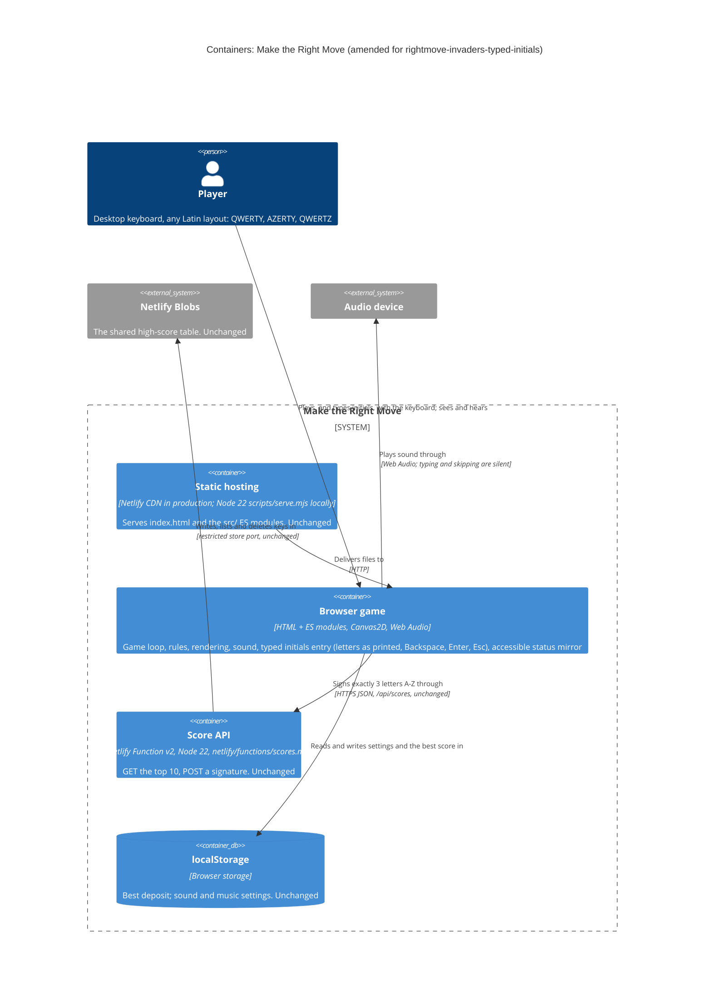
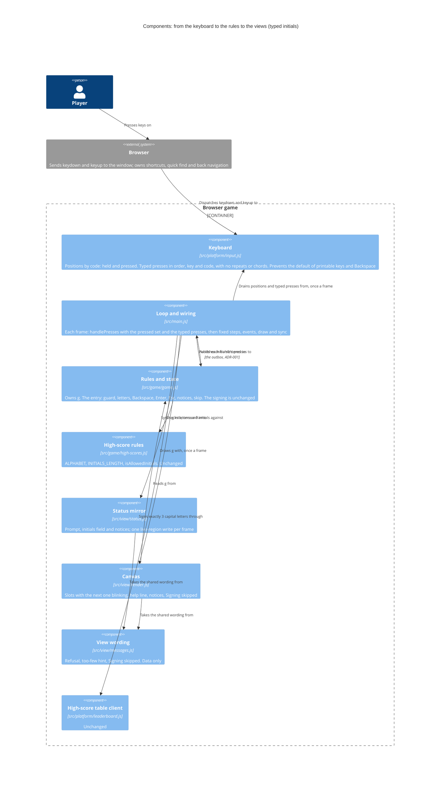

<!-- markdownlint-disable MD024 -->
# Feature delta: rightmove-invaders-typed-initials

A player whose deposit makes the shared high-score table **types** their three initials and presses Enter, instead of choosing each letter with Up and Down. Backspace deletes the last letter and Esc skips signing. Everything after the signing stays as `rightmove-invaders-leaderboard` shipped it: the signing lifecycle, the server contract and the table.

- **Type**: user-facing, a change to live functionality, brownfield (`rightmove-invaders-leaderboard`, in production since `144e23a`). Branch `rightmove-invaders-typed-initials`, cut from `main` at `d55cbf9`.
- **Density**: lean (Tier-1 only). **Research depth**: lightweight (the user took the key decisions). **JTBD**: yes.
- **No DISCOVER or DIVERGE.** The change comes from the user (2026-10-25): "the player should type the letters directly". The jobs are assumptions, and K16–K18 validate them.
- **SSOT**: [jobs.yaml](../../product/jobs.yaml) (J-TABLE-SIGN, J-TABLE-SKIP) · [persona](../../product/personas/casual-arcade-player.yaml) · [journey](../../product/journeys/play-a-session.yaml) (new high-score steps) · [leaderboard feature delta](../rightmove-invaders-leaderboard/feature-delta.md)
- **Slices**: [slice 01, type your initials](slices/slice-01-type-your-initials.md) · [slice 02, skip with Esc](slices/slice-02-skip-with-esc.md)

---

## Wave: DISCUSS / [REF] Persona ID

`casual-arcade-player`: Alex Morgan (they/them). Plays for fun in 5–10 minute sessions on a MacBook Air with a UK keyboard, and grew up with arcade games. The domain examples also use other players of the same segment: Camille Dubois (French AZERTY), Jonas Ziegler (German QWERTZ), Mina Patel, Sam Taylor and Priya Shah.

## Wave: DISCUSS / [REF] JTBD one-liner

When my deposit makes the shared high-score table, I want to type my initials as I would anywhere else and press Enter (or Esc to pass), so I can claim my place in seconds and get back to playing.

| Job | Opportunity | Stories |
|---|---|---|
| J-TABLE-SIGN (sign the table quickly, with exactly my initials) | 11 | US-01, US-02, US-03, US-04 |
| J-TABLE-SKIP (pass on signing with one key) | 9 | US-05 |

**Evidence level: assumption.** It is the product owner's own preference (2026-10-25), with no playtest and no player feedback yet.

## Wave: DISCUSS / [REF] Locked decisions

| ID | Decision | Verdict |
|---|---|---|
| D1 | The player types up to 3 letters. **Enter** signs once 3 letters are in, and Enter with fewer does nothing but the hint of D13. **Backspace** deletes the last letter. | Locked (user, 2026-10-25) |
| D2 | **Only letters type**: Up and Down no longer change letters, and the arrows are ignored during entry. | Locked (user, 2026-10-25) |
| D3 | **Esc skips signing**: the entry closes, nothing is sent, the deposit doesn't enter the table, and Enter starts a new game as usual. | Locked (user, 2026-10-25) |
| D4 | **Initials on the word filter are cleared**: the refusal is shown (reworded in D12), and the entry goes back to empty. | Locked (user, 2026-10-25) |
| D5 | The entry starts **empty** (`_ _ _`), not `A A A`. | Locked (orchestrator default, no objection) |
| D6 | Lowercase is accepted and shown in capitals. Digits, punctuation, accented letters and anything else are ignored. | Locked (orchestrator default, no objection) |
| D7 | During entry **every letter key types its letter**, M, N, P, A and D included, and Space does nothing. The M and N toggles and P (pause) don't apply during entry, and work again once it closes. | Locked (orchestrator default, no objection) |
| D8 | **The letter shown is the one printed on the key the player presses**, so AZERTY and QWERTZ layouts work too. This is a product AC; the mechanism is DESIGN's. | Locked (orchestrator default, no objection) |
| D9 | Unchanged: only a deposit that makes the table is asked; the signing lifecycle (pending → confirmed, off-table or unconfirmed); the server contract (3 letters A–Z, `/api/scores`); the 16-word filter; the accessible initials field and its announcements; Enter restarts after signing. | Locked (orchestrator default, no objection) |
| D10 | Desktop keyboard only: no on-screen keyboard, no mobile, no names longer than 3 letters. | Locked (orchestrator default, no objection) |
| D11 | **Stray-key guard**: for the first 0.6 s of game over, no key acts on the entry (no letter, Backspace, Enter or Esc). A key held down from play never types. 0.6 s is the game's existing wait before Enter can start a new game. | Locked (PO default, confirmed by the user 2026-10-25) |
| D12 | **Wording** as in "Player-facing wording" below. The game-over announcement keeps `Deposit saved £…` and `Enter your initials`, because the walking skeleton reads them. The accessible field says `A, letter 2 of 3` with no underscores: the field is visually hidden, and screen readers read "_" inconsistently ("underscore", "line" or nothing). The canvas shows `A _ _`. | Locked (PO default, confirmed by the user 2026-10-25) |
| D13 | Enter with fewer than 3 letters sends nothing, keeps the letters, and says `Type 3 letters to sign.` (this answers D1's "your call"). | Locked (PO default) |
| D14 | A 4th letter is ignored: it doesn't overwrite and isn't announced. Holding a key down gives one press, with no auto-repeat (Backspace included). Backspace on an empty entry does nothing. | Locked (PO default) |
| D15 | **Every key press counts once, in the order pressed, however fast**: `a`, `a`, `x` typed within one frame give `AAX`. For the entry, this replaces the leaderboard's "presses of the same key within one frame count once". The live region still changes at most once per frame. | Locked (PO default) |
| D16 | A skip isn't a signing: the current signing and its mark are kept (DDD-8), and the local best is saved as usual. A skip has no sound. | Locked (PO default) |
| D17 | A letter typed with Cmd or Ctrl held types nothing, so browser shortcuts are left alone, as today. Option and Alt characters (å, ß, ü) aren't A–Z letters and are ignored (D6). No key typed during entry may start a browser feature, for example Firefox's quick find on `/` or `'`. | Locked (PO default) |
| D18 | Slice order: typing first, Esc second, ideally in one release. If slice 01 ships alone, a player who doesn't want to sign types any 3 letters, which is no worse than today, where Enter pressed three times signs `AAA`. | Locked (PO default) |

## Wave: DISCUSS / [REF] Scope assessment

**PASS (right-sized).** The feature has 5 stories in 2 slices, and each slice is 1 day or less. It touches one bounded context, the game in the browser: the keyboard adapter, the rules' entry, the status mirror, the canvas and the wording. The Score API, the store, the table client and the word list are untouched. The walking skeleton is inherited, with no new integration point. Estimate: about 1 day of DELIVER (slice 01 about 5–6 h, slice 02 about 2 h), plus DISTILL's rewrite of the existing entry steps. Each slice has one outcome, so no split is needed.

## Wave: DISCUSS / [REF] Player-facing wording (proposed)

DISTILL copies this into its Messages table, because the `.feature` files are the wording's SSOT. Apostrophes are ASCII, as in `messages.js`.

| When | Status mirror (live region; `data-hud="initials"` for the field) | Canvas | Slice |
|---|---|---|---|
| Game over, deposit makes the table | `Game over: Offer rejected. Deposit saved £1,250. New high score! Enter your initials: type 3 letters, then press Enter to sign.` Slice 02 adds ` Esc skips.` | `New high score!`, three slots `_ _ _` with the first blinking, and the help line `Type 3 letters   Enter sign   Backspace delete`. Slice 02 adds `   Esc skip` | 01, 02 |
| The field, and its live update on each change | `No letters yet, letter 1 of 3` → `A, letter 2 of 3` → `A L, letter 3 of 3` → `A L X, press Enter to sign` | `A _ _`, then `A L _`, then `A L X`. The next empty slot blinks | 01 |
| Enter with fewer than 3 letters | `Type 3 letters to sign.` Slice 02 changes it to `Type 3 letters to sign, or press Esc to skip.` | The same words under the help line, until the next key | 01, 02 |
| Initials on the word filter | `Those initials aren't allowed. Type different ones.`, then the field `No letters yet, letter 1 of 3` | The refusal in red under the help line until the next key; the slots are empty | 01 |
| Esc | `Signing skipped. Press Enter to house-hunt again.` | `Signing skipped` where the signing line goes, then the list | 02 |
| Pending, confirmed, off-table, unconfirmed, unavailable | Unchanged: `Signing ALX…`, `Signed ALX, #3.`, `The table filled up before ALX arrived.`, `Couldn't confirm ALX's signing.`, `High-score table unavailable.` | Unchanged | — |

## Wave: DISCUSS / [REF] Story map and slice order

Backbone, the new journey steps in [play-a-session](../../product/journeys/play-a-session.yaml): **qualify → type initials → sign or skip → see the table**.

| Qualify | Type initials | Sign or skip | See the table |
|---|---|---|---|
| The entry opens empty (US-01) | Letters fill the slots, in capitals (US-01) | Enter with 3 letters signs (US-01) | *Inherited*: pending, then confirmed, off-table or unconfirmed; the row marked |
| A tap as the game ends doesn't type (US-02) | Backspace takes back the last letter (US-01) | Enter early: a hint, and nothing sent (US-01) | *Inherited*: the list on game over and on the title |
| *Inherited*: only a deposit that makes the table, and only while the table is available | Only letters type; M, N and P are letters (US-02) | Blocked initials: refused, and the entry emptied (US-04) | |
| | The letter printed on the key (US-03) | Esc skips (US-05) | |

**Walking skeleton**: inherited from the leaderboard (qualify → enter FAB → the table topped by FAB → another house-hunter sees it). This feature only changes how its "enter" step is done (WS strategy, below).

| Order | Slice | Stories | Why this position |
|---|---|---|---|
| 1 | [01 Type your initials](slices/slice-01-type-your-initials.md) | US-01, US-02, US-03, US-04 | The user's request and the higher opportunity (11). It also carries the riskiest assumption: typed letters arrive as printed, in order, without stray game keys, in three engines |
| 2 | [02 Skip with Esc](slices/slice-02-skip-with-esc.md) | US-05 | Opportunity 9, and the smallest. It reuses slice 01's entry key handling and its 0.6 s guard. Ideally shipped in the same release (D18) |

**Priority rationale**: the walking skeleton is inherited, so the riskiest assumption comes first. That is slice 01: layouts, key order and stray keys. Value × urgency / effort favours slice 02 (3 × 3 / 1 = 9, against 5 × 4 / 3 ≈ 6.7), but the tie-break puts the riskiest assumption first, and slice 02 depends on slice 01's key handling.

**Carpaccio taste tests**: neither slice ships a new component (both extend five existing ones), and neither needs a new abstraction first. Each slice can disprove something (see its learning hypothesis), runs on the real page, real keyboards and the preview's real table, and has a same-day dogfood. The two slices aren't the same thing at different scales. **PASS.**

## Wave: DISCUSS / [REF] User stories

### US-01: Alex types their initials and signs

`job_id: J-TABLE-SIGN` · slice 01 · ≤ 1 day

Alex has just made the shared top 10 with £1,250. To sign ALX on the letter wheel, they press Up 11 times for L, Down 3 times for X (if they know the wheel wraps round; Up 23 times if not) and Enter three times. That is 17 to 37 key presses at the moment they want to enjoy, with the letters right under their fingers.

#### Elevator Pitch

Before: Alex picks each initial on a letter wheel with Up and Down and takes it with Enter: 17 key presses for ALX, or 37 with Up only.
After: at game over with a deposit that makes the table, type `alx` and press Enter → sees `A L X` fill the three empty slots as they type, then "Signing ALX…" and, once the table answers, "Signed ALX, #3." with the ALX row marked in the High scores list.
Decision enabled: Alex sees their initials spelled right before pressing Enter, decides to sign (or to Backspace a typo), and starts the next game straight away.

**Domain examples**

1. *Happy path*: the table holds KIM £2,000, LEO £1,500 and TED £1,000. Alex ends on "Offer rejected" with £1,250 and types `a`, `l`, `x` without Shift. The slots read `A L X`. Enter → "Signing ALX…", then "Signed ALX, #3.".
2. *Typo*: Alex types `A L C`, sees the C, and presses Backspace (`A L _`). They type `x` and press Enter, and ALX is signed.
3. *Too early*: Alex types `A L` and presses Enter, thinking two letters are enough. Nothing is sent, the game says "Type 3 letters to sign." and `A L` stays. They type `x`, press Enter, and ALX is signed.

**UAT scenarios**

1. *Typed initials sign the table.* Given the high-score table holds KIM £2,000, LEO £1,500 and TED £1,000, and Alex's game is over with £1,250, When Alex types "alx" and presses Enter, Then the game tells them "Signing ALX…" and then "Signed ALX, #3.", and the ALX row is marked as theirs.
2. *The entry opens empty.* Given the high-score table holds 9 signatures of £1,000, When Alex finishes a game with £1,250, Then the game tells them "New high score! Enter your initials: type 3 letters, then press Enter to sign." and the initials field reads "No letters yet, letter 1 of 3".
3. *Each letter shows as it is typed.* Given the entry is open and empty, When Alex types "a", Then within one frame the initials field reads "A, letter 2 of 3", and the game tells them "A, letter 2 of 3".
4. *Backspace takes back the last letter.* Given Alex has typed "A L C", When they press Backspace, Then the initials field reads "A L, letter 3 of 3".
5. *Enter with fewer than 3 letters sends nothing.* Given Alex has typed "A L", When they press Enter, Then nothing is sent to the table, the initials field still reads "A L, letter 3 of 3", and the game tells them "Type 3 letters to sign" (slice 02 adds ", or press Esc to skip.").
6. *A fourth letter changes nothing.* Given Alex has typed "A L X", When they type "q", Then the initials field still reads "A L X, press Enter to sign".
7. *Fast typing keeps every letter, in order.* Given the entry is open and empty, When Alex types "aax" and presses Enter, all within one frame, Then the game tells them "Signing AAX…".

**Acceptance criteria**

- [ ] The entry opens with three empty slots, never `A A A`. The game-over announcement still contains `Deposit saved £…` and `Enter your initials`.
- [ ] Each letter key types its letter, in capitals, into the next empty slot. The field shows it, and it is announced, within one frame (17 ms) of the key press.
- [ ] Backspace removes the last letter, and on an empty entry it does nothing.
- [ ] Enter with 3 letters signs exactly those letters, and the signing lifecycle is unchanged. Enter with fewer letters sends nothing, keeps the letters and says "Type 3 letters to sign."
- [ ] A 4th letter is ignored, and holding a key down types its letter once.
- [ ] Every press counts once, in the order pressed, however fast: two presses of the same letter within one frame give two letters.
- [ ] The live region changes at most once per frame, so letters typed within one frame are announced together.

**Outcome KPI**: K16 (signing is self-evident).
**Technical notes**: `src/platform/input.js` records only `e.code`, and the rules see a frame's presses as a set, so two presses of one key within a frame count once (leaderboard DESIGN, Driving ports). This story needs every press, in order; DESIGN decides how. The rules still send exactly 3 capital letters, so `isValidSignature` and `/api/scores` don't change. Backspace must never navigate away from the page.
**Dependencies**: `rightmove-invaders-leaderboard` in production (done).

### US-02: Only letters type while Mina signs

`job_id: J-TABLE-SIGN` · slice 01 · ≤ ½ day

Mina Patel signs MNP. Each of her letters is also a game key: M mutes, N stops the music, P pauses, and A and D move, Space fires and the arrows move too. At the entry she needs every letter key to be a letter and every other key to do nothing. A key she was still hammering as the formation landed mustn't end up on a public table.

#### Elevator Pitch

Before: Mina can't put M, N or P in her initials by pressing those keys: on the entry today, M turns all sound off and N stops the music.
After: at the initials entry, type `m`, press Up, type `7`, press Space, then type `n` and `p` → sees `M N P` (Up, 7 and Space ignored), and the HUD still shows Sound On and Music On. Once she has signed, M mutes again.
Decision enabled: Mina trusts that only the letters she types reach the table, and decides to type her initials as they are, without working round the game's keys.

**Domain examples**

1. *Game keys as letters*: Mina types `m`, `n`, `p` and gets `M N P`. The sound and the music stay on. After signing, M mutes as usual.
2. *Old habits*: Alex presses Up out of habit, then `7`, Space and `.`. Nothing changes, and the field still reads "No letters yet, letter 1 of 3".
3. *A tap as the game ends*: Alex is tapping D to dodge when the formation lands ("Gazumped!"). The tap comes 0.3 s after game over, so no D appears. A `d` typed 1 s after game over does show.

**UAT scenarios**

1. *Game keys type their letters.* Given the entry is open and the sound and the music are on, When Mina types "mnp", Then the initials field reads "M N P, press Enter to sign", and the HUD shows Sound On and Music On.
2. *Keys that aren't letters are ignored* (outline: Up, Down, Left, `7`, Space, `.`, `-`, `/`). Given the entry is open and empty, When Alex presses `<key>`, Then the initials field still reads "No letters yet, letter 1 of 3", and nothing about the initials is announced.
3. *The toggles work again once the entry closes.* Given Mina has signed MNP, When she presses M, Then the sound turns off, and the game tells her "Sound off. Press M to turn it on."
4. *A key tapped as the game ends doesn't type.* Given the game ended 0.3 seconds ago and the entry is open, When Alex types "d", Then the initials field still reads "No letters yet, letter 1 of 3".
5. *Browser shortcuts don't type.* Given the entry is open and empty, When Alex presses a letter with Ctrl (or Cmd) held, Then the initials field still reads "No letters yet, letter 1 of 3".

**Acceptance criteria**

- [ ] During the entry, every A–Z key types its letter, A, D, M, N and P included. M and N don't toggle the sound or the music, and P doesn't pause.
- [ ] Arrows, digits, Space, punctuation and every other key that isn't a letter do nothing and announce nothing. Backspace, Enter and Esc have their own meanings.
- [ ] No key typed during the entry starts a browser feature (for example Firefox's quick find on `/` or `'`): the next letter still types.
- [ ] Once the entry closes (signed, or skipped in slice 02), M, N and every other key work as before.
- [ ] For the first 0.6 s of game over, no key acts on the entry, and a key held down from play never types (D11).
- [ ] A letter typed with Cmd or Ctrl held types nothing (D17).

**Outcome KPI**: K17 (what you see is what you sign).
**Technical notes**: D7 inverts, for the entry only, `handlePresses`' rule "M and N work on every screen" (`src/game/game.js`). The 0.6 s threshold is the one already in `handlePresses` (`g.overT > 0.6`). Firefox's quick find (`/`, `'`, and typeahead find if the player has turned it on) can take the keyboard away from the page. That is a manual check in real Firefox (DoD 5).
**Dependencies**: US-01.

### US-03: The letter on Camille's key is the letter she signs

`job_id: J-TABLE-SIGN` · slice 01 · ≤ ½ day

Camille Dubois plays the shared table from Lyon on a French AZERTY MacBook, and Jonas Ziegler from Berlin on German QWERTZ. On their keyboards A, Q, Z, W, M and Y are printed where a UK keyboard has other letters. A game that read key positions would sign QAM when Camille presses C, A and M.

#### Elevator Pitch

Before: The game reads key positions laid out for a UK keyboard, so on AZERTY the key printed A arrives as the UK Q. The letter wheel hid this; typing would expose it.
After: on an AZERTY keyboard at the initials entry, press the keys printed C, A and M, then Enter → sees `C A M` in the slots and "Signing CAM…".
Decision enabled: Camille signs on her own keyboard with confidence, and decides to play on instead of checking what the table will show.

**Domain examples**

1. *AZERTY*: Camille presses the keys printed C, A and M, and gets `C A M`. CAM is signed.
2. *QWERTZ*: Jonas presses the keys printed J, A and Z, and gets `J A Z`, not `J A Y`.
3. *Accents*: Élodie Martin (AZERTY) presses the key printed É, and nothing is typed. She types `e`, `l`, `m` and signs ELM.

**UAT scenarios**

1. *Letters on an AZERTY keyboard.* Given Camille's keyboard is French AZERTY and the entry is open, When she presses the keys printed C, A and M, Then the initials field reads "C A M, press Enter to sign".
2. *Letters on a QWERTZ keyboard.* Given Jonas's keyboard is German QWERTZ and the entry is open, When he presses the keys printed J, A and Z, Then the initials field reads "J A Z, press Enter to sign".
3. *Accented letters are ignored.* Given Élodie's keyboard is French AZERTY and the entry is open and empty, When she presses the key printed É, Then the initials field still reads "No letters yet, letter 1 of 3".
4. *Capitals, however they are typed.* Given the entry is open and empty, When Camille types C with Shift held, A with Caps Lock on and a plain m, Then the initials field reads "C A M, press Enter to sign".

**Acceptance criteria**

- [ ] The letter typed is the one printed on the key pressed, on UK and US QWERTY, French AZERTY and German QWERTZ layouts.
- [ ] Lowercase, Shift and Caps Lock all give the capital letter.
- [ ] Letters outside A–Z (é, ü, ß, and å from Option) are ignored, never turned into a plain letter.

**Outcome KPI**: K17.
**Technical notes**: today `input.js` records `e.code`, a key position (AZERTY's printed A arrives as `KeyQ`). D8 is a product AC; the mechanism is DESIGN's. Playwright's `keyboard.press` sends US-layout events, so DISTILL has to produce events whose printed character differs from the key position. A real AZERTY or QWERTZ keyboard in Chrome, Firefox and Safari is a manual check (DoD 5). The movement keys and the M/N/P toggles outside the entry stay positional (Out of scope).
**Dependencies**: US-01.

### US-04: Sam's blocked initials start again empty

`job_id: J-TABLE-SIGN` · slice 01 · ≤ ½ day

Sam Taylor types A S S for a laugh, and the word filter refuses it (DDD-10, unchanged). Today the letters stay, the first one becomes current, and the game says "Change a letter.". That made sense on a letter wheel. When typing, there is no current letter to change, and Backspace only takes back the last one.

#### Elevator Pitch

Before: Refused initials stay on screen with "Change a letter.", a letter-wheel instruction that doesn't fit typing.
After: at the initials entry, type `ass` and press Enter → sees "Those initials aren't allowed. Type different ones." and three empty slots. Then type `sam` and press Enter → "Signing SAM…".
Decision enabled: Sam knows nothing was sent, and decides on other initials straight away.

**Domain examples**

1. Sam (£300) types `ass` and presses Enter: refused, and the entry is empty. He types `sam`, and SAM is signed.
2. Nadia Azoulay types `naz`, which is on the 16-word list: refused. She types `nad`, and NAD is signed.
3. Sam is refused, then presses Enter at once: "Type 3 letters to sign.", and nothing is sent.

**UAT scenarios**

1. *Refused initials are cleared.* Given Sam's game is over with £300 and the high-score table has room, When Sam types "ass" and presses Enter, Then the game tells him "Those initials aren't allowed. Type different ones.", the initials field reads "No letters yet, letter 1 of 3", and nothing is sent to the table.
2. *Other initials sign.* Given Sam's ASS has just been refused, When he types "sam" and presses Enter, Then the game tells him "Signing SAM…".
3. *The refusal shows until the next key.* Given Sam's ASS has just been refused, When he types "s", Then the refusal is gone, and the initials field reads "S, letter 2 of 3".

**Acceptance criteria**

- [ ] Initials on the word filter are refused in the game before anything is sent: no signing, and no request to the table.
- [ ] The entry empties and says "Those initials aren't allowed. Type different ones.". The refusal shows until the next key.
- [ ] Initials typed afterwards sign as usual.

**Outcome KPI**: K16 (a refused player still signs unaided within the playtest).
**Technical notes**: the 16-word list in `src/game/high-scores.js` and the server's 400 `initials-not-allowed` don't change (D9). The leaderboard's rules-operations row and DISTILL's Messages row for the refusal change (Changed assumptions).
**Dependencies**: US-01.

### US-05: Priya skips signing with Esc

`job_id: J-TABLE-SKIP` · slice 02 · ≤ ½ day

Priya Shah plays on her lunch break, on a screen her colleagues can see. Her £850 makes the table, but she would rather not put her initials on a public table. Today the only way past the entry is to sign, and pressing Enter to get through it signs "AAA". After slice 01 she would have to type three letters.

#### Elevator Pitch

Before: The only way past the initials entry is to sign, and pressing Enter to get through it leaves "AAA" on the shared table.
After: at the initials entry, press Esc → sees "Signing skipped." and "Press Enter to house-hunt again.", with the High scores list unchanged (no £850 row). Enter then starts a new game.
Decision enabled: Priya decides to keep her initials off the public table and gets straight back to playing.

**Domain examples**

1. Priya (£850) presses Esc and sees "Signing skipped.". Nothing is sent, and the table is unchanged. Enter starts a new game.
2. Priya types `p`, `s`, changes her mind and presses Esc. The game skips, and P S is dropped.
3. Alex signed ALX in the last game (confirmed, and marked). This game Alex skips, and the ALX row stays marked.

**UAT scenarios**

1. *Esc skips signing.* Given Priya's game is over with £850 and the high-score table has room, When she presses Esc, Then the game tells her "Signing skipped. Press Enter to house-hunt again.", nothing is sent to the table, and the High scores list shows no £850 row.
2. *Letters already typed are dropped.* Given Priya has typed "P S", When she presses Esc, Then the game tells her "Signing skipped. Press Enter to house-hunt again." and nothing is sent to the table.
3. *Enter plays again after a skip.* Given Priya has skipped signing, When she presses Enter, Then a new game starts.
4. *An earlier signing keeps its mark.* Given Alex's ALX was confirmed and marked in the last game, and this game's deposit makes the table, When Alex presses Esc, Then ALX's row is still marked as Alex's.
5. *Esc pressed as the game ends doesn't skip.* Given the game ended 0.3 seconds ago and the entry is open, When Alex presses Esc, Then the entry is still open and nothing is announced as skipped.
6. *The hint offers the way out.* Given the entry is open and empty, When Priya presses Enter, Then the game tells her "Type 3 letters to sign, or press Esc to skip."

**Acceptance criteria**

- [ ] Esc closes the entry at any point (empty, partly typed or full), sends nothing, and says "Signing skipped. Press Enter to house-hunt again."; the canvas shows "Signing skipped".
- [ ] The deposit doesn't enter the table: the list shows as it does for a deposit that wasn't asked.
- [ ] Enter then starts a new game, as it does after a signing.
- [ ] A skip isn't a signing: the current signing and its mark are kept, and the local best is saved as usual (D16).
- [ ] Esc during the first 0.6 s of game over does nothing (D11).
- [ ] The prompt ends with "Esc skips.", the canvas help line shows "Esc skip", and the early-Enter hint says "Type 3 letters to sign, or press Esc to skip."

**Outcome KPI**: K18 (skipping is findable and safe), K19.
**Technical notes**: Esc pauses during play ("P or Esc"). The game-over screen isn't pausable, so Esc has no other meaning there. A skip makes no request to the table and plays no sound. Whether the rules publish an event for it is DESIGN's call.
**Dependencies**: US-01 (the entry's key handling and the 0.6 s guard).

## Wave: DISCUSS / [REF] Outcome KPIs

**Objective**: signing the high-score table is as quick as writing your initials anywhere, and passing on it is just as easy.

**Playtest protocol** (K16–K18): 5 people who match the persona and aren't on the team, at least 1 of whom types on AZERTY or QWERTZ on their own laptop. They play on the pull request's deploy preview, whose table starts empty, so any deposit makes it. Nobody is told how to sign or skip. Each plays two games. After the first game over, they sign. After the second, they are asked to "move on without putting your initials up". Times come from a screen recording, from the prompt appearing to "Signing …" or "Signing skipped.". n is recorded with every result.

| ID | Who | Does what | Target | Baseline | Measured by | Gate |
|---|---|---|---|---|---|---|
| K16 | Playtesters whose deposit makes the table | Sign with their own initials, unaided | 5 of 5, each within 10 s of the prompt | Not measured. Structurally, the letter wheel needs 9 presses for FAB and 17 for ALX (37 with Up only); typing needs 4 | Screen recording, stopwatch | soft (north star) |
| K17 | The same, the AZERTY or QWERTZ tester included | End up with exactly the letters they meant | 0 signatures different from what the player meant | n/a | Asked after each signing, against the preview table | soft (any miss blocks closing the feature until it is explained) |
| K18 | Playtesters asked to move on without signing | Skip with Esc, unaided, and never skip by accident | ≥ 4 of 5 within 10 s; 0 accidental skips across all sessions | Today there is no way to skip | Screen recording | soft |
| K19 | Production players | Leave fewer throwaway rows | No new `AAA` row on the production table in the 30 days after release | The `AAA` rows on the production top 10 on release day | `GET /api/scores`, weekly | soft (observational: low traffic) |

**Guardrails** (hard, automated): the leaderboard's walking skeleton and its scenarios (as amended by DISTILL), and the sound feature's M and N scenarios, stay green in Chromium, Firefox and WebKit, and nothing under `netlify/` changes. Proposed IDs: DISTILL registers K16–K19 in [kpi-contracts.yaml](../../product/kpi-contracts.yaml).

**Hypothesis**: we believe that typed initials, with Backspace and Esc, will let casual arcade players sign or pass in seconds. We will know this is true when 5 of 5 playtesters sign unaided within 10 s with exactly their own letters, and at least 4 of 5 find Esc when they want to pass.

## Wave: DISCUSS / [REF] Definition of Done

1. Every acceptance criterion is verified as DISTILL's traceability says, and the automated ones are green in Chromium, Firefox and WebKit.
2. The leaderboard's walking skeleton is green with its entry step typing FAB. `npm test` and `npm run build` are green, with no `@pending` left.
3. No trace of the letter wheel is left: the prompt, the canvas help line, the field and the test drivers all describe typing.
4. K16–K18 were recorded with n from the playtest; K19's baseline was recorded on release day.
5. Manual checks by the deliverer, on the deploy preview: a real AZERTY or QWERTZ keyboard in Chrome, Firefox and Safari; Firefox's quick find (`/`, `'`) doesn't take the keyboard; the canvas slots, the blinking next slot, the help line, the hint, the refusal and "Signing skipped" in the compact game-over layout (the leaderboard's D10 waiver: no test reads the canvas).
6. VoiceOver on macOS speaks the prompt, each letter, the hint, the refusal and the skip.
7. The README's controls describe typing the initials, Backspace and Esc.
8. The server contract, the word list and the signing lifecycle are unchanged, and there is no new dependency.
9. The PO's check on the deploy preview is done, and the work is merged to `main`.

## Wave: DISCUSS / [REF] Out of scope

- An on-screen keyboard, touch or mobile entry (D10).
- Names longer than 3 letters.
- Turning É into E, non-Latin scripts and IME input.
- Moving a cursor inside the initials (arrows to edit the middle letter).
- A timeout that signs or skips by itself, or a way back into the entry after a skip.
- Any change to the word list, the server contract or the table.
- A sound for typing or skipping.
- **Making the game keys layout-aware outside the entry.** On AZERTY, the M toggle today answers the key printed `,`, because it reads `KeyM`'s position. A pre-existing issue, and a candidate follow-up.

## Wave: DISCUSS / [REF] WS strategy

**Inherited, not rewritten, duplicated or retagged.** The leaderboard's walking skeleton ("A house-hunter signs the high-score table and another house-hunter sees it", `@walking_skeleton @driving_port`) already covers this feature's path end to end: the real page and keyboard, and the real function and Blobs client on the emulator behind `scripts/serve.mjs` (old strategy C, real local).

- **DISTILL moves its step `When I enter the initials "FAB"` to typing.** Today the step presses ArrowUp to turn each letter. The new step types `f`, `a`, `b` and presses Enter. It must first let 0.7 s of game time pass (D11), because the step before it can leave as little as 0 s after game over. The step text, and so the feature file, can stay as they are.
- Its reads stay valid: the game-over announcement still contains `Deposit saved £50` and `Enter your initials`, and the list still reads `FAB £50`.

## Wave: DISCUSS / [REF] Driving ports

- **The keyboard in the game page while the initials entry is open**: letter keys, read as the character printed on the key; Backspace, Enter and Esc; every other key ignored. Every press counts once, in order (D15).
- Outside the entry, unchanged: Enter, Space, the arrows or A/D, M, N, and P/Esc.
- Unchanged and not driven by this feature: window `blur` and `visibilitychange`, page load, and the HTTP `/api/scores` (driven, untouched).

## Wave: DISCUSS / [REF] Pre-requisites

- `rightmove-invaders-leaderboard` in production (`144e23a`; release record `d55cbf9`), with 326 tests green.
- **For DESIGN**:
  - how the printed character reaches the rules (today `input.js` records `e.code` only), with every press kept, in order (D15);
  - amending the leaderboard rows listed under Changed assumptions.
- **For DISTILL**:
  - a way to send key events whose printed character differs from the key position, in three engines (US-03); a 30-minute probe is advisable (slice 01 brief);
  - the existing tests that drive the letter wheel, all of which move to typing: the walking-skeleton step; M4's field (`A A A, letter 1 of 3`); M5's field, cadence (Up pressed 3 times) and refusal scenarios; `steps/domain-types.js` (`INITIALS_PROMPT`, `initialsField`, `INITIALS_FIELD_PATTERN`); `steps/leaderboard-game.js` (`chooseLetter`, `pressUp`); Tier B's entry model (`tier-b/signing-rules.js`); and `tests/unit/status-mirror.spec.js`.
- **For the playtest and the DoD**: the pull request's deploy preview, one real AZERTY or QWERTZ keyboard, and VoiceOver on macOS.

## Wave: DISCUSS / [REF] DoR validation

| # | Item | Status | Evidence |
|---|---|---|---|
| 1 | Problem statement clear, in domain language | PASS | Each story opens with the player's pain: 17–37 presses for ALX, M muting mid-signature, AZERTY's A arriving as Q, "Change a letter" when typing, "AAA" as the only way past the entry |
| 2 | Persona with specific characteristics | PASS | Alex Morgan (`casual-arcade-player`, MacBook Air, UK keyboard), plus named players of the same segment on AZERTY (Camille, Élodie) and QWERTZ (Jonas) |
| 3 | ≥ 3 domain examples with real data | PASS | 3 per story: ALX £1,250 at #3 under KIM £2,000 and LEO £1,500; MNP; CAM and JAZ; ASS → SAM; Priya's £850 |
| 4 | UAT in Given/When/Then, 3–7 per story | PASS | 7, 5, 4, 3 and 6 scenarios, each with one When, covering happy, edge and error paths |
| 5 | AC derived from UAT | PASS | Every AC maps to a UAT. "Within one frame" (US-01) and "no browser feature" (US-02) also get manual checks (DoD 5) |
| 6 | Right-sized | PASS | 5 stories in 2 slices of 1 day or less each, with 3–7 scenarios per story |
| 7 | Technical notes | PASS | On every story: `e.code` today, the frame's set of presses, the 0.6 s threshold, Firefox's quick find, Playwright's US-only key events |
| 8 | Dependencies resolved or tracked | PASS | The leaderboard is live. US-02–US-05 depend on US-01. DESIGN and DISTILL items are listed under Pre-requisites |
| 9 | Outcome KPIs with measurable targets | PASS | K16–K19, each with who, what, a numeric target, a baseline (or why there is none) and a method |
| — | Job traceability (hard check) | PASS | One `job_id` per story, both jobs in `jobs.yaml` (evidence: assumption) |
| — | Elevator pitch (hard check) | PASS | Every story has Before, After (a real UI action → an exact observable output) and Decision enabled. No story is `@infrastructure` |

**DoR status: PASSED.** No expansion trigger fired (one context, one persona segment, no regulatory terms, WS inherited), so the output is lean with no menu. The optional per-wave peer review was not run; the consolidated review runs at the end of DISTILL.

## Wave: DISCUSS / [REF] Changed assumptions

The leaderboard's documents are not edited. Their originals are quoted here, and DESIGN amends them:

- Leaderboard feature delta, header: "A deposit that makes the top 10 is signed with three initials (A–Z, Up/Down change the letter, Enter takes it)." → The initials are typed; Backspace deletes and Esc skips.
- DESIGN, Rules operations, Game over: "the initials entry opens (letters A A A, the first letter current)" → It opens empty (D5).
- DDD-10: "Blocked initials: the rules refuse the signing, keep the entry open with the letters kept, and ask the player to change them." → The entry is emptied, and the player is asked to type different initials (D4).
- DESIGN, Rules operations, "Third Enter, initials on the word filter": "The entry stays open with the letters kept, and a refusal is shown until the next key. The first letter becomes current (decided in DISTILL)" → Now "Enter with 3 letters on the word filter": the entry stays open, emptied, and the refusal is shown until the next key.
- DESIGN, Driving ports: "Keyboard in the page: as before, plus Up/Down/Enter while the initials are entered (presses of the same key within one frame count once)." → Letters, Backspace, Enter and Esc; every press counts once, in order (D15).
- DDD-14: "one short live-region update per change of letter or position (at most one per frame)" → One update per change of the typed letters, still at most one per frame.
- DISTILL, Messages: the prompt "New high score! Enter your initials: Up and Down change the letter, Enter takes it.", the field "`F A A, letter 2 of 3`" and the refusal "`Those initials aren't allowed. Change a letter.`" → The wording table above (D12).
- `src/game/game.js`, `handlePresses`: "M and N work on every screen, and never touch the game itself." → Except while the initials are entered (D7).
- Leaderboard evolution document: "No persona, job, journey step or story was written for the table." → J-TABLE-SIGN, J-TABLE-SKIP, the journey's high-score steps and the persona's vocabulary are added now.

## Wave: DISCUSS / [REF] Wave decisions summary

- **Decisions**: D1–D10 (user, and orchestrator defaults with no objection); D11–D18 (PO defaults). The user approved the wording and D11–D18 on 2026-10-25.
- **Jobs**: J-TABLE-SIGN (opportunity 11) and J-TABLE-SKIP (9). Both are assumptions from the PO's own preference, validated by K16–K18.
- **Feature type**: user-facing, brownfield. **Walking skeleton**: inherited from the leaderboard; only its entry step's body changes.
- **Constraints**:
  - The rules still send exactly 3 capital letters, and nothing under `netlify/` changes.
  - Every press counts once, in order, during the entry.
  - The global toggles are suspended only while the entry is open.
  - No key acts on the entry in the first 0.6 s of game over.
- **Risks**:
  - No DISCOVER or DIVERGE, and the jobs are unvalidated.
  - Layout-true letters need DISTILL to fake layouts in three engines, plus a manual check on a real keyboard.
  - Firefox's quick find can take the keyboard.
  - The skeleton's step can flake against the 0.6 s guard unless it waits first.
- **Handoff**: DESIGN (nw-solution-architect), with the stories, the wording, the Changed assumptions and the Pre-requisites. DEVOPS gets K16–K19 only, and needs no new instrumentation: K19 reads the public table.

---

## Wave: DESIGN / [REF] DDD list

Scope: application (nw-solution-architect) · mode: propose · paradigm: OOP · density: lean · no SPIKE. Every row is **Accepted**: the user approved the DESIGN as written on 2026-10-25. The IDs are `DDD-T…`, so they don't clash with the leaderboard's DDD-1…19, which stand unless a row here says otherwise. ADR: [ADR-009](../../product/architecture/adr-009-keyboard-typed-presses-in-order.md) (accepted).

| ID | Decision | Verdict | One-line rationale |
|---|---|---|---|
| DDD-T1 | **Two channels from one keyboard** (ADR-009). The positional channel is unchanged: `isDown(code)`, `takePressed()` (a Set of codes), `endStep()` and `releaseAll()`. New: `takeTyped()` returns every keydown since the last call, in the order it arrived, as `{ key, code }`. Repeats (`e.repeat`) and chords (Cmd, Ctrl or Alt/Option held) are left out. `main.js` drains both channels every frame, paused or not. | Accepted | The printed letter (D8) and every press in order (D15), without touching the game keys (Out of scope) or the fixed step (ADR-000) |
| DDD-T2 | **One rules entry per frame**: `handlePresses(pressed, typed)`. `typed` defaults to none, so the callers that pass one argument stay valid. A frame that starts with the entry open belongs to the entry: the rules read `typed` in order and ignore `pressed`. Any other frame reads `pressed` only, as today. Presses that come after the entry closes in the same frame (Enter signs, Esc skips) are dropped. | Accepted | The rules decide what keys mean. The Enter that signs can never also restart, and M, N and P can't leak into the entry (D7) |
| DDD-T3 | **What a letter is** (the rules, `game.js`): the raw `key` is exactly one of the 52 ASCII letters a–z and A–Z, shown and signed in capitals. There is no Unicode normalisation and no case folding, so é, ü, ß, å, ı (dotless i), ſ (long s), K (the Kelvin sign) and a decomposed é are ignored, never turned into a plain letter. The check runs on the raw character, before uppercasing: `'ß'.toUpperCase()` is `'SS'`, and `'ı'.toUpperCase()` is `'I'`. Backspace, Enter and Escape are read by `key`, so the numpad Enter signs too. Every other key is ignored. It uses `ALPHABET` and `INITIALS_LENGTH` from `high-scores.js`, which doesn't change. | Accepted | D6, D8 and US-03, with no transliteration. The server contract (3 letters A–Z) and `isValidSignature` are unchanged (D9) |
| DDD-T4 | **Repeats and chords** (the adapter): a held key gives one press (D14), Backspace included. A chord is never typed and keeps its browser default (D17). For the typed channel only, Alt/Option counts as a chord, like Cmd and Ctrl: Option letters (å, ß) are ignored as D6 says, and Windows Alt+letter accelerators are left alone. The positional channel keeps today's filter (Cmd and Ctrl only), so holding Option during play still moves and fires. | Accepted | Browser and OS shortcuts are left alone, and nothing changes outside the entry |
| DDD-T5 | **The stray-key guard** (the rules): while the entry is open and `g.overT ≤ 0.6`, the frame's typed and positional presses are **dropped**, not queued. A key held down from play only repeats, so it never types. | Accepted | D11. A queue would type the very tap the guard exists to stop |
| DDD-T6 | **Entry operations** (the rules; the table is under Component decomposition): • The entry opens empty (D5). • A letter fills the next slot; a 4th is ignored (D14). • Backspace removes the last letter, and does nothing on an empty entry. • Enter with 3 letters signs, or is refused and empties the entry (D4). • Enter with fewer gives the too-few hint and keeps the letters (D13). • Esc skips (slice 02). **A notice (the refusal or the hint) shows until the next key the entry acts on**, that is a letter, Backspace, Enter or Esc that does something. A key the entry ignores changes nothing, the notice included *(clarified in DESIGN: DISCUSS says "until the next key")*. Notices are numbered, so the mirror announces each one even when the words repeat: Enter pressed twice too early is heard twice. | Accepted | One set of rules, in the only module that writes `g` |
| DDD-T7 | **The Esc skip** (slice 02) is state only. The entry closes, and the rules record that this game over was skipped, in a flag next to `signedThisGame` that `startGame` clears. There is no signing and no event, so no sound and no request; ADR-001's outbox is unchanged. The current signing, its mark, the settled notice and the table are untouched (DDD-8). The local best was already saved when the game ended. Enter then starts a new game as usual. | Accepted | D3 and D16. Nothing would consume an event, so none is added |
| DDD-T8 | **Browser defaults** (the adapter, ADR-009), on every screen: • `preventDefault` for each keydown that isn't a chord and whose `key` is one printable character, repeats included. • The same for Backspace. • Space and the arrows are prevented, as before. • Never Enter, Esc, Tab or a chord, so Enter still opens a focused footer link and every shortcut still works. The page has no editable element; if one is ever added, it must be exempt. | Accepted | D17 and US-01's Backspace note, with no mode and no rule in the adapter. It also stops Firefox's find bar taking the keyboard during play |
| DDD-T9 | **Wording, by owner**: • `messages.js`, for both views: the refusal "Those initials aren't allowed. Type different ones."; the too-few hint, "Type 3 letters to sign." in slice 01 and "Type 3 letters to sign, or press Esc to skip." in slice 02; and "Signing skipped", as a canvas heading and as a sentence for the mirror. • `status.js`, mirror only: the prompt and the field. • `render.js`, canvas only: the slots, the blinking next slot and the help line. "Deposit saved £…" and "Enter your initials" stay in the game-over announcement. | Accepted | D12. Each phrase both views say is declared once |
| DDD-T10 | **The live region changes at most once per frame**, by the existing mechanism. The rules take the whole frame's typed presses before `status.sync` runs, once. So letters typed within one frame are announced together, as the field they leave: "a" and "l" in one frame give "A L, letter 3 of 3". Within one write, the notice comes first, then the field if it changed. An entry that closes is announced by the game-over announcement ("Signing ALX…", "Signing skipped."). | Accepted | DDD-14 carried over, with no new timer or queue in the view |
| DDD-T11 | **The testability seam**: the keyboard listens on the window, reads only `key`, `code`, `repeat`, `metaKey`, `ctrlKey` and `altKey`, and never checks `isTrusted`. So a test can dispatch `new KeyboardEvent('keydown', { key: 'a', code: 'KeyQ', bubbles: true, cancelable: true })`, then its keyup, to stand in for AZERTY, and read `defaultPrevented`. The rules take plain data (`[{ key, code }]`), so the unit specs and the in-memory model can type without a browser. | Accepted | US-03 needs a key that differs from its code, and Playwright's `keyboard.press` sends US-layout events only |
| DDD-T12 | **Earned trust for the keyboard**. A keyboard can't be probed at start-up: it has nothing to report until a key is pressed, and the game never refuses to start over it. Its contract is earned through the catalogued lies below, each with its check. | Accepted | Every browser behaviour the entry relies on is checked somewhere |
| DDD-T13 | **Unchanged**: • `src/game/high-scores.js`, including its now-stale comment "Up and Down move round it" (D9 and the guardrail) • `netlify/**`, `platform/leaderboard.js`, `platform/storage.js`, `game/events.js`, `sound/**` and `index.html` • the signing lifecycle (DDD-8), the server contract, and ADR-000…008 **Layering**: the five rules hold, and a sixth is added: `platform/input.js` imports nothing. | Accepted | The change stays inside one bounded context (DISCUSS, Scope assessment) |

**Catalogued lies** (DDD-T12):

| Lie | How it shows | How the design handles it, and the check |
|---|---|---|
| `code` is a position, not the printed letter | AZERTY's A signs Q; QWERTZ's Z signs Y | The entry reads `key`. Acceptance: synthetic `{ key, code }` pairs (`a`/`KeyQ`, `z`/`KeyY`, `m`/`Semicolon`) in three engines. Manual: a real AZERTY or QWERTZ keyboard in Chrome, Firefox and Safari (DoD 5) |
| Two presses of one key within a frame | A Set merges them | The ordered typed queue. Acceptance: "aax" and Enter within one frame give "Signing AAX…". A unit test of the adapter over a plain `EventTarget` |
| Auto-repeat | A held key types many letters | Only a press with `repeat` false types. Acceptance: Playwright's second `keyboard.down` on a held key carries `repeat` |
| `key` isn't one ASCII letter (`Dead`, `Process`, `Unidentified`, `é`, `ß`, `ı`, `ſ`, `K`, a decomposed é) | A stray or transliterated letter | DDD-T3's exact check on the raw character. A unit table of the rules with these values |
| Chords (Cmd, Ctrl, Alt/Option; on Windows AltGr is Ctrl+Alt) | A shortcut types a letter, or the page blocks a shortcut | Never typed, never prevented. Acceptance: Ctrl+letter and Meta+letter type nothing |
| Firefox's quick find (`/`, `'`) and typeahead find | The find bar takes the keyboard | `preventDefault` on printable keys. Automated: `defaultPrevented` on a cancelable synthetic keydown. Manual: real Firefox, with typeahead find turned on too (DoD 5) |
| Backspace navigates back (older browsers, or a pref) | The page is left mid-entry | `preventDefault` on Backspace. Manual, in Firefox and Safari |
| A key tapped as the game ends, or held down from play | A stray letter on a public table | The 0.6 s guard drops presses, and held keys only repeat. Acceptance: "d" 0.3 s after game over, and Esc 0.3 s after game over (slice 02) |
| Synthetic events are untrusted and run no default | A test passes that a real browser would fail | The adapter doesn't check `isTrusted`, and defaults are checked through `defaultPrevented` plus the manual checks. DISTILL's 30-minute probe confirms that dispatch works in three engines |
| A keyup lost on blur | A key stuck down | Unchanged: `releaseAll()` on blur and on a hidden tab |

## Wave: DESIGN / [REF] Component decomposition

Contract shapes as in the leaderboard: **pure** · **bounded-change** (a declared universe and delta) · **composition root** / **static**.

| Component | Path | Change | Contract shape | Notes |
|---|---|---|---|---|
| Keyboard | `src/platform/input.js` | EXTEND | bounded-change (adapter) | Universe: its own held, pressed, unseen and release sets, the new typed queue, and `preventDefault` on the events it receives. Delta: `takeTyped()` (DDD-T1, DDD-T4) and the default policy (DDD-T8). The positional API and its meaning are unchanged. It imports nothing (the sixth layering rule) |
| Rules and state | `src/game/game.js` | EXTEND | bounded-change | Universe: `g.initials` = `{ letters (0–3 capitals, in the order typed), notice (null, or { kind: refused or too-few, n }) }`; the skip flag (slice 02); and, through `sign()`, the leaderboard's signing delta, unchanged. `g.settings` is untouched while the entry is open. `handlePresses(pressed, typed)` (DDD-T2). `index` and the letter wheel (`turned`) go: the next slot is `letters.length`. `snapshot().entry` follows the new shape (DISTILL settles its fields). The names are suggestions; DELIVER may rename them, along with the views and the tests that read them |
| Loop and wiring | `src/main.js` | EXTEND | composition root | One change: each frame, `handlePresses(keyboard.takePressed(), keyboard.takeTyped())` |
| Status mirror | `src/view/status.js` | EXTEND | bounded-change | Writes the same `[data-hud]` fields and live region. The prompt and the field change (Player-facing wording). Each notice is announced once, by its number. "Signing skipped." replaces the prompt when Esc closes the entry |
| Rendering | `src/view/render.js` | EXTEND | bounded-change (canvas pixels) | Three slots, `_` when empty, with the next empty slot blinking (none once all 3 are in). The help line `Type 3 letters   Enter sign   Backspace delete`, plus `   Esc skip` in slice 02. The hint, or the refusal in red, under it. "Signing skipped" on the signing line, then the list |
| View wording | `src/view/messages.js` | EXTEND | pure (data) | DDD-T9 |
| Layering test | `tests/unit/layering.spec.js` | EXTEND (DELIVER) | pure (test) | The sixth rule: `src/platform/input.js` imports nothing |
| README | `README.md` | EXTEND (DELIVER, at close-out) | static | The controls: type the initials, Backspace, Enter and Esc (DoD 7) |

### Rules operations (`src/game/game.js`), the entry only

Everything not listed here is as the leaderboard's Rules operations say.

| Operation | Delta |
|---|---|
| Game over, and `makesTheTable` | The entry opens **empty**: no letters and no notice (D5). Everything else as before |
| A frame while the entry is open and `g.overT ≤ 0.6` | Nothing: the frame's typed and positional presses are dropped (D11) |
| A frame while the entry is open | `pressed` is ignored: no M or N toggle, no pause, no restart (D7). The typed presses are taken in order, as below |
| A letter, with fewer than 3 in | Appended, in capitals; the notice is cleared |
| A letter, with 3 in | Nothing (D14) |
| Backspace, with letters in | The last one removed; the notice is cleared |
| Backspace, on an empty entry | Nothing (D14) |
| Enter, 3 letters, allowed | As the leaderboard's "Third Enter, initials allowed": the entry closes, a new signing n is pending and becomes the current one, and the rules emit `initialsEntered { initials, score, signing: n }`. The rest of the frame is dropped |
| Enter, 3 letters, on the word filter | No signing and no event. The entry is **emptied**, and shows the refusal notice (D4) |
| Enter, fewer than 3 | Nothing is sent. The letters are kept, and the entry shows the too-few notice (D13) |
| Esc (slice 02) | The entry closes and this game over is marked skipped. No signing, no event, no sound. The signing, its mark, the settled notice, the table and the best are unchanged (D3, D16). The rest of the frame is dropped. *In slice 01, Esc is a key the entry ignores* |
| Any other key | Nothing, the notice included |
| Enter once the entry has closed (signed or skipped), with `g.overT > 0.6` | A new game, as today; the skip flag is cleared |

### Signing-status lifecycle: the entry rows

These rows replace the leaderboard's entry rows. The rows from pending on are unchanged.

| From | Trigger | To | Status mirror (and the canvas, on game over) |
|---|---|---|---|
| no entry | Game over, and `makesTheTable` | entering, empty | The prompt (Player-facing wording); the field reads "No letters yet, letter 1 of 3" |
| entering | A letter or Backspace that changes the letters | entering | The field, for example "A, letter 2 of 3" |
| entering | Enter, fewer than 3 | entering | "Type 3 letters to sign." (slice 02: "…, or press Esc to skip.") |
| entering | Enter, 3, blocked | entering, empty | "Those initials aren't allowed. Type different ones. No letters yet, letter 1 of 3" |
| entering | Enter, 3, allowed | pending (n) | "Signing ALX…", then the leaderboard lifecycle, unchanged |
| entering | Esc (slice 02) | skipped: no signing, and an earlier signing unchanged | "Signing skipped. Press Enter to house-hunt again." |

## Wave: DESIGN / [REF] Driving ports

- **The keyboard in the page, while the initials entry is open**: the letters, read as printed (`key`), plus Backspace, Enter and Esc. Every press counts once, in order (D15). Repeats and chords don't type, and no key acts in the first 0.6 s of game over.
- **The keyboard in the page, outside the entry**: unchanged, by position (Enter, Space, the arrows or A/D, M, N, and P/Esc).
- **On every screen**: printable keys and Backspace never start a browser feature (DDD-T8).
- Unchanged, and not driven by this feature: window `blur` and `visibilitychange`, page load, and the server's HTTP `/api/scores`.

## Wave: DESIGN / [REF] Driven ports + adapters

| Port | Adapter | Change | In acceptance tests |
|---|---|---|---|
| Accessibility tree | `src/view/status.js` | The prompt, the field, the notices, "Signing skipped." | Real, and asserted on (`data-hud="initials"`, the live region and its writes) |
| Screen | `src/view/render.js` | The slots, the help line, the notices, "Signing skipped" | Real, not asserted on (the D10 waiver; manual, DoD 5) |
| Shared high-score table (client) | `src/platform/leaderboard.js` | None: a signing still sends exactly 3 capital letters | Real, through `scripts/serve.mjs`, as in the leaderboard |
| Audio output | `src/sound/synth.js` | None: typing and skipping make no sound | The journal, unchanged |
| Persistence | `src/platform/storage.js` | None: the best is saved at game over, before the entry | Unchanged |

**Contract tests for external integrations**: none new. The only external integration, Netlify Blobs behind the Score API, is untouched, and the leaderboard's annotation stands.

## Wave: DESIGN / [REF] Technology choices

- Unchanged: vanilla ES2022 modules, Canvas2D, no bundler, and **no new dependency**, runtime or dev.
- From the UI Events standard: `KeyboardEvent.key`, `code` and `repeat`, supported in every target browser.
- Rejected: `navigator.keyboard.getLayoutMap()` (Chromium only), a hidden `<input>` read through `beforeinput` (ADR-009), and dependency-cruiser for the sixth rule (the hand-rolled scan already covers it).

## Wave: DESIGN / [REF] Decisions table

| ID | Decision | Alternatives rejected |
|---|---|---|
| DDD-T1 | An ordered typed queue of `{ key, code }` beside the unchanged positional sets (ADR-009) | `takePressed()` as an ordered list (changes every one-shot rule, and the game outside the entry); `e.key` in the existing Set (still loses duplicates and order); a hidden `<input>` (focus, the accessibility tree, event merging); `getLayoutMap()` (Chromium only) |
| DDD-T2 | `handlePresses(pressed, typed)`; a frame that starts with the entry open is the entry's | `main.js` withholding `pressed` during the entry (the wiring would decide what keys mean); a separate `handleTyped` called before `handlePresses` (the Enter that signs would also restart, since `g.overT > 0.6`) |
| DDD-T3 | One raw ASCII letter, then capitals; no normalisation, no case folding | `toUpperCase()` before the check (ß gives SS, ı gives I); a case-insensitive Unicode regex (it matches ſ and K); NFD, then stripping the accents (transliteration, out of scope) |
| DDD-T4 | No repeats and no Cmd/Ctrl/Alt chords in the typed channel; the positional filter unchanged | Typing Alt chords (Windows Alt+letter would type, and its accelerator would be blocked); adding Alt to the positional filter (holding Option during play would stop the pin) |
| DDD-T5 | Presses during the 0.6 s guard are dropped | Queued until 0.6 s (types the stray tap); dropping letters but keeping Enter, Esc and Backspace (contradicts D11) |
| DDD-T6 | The entry operations; numbered notices that clear on the next key the entry acts on | Any key clears a notice (a key the entry ignores would then do something); notices without numbers (a second early Enter would be silent) |
| DDD-T7 | The Esc skip is state only, with no event | A new `initialsSkipped` event (nothing consumes it: no sound and nothing sent, D16); `initialsEntered` with a skip flag (`main.js` would have to filter it, and a stray POST would be one bug away) |
| DDD-T8 | `preventDefault` on every screen for printable keys and Backspace; never Enter, Esc, Tab or chords | Only while the entry is open, through a mode set by `main.js` or a predicate on the rules' state (a mode in the adapter that mirrors a rule, and quick find would still take the keyboard during play); also preventing Enter (a focused footer link would stop opening) |
| DDD-T9 | Shared phrases in `messages.js`, mirror-only words in `status.js`, canvas-only words in `render.js` | Everything in `messages.js` (the help line and the field are each said by one view only) |
| DDD-T10 | One `status.sync` per frame, after the whole queue; letters within one frame are announced together | A queue of announcements, one per letter (more than one write per frame, against DDD-14) |
| DDD-T11 | Synthetic `KeyboardEvent`s whose key differs from their code; the rules take plain data | Real layouts in the test run (Playwright has none); CDP's `Input.dispatchKeyEvent` (Chromium only) |
| DDD-T12 | Earned trust through catalogued lies, with no start-up probe for the keyboard | A start-up key probe (there is nothing to probe before a key press, and the game must never refuse to start) |
| DDD-T13 | Nothing changes beyond the browser game's entry; a sixth layering rule | Moving the letter check into `high-scores.js` (the file must not change, and the server needs no key semantics) |

## Wave: DESIGN / [REF] Reuse Analysis

Searched `src/**` for:
- key handling: `keydown`, `e.code`, `takePressed`, `isDown`
- the entry: `initials`, `ALPHABET`, `refuse`, `blankInitials`
- the wording: `messages.js`, `INITIALS_HELP`
- browser globals in `src/game/**`: none found

No new component is needed.

| Existing component | File | Overlap | Decision | Contract shape | Universe, and how the crafter checks it | Justification |
|---|---|---|---|---|---|---|
| Keyboard | `src/platform/input.js` | Keydown and keyup, the Cmd/Ctrl filter, `preventDefault` for Space and the arrows | EXTEND | bounded-change (adapter) | Its sets, the typed queue, and `defaultPrevented` on each event. A unit test over a plain `EventTarget` checks the order, duplicates, repeats and chords, which events were prevented, and that the positional results are unchanged | Already the only keydown listener; a second listener would split the ordering and the filters |
| Rules and state | `src/game/game.js` | `handlePresses`, `enterInitials`, `refuse`, `blankInitials`, `sign`, `g.overT`, `isPausable` | EXTEND | bounded-change | `g.initials`, the skip flag, and the signing delta through `sign()`; `g.settings` unchanged during the entry. Checked through `snapshot()` before and after each frame (`tests/common/state-delta.js`), as in Tier B | The only writer of `g`, and the entry already lives here |
| Loop and wiring | `src/main.js` | The per-frame `handlePresses(keyboard.takePressed())` | EXTEND | composition root | One more argument per frame | Wiring only |
| Status mirror | `src/view/status.js` | `INITIALS_HELP`, `initialsField`, `initialsAnnouncement`, `set(…, always)` | EXTEND | bounded-change | The `[data-hud]` fields and the live region. `status-mirror.spec.js`, rewritten by DISTILL: the field, one write per frame, each notice once | The field and the cadence already exist; only the words and the notice change |
| Rendering | `src/view/render.js` | `drawInitialsEntry`, `drawGameOver`, `blink` | EXTEND | bounded-change (pixels) | Canvas only; manual (D10) | The slots and the blink exist; the letter wheel becomes typed slots |
| View wording | `src/view/messages.js` | `INITIALS_REFUSED`, and the `PLAY_AGAIN` / `PLAY_AGAIN_SENTENCE` pattern | EXTEND | pure | Data, read by both views | The established home for the phrases both views say |
| High-score rules | `src/game/high-scores.js` | `ALPHABET`, `INITIALS_LENGTH`, `isAllowedInitials` | NONE (reused as is) | pure | Unchanged, and already imported by `game.js` | Must not change (D9); the server contract stays |
| Event vocabulary | `src/game/events.js` | `INITIALS_ENTERED` | NONE | pure | Unchanged | Nothing would consume a skip event, so there is none |
| Layering test | `tests/unit/layering.spec.js` | The import scan and its list of rules | EXTEND | pure (test) | One more rule row | Enforces DDD-T8's "the adapter decides nothing" |
| Page | `index.html` | `data-hud="initials"` | NONE | static | Unchanged | The field already exists |

**No CREATE NEW**: every change extends an existing module, and there is no new file under `src/`.

## Wave: DESIGN / [REF] C4 diagrams

**System context**: unchanged. See the [brief's System context](../../product/architecture/brief.md#c4-system-context).

**Containers**, amended for this feature (the brief's container diagram, with the typed entry):

**Components**: the keyboard → rules → views path inside the browser game.

## Wave: DESIGN / [REF] Changed assumptions

The originals are quoted verbatim, with their path, and the new assumption follows the arrow. The leaderboard's documents and the code are not edited by DESIGN. The list starts from DISCUSS's Changed assumptions.

`docs/feature/rightmove-invaders-leaderboard/feature-delta.md`:
- **Header**: "A deposit that makes the top 10 is signed with three initials (A–Z, Up/Down change the letter, Enter takes it)." → The initials are typed, as printed on the key. Backspace deletes, and Esc skips (slice 02).
- **DESIGN, Rules operations, Game over**: "As before, plus the initials entry opens (letters A A A, the first letter current) only if `makesTheTable(table state, deposit)` is true." → It opens empty, with no current letter: the next slot is the first empty one (DDD-T6).
- **DESIGN, DDD-10**: "Blocked initials: the rules refuse the signing, keep the entry open with the letters kept, and ask the player to change them. The server refuses them too (400 `initials-not-allowed`)." → The entry stays open, **emptied**, and asks the player to type different initials. The server is unchanged (D4).
- **DESIGN, Rules operations**: "Third Enter, initials allowed | The entry closes. A new signing `{ initials, n, pending }` becomes the current signing and replaces the earlier one, including its highlight." → "Enter with 3 letters, allowed", otherwise unchanged. The rest of that frame's presses are dropped (DDD-T2).
- **DESIGN, Rules operations**: "Third Enter, initials on the word filter | No signing and no event. The entry stays open with the letters kept, and a refusal is shown until the next key. The first letter becomes current (decided in DISTILL)" → "Enter with 3 letters on the word filter": no signing and no event. The entry stays open, emptied, and the refusal shows until the next key the entry acts on (DDD-T6).
- **DESIGN, Signing-status lifecycle**: the rows "no entry | Game over, and `makesTheTable` is true | entering | "New high score! Enter your initials: Up and Down change the letter, Enter takes it."", "entering | Up/Down | entering | Initials field and announcement, for example "F A A, letter 2 of 3"" and "entering | Third Enter, blocked word | entering | "Those initials aren't allowed. Change a letter."" → The entry rows under Component decomposition.
- **DESIGN, Driving ports**: "**Keyboard in the page**: as before, plus Up/Down/Enter while the initials are entered (presses of the same key within one frame count once). Enter restarts from every signing status." → While the entry is open: the letters as printed, plus Backspace, Enter and Esc, with every press counting once, in order (DDD-T1, DDD-T2). Enter still restarts from every signing status.
- **DESIGN, DDD-14**: "Accessibility: a `data-hud="initials"` field while entering, one short live-region update per change of letter or position (at most one per frame), announcements of signing outcomes whenever they arrive, and `aria-current` on the confirmed row in the High scores list." → One update per frame that changes the typed letters or shows a notice, still at most one per frame. Each notice is announced, even when its words repeat (DDD-T6, DDD-T10).
- **DESIGN, Component decomposition, Status mirror**: "Announces the chosen letter, the refusal, each settled outcome once when it arrives (in any game state, including a replaced signing's) and "High-score table unavailable"" → It announces the typed letters (the field), each notice once, each settled outcome once, "High-score table unavailable." and "Signing skipped.".
- **DISTILL, Messages**:
  - "`New high score! Enter your initials: Up and Down change the letter, Enter takes it.`" → the prompt in Player-facing wording
  - "`F A A, letter 2 of 3` (letters spaced, position 1–3); empty when not entering" → "No letters yet, letter 1 of 3" … "A L X, press Enter to sign"; still empty when not entering
  - "`Those initials aren't allowed. Change a letter.` The letters are kept, and the **first** letter becomes current" → "Those initials aren't allowed. Type different ones.", and the entry is empty
  - "Cadence: one live-region update per change of letter or position, so presses of the same key within one frame give one update." → One update per frame; presses within one frame each count, and are announced together (DDD-T10)
- **DISTILL, Driving adapter coverage**: "Keyboard: Up/Down/Enter on the initials | M5 initials field, cadence outline, refusal; every signing" → Letters, Backspace, Enter and Esc, with synthetic events whose key differs from their code for the layouts (DDD-T11).
- **Leaderboard evolution document**: "No persona, job, journey step or story was written for the table." → Done in DISCUSS (J-TABLE-SIGN, J-TABLE-SKIP, the journey's steps); nothing for DESIGN.

`docs/product/outcomes/registry.yaml`:
- **OUT-11** input: "third Enter on the initials entry", and output "blocked initials keep the entry open"; **OUT-14** output: "data-hud=initials field reads "F A A, letter 2 of 3" while entering (empty otherwise); one live-region update per change of letter or position, at most one per frame (same-key presses within a frame count once)" → To be amended or superseded by DISTILL (Open questions).

The code (DELIVER changes it; the quotes record what DESIGN overturns):
- `src/game/game.js` (`handlePresses`): "// M and N work on every screen, and never touch the game itself." → Except while the initials entry is open (D7, DDD-T2).
- `src/game/game.js`: "// Arcade initials: every letter starts at A, Up and Down move it round the alphabet, Enter takes it and moves on." → Typed initials (DDD-T6).
- `src/view/status.js`: "The rules see a frame's presses once, so presses of the same key within a frame are one change." → Every press counts; letters typed within one frame are announced together (DDD-T10).
- `src/platform/input.js`: "// Keys pressed since the last call, for one-shot actions such as Enter or P." → Still true of the positions; `takeTyped()` is added beside it (DDD-T1).
- `src/game/high-scores.js`: "export const ALPHABET = 'ABCDEFGHIJKLMNOPQRSTUVWXYZ';  // arcade initials, Up and Down move round it" → The comment goes stale. The file is not changed (D9, DDD-T13).

`docs/product/architecture/` (amended in place, marked "typed-initials"):
- `brief.md`:
  - "| Keyboard | `src/platform/input.js` | Held and latched keys | Shipped |" → the row now describes the typed presses as well
  - "browser keyboard (`platform/input.js`), including Up/Down/Enter for the initials" → the typed initials (ADR-009)
  - "1. `handlePresses` for one-shot keys (Enter, P/Esc, M, N)." → `handlePresses(pressed, typed)`
  - the Rules, Rendering, Status mirror and View wording rows gain a typed-initials note
  - ADR-009 is listed, and the sixth layering rule is added
- ADR-006: "**Five layering rules**" → a sixth is added by ADR-009 and the brief. ADR-006 itself isn't edited, and its five rules stand.

## Wave: DESIGN / [REF] Open questions

**For DISTILL**:
1. **The 30-minute probe** (slice 01 brief), not run in DESIGN. In Chromium, Firefox and WebKit under Playwright, check that:
   - a `KeyboardEvent('keydown', { key: 'a', code: 'KeyQ', bubbles: true, cancelable: true })` dispatched on the window (through `page.evaluate` or `page.dispatchEvent`) reaches a window listener with those `key` and `code` values;
   - `repeat: true`, `ctrlKey`, `metaKey` and `altKey` arrive as given;
   - `defaultPrevented` reads true for `/`, `'` and Backspace once the game's listener has run.

   If an engine fails, CDP's `Input.dispatchKeyEvent` works in Chromium only: the AZERTY and QWERTZ scenarios would then run there alone, and the other engines would rely on the manual check. The slice brief also asks what each browser reports, on a real Mac, for the É key and for an Option letter.
2. **Each synthetic keydown needs its keyup.** Otherwise `held` keeps the code, and a QWERTZ "a" (on `KeyA`) would move the pin left in the next game.
3. **The guard and the walking skeleton**: the walking-skeleton step must type only after 0.7 s of game time (DISCUSS). `leaderboard-game.js` already waits `SETTLE_MS` (700 ms) once game over is announced; keep that wait before typing.
4. **More test code drives the letter wheel** than the DISCUSS list names: `tests/unit/answers-while-paused.spec.js` and `tests/unit/malformed-answers.spec.js` sign with ArrowUp and Enter, and so do the step files `steps/leaderboard.steps.js` and `steps/high-score-table.steps.js`. Callers that pass only a Set to `handlePresses` stay valid (DDD-T2).
5. **The new shape of `snapshot().entry`** (the letters, 0 to 3, and the notice) and the skip flag, for Tier B and the status-mirror spec.
6. **The rules' letter table** (DDD-T3): which values type and which are ignored, including the traps (ß, ı, ſ, K, a decomposed é, `Dead`, `Process`, `Unidentified`, a space, the digits, `/`).
7. **Outcomes**: OUT-11 ("third Enter", "blocked initials keep the entry open") and OUT-14 ("F A A, letter 2 of 3", "same-key presses within a frame count once", "Change a letter.") need amending or superseding. Register the typed entry, as OUT-14 was registered for the leaderboard. Proposed: OUT-15 for the typed initials (letters as printed, every press in order, the guard, the suspended toggles, the emptied refusal), and OUT-16 for the skip.
8. Optional: a scenario where a key the entry ignores (Up) leaves a refusal on show (DDD-T6's clarification).

**For DELIVER**:
1. The sixth layering rule (`platform/input.js` imports nothing), with a broken case and a kept case, like the other five.
2. A unit test of `createKeyboard` over a plain `EventTarget`. It checks:
   - the typed order, duplicates included
   - that repeats and chords are not typed
   - that the positional results are unchanged
   - which events had `preventDefault` called
3. The manual checks (DoD 5):
   - a real AZERTY or QWERTZ keyboard in Chrome, Firefox and Safari
   - Firefox's quick find on `/` and `'`, also with "Search for text when you start typing" turned on
   - Backspace staying on the page in Firefox and Safari
   - the canvas layout
4. The wording depends on the slice: slice 01 ships the hint without Esc, and the help line without "Esc skip".
5. The README controls (DoD 7). The stale comment in `src/game/high-scores.js` stays (DDD-T13).

**For DEVOPS**: nothing new. There is no new instrumentation, and K19 reads the public table.

## Wave: DESIGN / [REF] Wave decisions summary

- **Pattern**: unchanged. A modular monolith with ports and adapters, and the OOP paradigm (`CLAUDE.md`). The keyboard adapter reports and the rules decide (ADR-009, proposed).
- **Changes**:
  - **New**: ADR-009. No new source file.
  - **Extended**: `platform/input.js`, `game/game.js`, `main.js`, `view/status.js`, `view/render.js` and `view/messages.js`; in DELIVER, also `tests/unit/layering.spec.js` and the README.
  - **Unchanged**: everything server side, `high-scores.js`, `leaderboard.js`, `events.js`, storage and sound.
- **Constraints**:
  - The game keys stay positional, and `isDown` and the fixed step are unchanged.
  - Both keyboard channels are drained every frame.
  - A frame that starts with the entry open belongs to the entry.
  - The guard drops presses.
  - The rules still send exactly 3 capital letters.
  - Six layering rules (five, plus `platform/input.js` imports nothing).
- **Quality attributes**:
  - **Responsiveness**: a keydown is taken by the next frame's `handlePresses` and shown by the same frame's sync, so it shows within one frame. The only added work is a loop over a few presses.
  - **Accessibility**: one live-region write per frame, and each notice once.
  - **Portability**: `key`, `code` and `repeat` in all three engines, with the layouts checked by hand.
  - **Testability**: the rules take plain data, and synthetic events stand in for layouts.
  - **Maintainability**: one module per concern, and no new file.
- **Upstream**: no DISCUSS story or AC changes, so there is no `design/upstream-changes.md`. Three clarifications, all compatible with the ACs:
  - a notice clears on the next key the entry acts on (DDD-T6);
  - presses after the closing Enter or Esc within the same frame are dropped (DDD-T2);
  - Alt/Option chords never type (DDD-T4).
- **Side effect outside the entry** (DDD-T8): Firefox's quick find and typeahead find never open from the game page, and Backspace never navigates back, on any screen.
- **Review**: the per-wave peer review was not run. The consolidated review runs at the end of DISTILL, as in DISCUSS. A self-check against the critique dimensions found no new technology, at least 2 rejected alternatives per decision, and testability addressed.
- **Outcomes check**: `nwave-ai outcomes check-delta` could not be run in this session (no shell). DISTILL registers the outcomes (Open questions, DISTILL 7).
- **Handoff**: DISTILL (nw-acceptance-designer), with the DDD list, the rules operations, the catalogued lies and the Open questions. DEVOPS: nothing new.
