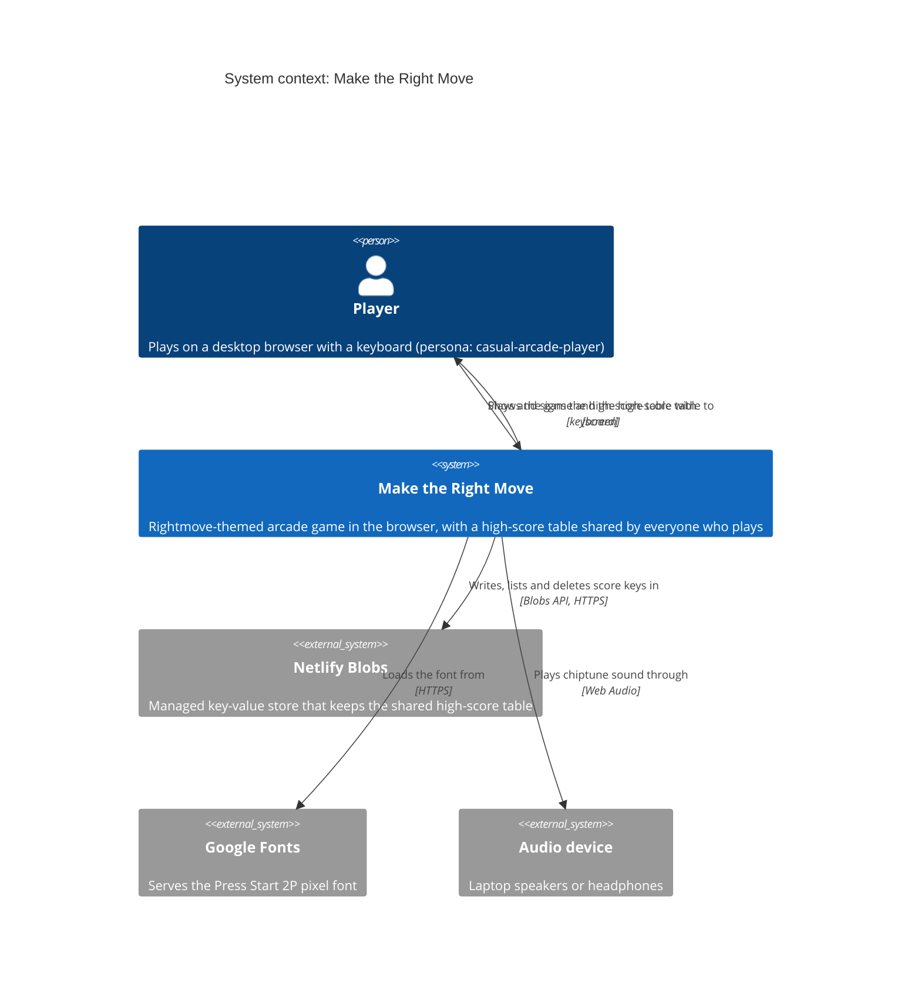
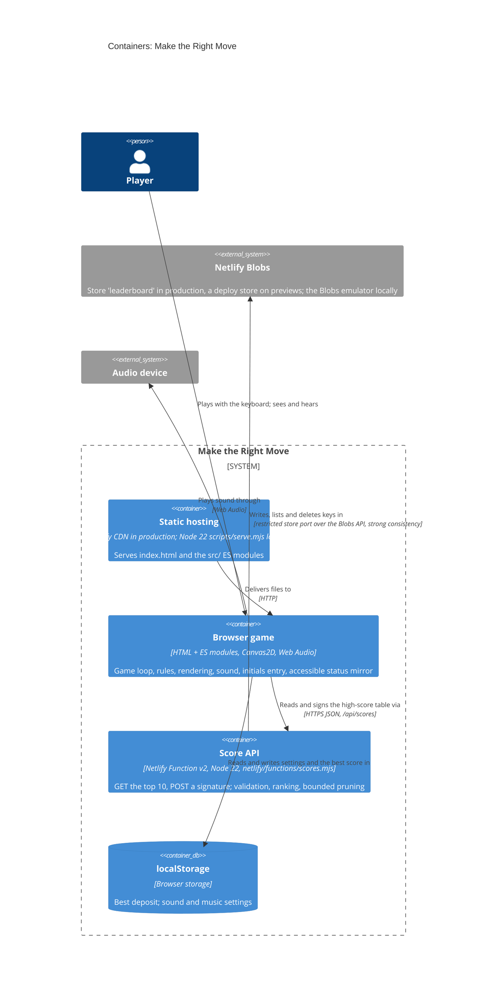
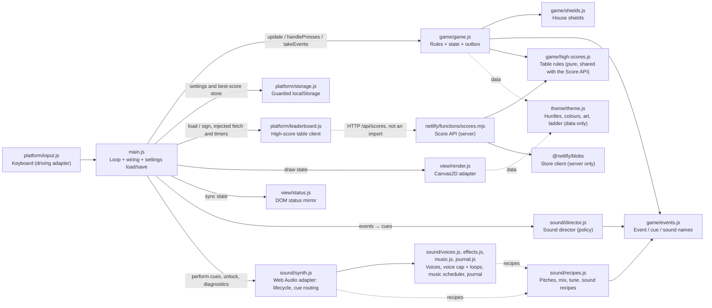

# Architecture brief: Make the Right Move

SSOT for the game's architecture. Each architect owns one section. Decisions are in the `adr-*.md` files next to this file.

## Application Architecture

*Owner: nw-solution-architect · Last updated: 2026-10-24 (rightmove-invaders-leaderboard)*

*File layout note (2026-10-24): `src/` was reorganised into `game/`, `sound/`, `view/`, `platform/` and `theme/`; paths below are the current ones, while ADRs and wave records keep the paths they had at the time. A later refactor the same day moved the sound recipes to `sound/recipes.js`, handed the best-score store in from `main.js` and split the synth into `voices.js`, `effects.js`, `music.js` and `journal.js`.*

**Style**: a single-page browser game built as a small modular monolith with ports and adapters. The game rules (`game/game.js`) are the core; output adapters (canvas, DOM status mirror, sound) read state or consume events, and `main.js` wires everything together. The rules import only from `game/` and `theme/` (hurdle values, colours and art are data they read; `game/events.js` is pure constants, ADR-001), and `theme/` imports nothing. Persistence goes through `main.js`, which hands settings to the rules with `applySettings` and the best-score store with `applyBestStore` (`{ load, save }`; the rules run on a store that keeps nothing until then), so only `game.js` writes `g`. Paradigm: object-oriented (factory functions returning objects with private state; see `CLAUDE.md`).

The shared high-score table adds one thin server-side adapter, the **Score API** (`netlify/functions/scores.mjs`, a Netlify Function).
- **Storage**: it keeps one Netlify Blobs key per score (ADR-004). Its composition roots (the Netlify entry, and `scripts/serve.mjs` locally) choose the store with a pure `chooseStore(context)` (ADR-005) and hand the handler only a restricted table-store port: `list`, `putIfNew` and `remove`, for well-formed score keys only, with `list` alone for GET.
- **Shared rules**: the table size, initials, £50 step, signature validity, word filter and qualification live in the pure `game/high-scores.js` (ADR-006). The function uses the size and signature validity; qualification (`makesTheTable`) is the browser's alone.
- **Browser side**: the browser reaches the table through `platform/leaderboard.js`. `main.js` hands the answers to the rules between frames, so the network is never on the frame path. Every answer with rows carries the server's listing time (`listedAt`), and the rules apply rows in that order (ADR-008).

**Quality attributes, in priority order**
1. **Responsiveness**: input and sound within one frame. The game's p95 frame work was ≤ 4 ms under stress in the spike (ADR-000); sound may add at most 0.5 ms (ADR-002, sound DDD-12 and D11). No frame waits on the network.
2. **Integrity of the high-score table**: no signature is lost or overwritten when players sign at the same moment (0 lost with up to 100 at once on the emulator, ADR-004). The handler can only add or remove well-formed score keys. The browser and the function apply one signature-validity rule (ADR-006). Only the published production deploy writes the production table: previews and older production deploys never do (ADR-005, amended in DEVOPS, 2026-10-24).
3. **Graceful degradation**: the game plays fully, with the local best, when the table is down, slow or absent. The table is unavailable only while no table has ever loaded; a failed refresh keeps the last good table. The player is told what happened to their signing, even during the next game, and Enter never waits on the server (ADR-008).
4. **Testability**: deterministic, fast-forwardable acceptance tests through real keyboard input (fake clock, seeded randomness, the status mirror, the sound journal). The real function and the real Blobs client run on the local Blobs emulator, and network faults are injected with `page.route`.
5. **Accessibility**: the status mirror carries the HUD, the initials being entered, the signing outcome and the High scores list, with the player's row marked.
6. **Maintainability**: theme, art and sound recipes are data; one module per concern; one event vocabulary (`game/events.js`); no runtime dependencies in the browser (the function's only dependency is `@netlify/blobs`).
7. **Portability**: desktop Chrome/Edge, Firefox and Safari, with no bundler or transpile step.

**Security and exposure**:
- **Network**: besides the font, the browser calls only its own origin (`/api/scores`).
- **The one public write endpoint** accepts exactly `{ initials, score }`: JSON only (else 415), read with a 1 KB byte cap (else 413), three letters A–Z that are not on the word filter, and a positive multiple of £50 up to £9,999,999 (else 400). A successful GET is cached for 15 s at the CDN; every other answer from the function is `no-store` (ADR-007, DDD-6; amended in DEVOPS, 2026-10-24).
- **Rate limit**: the function asks Netlify for 10 requests per 60 s per IP and domain (`config.rateLimit`; amended in DEVOPS, 2026-10-24). Whether it holds is checked on a deploy preview before the first production deploy (K14). If it doesn't hold, the function isn't merged (see Platform and Delivery).
- **Data kept**: a signature keeps 3 initials, a score and a time, kept until pruned or deleted by the owner, with no backup. Netlify processes client IPs for rate limiting; the game stores none, and no cookie or account. Logs carry only fixed reasons: never an error message, a key, the body, an id, initials or an IP. Nothing escapes the function's handler: a catch-all logs only the fixed reason and answers 500 `unexpected`, and `scripts/serve.mjs` logs the fixed reason only too (ADR-007, amended in DEVOPS). Module-load errors and runtime timeouts sit outside the handler; no key is on that path. The `test-board` cookie exists only on the local server.
- **Accepted risk**: anyone can still post a made-up score. The owner can delete the row.
- **Unchanged**: the only global is the frozen, data-only `window.makeTheRightMove` diagnostics handle (ADR-003). Settings are strictly parsed `'on'`/`'off'` strings that default to on.

**Operability**: one function and one store, with no secrets and no scheduled jobs. The production store has no backup, an accepted loss. Each request writes one structured log line: the event, a fixed reason, the duration, the key count, the store scope, the raw deploy context and the raw `published` flag. "scope=deploy on the production site" means context detection broke.

### C4: System context

### C4: Containers

Locally, `scripts/serve.mjs` serves the files and mounts the Score API's handler on a `BlobsServer` emulator in a temporary directory, with one store per `test-board` cookie. It is not deployed.

### Components of the browser game and the Score API (module dependency flowchart)

**Frame pipeline** (each `requestAnimationFrame`):
1. `handlePresses` for one-shot keys (Enter, P/Esc, M, N).
2. Fixed 120 Hz `update` steps.
3. `takeEvents()` → director → `synth.perform` for each cue; save settings on toggle events; `gameStarted` → refresh the high-score table in the background; `initialsEntered` → sign it.
4. `render.draw`.
5. `status.sync`.

On `blur` or a hidden tab: `pause()`, then step 3 immediately (sound DDD-9).

The table's answers, failures and timeouts arrive in promise callbacks between frames. The timeout is 5000 ms, on timers injected by `main.js`. `main.js` hands each outcome to the rules. The rules keep:
- **one table state `{ status, rows }`**, with status unknown, available or unavailable (unavailable only while no table has ever loaded). Every answer with rows carries `listedAt`, the function's `Date.now()` taken right after its listing. Rows apply only if their `listedAt` is ≥ the last applied one; older rows are ignored. A POST's listing always follows its own write, so an earlier-listed GET can't roll the table back. Clock skew of a few ms between function instances is an accepted edge.
- **the latest signing**: pending, then confirmed, off-table or unconfirmed, matched to its POST answer by the signing number. It is kept across games until the next signing. A confirmed row loses its highlight if it leaves the table. The outcome of a signing that a newer signing has replaced is still announced once, without touching the current signing.

Nothing in a frame waits on the network. An outcome that arrives during play is announced by the status mirror only (ADR-008).

### Components

| Component | Path | Responsibility |
|---|---|---|
| Loop and wiring | `src/main.js` | Composition root: fixed-step loop, adapter wiring, synth capabilities (context factory, clock, timers), settings load/`applySettings`/save, best-score store (`applyBestStore`), the high-score table client (injected `fetch` and timers; load on page load and on `gameStarted`, sign on `initialsEntered`, outcomes handed to the rules), audio unlock on keydown, immediate flush on blur/hidden, `window.makeTheRightMove` |
| Rules and state | `src/game/game.js` | Game state `g`: `g.settings` (set via `applySettings`), `g.best` (loaded and saved through the store given to `applyBestStore`), and the high-score table state `{ status, rows }`, the last applied `listedAt`, the initials entry, the latest signing and the settled-outcome notice. The table outcomes are handed in by `main.js`. Also the rules, M/N/P handling and the event outbox (`emit`, `takeEvents`) |
| High-score rules | `src/game/high-scores.js` | Pure, imports nothing: table size, initials alphabet and length, £50 step, maximum, signature validity, 3-letter word filter (also used by the Score API), and qualification `makesTheTable` (browser only; it requires an available table) |
| Vocabulary | `src/game/events.js` | `GameEvent` (including `initialsEntered`), `CueOp`, `Sound` |
| Keyboard | `src/platform/input.js` | Held and latched keys |
| Rendering | `src/view/render.js` | Reads `g`. Canvas drawing, HUD (including the sound and music indicators), the high-score table with the confirmed row highlighted (title attract, game over), initials entry and the signing messages on game over. Nothing new is drawn during play |
| Status mirror | `src/view/status.js` | Reads `g`. Accessible DOM HUD and announcements (including signing outcomes whenever they arrive), the initials field, and the High scores list with the confirmed row marked `aria-current` |
| Storage | `src/platform/storage.js` | Guarded localStorage (best score, settings) |
| High-score table client | `src/platform/leaderboard.js` | One request per call to `/api/scores`; rejects on a non-OK answer, a network error or the 5000 ms timeout; never retries |
| Score API | `netlify/functions/scores.mjs` | The Netlify entry: `chooseStore`, `getStore` or `getDeployStore`, the restricted table-store port, routing (GET gets `list` only), `config.path` and `config.rateLimit`. The port factory. The request handler: validation (415, 413, 400), one key per score, bounded best-effort pruning, rows stamped with `listedAt`, cache headers (a GET 200 cached for 15 s at the CDN, everything else `no-store`), JSON errors (a port refusal is a 500), one log line with a fixed reason. The pure key codec, ranking, prune plan and `chooseStore` |
| Local server | `scripts/serve.mjs` | Dev and test only: static files, plus the Score API's handler on a `BlobsServer` emulator (temporary directory deleted on exit), with one store per `test-board` cookie behind the same restricted port |
| Theme | `src/theme/theme.js` | Data: hurdles, colours, art, ladder, plus pure derivations; imports nothing |
| Sound recipes | `src/sound/recipes.js` | Data: hit pitch, march notes, the mix (`BUS_LEVELS`), the tune (`MUSIC`) and `SOUND_RECIPES` |
| Shields | `src/game/shields.js` | Destructible shield grids |
| Sound director | `src/sound/director.js` | Sound policy: event → cue plan (mute, pause, rate limits, march cycle, siren, music) |
| Synth | `src/sound/synth.js` | Web Audio adapter: lifecycle (locked, running, suspended, unavailable), cue routing, fail-safe, diagnostics |
| Synth parts | `src/sound/voices.js`, `effects.js`, `music.js`, `journal.js` | Voice building (noise buffer, siren), effect voices (voice cap, loops), music look-ahead scheduler, journal of the last 100 sounds |

### Ports

- **Driving**: browser keyboard (`platform/input.js`), including Up/Down/Enter for the initials; window `blur` and document `visibilitychange`; page load (which also starts the first table load, the client's probe). Server side: HTTP `/api/scores` (GET, POST), through Netlify in production and `scripts/serve.mjs` locally.
- **Driven**: screen (`view/render.js`); accessibility tree (`view/status.js`); audio output (`sound/synth.js`, with injected context factory, page clock and timers; the audio clock is real time); persistence (`platform/storage.js`); the shared high-score table (`platform/leaderboard.js`, with injected `fetch` and timers). Server side: the restricted table-store port (`list`, `putIfNew`, `remove` for well-formed score keys only, with no `deleteAll`; GET gets `list` alone). The composition roots build it around a `@netlify/blobs` store chosen by `chooseStore` (ADR-004, ADR-005). Also a clock, an id source and a logger, injected into the handler.
- **Internal**: the event outbox (`game/game.js` → `main.js` → `sound/director.js`), ADR-001. `gameStarted` and `initialsEntered` also drive the table.

### Decisions
- [ADR-000](adr-000-vanilla-canvas-fixed-step.md): vanilla Canvas2D, fixed-step loop.
- [ADR-001](adr-001-game-events-outbox.md): the rules publish events through an outbox they own.
- [ADR-002](adr-002-hand-rolled-web-audio-synth.md): a hand-rolled Web Audio synth with data recipes.
- [ADR-003](adr-003-sound-journal-for-tests.md): tests observe sound through the synth's read-only journal.
- [ADR-004](adr-004-high-score-table-function-over-blobs.md): the shared high-score table is a Netlify Function over Netlify Blobs, one blob key per score.
- [ADR-005](adr-005-table-store-by-deploy-context.md): the high-score store is chosen by deploy context.
- [ADR-006](adr-006-shared-high-score-rules.md): high-score rules shared by the browser and the function in one pure module.
- [ADR-007](adr-007-proportionate-abuse-controls.md): proportionate abuse controls for the public score endpoint; forged scores are an accepted risk.
- [ADR-008](adr-008-table-probed-never-awaited.md): the high-score table is probed, never awaited, and a signing has an explicit outcome.

### Architecture enforcement

Style: modular monolith with ports and adapters · Language: JavaScript (ES modules) · Tool: a hand-rolled import-scan unit test in the `unit` project, so it runs in the build gate (ADR-006). The scan matches `import … from '…'`, bare `import '…'`, `export … from '…'` and dynamic `import('…')`. Five rules:
1. `game/` imports only from `game/` and `theme/`.
2. `theme/` imports nothing.
3. `game/high-scores.js` imports nothing.
4. `src/**` never imports `netlify/**` or `@netlify/*`.
5. `netlify/**` imports only `src/game/high-scores.js` from `src/`.

The handler reaches the store only through the restricted table-store port; unit tests on the real emulator check this.

## Platform and Delivery

*Owner: nw-platform-architect · Last updated: 2026-10-24 (rightmove-invaders-leaderboard, DEVOPS)*

### Deployment

The game is published on **Netlify** from the GitHub repo `lagom1985/rightmove-space-invaders`: static files on the CDN, plus one function, the Score API.
- **Site**: production is https://maketherightmove.fabiodamico.xyz, a custom domain on a Netlify site. The apex `fabiodamico.xyz` uses Netlify DNS, so the DNS record and the Let's Encrypt certificate are automatic.
- **Plan**: the **legacy Free** plan. Serverless only: no containers and no server of our own. `scripts/serve.mjs` is the local and test server only; it is not deployed.
- **Build gate**:
  - `npm run build` runs `bddgen`, the Playwright `unit` and `in-memory` projects (no browser), then `scripts/build.mjs`, which copies `index.html` and `src/` into `dist/`.
  - Netlify then bundles `netlify/functions/scores.mjs` with esbuild, which inlines `src/game/high-scores.js` and `@netlify/blobs`. Only the bundler family is set in `netlify.toml`; the esbuild version is Netlify's.
  - A failing test or bundle fails the deploy, and Netlify keeps serving the previous one.
  - The browser projects (and the hard KPIs K5 and K7) run locally with `npm test`.
- **Triggers**: trunk-based on `main`. A push to `main` deploys to production. Pull requests get deploy previews, and so do branches where branch deploys are on. No GitHub Actions.
- **Headers** (`netlify.toml`, for the static files):
  - `nosniff`, `Referrer-Policy: strict-origin-when-cross-origin` and `Permissions-Policy: camera=(), microphone=(), geolocation=()`
  - `index.html` is `no-cache`, and `/src/*` is `max-age=0, must-revalidate`, because the files are not hashed
  - no CSP, so Google Fonts and Web Audio keep working
  - nothing for `/api/*`: the function sets its own headers. The `/*` rule matches `/api/scores` by pattern, but Netlify's docs say custom headers aren't applied to URLs handled by a function. The first preview records a function answer's real header set, and checks that nothing conflicts with DDD-6

### The Score API on Netlify

- **Function**: Functions v2 on Node 22, at `/api/scores` (`config.path`). Every deploy carries its own copy of it, reachable at that deploy's URL until the deploy is deleted.
- **Store by deploy context** (ADR-005):
  - **The published production deploy** uses the site-wide store `leaderboard`: `chooseStore` requires `context === 'production'` and `published === true`. The table survives deploys and rollbacks, because a rollback simply makes the deploy it publishes the writer. It has no backup (an accepted loss).
  - **Older production deploys**, reached through their permalinks, write a deploy store of their own, so they can't sign the real table with old code.
  - **Deploy previews and branch deploys** each get an empty deploy store, which follows its deploy and is deleted with it.
  - **Locally**: the `BlobsServer` emulator, with one store per `test-board` cookie.
- **Rate limit**: `config.rateLimit` allows 10 requests per 60 s per IP and domain, GET and POST together. It is one of the 2 code rules the plan allows.
  - Netlify answers the 429 itself; enforcement can lag by up to 10 s.
  - It is checked on a deploy preview before the first production deploy (K14). If it doesn't hold, the function isn't merged.
- **GET cache**: a successful GET is cached at the CDN for 15 s (`Netlify-CDN-Cache-Control: public, s-maxage=15, durable`), and browsers revalidate.
  - `Netlify-Vary: query=table` keeps arbitrary query strings from splitting the cache.
  - POSTs and errors are `no-store`.
  - Other computers see a new row up to about 15 s late. The signer sees it at once, in the POST answer (ADR-008).
- **Nothing else**: no secrets, no environment variables beyond `NODE_VERSION`, and no scheduled jobs.

### Quotas and the outage risk

- **Quotas**: legacy Free allows 125k function invocations per site per month, counted per request. It also has hard limits of 100 GB bandwidth and 300 build minutes. Usage resets on the 1st.
- **Outage risk**: at 100% of the function quota, Netlify pauses **every site on the account** and stops builds, until a payment method is added and the account upgraded. Free has no automatic upgrade.
- **Honest play** costs about 1.1 to 3 invocations per game: under 15,000 a month even at 5,000 games.
- **Abuse** is what reaches the limit.
  - Netlify's enforcement lag lets one IP sending r requests a second through at about 10 + 10r a minute, on each hostname that serves the function.
  - At 20 a second, that is about 302k invocations a day: the month in **about 10 hours**, with about an hour between the 90% email and the pause.
  - More hostnames or more IPs make it faster.
  - The real cap is measured on a preview before the merge (K14).
- **Blobs**: limits are not listed for the plan. They are checked on the account before the merge, and stay an unmonitored risk if nothing is visible.
- **Controls**:
  - the rate limit
  - the GET cache
  - Netlify's usage emails (at 50, 75, 90 and 100%), plus a daily check that turns the cumulative Usage total into a rate and acts on it
  - the kill switch
- **The account**: before the merge, the user decides whether to move the game to a Netlify team or account of its own, so that a pause can't take down the other sites. Transfer and terms are unverified.

### Rollback and the kill switch

- **Rollback**: Netlify → Deploys → a previous deploy → Publish deploy.
  - It is instant, and it moves the files, the function and its rate-limit rule together.
  - It does **not** roll back the production table: signatures and deletions stay.
  - Auto publishing stops until "Unlock to start auto publishing".
  - The key format is a persisted schema, so never change the `s/` keys or the store name in place.
- **Kill switch** (zero code): publish the last production deploy from before the leaderboard.
  - It is armed on the merge day, and checked to have no function.
  - That deploy has no function, so `/api/scores` is a static 404 that costs no invocation, and the game plays as before, without a table.
  - It covers only the production hostnames: previews, branch deploys and permalinks keep their own copies, which are listed and deleted as needed.
  - To resume, publish the latest deploy and unlock auto publishing.
  - Free deletes old deploys after 30 days, so after the recorded expiry date the only route is a revert commit on `main` (one build).

### Observability

- **Logs**: the function's structured JSON logs, one line per request with a fixed reason, the scope, the raw deploy context and the raw `published` flag (ADR-005, ADR-007). They are in Netlify → Cloud compute → Functions → `scores`. Netlify's docs say "at least 24 hours"; retention on legacy Free is unverified and is checked on day 1.
- **Usage**: the Functions Usage page (a cumulative total, read daily), and Netlify's usage emails.
- **Nothing else**: no third-party tools, no paging, and no SLOs.
- **After each deploy and each rollback**: a cached GET runs no function, so the check uses `?table=<random>` and expects `scope=site` and `published=true`.

### Privacy

The game stores 3 initials, a score and a time per signature, kept until pruned or deleted by the owner, with no backup. Netlify processes client IPs for rate limiting; we log none. Production sets no cookies, and the only third-party request is Google Fonts.

Details and the checks run: [the leaderboard feature-delta](../../feature/rightmove-invaders-leaderboard/feature-delta.md) (Wave: DEVOPS) and its [environments.yaml](../../feature/rightmove-invaders-leaderboard/environments.yaml). The static-site baseline: [the sound feature-delta](../../feature/rightmove-invaders-sound/feature-delta.md) (Wave: DEVOPS) and its [environments.yaml](../../feature/rightmove-invaders-sound/environments.yaml).
