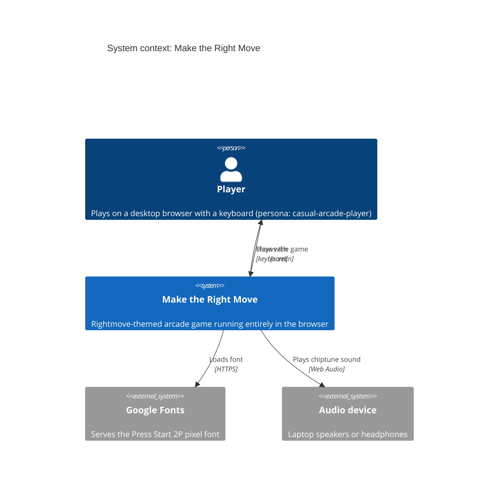
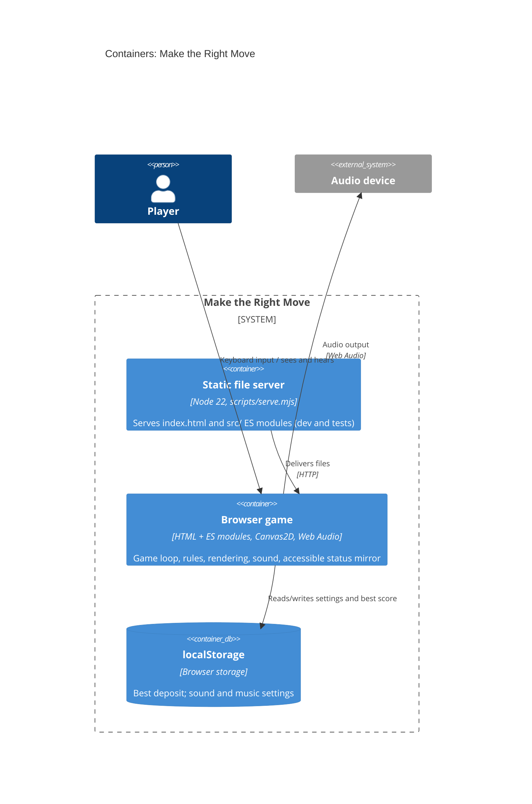
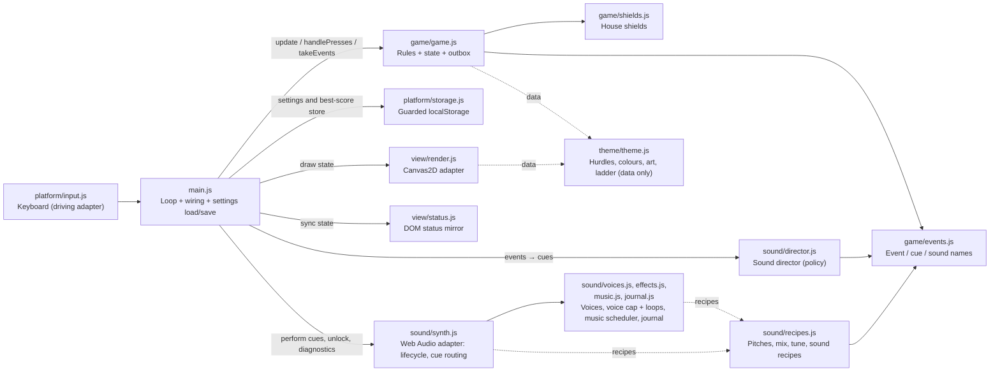

# Architecture brief: Make the Right Move

SSOT for the game's architecture. Each architect owns one section. Decisions are in the `adr-*.md` files next to this file.

## Application Architecture

*Owner: nw-solution-architect · Last updated: 2026-10-23 (rightmove-invaders-sound, revision 3)*

*File layout note (2026-10-24): `src/` was reorganised into `game/`, `sound/`, `view/`, `platform/` and `theme/`; paths below are the current ones, while ADRs and wave records keep the paths they had at the time. A later refactor the same day moved the sound recipes to `sound/recipes.js`, handed the best-score store in from `main.js` and split the synth into `voices.js`, `effects.js`, `music.js` and `journal.js`.*

**Style**: a single-page browser game built as a small modular monolith with ports and adapters. The game rules (`game/game.js`) are the core; output adapters (canvas, DOM status mirror, sound) read state or consume events, and `main.js` wires everything together. The rules import only from `game/` and `theme/` (hurdle values, colours and art are data they read; `game/events.js` is pure constants, ADR-001), and `theme/` imports nothing. Persistence goes through `main.js`, which hands settings to the rules with `applySettings` and the best-score store with `applyBestStore` (`{ load, save }`; the rules run on a store that keeps nothing until then), so only `game.js` writes `g`. Paradigm: object-oriented (factory functions returning objects with private state; see `CLAUDE.md`).

**Quality attributes, in priority order**
1. **Responsiveness**: input and sound within one frame. The game's p95 frame work was ≤ 4 ms under stress in the spike (ADR-000); sound may add at most 0.5 ms (ADR-002, DDD-12, D11).
2. **Testability**: deterministic, fast-forwardable acceptance tests through real keyboard input (fake clock, seeded randomness, the status mirror, the sound journal).
3. **Maintainability**: theme, art and sound recipes are data; one module per concern; one event vocabulary (`game/events.js`); no runtime dependencies.
4. **Portability**: desktop Chrome/Edge, Firefox and Safari, with no bundler or transpile step.

**Security and exposure**: client-only, with no personal data and no network calls besides the font. The only global is the frozen, data-only `window.makeTheRightMove` diagnostics handle (ADR-003). Settings are strictly parsed `'on'`/`'off'` strings that default to on.

### C4: System context

### C4: Containers

### Components of the browser game (module dependency flowchart)

**Frame pipeline** (each `requestAnimationFrame`):
1. `handlePresses` for one-shot keys (Enter, P/Esc, M, N).
2. Fixed 120 Hz `update` steps.
3. `takeEvents()` → director → `synth.perform` for each cue; save settings on toggle events.
4. `render.draw`.
5. `status.sync`.

On `blur` or a hidden tab: `pause()`, then step 3 immediately (DDD-9).

### Components

| Component | Path | Responsibility |
|---|---|---|
| Loop and wiring | `src/main.js` | Composition root: fixed-step loop, adapter wiring, synth capabilities (context factory, clock, timers), settings load/`applySettings`/save, best-score store (`applyBestStore`), audio unlock on keydown, immediate flush on blur/hidden, `window.makeTheRightMove` |
| Rules and state | `src/game/game.js` | Game state `g` (including `g.settings`, set via `applySettings`, and `g.best`, loaded and saved through the store given to `applyBestStore`), rules, M/N/P handling, event outbox (`emit`, `takeEvents`) |
| Vocabulary | `src/game/events.js` | `GameEvent`, `CueOp`, `Sound` |
| Keyboard | `src/platform/input.js` | Held and latched keys |
| Rendering | `src/view/render.js` | Canvas drawing, HUD (including the sound and music indicators) |
| Status mirror | `src/view/status.js` | Accessible DOM HUD and announcements |
| Storage | `src/platform/storage.js` | Guarded localStorage (best score, settings) |
| Theme | `src/theme/theme.js` | Data: hurdles, colours, art, ladder, plus pure derivations; imports nothing |
| Sound recipes | `src/sound/recipes.js` | Data: hit pitch, march notes, the mix (`BUS_LEVELS`), the tune (`MUSIC`) and `SOUND_RECIPES` |
| Shields | `src/game/shields.js` | Destructible shield grids |
| Sound director | `src/sound/director.js` | Sound policy: event → cue plan (mute, pause, rate limits, march cycle, siren, music) |
| Synth | `src/sound/synth.js` | Web Audio adapter: lifecycle (locked, running, suspended, unavailable), cue routing, fail-safe, diagnostics |
| Synth parts | `src/sound/voices.js`, `effects.js`, `music.js`, `journal.js` | Voice building (noise buffer, siren), effect voices (voice cap, loops), music look-ahead scheduler, journal of the last 100 sounds |

### Ports

- **Driving**: browser keyboard (`platform/input.js`); window `blur` and document `visibilitychange`; page load.
- **Driven**: screen (`view/render.js`); accessibility tree (`view/status.js`); audio output (`sound/synth.js`, with injected context factory, page clock and timers; the audio clock is real time); persistence (`platform/storage.js`).
- **Internal**: the event outbox (`game/game.js` → `main.js` → `sound/director.js`), ADR-001.

### Decisions
- [ADR-000](adr-000-vanilla-canvas-fixed-step.md): vanilla Canvas2D, fixed-step loop.
- [ADR-001](adr-001-game-events-outbox.md): the rules publish events through an outbox they own.
- [ADR-002](adr-002-hand-rolled-web-audio-synth.md): a hand-rolled Web Audio synth with data recipes.
- [ADR-003](adr-003-sound-journal-for-tests.md): tests observe sound through the synth's read-only journal.

## Platform and Delivery

*Owner: nw-platform-architect · Last updated: 2026-10-24 (rightmove-invaders-sound, DEVOPS)*

### Deployment

The game is published as static files on **Netlify**, from the GitHub repo `lagom1985/rightmove-space-invaders`. Production is https://maketherightmove.fabiodamico.xyz (a custom domain on a Netlify site; the apex `fabiodamico.xyz` already uses Netlify DNS, so the DNS record and the Let's Encrypt certificate are automatic). `scripts/serve.mjs` remains the local and test server only; it is not deployed.

- **Build gate**: `npm run build` runs `bddgen`, the Playwright `unit` and `in-memory` projects (46 tests, no browser needed), then `scripts/build.mjs`, which copies `index.html` and `src/` into `dist/`. A failing test fails the build and Netlify keeps serving the previous deploy. The browser projects (and the hard KPIs K5 and K7) run locally with `npm test`.
- **Triggers**: a push to `main` deploys to production; pull requests and branches get deploy previews. Trunk-based, no GitHub Actions, no containers.
- **Headers** (`netlify.toml`): `nosniff`, `Referrer-Policy: strict-origin-when-cross-origin`, `Permissions-Policy: camera=(), microphone=(), geolocation=()`; `index.html` is `no-cache` and `/src/*` is `max-age=0, must-revalidate` (files are not hashed). No CSP, so Google Fonts and Web Audio keep working.
- **Rollback**: Netlify → Deploys → a previous deploy → Publish deploy.
- **Observability**: none. There is no server and no personal data; KPIs come from the playtest, the test suite and `scripts/measure-performance.mjs`.

Details and the checks run: [feature-delta.md](../../feature/rightmove-invaders-sound/feature-delta.md) (Wave: DEVOPS) and [environments.yaml](../../feature/rightmove-invaders-sound/environments.yaml).
