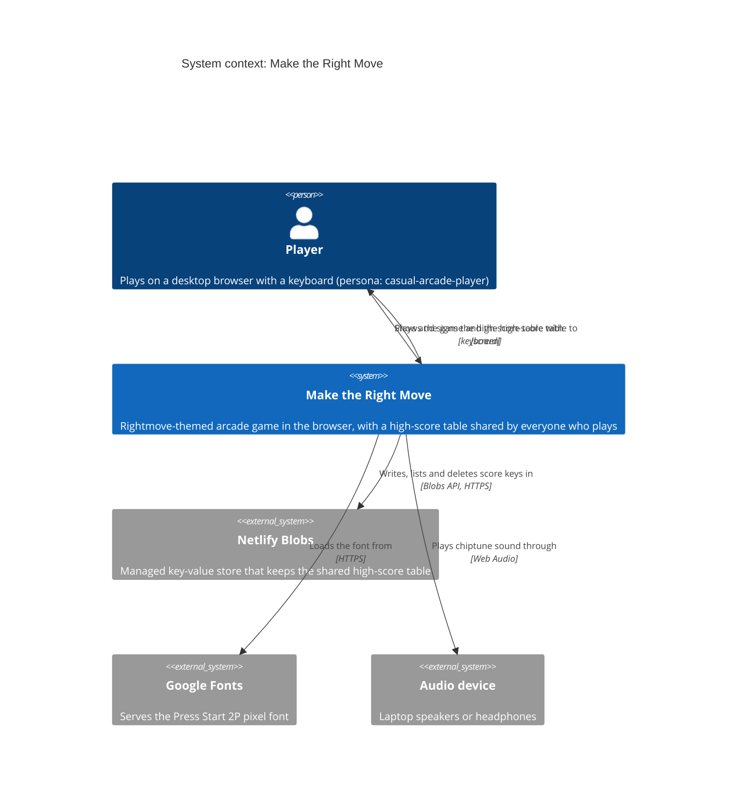
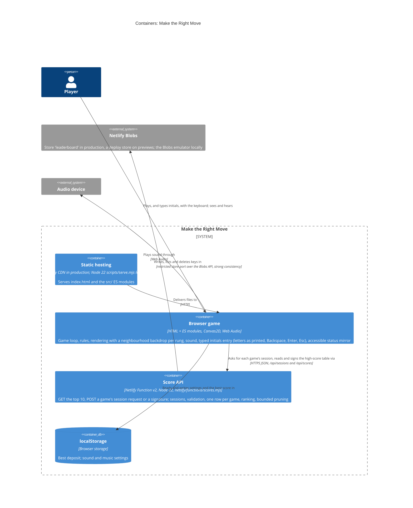
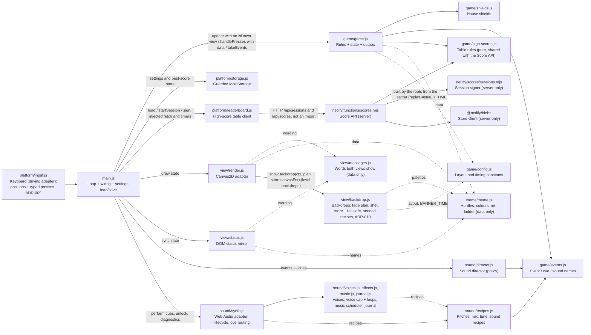

# Architecture brief: Make the Right Move

SSOT for the game's architecture. Each architect owns one section. Decisions are in the `adr-*.md` files next to this file.

## Application Architecture

*Owner: nw-solution-architect · Last updated: 2026-10-27 (rightmove-invaders-replay-verified-scores, DELIVER: slice 01's rows marked shipped (sessions, one row per game, the secret), with the step commits; the record, the replay, chance and particles stay designed, for slice 02; edits marked "replay-verified". Earlier, 2026-10-26: rightmove-invaders-replay-verified-scores, DESIGN accepted by the user: the table replays every game, ADR-012 and ADR-013; edits marked "replay-verified", designed and not yet built. Earlier that day: rightmove-invaders-level-backdrops, DELIVER: the level-backdrops rows marked shipped, with the step commits and the names as built; earlier that day, DESIGN: a neighbourhood backdrop for every rung of the ladder, ADR-010 and ADR-011 accepted, then revised the same day after the Final Wave Review Gate (`BANNER_TIME` moves to `config.js`, the drawing shell moves into `backdrop.js`, the contrast promise restated, the legibility check in the `in-memory` project); edits marked "level-backdrops". Before that: rightmove-invaders-typed-initials, DELIVER: the typed-initials rows marked shipped, with the names as built; earlier that day, DESIGN revised after the Final Wave Review Gate, with no decision changed, then after the second review cycle: `update` narrowed to an `{ isDown }` view, the entry step's plan, the declared delta and the Alt defaults; on 2026-10-25, DESIGN: typed initials, ADR-009 accepted; edits marked "typed-initials". Before that: rightmove-invaders-leaderboard, DELIVER: the components marked shipped)*

*File layout note (2026-10-24): `src/` was reorganised into `game/`, `sound/`, `view/`, `platform/` and `theme/`; paths below are the current ones, while ADRs and wave records keep the paths they had at the time. A later refactor the same day moved the sound recipes to `sound/recipes.js`, handed the best-score store in from `main.js` and split the synth into `voices.js`, `effects.js`, `music.js` and `journal.js`.*

**Style**: a single-page browser game built as a small modular monolith with ports and adapters. The game rules (`game/game.js`) are the core; output adapters (canvas, DOM status mirror, sound) read state or consume events, and `main.js` wires everything together. The rules import only from `game/` and `theme/` (hurdle values, colours and art are data they read; `game/events.js` is pure constants, ADR-001), and `theme/` imports nothing. Persistence goes through `main.js`, which hands settings to the rules with `applySettings` and the best-score store with `applyBestStore` (`{ load, save }`; the rules run on a store that keeps nothing until then), so only `game.js` writes `g`. Paradigm: object-oriented (factory functions returning objects with private state; see `CLAUDE.md`).

*level-backdrops*: each rung of the property ladder has its own neighbourhood backdrop. Its palette is theme data (`NEIGHBOURHOODS`). `view/backdrop.js` paints it from seeded recipes, keeps two built at a time and never rebuilds one it holds at its scale, and fades the next one in during "Wave cleared!". `render.js` only calls its shell (ADR-010). A legibility rule on the palette data keeps every foreground use at its WCAG minimum (ADR-011). `game/` changed by one constant: `BANNER_TIME` moved to `game/config.js`, and `game.js` re-exports it.

The shared high-score table adds one thin server-side adapter, the **Score API** (`netlify/functions/scores.mjs`, a Netlify Function).
- **Storage**: it keeps one Netlify Blobs key per score (ADR-004). Its composition roots (the Netlify entry, and `scripts/serve.mjs` locally) choose the store with a pure `chooseStore(context)` (ADR-005) and hand the handler only a restricted table-store port: `list`, `putIfNew` and `remove`, for well-formed score keys only, with `list` alone for GET.
- **Shared rules**: the table size, initials, £50 step, signature validity, word filter and qualification live in the pure `game/high-scores.js` (ADR-006). The function uses the size and signature validity; qualification (`makesTheTable`) is the browser's alone.
- **Browser side**: the browser reaches the table through `platform/leaderboard.js`. `main.js` hands the answers to the rules between frames, so the network is never on the frame path. Every answer with rows carries the server's listing time (`listedAt`), and the rules apply rows in that order (ADR-008).
- *replay-verified*: **the table replays every game** (ADR-012, ADR-013). Slice 01 is shipped (2026-10-27); the rest is designed, not yet built (slice 02).
  - Designed: the rules become one game per instance (`createGame`), with every gameplay draw from a seed the game picks as it starts.
  - Shipped (slice 01): each game picks its seed as it starts (128 bits, in `main.js` until the rules draw from it), posts it to `POST /api/sessions`, and gets an HMAC-signed session and the refreshed table back.
  - Designed: the rules record the three held controls by step. Shipped (slice 01): the signing carries its game's session, and waits for it.
  - Designed: the function replays the record (`game/replay.js`) and saves the deposit it produces. Shipped (slice 01): one row per game.
  - The accepted risk narrows to a program that plays well.

**Quality attributes, in priority order**
1. **Responsiveness**: input and sound within one frame. The game's p95 frame work was ≤ 4 ms under stress in the spike (ADR-000); sound may add at most 0.5 ms (ADR-002, sound DDD-12 and D11). No frame waits on the network. *level-backdrops*: a backdrop is built lazily, on four triggers only: one the store holds is never rebuilt at its scale, and a rung dropped from the two is built again when next needed. The next rung is built on the first "Wave cleared!" frame, when the player can't act. A resize during play costs one hitch per change of scale (up to 7 ms in Firefox at 2×), accepted. The fade adds one `drawImage` (ADR-010).
2. **Integrity of the high-score table**: no signature is lost or overwritten when players sign at the same moment (0 lost with up to 100 at once on the emulator, ADR-004). The handler can only add or remove well-formed score keys. The browser and the function apply one signature-validity rule (ADR-006). Only the published production deploy writes the production table: previews and older production deploys never do (ADR-005, amended in DEVOPS, 2026-10-24). *replay-verified*: a signing needs the session its game was issued as it started, and a game has one row (ADR-012; shipped in slice 01, 2026-10-27). Designed (slice 02): every deposit on the table is one its game produced, because the function replays each signed game.
3. **Graceful degradation**: the game plays fully, with the local best, when the table is down, slow or absent. The table is unavailable only while no table has ever loaded; a failed refresh keeps the last good table. The player is told what happened to their signing, even during the next game, and Enter never waits on the server (ADR-008). *level-backdrops*: a backdrop that can't be built leaves a flat background, and the game plays on (ADR-010). The game has no client telemetry, so such a failure is seen only by tests and by eye.
4. **Testability**: deterministic, fast-forwardable acceptance tests through real keyboard input (fake clock, seeded randomness, the status mirror, the sound journal). The real function and the real Blobs client run on the local Blobs emulator, and network faults are injected with `page.route`. *level-backdrops*: a backdrop never calls `Math.random`, so the seeded game is the same with it as without it. The fade plan, the shell, the recipes (painted on a recording context) and the store are checked in memory. The wiring from window `resize` to the store's `rescale` is checked by hand only (a recorded gap).
5. **Accessibility**: the status mirror carries the HUD, the initials being entered, the signing outcome and the High scores list, with the player's row marked. *level-backdrops*: every foreground use meets its WCAG minimum (3:1 for objects, 4.5:1 for text) against every backdrop palette, checked on data in the `in-memory` project (ADR-011). One exemption is named, the door. The title legend's names are drawn on a dark outline and checked against it, so Gazumper's label passes (ADR-011's amendment). The game-over red, the paused and game-over veils and the legend's outline are excused by name: none of them needs to stand out against a backdrop. Some contrasts drop against the old backdrop, a trade the user accepted: on Studio flat, Gazumper goes from 3.84:1 to 3.51:1 and brick from 3.92:1 to 3.42:1. The mirror names the neighbourhood, and says it at the start of every wave after a clear.
6. **Maintainability**: theme, art and sound recipes are data; one module per concern; one event vocabulary (`game/events.js`); no runtime dependencies in the browser (the function's only dependency is `@netlify/blobs`). *level-backdrops*: the palettes are data, with one map and skyline recipe pair per `look`.
7. **Portability**: desktop Chrome/Edge, Firefox and Safari, with no bundler or transpile step.

**Security and exposure**:
- **Network**: besides the font, the browser calls only its own origin (`/api/scores`, and `/api/sessions` since *replay-verified*'s slice 01).
- **The one public write endpoint** accepts exactly `{ initials, score }`: JSON only (else 415), read with a 1 KB byte cap (else 413), three letters A–Z that are not on the word filter, and a positive multiple of £50 up to £9,999,999 (else 400) and no more than the plausible ceiling of £250,000 (else 400 `implausible-score`; amended after the forged-scores RCA, 2026-10-26). A successful GET is cached for 15 s at the CDN; every other answer from the function is `no-store` (ADR-007, DDD-6; amended in DEVOPS, 2026-10-24).
  - *replay-verified* (shipped in slice 01, 2026-10-27): a second public write path, `POST /api/sessions` (exactly `{ seed }`, 32 lowercase hex, under a 1 KB cap), answers with a session and the table. Both paths are served by the one function, under one rate-limit rule, dispatched by exact path; any other path is 404 `not-found`.
  - *replay-verified* (shipped in slice 01): a signing is exactly `{ initials, score, session }`, under the 1 KB cap until slice 02. It is refused without a session (`session-required`), with one the table didn't seal or issued more than 10 s ahead of its clock (`invalid-session`), with one more than 2 hours old (`session-expired`), and for a game that already has a row (409 `already-signed`).
  - Designed (slice 02 and 03): the signing becomes exactly `{ initials, score, session, record }`, under a 128 KB cap, refused when its game time exceeds the time since its session was issued plus 10 s, for a record over 60 minutes or of other rules, and when its replay doesn't produce the claimed deposit.
  - The ceiling becomes £500,000 with the replay (ADR-012; the full order is in the replay-verified-scores feature delta).
- **Rate limit**: the function asks Netlify for 10 requests per 60 s per IP and domain (`config.rateLimit`; amended in DEVOPS, 2026-10-24). Whether it holds is checked on a deploy preview before the first production deploy (K14). If it doesn't hold, the function isn't merged (see Platform and Delivery).
- **Data kept**: a signature keeps 3 initials, a score and a time, kept until pruned or deleted by the owner, with no backup. Netlify processes client IPs for rate limiting; the game stores none, and no cookie or account. Logs carry only fixed reasons: never an error message, a key, the body, an id, initials or an IP. Nothing escapes the function's handler: a catch-all logs only the fixed reason and answers 500 `unexpected`, and `scripts/serve.mjs` logs the fixed reason only too (ADR-007, amended in DEVOPS). Module-load errors and runtime timeouts sit outside the handler; no key is on that path. The `test-board` cookie exists only on the local server.
- **Accepted risk**: anyone can still post a made-up score up to £250,000. The owner can delete the row. Forging happened on 2026-10-26, which fired ADR-007's revisit trigger: [the root-cause analysis](../../analysis/root-cause-analysis-forged-high-scores.md) recommends server-side replay as the real fix. *replay-verified* (accepted by the user, 2026-10-26): ADR-012 supersedes this accepted risk. Since slice 01 (2026-10-27), a score sent with no game's session is refused, but whoever asks for a session first can still claim up to £250,000, one row per session's game. Once the replay is built (slice 02), a made-up deposit is refused.
  - **What still gets through**: a program that plays well, in real time or by searching inputs and seeds offline. It is held to the game's rules, to real time per game, to one row per game, to the session's 2 hours, to the rate limit and to the £500,000 ceiling.
  - **A deleted row can come back** within its session's 2 hours.
- **Unchanged**: the only global is the frozen, data-only `window.makeTheRightMove` diagnostics handle (ADR-003). Settings are strictly parsed `'on'`/`'off'` strings that default to on.

**Operability**: one function and one store, with one secret and no scheduled jobs (*replay-verified*, shipped in slice 01, 2026-10-27: `SCORES_SESSION_SECRET`, per deploy context, set and rotated as the README's Deploy section says; without it nobody can sign, and the log says `secret-missing`). The production store has no backup, an accepted loss. Each request writes one structured log line: the event, a fixed reason, the duration, the key count, the store scope, the raw deploy context and the raw `published` flag. "scope=deploy on the production site" means context detection broke.

### C4: System context

### C4: Containers

Locally, `scripts/serve.mjs` serves the files and mounts the Score API's handler on a `BlobsServer` emulator in a temporary directory, with one store per `test-board` cookie. It is not deployed.

### Components of the browser game and the Score API (module dependency flowchart)

**Frame pipeline** (each `requestAnimationFrame`):
1. `handlePresses(pressed, typed)`: the one-shot keys by position (Enter, P/Esc, M, N), or, in a frame that starts with the initials entry open, the frame's typed presses in order instead (typed-initials, ADR-009).
2. Fixed 120 Hz `update` steps. *typed-initials*: `update` gets an `{ isDown }` view of the keyboard, never the keyboard (DDD-T14).
3. `takeEvents()` → director → `synth.perform` for each cue; save settings on toggle events; `gameStarted` → refresh the high-score table in the background (*replay-verified*, shipped in slice 01: by asking for the game's session, whose answer brings the table); `initialsEntered` → sign it (with that session, once it has arrived).
4. `render.draw`. *level-backdrops*: the backdrop first, through `showBackdrop(ctx, backdropPlan(frame), store.canvasFor)`. A backdrop is built when the store is asked for one it doesn't hold, on the four triggers of ADR-010.
5. `status.sync`.

On `blur` or a hidden tab: `pause()`, then step 3 immediately (sound DDD-9). *typed-initials*: the keyboard's `releaseAll()` comes first, as today, and also empties the typed queue. Game over isn't pausable, so an open initials entry keeps its letters (D20).

The table's answers, failures and timeouts arrive in promise callbacks between frames. The timeout is 5000 ms, on timers injected by `main.js`. `main.js` hands each outcome to the rules. The rules keep:
- **one table state `{ status, rows }`**, with status unknown, available or unavailable (unavailable only while no table has ever loaded). Every answer with rows carries `listedAt`, the function's `Date.now()` taken right after its listing. Rows apply only if their `listedAt` is ≥ the last applied one; older rows are ignored. A POST's listing always follows its own write, so an earlier-listed GET can't roll the table back. Clock skew of a few ms between function instances is an accepted edge.
- **the latest signing**: pending, then confirmed, off-table or unconfirmed, matched to its POST answer by the signing number. It is kept across games until the next signing. A confirmed row loses its highlight if it leaves the table. The outcome of a signing that a newer signing has replaced is still announced once, without touching the current signing.

Nothing in a frame waits on the network. An outcome that arrives during play is announced by the status mirror only (ADR-008).

### Components

Every component below is shipped, except the rows marked *Designed (ADR-012/ADR-013), not built* (replay-verified-scores). Shipped means implemented, tested and committed:
- **The replay-verified-scores parts of slice 01** (sessions, one row per game, the secret) were delivered on 2026-10-27 (DELIVER, `94017ff`, `f6ec52c`, `15d205e`, `4ccb743`, `bd4e4d2`, `013c3b0`, `da24129`, `9bf6372`, `629e673`, `c13c573` and 01-11) on branch `rightmove-invaders-replay-verified-scores`. They are not pushed or merged yet: slice 01's preview run comes first, with the user's OK to push.
- **The leaderboard's parts** were delivered on 2026-10-25 (rightmove-invaders-leaderboard DELIVER, `4f9d64f` → `2c53e96`), and are in production since `144e23a` (PR #1).
- **The typed-initials parts** were delivered on 2026-10-26 (rightmove-invaders-typed-initials DELIVER, `81498c0` → `96a2146`), and are in production since `346d635` (PR #2).
- **The level-backdrops parts** are in production since `10396cf` (PR #7).

*level-backdrops*: the walking skeleton (`83a83fb`, branch `rightmove-invaders-level-backdrops`) shipped the backdrop parts of the Backdrops, Rendering, Theme and Status mirror rows. What DESIGN added was delivered on 2026-10-26 (rightmove-invaders-level-backdrops DELIVER, `23c1a2b` → `060dc37`): the fade plan and its shell `showBackdrop`, painting on a given context, the store's move to `backdrop.js` with its fail-safe, `BANNER_TIME`'s move to `game/config.js`, the arrival sentence and the two darkened roads. The branch is not pushed or merged yet: it reaches production with the merge to `main`, after the checks still owed on real hardware and a deploy preview (the [feature delta](../../feature/rightmove-invaders-level-backdrops/feature-delta.md#wave-deliver--ref-pre-requisites)'s DELIVER pre-requisites).

| Component | Path | Responsibility | Status |
|---|---|---|---|
| Loop and wiring | `src/main.js` | Composition root: fixed-step loop, adapter wiring, synth capabilities (context factory, clock, timers), settings load/`applySettings`/save, best-score store (`applyBestStore`), the high-score table client (injected `fetch` and timers; load on page load and on `gameStarted`, sign on `initialsEntered`, outcomes handed to the rules), audio unlock on keydown, immediate flush on blur/hidden, `window.makeTheRightMove`. *typed-initials*: each frame, `handlePresses(keyboard.takePressed(), keyboard.takeTyped())`, paused or not; `update` gets a frozen `{ isDown }` view of the keyboard | Shipped; the table wiring 2026-10-25; the typed wiring 2026-10-26 (typed-initials) |
| Rules and state | `src/game/game.js` | Game state `g`: `g.settings` (set via `applySettings`), `g.best` (loaded and saved through the store given to `applyBestStore`), and the high-score table state `{ status, rows }`, the last applied `listedAt`, the initials entry, the latest signing and the settled-outcome notice. The table outcomes are handed in by `main.js`. Also the rules, M/N/P handling, the event outbox (`emit`, `takeEvents`) and `snapshot()`, a frozen read model for tests. *typed-initials*: the entry is typed. `handlePresses(pressed, typed)`, which takes data only, gives a frame that starts with the entry open to the entry, with no M/N/P. It applies a pure entry step, `entryStep`, to each typed press in order: letters A–Z as printed, Backspace, Enter and Esc, and the identity for any other key. The step returns a plan, `{ letters, notice, skip, signing }` (DESIGN's `{ entry′, notice′, skip′, signing }`; `letters` is null once the entry closes), and emits nothing; `handlePresses` applies it, numbering new notices and signing through `sign()`, which emits `initialsEntered`. No key acts on the entry for the first 0.6 s of game over. The entry opens empty, and blocked initials empty it. Enter with fewer than 3 letters gives a hint; notices are numbered across games, by a counter kept outside `g`. Esc skips, with no event and no request. The entry's closed world is all of `g` except its declared delta (the feature delta's Reuse Analysis), checked around `handlePresses` only. `update(dt, keys)` uses only `keys.isDown`. `canPlayAgain()` (game over, no entry open, past the 0.6 s guard) is the one rule for "Enter plays again", which the canvas reads too. *level-backdrops*: `BANNER_TIME` lives in `game/config.js`; `game.js` imports and re-exports it, so every existing import keeps working (tests read the banner's length from the rules). Nothing else changed (ADR-010) | Shipped; the table state and signing 2026-10-25; the typed entry 2026-10-26 (typed-initials); the `BANNER_TIME` move 2026-10-26 (level-backdrops, `e943084`) |
| High-score rules | `src/game/high-scores.js` | Pure, imports nothing: table size, initials alphabet and length, £50 step, maximum, signature validity, 3-letter word filter (also used by the Score API), and qualification `makesTheTable` (browser only; it requires an available table). *typed-initials*: one comment-only edit in DELIVER, which removed the stale note on the letter wheel (`923b2df`); no code change | Shipped 2026-10-25 (new) |
| Vocabulary | `src/game/events.js` | `GameEvent` (including `initialsEntered`), `CueOp`, `Sound` | Shipped |
| Keyboard | `src/platform/input.js` | Held and latched keys by position (`code`). *typed-initials*: also `takeTyped()`, every press that isn't a repeat or a Cmd/Ctrl/Alt chord, in order, as `{ key }`, which `releaseAll()` empties too. And one pure default policy, `preventsDefault`, which the listener applies on every screen (the user's decision): `preventDefault` for printable keys and Backspace unless Cmd, Ctrl or Alt/Option is held (no quick find, no back navigation), and for Space and the arrows unless Cmd or Ctrl is held, as before (so Alt+Left stays blocked, pre-existing). It reports presses and applies that policy, decides nothing about the game, and imports nothing (ADR-009) | Shipped; the typed presses and the default policy 2026-10-26 (typed-initials) |
| Rendering | `src/view/render.js` | Reads `g`. Canvas drawing, HUD (including the sound and music indicators), the high-score table with the confirmed row highlighted (the game-over screen of any later game; the title shows no signing, because a signing does not survive the reload that shows it: clarified in DISTILL), initials entry and the signing messages on game over. The high-score table adds nothing to the screen during play. *typed-initials*: three slots `_ _ _` with the next one blinking, the typing help line, the hint and the refusal under it, and "Signing skipped". The feature delta's Rendering universe lists what changes and what must not (DoD 5's checklist, still owed by hand). "Press Enter to house-hunt again" blinks on the rules' `canPlayAgain()`. *level-backdrops*: under everything, it draws the rung's neighbourhood by calling `backdrop.js`'s `showBackdrop(ctx, backdropPlan({ level, state, banner }), store.canvasFor)`, and nothing more. It creates the store with `() => document.createElement('canvas')`, and `resize()` calls the store's `rescale(k)`. It keeps no cache and no fade logic of its own (ADR-010) | Shipped; the table lines 2026-10-25; the typed entry 2026-10-26 (typed-initials); the backdrop and its crossfade 2026-10-26 (level-backdrops skeleton); the call to `showBackdrop` 2026-10-26 (level-backdrops, `366b1b4`), the skeleton's cache and fade deleted |
| Status mirror | `src/view/status.js` | Reads `g`. Accessible DOM HUD and announcements (including signing outcomes whenever they arrive), the initials field, and the High scores list with the confirmed row marked `aria-current` | Shipped; the table announcements 2026-10-25. *typed-initials*: the field reads "No letters yet, letter 1 of 3" … "A L X, press Enter to sign"; each hint or refusal is announced once, by its number, even when the words repeat (the numbers run on across games; the write passes `always` when the number changes, since `set()` skips unchanged text); "Signing skipped. Press Enter to house-hunt again." in place of the prompt after a skip (shipped 2026-10-26). *level-backdrops*: the Neighbourhood field, `data-hud="neighbourhood"` (shipped in the skeleton, 2026-10-26), and the arrival sentence "Now on the property ladder at {rung}. {Neighbourhood name}." (shipped 2026-10-26, `63efbf4`). The sentence is heard at the start of every wave after a clear, the repeats from Forever home onwards included, and never on a new game, which says only "Game started…" |
| Backdrops | `src/view/backdrop.js` | *level-backdrops* (ADR-010): • the pure `backdropPlan({ level, state, banner })` → `{ here, next, mix }`, with `BANNER_TIME` from `game/config.js`; • the shell `showBackdrop(context, plan, canvasFor)`, handed the store's `canvasFor` alone. It draws `here`, then `next` at `mix`, and restores `globalAlpha`. A rung whose canvas is null gets its palette's `bg` at the same alpha (the feature delta's composition table); • `paintBackdrop(context, neighbourhood)`: one map and one skyline recipe per `look`, seeded per rung (never `Math.random`), in palette colours and `COLORS.green` only; • the store `createBackdropCache(createCanvas)` → `{ rescale(k), canvasFor(neighbourhood) }`. It keeps at most two built canvases (`MAX_HELD`), releases a dropped one by sizing it 0 by 0, and `rescale` does nothing on an unchanged scale. The fail-safe: `canvasFor` returns null for a failed rung, with no throw, no log and no retry until a change of scale. Failed marks don't count towards the two and are never evicted. Imports only `theme/` and `game/config.js` (rule 7), and references no DOM global in code | Shipped: the recipes and the seeded generator in the skeleton (2026-10-26, `83a83fb`); the plan (`fe1279e`, `d445204`), the painting on a given context with Forever home's cottage moved (`46882b0`), the store and the shell (`366b1b4`, `7f3ccba`) and the fail-safe (`6cfa346`, `ef4878b`) 2026-10-26 (level-backdrops DELIVER), then refactored (`26b7701`, `060dc37`). `buildBackdrop` and DISTILL's RED scaffolds deleted (`366b1b4`) |
| View wording | `src/view/messages.js` | Data: the words both views show (the signing messages, the refused initials, the unavailable table, play again), declared once so the canvas says what the tested mirror says; imports nothing. *typed-initials*: the refusal reworded and the too-few hint (`INITIALS_NOTICES`), and "Signing skipped" (`SIGNING_SKIPPED`, `SIGNING_SKIPPED_SENTENCE`) | Shipped 2026-10-25 (new, from the DELIVER refactor); the typed wording 2026-10-26 (typed-initials) |
| Storage | `src/platform/storage.js` | Guarded localStorage (best score, settings) | Shipped |
| High-score table client | `src/platform/leaderboard.js` | One request per call to `/api/scores`; rejects on a non-OK answer, an OK answer that isn't the promised table (rows of `{ initials, score, id }` and a `listedAt`, plus a string `id` for a signing), a network error or the 5000 ms timeout; never retries. *replay-verified*: `startSession(seed)` posts the game's seed to `/api/sessions` once as the game starts, and rejects an answer without rows, a `listedAt` or a session for the seed it sent. A signing waits for its game's session and carries it, its 5000 ms starting as it is sent; if the session failed, the signing fails at once, unsent | Shipped 2026-10-25; the session 2026-10-27 (replay-verified slice 01: `f6ec52c`, `9bf6372`, `629e673`) |
| Score API | `netlify/functions/scores.mjs` | The Netlify entry: a method other than GET or POST is refused (405) before any store is opened; `chooseStore`, `getStore` or `getDeployStore`, the restricted table-store port, routing (GET gets `list` only), `config.path` and `config.rateLimit`. The port factory. The request handler: validation (415, 413, 400), one key per score, bounded best-effort pruning, rows stamped with `listedAt`, cache headers (a GET 200 cached for 15 s at the CDN, everything else `no-store`), JSON errors (a port refusal is a 500), one log line with a fixed reason. The pure key codec, ranking, prune plan and `chooseStore`. *replay-verified* (slice 01): `config.path` is `/api/scores` and `/api/sessions`, under the one rate-limit rule; `dispatch` by exact path (any other path 404 `not-found`), after `refuseBeforeTheTable` (405 with `Allow`, before a store is opened), shared with `scripts/serve.mjs`. The entry builds its signer from `SCORES_SESSION_SECRET`, and none from a value that isn't canonical (500 `secret-missing`). Each handler gets only its part of the port and of the signer. The session request: JSON (415), 1 KB (413), exactly `{ seed }` (400 `invalid-seed`), then `{ seed, issuedAt }` sealed and answered with its own listing's rows (a failed listing issues no session). The signing: `{ initials, score, session }`, its checks in one ordered table, the 2-hour lifetime and the 10 s allowance on the handler's clock (`CLOCK_ALLOWANCE_MS`). One row per game: a row's id is its game id, ranking and pruning go by game id (losers first), and a second row for a game is removed and answered 409 `already-signed` | Shipped 2026-10-25; sessions and one row per game 2026-10-27 (replay-verified slice 01: `f6ec52c`, `15d205e`, `4ccb743`, `bd4e4d2`, `013c3b0`, `da24129`) |
| Local server | `scripts/serve.mjs` | Dev and test only: static files, plus the Score API's handler on a `BlobsServer` emulator (temporary directory deleted on exit, SIGINT and SIGTERM), with one store per `test-board` cookie behind the same restricted port. It answers a path that doesn't decode with 400 and other methods with 405, and streams a signing's body to the handler, whose 1 KB cap is the read limit. *replay-verified* (slice 01): a random 32-byte secret of its own at each start; `/api/sessions` and `/api/scores` dispatched as the entry does (TRACE and CONNECT refused on both); `POST /__test/rows` puts a row without a game on a test board (DDD-R17). Its files are an allow-list (PL-11): `index.html`, `src/**` and the test fixture pages, never a path with a segment starting with `.`; anything else is 404 | Shipped; the Score API mount 2026-10-25; the session routes, `/__test/rows` and the allow-list 2026-10-27 (replay-verified slice 01: `f6ec52c`, `15d205e`, 01-11) |
| Theme | `src/theme/theme.js` | Data: hurdles, colours, art, ladder, plus pure derivations; imports nothing. *level-backdrops*: `NEIGHBOURHOODS` (name, look and a nine-colour palette, every colour at luminance ≤ 0.05, ADR-011) and `neighbourhood(level)`, clamped like `ladderName`. A check keeps `LADDER` and `NEIGHBOURHOODS` the same length. DELIVER darkened Terrace's and Leafy avenue's road colours by a step (`#2f3f57` → `#2e3e56`, `#403f33` → `#3f3e32`), so that dream's 8 px text reaches 4.5:1 | Shipped; the neighbourhoods 2026-10-26 (level-backdrops skeleton); the two road colours 2026-10-26 (level-backdrops, `b4b4363`) |
| Sound recipes | `src/sound/recipes.js` | Data: hit pitch, march notes, the mix (`BUS_LEVELS`), the tune (`MUSIC`) and `SOUND_RECIPES` | Shipped |
| Shields | `src/game/shields.js` | Destructible shield grids. *replay-verified*: `erode(hit, r, chance)` with squared distances | Shipped; the change designed (ADR-013) |
| Chance | `src/game/chance.js` | *replay-verified*: sfc32 from the game's 128-bit seed; every gameplay draw; imports nothing | Designed (ADR-013), not built |
| Particles | `src/game/particles.js` | *replay-verified*: the particles, moved out of `game.js`; the one module in `game/` allowed `Math.random`, `cos` and `sin`; none when `particles: false` | Designed (ADR-013), not built |
| Record | `src/game/record.js` | *replay-verified*: `RULES_VERSION`, `MAX_GAME_STEPS` (60 minutes), the control bits, the compact `keys` encoding, recorder and reader; imports nothing; shared with the Score API | Designed (ADR-013), not built |
| Replay | `src/game/replay.js` | *replay-verified*: replays a record from its seed on a fresh game without particles; the Score API's way into the rules | Designed (ADR-013), not built |
| Session signer | `netlify/scores/sessions.mjs` | *replay-verified*: HMAC-SHA256 session tokens and the game id (SHA-256 of the seed), built by the composition roots from the secret. `readSessionSecret` takes only canonical base64 of exactly 32 bytes; `verify` checks the shape before the seal, never throws and takes no clock | Shipped 2026-10-27 (replay-verified slice 01: `94017ff`; wired in `f6ec52c`) |
| Sound director | `src/sound/director.js` | Sound policy: event → cue plan (mute, pause, rate limits, march cycle, siren, music) | Shipped |
| Synth | `src/sound/synth.js` | Web Audio adapter: lifecycle (locked, running, suspended, unavailable), cue routing, fail-safe, diagnostics | Shipped |
| Synth parts | `src/sound/voices.js`, `effects.js`, `music.js`, `journal.js` | Voice building (noise buffer, siren), effect voices (voice cap, loops), music look-ahead scheduler, journal of the last 100 sounds | Shipped |

Release tooling, not part of the game: `scripts/smoke-leaderboard.mjs`, the DEVOPS smoke test of the Score API on a deploy preview and on production, behind a write guard (shipped 2026-10-25, not yet run; Platform and Delivery). *replay-verified*: `--slice 01 --preview` runs slice 01's gate, signing through sessions (shipped 2026-10-27, `c13c573`; not yet run).

### Ports

- **Driving**: browser keyboard (`platform/input.js`). The game keys are read by position. *typed-initials*: while the initials entry is open, the letters are read as printed, plus Backspace, Enter and Esc, with every press in order, in place of Up/Down/Enter (ADR-009). On every screen, printable keys and Backspace never start a browser feature (the user's decision). Also window `blur` and document `visibilitychange`; page load (which also starts the first table load, the client's probe). *level-backdrops*: window `resize`, already wired to `renderer.resize()`, also rescales the backdrop store. A new scale drops the built backdrops and the failed marks, and the same scale changes nothing. No automated test drives this wiring; it is checked by hand. Server side: HTTP `/api/scores` (GET, POST), and `/api/sessions` (POST; *replay-verified*, shipped in slice 01), through Netlify in production and `scripts/serve.mjs` locally.
- **Driven**: screen (`view/render.js`; *level-backdrops*: it calls `view/backdrop.js`'s `showBackdrop` for the backdrops, whose canvases come from an injected factory and where a failed build degrades to a flat background, ADR-010); accessibility tree (`view/status.js`); audio output (`sound/synth.js`, with injected context factory, page clock and timers; the audio clock is real time); persistence (`platform/storage.js`); the shared high-score table (`platform/leaderboard.js`, with injected `fetch` and timers). Server side: the restricted table-store port (`list`, `putIfNew`, `remove` for well-formed score keys only, with no `deleteAll`; GET gets `list` alone). The composition roots build it around a `@netlify/blobs` store chosen by `chooseStore` (ADR-004, ADR-005). Also a clock and a logger, injected into the handlers. *replay-verified* (shipped in slice 01): each handler's part of the session signer too; a row's id is its game id, so a signing takes no id source.
- **Internal**: the event outbox (`game/game.js` → `main.js` → `sound/director.js`), ADR-001. `gameStarted` and `initialsEntered` also drive the table.

### Decisions
- [ADR-000](adr-000-vanilla-canvas-fixed-step.md): vanilla Canvas2D, fixed-step loop.
- [ADR-001](adr-001-game-events-outbox.md): the rules publish events through an outbox they own.
- [ADR-002](adr-002-hand-rolled-web-audio-synth.md): a hand-rolled Web Audio synth with data recipes.
- [ADR-003](adr-003-sound-journal-for-tests.md): tests observe sound through the synth's read-only journal.
- [ADR-004](adr-004-high-score-table-function-over-blobs.md): the shared high-score table is a Netlify Function over Netlify Blobs, one blob key per score.
- [ADR-005](adr-005-table-store-by-deploy-context.md): the high-score store is chosen by deploy context.
- [ADR-006](adr-006-shared-high-score-rules.md): high-score rules shared by the browser and the function in one pure module.
- [ADR-007](adr-007-proportionate-abuse-controls.md): proportionate abuse controls for the public score endpoint; forged scores are an accepted risk.
- [ADR-008](adr-008-table-probed-never-awaited.md): the high-score table is probed, never awaited, and a signing has an explicit outcome.
- [ADR-009](adr-009-keyboard-typed-presses-in-order.md): the keyboard reports typed key presses in order, beside positional key state (accepted, typed-initials; revised 2026-10-26; implemented in DELIVER, 2026-10-26).
- [ADR-010](adr-010-neighbourhood-backdrops-seeded-view-recipes.md): neighbourhood backdrops: palette data in the theme, seeded recipes in the view, a store of two built only when needed, with a fail-safe (accepted, level-backdrops, 2026-10-26; implemented in DELIVER, 2026-10-26).
- [ADR-011](adr-011-backdrop-legibility-rule.md): the backdrop legibility rule: a luminance cap on palette data, and a contrast need per use, checked over every pair (accepted, level-backdrops, 2026-10-26; implemented in DELIVER, 2026-10-26).
- [ADR-012](adr-012-the-table-replays-every-game.md): the high-score table replays every game, from a session issued as it starts; supersedes ADR-007's accepted risk (accepted, replay-verified-scores, 2026-10-26; slice 01 built 2026-10-27: the sessions, the secret and one row per game; the replay not yet built).
- [ADR-013](adr-013-deterministic-rules-one-game-per-instance.md): deterministic game rules, one game per instance, shared by the browser and the function (accepted, replay-verified-scores, 2026-10-26; not yet built).

### Architecture enforcement

Style: modular monolith with ports and adapters · Language: JavaScript (ES modules) · Tool: a hand-rolled import-scan unit test in the `unit` project, so it runs in the build gate (ADR-006). The scan matches `import … from '…'`, bare `import '…'`, `export … from '…'` and dynamic `import('…')`. Five rules, plus a sixth added by typed-initials, a seventh added by level-backdrops, an eighth and a ninth designed by replay-verified-scores (not yet built), and a tenth that replay-verified-scores built in slice 01:
1. `game/` imports only from `game/` and `theme/`.
2. `theme/` imports nothing.
3. `game/high-scores.js` imports nothing.
4. `src/**` never imports `netlify/**` or `@netlify/*`.
5. `netlify/**` imports only `src/game/high-scores.js` from `src/`. *replay-verified* (ADR-013, designed): only `src/game/high-scores.js`, `src/game/record.js` and `src/game/replay.js`.
6. *typed-initials (ADR-009; added in DELIVER, `f05027a`)*: `platform/input.js` imports nothing, so the keyboard can never read the rules' state.
7. *level-backdrops (ADR-010; added to `tests/unit/layering.spec.js` by DISTILL, with a broken case and a kept case)*: `view/backdrop.js` imports only from `theme/` and `game/config.js`, so a backdrop depends only on its neighbourhood, its scale and the layout, and can never read `g`. `BANNER_TIME` moved to `game/config.js` in DELIVER (`e943084`; re-exported by `game.js`), so the plan needs nothing else.
8. *replay-verified (ADR-013, designed)*: `game/chance.js` and `game/record.js` import nothing.
9. *replay-verified (ADR-013, designed)*: **the determinism scan**, an allowlist over `src/game/` (except `particles.js`) and `src/theme/`. Every `Math` is followed by `.` and one of `floor`, `ceil`, `round`, `trunc`, `abs`, `min`, `max`, `sign` or `imul`, and no `**`, `Date`, `performance` or `crypto` appears. *Built on top of level-backdrops*: `theme/` now holds `NEIGHBOURHOODS` and `neighbourhood(level)`, which uses `Math.min`, which the allowlist admits.
10. *replay-verified (shipped in slice 01, `94017ff`)*: **the token rule**. `test-clock`, `test-board`, `__test` and `TEST_SECRET` appear nowhere in `src/**` or `netlify/**`, comments included, every file read as text, so the test-only routes and the public test secret stay in the local server and the tests.

*level-backdrops*:
- **No DOM global in `view/backdrop.js`** (`document`, `window`, `devicePixelRatio`): its canvases come only from the factory `render.js` injects. The import scan can't see globals, so DELIVER checked this with a whole-word grep, comments included: none in 01-10 (`b4b4363`). The review revision (`060dc37`) briefly named the injected factory's DOM call in a comment; the close-out commit rewords it, and the grep finds nothing again.
- **Legibility on data** (ADR-011): milestone 5 of the feature's acceptance tests, in the `in-memory` project (`tests/e2e/rightmove-invaders-level-backdrops/acceptance/milestone-5-everything-stays-readable.feature`), checks every pair in plain loops, with no fast-check: 594 pairs, the legend's 6 names against their outline, and 54 cap checks. Every palette colour is at luminance ≤ 0.05, and every use meets its contrast need against every palette colour, raised by 0.001. The door is exempt by name. The title legend's names are checked against their outline, `COLORS.outline` (ADR-011's amendment), and the WCAG maths has one helper, `tests/unit/support/contrast.js`, checked against WCAG's published ratios in `tests/unit/contrast.spec.js`.
- **Recipes on a recording context** (ADR-010): every neighbourhood is painted with `Math.random` replaced by a stub that throws. It must make the same calls every time, use only palette colours and `COLORS.green`, and have both a map and a skyline recipe for every `look`.
- **Also checked in memory**: `backdropPlan`, enumerated; `showBackdrop` against its composition table; the store's limit of two, its early return on an unchanged scale and its fail-safe; and `LADDER` and `NEIGHBOURHOODS` having the same length.
- **By hand only, a recorded gap**: the wiring from window `resize` to `renderer.resize()` to the store's `rescale`, and everything the canvas must not change (an accepted residual risk).

*typed-initials*:
- **Pure policies**: the keyboard's default policy and the rules' entry step are pure functions; the entry step emits no events. Unit tests enumerate each over each class, with representatives (ADR-009): `tests/unit/keyboard.spec.js` and `tests/unit/entry-step.spec.js`.
- **Globals**: the scan reads imports only, so a browser global used without an import (`window`, `document`, `localStorage`) passes it. `game/` was checked for globals by hand. A globals check in the same scan is a candidate follow-up.
- **Narrowed** (typed-initials DDD-T14): `main.js` hands `update` an `{ isDown }` view of the keyboard, never the keyboard, so the rules can't drain the typed queue, take the pressed set or release keys. A unit check, `tests/unit/update-keyboard.spec.js`, asserts that `update` calls only `isDown`. `handlePresses(pressed, typed)` takes data only.
- **Waived** (architect, 2026-10-26, typed-initials DDD-T14; pre-existing): the views read the mutable `g`. `render.js` imports it and `status.js` receives it; this feature adds reads only. A read-only view of `g` for the views is a candidate follow-up.

The handler reaches the store only through the restricted table-store port; unit tests on the real emulator check this.

## Platform and Delivery

*Owner: nw-platform-architect · Last updated: 2026-10-27 (rightmove-invaders-replay-verified-scores, DELIVER: slice 01's sessions path, its secret and the smoke test's slice 01 mode marked shipped; `.env*` git-ignored. Earlier, 2026-10-26: rightmove-invaders-replay-verified-scores, DEVOPS: the session secret per deploy context, the `config.path` probe, the smoke test's steps S1–S13, K20–K25; edits marked "replay-verified". Before that, 2026-10-25: rightmove-invaders-leaderboard, DELIVER: the smoke test is written; the go/no-go is still owed)*

### Deployment

The game is published on **Netlify** from the GitHub repo `lagom1985/rightmove-space-invaders`: static files on the CDN, plus one function, the Score API.
- **Site**: production is https://maketherightmove.fabiodamico.xyz, a custom domain on a Netlify site. The apex `fabiodamico.xyz` uses Netlify DNS, so the DNS record and the Let's Encrypt certificate are automatic.
- **Plan**: the **legacy Free** plan. Serverless only: no containers and no server of our own. `scripts/serve.mjs` is the local and test server only; it is not deployed.
- **Build gate**:
  - `npm run build` runs `bddgen`, the Playwright `unit` and `in-memory` projects (no browser), then `scripts/build.mjs`, which copies `index.html` and `src/` into `dist/`.
  - Netlify then bundles `netlify/functions/scores.mjs` with esbuild, which inlines `src/game/high-scores.js` and `@netlify/blobs`. Only the bundler family is set in `netlify.toml`; the esbuild version is Netlify's.
  - A failing test or bundle fails the deploy, and Netlify keeps serving the previous one.
  - The browser projects (and the hard KPIs K5 and K7) run locally with `npm test`.
- **Triggers**: trunk-based on `main`. A push to `main` deploys to production. Pull requests get deploy previews, and so do branches where branch deploys are on. No GitHub Actions.
- **Headers** (`netlify.toml`, for the static files):
  - `nosniff`, `Referrer-Policy: strict-origin-when-cross-origin` and `Permissions-Policy: camera=(), microphone=(), geolocation=()`
  - `index.html` is `no-cache`, and `/src/*` is `max-age=0, must-revalidate`, because the files are not hashed
  - no CSP, so Google Fonts and Web Audio keep working
  - nothing for `/api/*`: the function sets its own headers. The `/*` rule matches `/api/scores` by pattern, but Netlify's docs say custom headers aren't applied to URLs handled by a function. The first preview records a function answer's real header set, and checks that nothing conflicts with DDD-6

### The Score API on Netlify

- **Function**: Functions v2 on Node 22, at `/api/scores` (`config.path`), and *replay-verified* (shipped in slice 01, `f6ec52c`) at `/api/sessions` too, `config.path` an array. Every deploy carries its own copy of it, reachable at that deploy's URL until the deploy is deleted.
- **Store by deploy context** (ADR-005):
  - **The published production deploy** uses the site-wide store `leaderboard`: `chooseStore` requires `context === 'production'` and `published === true`. The table survives deploys and rollbacks, because a rollback simply makes the deploy it publishes the writer. It has no backup (an accepted loss).
  - **Older production deploys**, reached through their permalinks, write a deploy store of their own, so they can't sign the real table with old code.
  - **Deploy previews and branch deploys** each get an empty deploy store, which follows its deploy and is deleted with it.
  - **Locally**: the `BlobsServer` emulator, with one store per `test-board` cookie.
- **Rate limit**: `config.rateLimit` allows 10 requests per 60 s per IP and domain, GET and POST together. It is one of the 2 code rules the plan allows. *replay-verified* (DEVOPS, 2026-10-26; shipped in slice 01, 2026-10-27): the function also serves `POST /api/sessions` (`config.path` as an array), under the same rule. A probe on a throwaway preview (deploy-preview-6) showed that both paths share the rule's one counter: 14 accepted in all, then 429 on both paths. Slice 01's preview run (S6, 8d) checks it on the shipped config.
- *replay-verified* (DEVOPS, 2026-10-26; shipped in slice 01, 2026-10-27, read by the Netlify entry since `f6ec52c`; the owner's guide is in the feature delta and in the README's Deploy section): **the session secret**, `SCORES_SESSION_SECRET`. It is 32 random bytes in canonical base64, with one value for Production and another for Deploy Previews and Branch deploys. `.env*` is git-ignored, and the local server never serves a dotfile.
  - Netlify applies a changed value only through a new deploy, so rotating the secret needs one, and a rollback restores the old value.
  - Without the secret nobody can sign, and the log says `secret-missing`.
  - Netlify answers the 429 itself; enforcement can lag by up to 10 s.
  - It is checked on a deploy preview before the first production deploy (K14). If it doesn't hold, the function isn't merged.
- **GET cache**: a successful GET is cached at the CDN for 15 s (`Netlify-CDN-Cache-Control: public, s-maxage=15, durable`), and browsers revalidate.
  - `Netlify-Vary: query=table` keeps arbitrary query strings from splitting the cache.
  - POSTs and errors are `no-store`.
  - Other computers see a new row up to about 15 s late. The signer sees it at once, in the POST answer (ADR-008).
- **Smoke test**: `scripts/smoke-leaderboard.mjs` (Node 22, no dependencies) measures K10–K14 on a deploy preview, and K13 on production with GETs only.
  - Its write guard refuses any POST to a production host or to the published deploy, and any POST before a first GET that found an empty table.
  - It was written and unit-tested in DELIVER (2026-10-25), and has not run on Netlify yet. Its first run, on the pull request's preview, is the go/no-go for the merge to `main`.
  - *replay-verified* (shipped in slice 01, `c13c573`): `--slice 01 --preview` runs slice 01's gate (S1–S6b), signing through sessions; its first session request checks the secret. Not run yet: it needs the user's OK to push.
- **Nothing else**: no other secret, no environment variables beyond `NODE_VERSION` and the secret, and no scheduled jobs. *replay-verified* (ADR-012, shipped in slice 01, 2026-10-27): the owner sets `SCORES_SESSION_SECRET`, 32 random bytes in canonical base64. One value goes on production, and another is shared by deploy previews and branch deploys. Rotating it ends every session in flight.

### Quotas and the outage risk

- **Quotas**: legacy Free allows 125k function invocations per site per month, counted per request. It also has hard limits of 100 GB bandwidth and 300 build minutes. Usage resets on the 1st.
- **Outage risk**: at 100% of the function quota, Netlify pauses **every site on the account** and stops builds, until a payment method is added and the account upgraded. Free has no automatic upgrade.
- **Honest play** costs about 1.1 to 3 invocations per game: under 15,000 a month even at 5,000 games.
- **Abuse** is what reaches the limit.
  - Netlify's enforcement lag lets one IP sending r requests a second through at about 10 + 10r a minute, on each hostname that serves the function.
  - At 20 a second, that is about 302k invocations a day: the month in **about 10 hours**, with about an hour between the 90% email and the pause.
  - More hostnames or more IPs make it faster.
  - The real cap is measured on a preview before the merge (K14).
- **Blobs**: limits are not listed for the plan. They are checked on the account before the merge, and stay an unmonitored risk if nothing is visible.
- **Controls**:
  - the rate limit
  - the GET cache
  - Netlify's usage emails (at 50, 75, 90 and 100%), plus a daily check that turns the cumulative Usage total into a rate and acts on it
  - the kill switch
- **The account**: before the merge, the user decides whether to move the game to a Netlify team or account of its own, so that a pause can't take down the other sites. Transfer and terms are unverified.

### Rollback and the kill switch

- **Rollback**: Netlify → Deploys → a previous deploy → Publish deploy.
  - It is instant, and it moves the files, the function and its rate-limit rule together.
  - It does **not** roll back the production table: signatures and deletions stay.
  - Auto publishing stops until "Unlock to start auto publishing".
  - The key format is a persisted schema, so never change the `s/` keys or the store name in place.
- **Kill switch** (zero code): publish the last production deploy from before the leaderboard.
  - It is armed on the merge day, and checked to have no function.
  - That deploy has no function, so `/api/scores` is a static 404 that costs no invocation, and the game plays as before, without a table.
  - It covers only the production hostnames: previews, branch deploys and permalinks keep their own copies, which are listed and deleted as needed.
  - To resume, publish the latest deploy and unlock auto publishing.
  - Free deletes old deploys after 30 days, so after the recorded expiry date the only route is a revert commit on `main` (one build).

### Observability

- **Logs**: the function's structured JSON logs, one line per request with a fixed reason, the scope, the raw deploy context and the raw `published` flag (ADR-005, ADR-007). They are in Netlify → Cloud compute → Functions → `scores`. Netlify's docs say "at least 24 hours"; retention on legacy Free is unverified and is checked on day 1.
- **Usage**: the Functions Usage page (a cumulative total, read daily), and Netlify's usage emails.
- **Nothing else**: no third-party tools, no paging, and no SLOs.
- **After each deploy and each rollback**: a cached GET runs no function, so the check uses `?table=<random>` and expects `scope=site` and `published=true`.

### Privacy

The game stores 3 initials, a score and a time per signature, kept until pruned or deleted by the owner, with no backup. Netlify processes client IPs for rate limiting; we log none. Production sets no cookies, and the only third-party request is Google Fonts.

Details and the checks run: [the leaderboard feature-delta](../../feature/rightmove-invaders-leaderboard/feature-delta.md) (Wave: DEVOPS) and its [environments.yaml](../../feature/rightmove-invaders-leaderboard/environments.yaml). The static-site baseline: [the sound feature-delta](../../feature/rightmove-invaders-sound/feature-delta.md) (Wave: DEVOPS) and its [environments.yaml](../../feature/rightmove-invaders-sound/environments.yaml).
