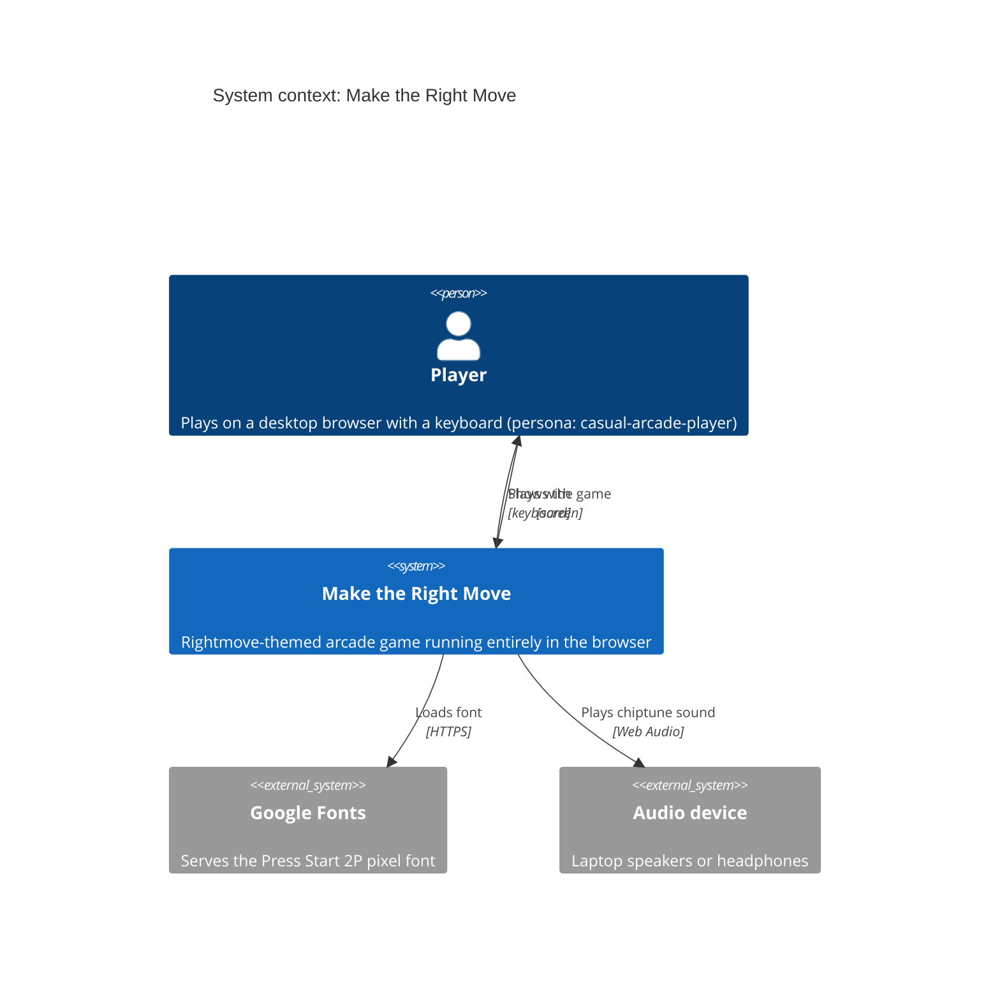
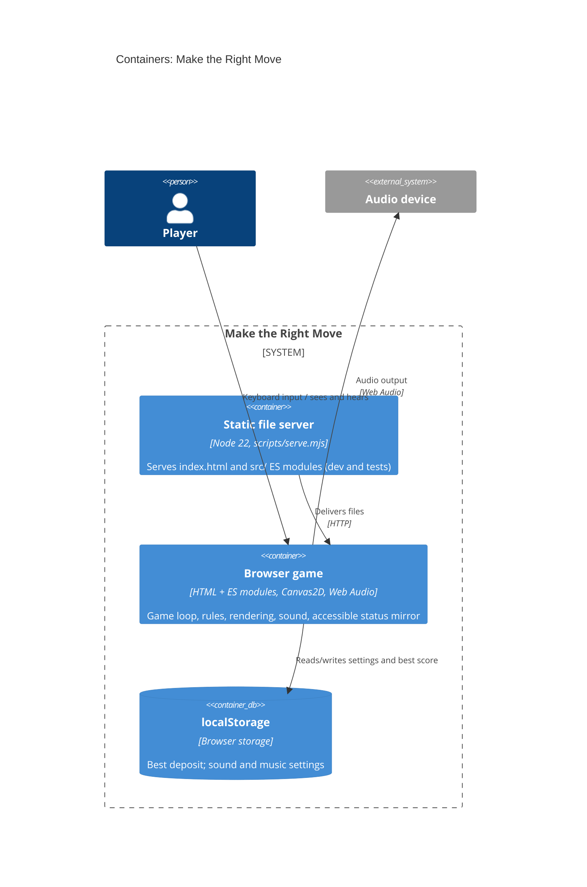
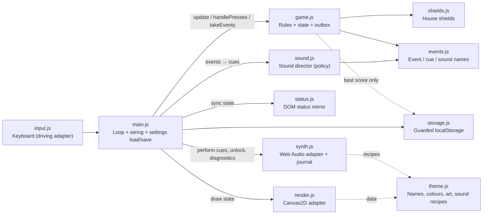

# Architecture brief: Make the Right Move

SSOT for the game's architecture. Each architect owns one section. Decisions are in the `adr-*.md` files next to this file.

## Application Architecture

*Owner: nw-solution-architect · Last updated: 2026-10-23 (rightmove-invaders-sound, revision 3)*

**Style**: a single-page browser game built as a small modular monolith with ports and adapters. The game rules (`game.js`) are the core; output adapters (canvas, DOM status mirror, sound) read state or consume events, and `main.js` wires everything together. Accepted exceptions in the rules' imports: `storage.js` for the best score (pre-existing) and `events.js` (pure constants) (ADR-001). New persistence goes through `main.js`, which hands settings to the rules with `applySettings`, so only `game.js` writes `g`. Paradigm: object-oriented (factory functions returning objects with private state; see `CLAUDE.md`).

**Quality attributes, in priority order**
1. **Responsiveness**: input and sound within one frame. The game's p95 frame work was ≤ 4 ms under stress in the spike (ADR-000); sound may add at most 0.5 ms (ADR-002, DDD-12, D11).
2. **Testability**: deterministic, fast-forwardable acceptance tests through real keyboard input (fake clock, seeded randomness, the status mirror, the sound journal).
3. **Maintainability**: theme, art and sound recipes are data; one module per concern; one event vocabulary (`events.js`); no runtime dependencies.
4. **Portability**: desktop Chrome/Edge, Firefox and Safari, with no build step.

**Security and exposure**: client-only, with no personal data and no network calls besides the font. The only global is the frozen, data-only `window.makeTheRightMove` diagnostics handle (ADR-003). Settings are strictly parsed `'on'`/`'off'` strings that default to on.

### C4: System context

### C4: Containers

### Components of the browser game (module dependency flowchart)

**Frame pipeline** (each `requestAnimationFrame`):
1. `handlePresses` for one-shot keys (Enter, P/Esc, M, N).
2. Fixed 120 Hz `update` steps.
3. `takeEvents()` → director → `synth.perform` for each cue; save settings on toggle events.
4. `render.draw`.
5. `status.sync`.

On `blur` or a hidden tab: `pause()`, then step 3 immediately (DDD-9).

### Components

| Component | Path | Responsibility |
|---|---|---|
| Loop and wiring | `src/main.js` | Composition root: fixed-step loop, adapter wiring, synth capabilities (context factory, clock, timers), settings load/`applySettings`/save, audio unlock on keydown, immediate flush on blur/hidden, `window.makeTheRightMove` |
| Rules and state | `src/game.js` | Game state `g` (including `g.settings`, set via `applySettings`), rules, M/N/P handling, event outbox (`emit`, `takeEvents`) |
| Vocabulary | `src/events.js` | `GameEvent`, `CueOp`, `Sound` |
| Keyboard | `src/input.js` | Held and latched keys |
| Rendering | `src/render.js` | Canvas drawing, HUD (including the sound and music indicators) |
| Status mirror | `src/status.js` | Accessible DOM HUD and announcements |
| Storage | `src/storage.js` | Guarded localStorage (best score, settings) |
| Theme | `src/theme.js` | Data: hurdles, colours, art, sound recipes, music, plus pure derivations |
| Shields | `src/shields.js` | Destructible shield grids |
| Sound director | `src/sound.js` | Sound policy: event → cue plan (mute, pause, rate limits, march cycle, siren, music) |
| Synth | `src/synth.js` | Web Audio adapter: performs cues, voice cap, loop, music scheduler, journal, state |

### Ports

- **Driving**: browser keyboard (`input.js`); window `blur` and document `visibilitychange`; page load.
- **Driven**: screen (`render.js`); accessibility tree (`status.js`); audio output (`synth.js`, with injected context factory, page clock and timers; the audio clock is real time); persistence (`storage.js`).
- **Internal**: the event outbox (`game.js` → `main.js` → `sound.js`), ADR-001.

### Decisions
- [ADR-000](adr-000-vanilla-canvas-fixed-step.md): vanilla Canvas2D, fixed-step loop.
- [ADR-001](adr-001-game-events-outbox.md): the rules publish events through an outbox they own.
- [ADR-002](adr-002-hand-rolled-web-audio-synth.md): a hand-rolled Web Audio synth with data recipes.
- [ADR-003](adr-003-sound-journal-for-tests.md): tests observe sound through the synth's read-only journal.
